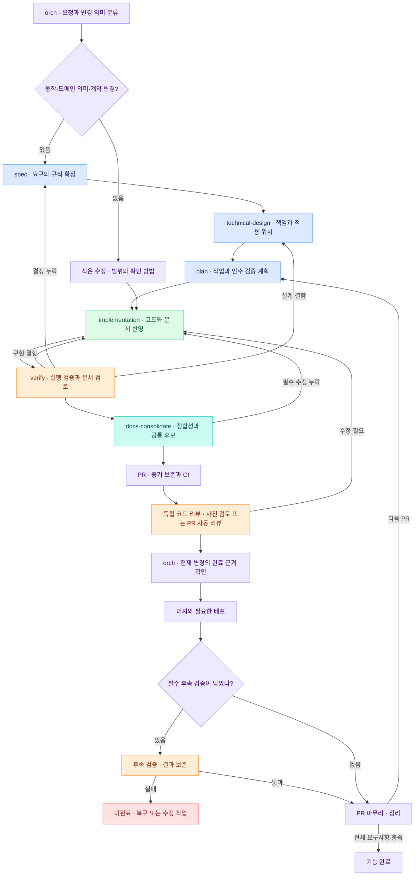
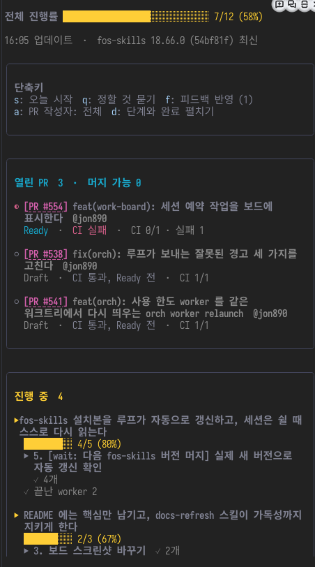

# fos-skills

기능 하나를 스펙부터 구현, 실제 동작 검증, 문서 정리까지 끝내도록 단계를 이어 주는 Claude Code 스킬 모음이에요.

## 흐름



- `spec`: 무엇을 만들지 사용자와 정하고 확인받아요
- `technical-design`: 어느 모듈이 무엇을 맡을지 정해요
- `plan`: PR 하나에서 할 작업과 검증 명령을 정해요
- `implementation`: 계획대로 코드를 고치고 테스트해요
- `verify`: 스펙대로 동작하는지 실제로 돌려 확인해요
- `docs-consolidate`: 기능 문서를 맞추고 공통으로 뺄 규칙을 찾아요
- `orch`: 위 단계를 worker 에게 맡기고 PR 머지와 정리까지 이어 가요

단계마다 넘어가는 기준과 문서 배치는 [docs/flow.md 「기능 하나를 끝내는 흐름」](docs/flow.md#기능-하나를-끝내는-흐름) 에 있어요.

<details>
<summary>그림의 Mermaid 원본</summary>



그림을 다시 그리는 방법은 [docs/contributing.md 「흐름 그림 다시 그리기」](docs/contributing.md#흐름-그림-다시-그리기) 에 있어요.

</details>

## 스킬 목록

| 스킬 | 언제 쓰나 |
| --- | --- |
| [`spec`](skills/spec/README.md) | 새 기능을 만들거나 동작을 바꾸기 전에 무엇을 만들지 정할 때 |
| [`technical-design`](skills/technical-design/README.md) | 확인한 스펙을 어느 모듈이 어떻게 맡을지 정할 때 |
| [`plan`](skills/plan/README.md) | 설계를 PR 하나의 작업과 검증 명령으로 나눌 때 |
| [`implementation`](skills/implementation/README.md) | 계획대로 구현하고 개발 테스트를 돌릴 때 |
| [`verify`](skills/verify/README.md) | 구현이 스펙대로 동작하는지 실제로 돌려 확인할 때 |
| [`docs-consolidate`](skills/docs-consolidate/README.md) | 검증한 기능의 문서를 맞추고 공통 규칙 후보를 찾을 때 |
| [`orch`](skills/orch/README.md) | 일을 worker 여럿에게 맡기고 PR 머지와 정리까지 맡길 때 |
| [`pr-review`](skills/pr-review/README.md) | 남의 PR 에 리뷰를 쓰고 등록할 때 |
| [`review-fix`](skills/review-fix/README.md) | 내 PR 에 달린 리뷰를 코드에 반영할 때 |
| [`inbox`](skills/inbox/README.md) | 업무 도구에서 나를 태그한 알림에 답할 때 |
| [`docs-audit`](skills/docs-audit/README.md) | 저장소 문서가 코드와 맞는지 점검할 때 |
| [`harness-cleanup`](skills/harness-cleanup/README.md) | CLAUDE.md 와 스킬 같은 에이전트 지침을 정리할 때 |
| [`machine-cleanup`](skills/machine-cleanup/README.md) | 맥의 디스크와 메모리, 오래된 세션과 브랜치를 정리할 때 |
| [`presentation`](skills/presentation/README.md) | 발표 자료를 HTML 슬라이드로 만들 때 |
| [`report`](skills/report/README.md) | 있는 내용을 한눈에 보이는 HTML 보고서로 정리할 때 |
| [`browser`](skills/browser/README.md) | CLI 나 API 로 안 되는 웹 작업을 브라우저로 끝낼 때 |
| [`content-preview`](export-only-skills/content-preview/README.md) | 외부에 올릴 글을 등록 전에 미리 볼 때 |
| [`korean-check`](export-only-skills/korean-check/README.md) | 한국어 문서와 응답이 자연스러운지 점검할 때 |

`content-preview` 와 `korean-check` 는 팀 저장소로도 내보내요. 그 플러그인도 설치했으면 같은 스킬이 접두사만 다르게 두 번 보여요.

## 설치와 갱신

```bash
claude plugin marketplace add jon890/fos-skills
claude plugin install fos-skills@fos-skills
claude plugin update fos-skills@fos-skills   # 새 버전 받기
```

플러그인 시스템이 없는 에이전트에서 쓰는 방법과 옛 이름으로 부르던 단계는 [docs/contributing.md](docs/contributing.md) 의 「링크로 설치」, 「단계 이름 변경」 에 있어요.

## 처음 써 보기

스킬은 `fos-skills:` 접두사로 불러요. 이름을 몰라도 하려는 일을 말하면 맞는 스킬이 떠요.

```text
/fos-skills:orch 작업 취소 기능을 스펙부터 구현·검증까지 진행해 줘
```

worker 에게 나눠 맡기려면 Orca 앱과 `gh` 로그인이 필요해요. 준비물은 [`skills/orch/README.md`](skills/orch/README.md) 의 「준비」 에 있어요.

## 화면

worker 여럿에게 일을 맡기면 `/board` 창에서 오늘 목표, 정할 것, 진행 중인 일을 한눈에 볼 수 있어요.



창에서 `s` 를 누르면 「오늘 시작」, `q` 를 누르면 「정할 것 묻기」 요청이 입력란에 채워져요. 화면은 fos-skills 저장소에서 2026-11-20 에 찍었고, 나머지 단축키는 [`extensions/work-board/README.md`](extensions/work-board/README.md) 에 있어요.

## 기여

- 의존 설치: `npm ci --ignore-scripts`
- 테스트: `node scripts/run-tests.ts` 와 `claude plugin test .`
- PR 은 draft 없이 main 으로 열고, CI 의 `Tests` job 이 통과해야 머지해요.

옵션, 저장소 구조, 스킬을 더할 때 고칠 곳, 버전 규칙은 [docs/contributing.md](docs/contributing.md) 에 있어요.
