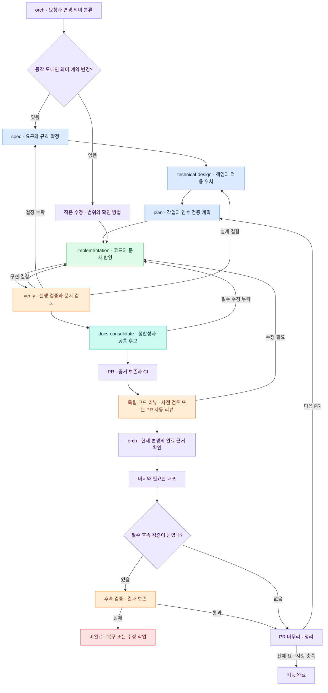
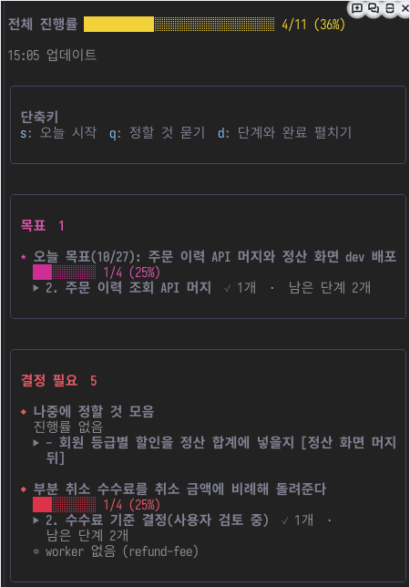

# fos-skills

기능 하나의 스펙을 정하고, 구현하고, 실제 동작을 검증하고, 문서를 맞추는 스킬 모음이에요.
`orch` 가 전체 루프를 제어하고 각 스킬은 자기 단계의 결과를 다음 단계에 넘겨요.

## 기능 하나를 끝내는 흐름



파랑은 요구사항·설계·계획, 초록은 구현, 주황은 검증, 청록은 문서 정리, 보라는 orch 의 전이, 빨강은 미완료를 나타내요.
`orch` 가 전체 전이를 조율해요. **인수 검증 계획은 구현 전에 plan 에서 만들고, verify 가 누락을 대조한 뒤 실제로 실행해요.**

<details>
<summary>Mermaid 원본과 다시 그리는 방법</summary>



원본은 위 Mermaid 한곳에 두고, [렌더링 설정](docs/diagrams/development-loop.config.json)에서 손그림 스타일과 고정 seed 를 지정해요.
Mermaid CLI 12.2.0 을 준비한 뒤 `python3 scripts/render-development-loop.py --mmdc /path/to/mmdc` 로 SVG 를 갱신해요.
SVG 를 함께 저장해 GitHub 에서도 같은 손그림 모양으로 볼 수 있어요.

</details>

| 단계 | 해결하는 것 | 다음으로 가는 기준 |
| --- | --- | --- |
| `spec` | 목표·범위·사용자 동작·권한·REQ1 같은 요구사항과 인수 조건 | 제품 결정이 닫혔고 사용자가 확인했어요 |
| `technical-design` | 모듈 책임·데이터 소유권·호출·상태 변경·검증 전략 | 주요 기술 결정이 닫혔고 기존 원칙·계약과 대조하고 독립 검토했어요 |
| `plan` | PR 하나의 작업·순서·변경 파일·검증 명령 | 스펙·설계와 연결된 계획을 critic 이 검토했어요 |
| `implementation` | 계획한 구현과 개발 테스트 | 구현 결과와 개발 검증 증거를 넘겼어요 |
| `verify` | 독립 코드·문서 리뷰와 실제 경계의 인수 검증 | 필수 인수 조건을 확인했고 완료를 막는 문제가 없어요 |
| `docs-consolidate` | 기능 문서 정합성과 공통화 후보 | 문서가 맞고 후보 또는 후보 없음의 근거가 남았어요 |

팀 실행은 implementation 의 수행 방식이에요. Claude Teams 를 필수로 요구하지 않아요.
현재 하네스에 하위 에이전트가 있으면 위임하고, 없으면 구현을 순차 실행해요. 독립 검토를 자기 점검으로 통과 처리하지 않아요.
스펙·설계는 기능 전체가 공유하고, 여러 PR 이면 plan → implementation → verify 를 반복해요.
작은 변경의 기술 설계는 기존 구조를 유지하는 근거 몇 줄이면 돼요. 기능마다 전체 아키텍처를 다시 짜지 않아요.

의미·계약을 유지하는 버그 수정, 정리, 허용 범위 안의 설정 값 조정은 짧은 경로를 써요. 작은 PR 이나 문서 변경이라도 도메인 판단 의미가 바뀌면 spec 부터 시작해요. 짧은 경로도 수정 확인과 필요한 독립 검토를 거쳐요. 기준은 [orch 의 기능 루프](skills/orch/references/feature-loop.md#루프를-쓸지-정한다)에 있어요.
spec 은 묻기 전에 코드를 읽고, 첫 라운드는 열린 질문, 이후 결정은 4개씩 선택지와 권장안으로 물어요. 결정이 닫히면 대화를 모르는 검토자가 빠진 결정을 찾아요. 절차는 [인터뷰 절차](skills/spec/references/interview.md)에 있어요.

기능 스펙 하나가 PR 여러 개로 나뉠 수 있어요. `plan 하나 = PR 하나` 는 유지하고, 마지막에 기능 전체의 인수 조건을 확인해요.
공통 후보는 기능마다 추출하고, 실제 공통화는 관련 기능 묶음이 끝났거나 정리를 요청했을 때 별도 작업으로 해요.
`orch` 는 이 흐름과 기존 worker·머지 큐를 연결해요. 별도 스케줄러나 상태 머신을 추가하지 않아요.

### 문서는 기능별로 나눠요

새 기능은 `docs/features/<기능>/spec.md` 에 요구사항을, `design.md` 에 기술 설계를 둬요. 작은 변경은 스펙의 기술 설계 절로 충분해요.
계획은 같은 기능의 `tasks/<계획>/index.json`, `phase-*.md` 에 나눠 두고 전역 번호나 기능 전체 진행표를 만들지 않아요.
기능에 속하지 않는 정리·이전 작업과 기존 계획은 설정의 최상위 `tasks/` 도 사용할 수 있어요.
현재 도메인 규칙은 `docs/domain/`, 출력 계약은 `docs/contracts/` 또는 기존 원본이 소유하고 기능 문서는 참조해요. ADR 은 선택 이유를 남겨요. 규칙은 spec 에서 확정하고 구현 PR 에서 코드·문서·검증 사례에 함께 반영해요.
전역 PRD·흐름·스키마를 기능마다 함께 고치거나 중앙 진행표에 기록하지 않아요.
정확한 API·DB 스키마는 저장소의 원본을 참조하고, 문서에는 동작과 설계 이유를 남겨요.
기존 문서는 일괄 이동하지 않고 관련 기능을 고칠 때 필요한 부분만 정리해요.

### 결정 기록은 종류와 현재 원본을 구분해요

ADR 에는 장기 선택의 이유와 기각한 대안, 감당할 비용을 남겨요. 새 문서는 `decision-type` 을 architecture, domain-policy, engineering-process 중 하나로 쓰고 보안·운영 같은 관심사는 선택 태그로 적어요.
현재 규칙과 정확한 값은 spec·도메인 문서·계약·설정·절차 문서가 소유하고 ADR 에서 연결해요. 정책은 spec, 구조는 technical-design, 절차는 해당 작업의 결정 주체가 정해요. 구현 PR 이 문서와 코드를 함께 고치고 verify 가 대조해요.
[작성 기준](skills/technical-design/references/adr-rules.md), [세 종류의 작성 예시](skills/technical-design/references/adr-examples.md), [단계별 책임](skills/spec/references/document-ownership.md#결정-기록의-단계별-책임)을 참고해요.
기존 ADR 의 경로·식별자는 유지하고 건드리는 영역부터 적용해요. 다른 저장소의 분류 도입은 그 저장소 관례를 확인한 별도 작업으로 진행해요.

### 문서 양식과 인수 검증 계획

작성 스킬의 `templates/` 에 샘플 양식을 한 벌씩 둬요. [문서별 양식과 소유권](skills/spec/references/document-ownership.md)을 보고 필요한 양식만 읽어요.
기존 PRD·flow·ADR 양식이 있으면 우선하고, 기존 문서를 일괄 재작성하지 않아요.
plan 은 개발 테스트와 별도로 인수 검증의 준비 조건·실행 절차·기대 결과·환경·시점을 정해요.
기본은 계획 폴더의 `verification-plan.md`, 작은 계획은 phase 의 인수 검증 계획 절이에요.
verify 는 스펙·설계와 대조해 누락을 보완한 뒤 실행하고, 실제 결과·커밋·증거를 PR 에 남겨요.
계획을 지울 때도 검증 절차와 증거는 남겨요. 기준은 [계획 수명 규칙](skills/plan/references/plan-lifecycle.md)이 소유해요.

PRD 는 제품 범위, flow 는 공통 상호작용, 기능 spec/design 은 상세 요구사항·설계를 소유해요.
이번 기능이 바꾼 공통 사실은 해당 PR 에 맞추고, 반복 표현 공통화는 별도 후보로 남겨요.
같은 공유 문서를 바꾸는 worker 는 orch 가 담당을 나누거나 순차 실행해요. 중앙 진행표를 모두 갱신하지 않아요.

### 처음 실행하기

```text
/fos-skills:orch 작업 취소 기능을 스펙부터 구현·검증까지 진행해 줘
/fos-skills:spec 작업 취소 기능을 설계해 보자
/fos-skills:technical-design docs/features/run-cancel/spec.md 의 모듈 책임과 데이터 소유권을 설계해 줘
/fos-skills:plan docs/features/run-cancel/design.md 를 PR 하나의 실행 계획으로 만들어 줘
```

BMAD 의 요구사항 연결, Superpowers 의 스펙·실행 계획 분리와 설계 승인 관문, gstack 의 실제 동작 QA 원칙을 참고했어요.
외부 프레임워크 전체를 설치하거나 중첩하지 않아요. [문서와 단계 인계](skills/spec/references/feature-docs.md)에 상세 규칙이 있어요.

### PR 전 검증과 머지·완료

기능 루프는 PR 하나라도 짧은 기술 설계와 계획을 남겨요. 인수 검증 계획은 phase 에 포함할 수 있어요.
PR 전에는 실행 인수 검증과 문서 대조를 마쳐요. 코드 리뷰를 PR 자동 리뷰에 맡겼으면 그 항목은 대기로 PR 을 열고, 실제 리뷰 결과를 받은 뒤 머지해요. 사전에 독립 리뷰를 받았으면 중복하지 않아요.

[기능 PR 완료 근거 양식](skills/orch/templates/feature-evidence.md)에 현재 HEAD, 인수 검증, 문서 대조, 독립 리뷰와 남은 후속 검증을 기록해요.
머지 큐는 기록 누락·오래된 커밋·미완료 사전 검증을 막고, 코디네이터는 실제 증거를 읽어요. 지시서도 이 블록도 없는 기존 PR 은 호환 경로를 유지해요.
필수 후속 검증이 남아도 머지할 수 있고, 워크트리와 브랜치는 머지 직후 지워요. 지시서, 업무 완료, 보드 done 같은 기능 완료는 보류해요. 배포 성공 뒤 실제 검증 결과를 기록하고 마무리를 재개해요.

### 작업 취소 기능을 개발한다면

| 단계 | 이 단계가 남기는 것 |
| --- | --- |
| spec | REQ1 소유자만 취소, REQ2 반복 취소 안전, REQ3 취소한 작업은 실행하지 않음 |
| technical-design | 작업 모듈이 상태를 소유하고 취소·실행 시작은 조건부 갱신. 상태와 이력은 같은 트랜잭션 |
| plan | `tasks/cancel-api/` 의 상태 전이·API·스케줄러 연결 작업과 검증 명령 |
| implementation | 실제 코드·개발 테스트·검증 커밋 |
| verify | 권한 거부·반복 취소·취소와 실행의 경쟁을 실제 API/DB/스케줄러 경계에서 확인한 증거 |
| docs-consolidate | 설계 문서 대조와 관련 기능을 비교한 공통 후보 또는 없음 |

## 만든 이유

에이전트가 코드를 빠르게 만들어도 기능 하나를 끝내려면 요구사항, 설계, 구현, 검증과 문서가 이어져야 해요.
계획에 모든 결정을 한꺼번에 담으면 논의가 커지고, 구현에만 집중하면 무엇을 만족해야 끝인지 흐려져요.
테스트 통과와 코드 리뷰만으로 실제 사용 흐름까지 확인했다고 보기 어렵고, 여러 기능의 문서를 공통 파일에 모으면 충돌을 푸는 데 시간이 들어요.

fos-skills 는 소프트웨어 개발의 각 단계를 연결하는 종합 스킬 모음이에요.
기능별로 필요한 결정을 끝낸 스펙을 만들고, 검증 가능한 작업으로 구현하고, 인수 조건을 실제 실행으로 확인해요.
그 결과를 문서에 반영하고 반복되는 규칙을 공통화 후보로 남겨 다음 개발에 활용해요.
`orch` 는 이 흐름을 제어하고 각 스킬은 자기 단계에 집중해요.
처음부터 모든 예외를 다루기보다 기능 하나를 끝까지 완성하고 사용하면서 절차를 다듬어요.

## 핵심 가치

- **기능을 끝까지 완성:** 스펙부터 구현·검증·문서까지 연결해 사용자에게 필요한 기능을 완료해요
- **스펙으로 결정하고 증거로 확인:** 요구사항과 인수 조건을 구현 전에 정하고, 테스트·리뷰·실제 동작으로 확인해요
- **역할은 작게, 흐름은 연결:** 스펙·계획·구현·독립 검증·문서 정리를 나누고 orch 가 결과에 따라 다음 단계를 이어 줘요
- **문서는 기능별로, 계약은 한곳에:** 기능 문서를 나눠 병렬 작업의 충돌을 줄이고 공유하는 규칙은 원본을 참조해요
- **사용하며 개선:** 공통 후보와 실제 실패에서 배워 필요한 규칙만 더해요. 공통화는 근거가 쌓였을 때 해요
- **공통 절차와 프로젝트 맥락:** 개발 절차는 함께 쓰고 검증 명령·환경·도메인 차이는 오버레이로 적용해요

## 저장소 구조

| 경로 | 책임 |
| --- | --- |
| `skills/<이름>/` | 설치해서 쓰는 스킬. 절차·참조·양식·스크립트·테스트를 함께 둬요 |
| `export-only-skills/<이름>/` | 팀 저장소로 내보내는 원본. 기본 스킬 탐색에는 넣지 않아요 |
| `extensions/work-board/` | 작업 현황 창과 보드 명령 |
| `tools/` | 여러 스킬이 사용하는 공용 도구 |
| `scripts/` | 저장소 검사·설치·내보내기·버전 관리 |
| `githooks/` | 이 저장소를 개발할 때 쓰는 Git 훅 |
| `docs/` | 개발 흐름·아키텍처·ADR |
| `.claude-plugin/`, `.codex-plugin/` | 하네스별 배포 매니페스트 |

스킬 전용 훅과 스크립트는 그 스킬 안에 둬요. Git 훅과 Claude 실행 훅을 같은 폴더에 모으지 않아요.
스킬 이름과 호출 명령은 유지돼요. 플러그인은 갱신하면 새 배치를 받고, 직접 걸었던 개인 심볼릭 링크는 새 경로로 바꿔요.
옛 경로의 스킬 사본이나 호환 링크는 저장소에 남기지 않아요. 팀 내보내기는 팀의 `skills/<이름>/` 구조를 유지하고 상대 참조도 맞춰요.

## 화면

worker 여럿에게 일을 맡기면 `/board` 창에서 오늘 목표, 정할 것, 진행 중인 일을 한눈에 볼 수 있어요.
버튼이나 단축키를 누르면 「오늘 시작」, 「정할 것 묻기」 요청이 입력란에 채워져요.



데모 저장소에서 2026-10-27 에 찍은 화면이에요. 실제 저장소의 설정과 대화 예시는 [`skills/orch/README.md`](skills/orch/README.md) 에 있어요.

## 스킬 목록

기능 개발 루프는 작게 시작하고 실제 사용에서 드러난 문제부터 고쳐요.

| 스킬 | 하는 일 |
| --- | --- |
| [`spec`](skills/spec/README.md) | 사용자를 인터뷰해 기능의 결정을 닫고, 확인받은 스펙을 남겨요 |
| [`technical-design`](skills/technical-design/README.md) | 기능의 구조·책임·데이터 소유권과 검증 전략을 정해요 |
| [`plan`](skills/plan/README.md) | 확정한 기술 설계를 PR 하나의 실행 계획으로 나눠요 |
| [`implementation`](skills/implementation/README.md) | 구현과 개발 테스트를 수행해요 |
| [`verify`](skills/verify/README.md) | 독립 리뷰와 스펙 기준 실행 검증을 해요 |
| [`docs-consolidate`](skills/docs-consolidate/README.md) | 기능 문서를 맞추고 공통 후보를 추출하거나 별도 공통화를 해요 |
| [`orch`](skills/orch/README.md) | 전체 개발 루프의 전이와 worker 실행·PR·머지·정리를 조율해요 |
| [`pr-review`](skills/pr-review/README.md) | 남의 PR 에 코드 리뷰를 쓰고 등록해요 |
| [`review-fix`](skills/review-fix/README.md) | PR 에 이미 달린 리뷰를 읽고 코드에 반영해요 |
| [`inbox`](skills/inbox/README.md) | 업무 도구에서 나를 태그한 알림을 `/board` 에 모으고, 확인받은 답변만 등록해요 |
| [`docs-audit`](skills/docs-audit/README.md) | 저장소 문서가 코드와 맞는지 감사하고, 승인받은 것만 고쳐요 |
| [`harness-cleanup`](skills/harness-cleanup/README.md) | 하네스 지침이 현재 설정과 실행 결과에 맞는지 감사하고, 승인받은 것만 고쳐요 |
| [`mac-cleanup`](skills/mac-cleanup/README.md) | 맥의 디스크, 메모리, 스왑과 오래된 세션, 머지된 브랜치를 조사하고 승인받은 것만 정리해요 |
| [`presentation`](skills/presentation/README.md) | 발표 자료를 HTML 슬라이드 덱 한 파일로 만들고, 장 수와 노트, 금지어, 세로 넘침을 검사해요 |
| [`report`](skills/report/README.md) | 있는 내용을 결론이 먼저 보이는 HTML 보고서 한 파일로 만들어 브라우저로 띄워요 |
| [`browser`](skills/browser/README.md) | CLI 나 API 로 안 되는 웹 작업을 `browser-driver` 로 브라우저를 조작해 끝내요. 로그인과 되돌리기 어려운 버튼만 사람이 확인해요 |

플러그인은 위 표의 스킬과 `/board` 창을 함께 실어요.
[`content-preview`](export-only-skills/content-preview/README.md) 와 [`korean-check`](export-only-skills/korean-check/README.md) 의 원본도 여기 있지만, 스킬로는 팀 저장소의 플러그인으로 받아요.
그 플러그인을 받을 수 없는 환경에서는 두 스킬이 목록에 뜨지 않아요.

## 처음 써 보기

**1.** Claude Code 플러그인으로 설치해요.

```bash
claude plugin marketplace add jon890/fos-skills
claude plugin install fos-skills@fos-skills
```

**2.** 스킬은 `fos-skills:` 접두사로 불러요. 이름을 몰라도 하려는 일을 말하면 맞는 스킬이 떠요.

```text
/fos-skills:spec 로그인 실패 횟수 제한을 설계해 보자
이 PR 리뷰해 줘
리뷰 달린 거 반영해 줘
```

**3.** 일을 worker 에게 나눠 맡기려면 Orca 앱과 `gh` 로그인이 필요해요. 준비물은 [`skills/orch/README.md`](skills/orch/README.md) 의 「준비」 에 있어요.

### 단계 이름 변경

`planning` 은 `plan`, `build-with-teams` 는 `implementation` 으로 바뀌었어요. 예전 명령 대신 새 이름으로 불러요.
기존 계획 경로와 R1/D1 ID 는 읽기 호환으로 유지해요. 기존 planning/build-with-teams 오버레이도 읽으며 새 이름의 값이 우선해요.

문서 감사는 `/fos-skills:docs-audit` 로 불러요. 옛 이름 `docs-check` 의 오버레이는 새 이름 파일이 없을 때만 읽고 경고하며, docs-audit 스킬의 다음 major(5.0.0)에서 호환을 제거해요.

### 갱신

플러그인에 버전을 쓰지 않아서, 버전을 올리지 않아도 main 의 새 커밋을 받아요.

```bash
claude plugin update fos-skills@fos-skills
```

### 링크로 설치

플러그인 시스템이 없는 에이전트에서는 스킬 디렉터리를 글로벌 스킬 디렉터리에 심링크해요.

```bash
ln -sfn ~/personal/fos-skills/skills/plan ~/.claude/skills/plan
```

플러그인과 같은 이름의 링크를 함께 두면 스킬이 둘씩 떠요.
링크에서 플러그인으로 옮기는 순서는 [링크 설치에서 옮기기](docs/flow.md#링크-설치에서-옮기기) 를 따라요.

공용 도구를 전역에서도 부르려면 함께 걸어요.

```bash
ln -sfn ~/personal/fos-skills/tools/browser-driver/browser_driver.py ~/.claude/scripts/browser-driver
```

## 공용 도구

`tools/` 에는 스킬이 아닌 공용 도구를 둬요.
스킬 하나가 소유하기에는 다른 스킬도 쓰고, 전역에 두기에는 이 저장소가 관리해야 하는 것이에요.

| 도구 | 하는 일 | 쓰는 스킬 |
| --- | --- | --- |
| `tools/browser-driver` | 브라우저 백엔드가 달라도 같은 명령으로 조작해요. 실패를 종료 코드로 드러내요 | `browser`, `content-preview` |

스킬은 이 도구를 저장소 안에서 찾고, 없으면 개인이 걸어 둔 것으로 내려가요.
이 플러그인의 루트 `bin/` 에는 orch 실행기 `orch` 하나만 있어요. `browser-driver` 는 PATH 명령으로 싣지 않아요. 근거는 [ADR-004](docs/adr/004-no-plugin-bin.md) 에 있어요.

`extensions/work-board/` 는 작업 현황 창 `/board` 를 그리는 mod 예요.
orch 스킬이 보드를 고치는 `extensions/work-board/bin/board.ts` 도 여기 있어요. 동작은 [`extensions/work-board/README.md`](extensions/work-board/README.md) 에 있어요.

`scripts/` 에는 이 저장소를 관리하는 명령과, 어느 스킬도 소유하지 않는 검사기를 둬요.

| 스크립트 | 하는 일 |
| --- | --- |
| `scripts/export-to-team.sh` | 공용 스킬을 팀 저장소로 내보내고 어긋남을 판정해요. 커밋을 고르는 `--source-ref` 는 머리 주석에 있어요 |
| `scripts/install-hooks.sh` | `githooks/` 의 훅을 `.git/hooks` 에 걸어요. `commit-msg` 는 커밋 메시지의 금지어를 커밋 전에 막고, `post-commit` 은 팀 저장소와의 어긋남을 알려요 |
| `scripts/run-node-tests.ts` | node 테스트 파일을 하나씩 자기 세션에서 돌리고 결과 폴더에 요약을 남겨요. 사용법은 머리 주석에 있어요 |
| `scripts/test-plugin-install.sh` | 격리된 설정 폴더에서 플러그인 설치를 테스트해요 |
| `scripts/check-shell-korean.py` | 셸 스크립트에서 `$변수` 뒤에 한글이 붙은 자리를 찾아요. 셸에 따라 죽는 이식성 결함이에요 |
| `scripts/check-skill-docs.py` | 스킬 README 와 CHANGELOG, 변경 이력 조각이 아래 「스킬 README」, 「버전과 변경 이력」 의 형식을 따르는지 검사해요 |
| `scripts/skill_changes.py` | 변경 이력 조각의 이름·내용 규칙과 조각으로 스킬 버전과 CHANGELOG 를 올리는 코드예요. 검사기와 `bump-plugin-version.py` 가 같이 써요 |
| `scripts/render-development-loop.py` | 이 README 의 Mermaid 원본으로 손그림 SVG 를 다시 그려요 |
| `scripts/bump-plugin-version.py` | main 에 들어온 변경 이력 조각과 변경으로 스킬 버전, 플러그인 version, `.claude-plugin/CHANGELOG.md` 를 올려요. `plugin-version.yml` workflow 가 불러요 |

`check-shell-korean.py` 가 `korean-check` 에 없는 것은 그 스킬이 마크다운 전용으로 경계를 정해 두었기 때문이에요.
판정 근거는 그 파일의 docstring 에 있어요.

## 기여

PR 은 draft 없이 열어요. CI 가 PR 과 main push 에서 돌아요.

CI 는 Claude Code CLI 2.1.309 를 npm 으로 설치해 저장소 루트에서 `claude plugin test .` 를 실행해요.
이 명령은 `claude-code/testing` 을 쓰는 TypeScript 테스트를 실행하며, 로그인이나 API 키가 필요하지 않아요.
Python 테스트는 저장소 루트에서 `python3 -m unittest discover -s skills/mac-cleanup/tests` 처럼 각 `tests/` 폴더를 주어 실행해요. 다른 위치에서 상대 경로로 부르면 `ImportError` 로 끝나는 스킬이 있어요.
orch, work-board, inbox 의 TypeScript 테스트는 Node 24 이상에서 `node scripts/run-node-tests.ts` 로 실행해요.
한 줄 `node --test` 로 모두 돌리면 프로세스 그룹에 신호를 보내는 테스트가 실행기까지 끝내 요약 없이 끝날 수 있어요. 이 실행기는 파일마다 세션을 나눠요.
오래 걸리면 `--background` 로 띄우고 `--wait` 로 결과를 기다려요. 한 번의 `--wait` 는 Bash 도구의 600초 안에 끝나요.
저장소별 PR 설정은 [orch 오버레이](.orch/overlay.md)에 둬요.

### 고치는 동안

설치본은 main 에 push 한 뒤에만 바뀌어요.
그래서 고치는 동안에는 작업 트리를 그 세션에만 로드해요.

```bash
claude --plugin-dir "$(git rev-parse --show-toplevel)"
```

설치 기록에 user 범위 설치본이 있으면 `orch` 실행기는 `--plugin-dir` 로 실은 작업 트리가 아니라 설치본으로 넘겨요. 작업 트리의 orch 스크립트를 돌리려면 `ORCH_SCRIPTS_DIR` 을 줘요.

```bash
ORCH_SCRIPTS_DIR="$(git rev-parse --show-toplevel)/skills/orch/scripts" orch loop status
```

로드가 맞는지 판정하는 방법은 [고치는 동안의 확인](docs/flow.md#고치는-동안의-확인) 에 있어요.

### 스킬을 더할 때

아래를 함께 고쳐요.

- `.claude-plugin/plugin.json` 의 `skills` 배열
- `.codex-plugin/plugin.json` 의 `skills` 배열. Codex 가 읽는 매니페스트라 hook 은 싣지 않아요([ADR-007](docs/adr/007-codex-manifest-without-hooks.md))
- 이 README 의 스킬 목록 표
- 팀에도 내보낼 스킬이면 `scripts/export-to-team.sh` 의 `SHARED_SKILLS`

두 `skills` 배열 가운데 하나라도 빠뜨리면 `python3 -m unittest discover -s scripts/tests` 가 실패해요.
내보내기 전용 원본은 [`scripts/export-only-skills.json`](scripts/export-only-skills.json) 에 적고 배열에서 빼요.

### 코어와 오버레이

- **코어**(이 저장소): 도메인과 무관한 워크플로예요. 단계 뼈대, 핵심 원칙, 검증기가 여기 있어요.
- **오버레이**(각 프로젝트의 `.claude/plan-overlay.md`, `.orch/overlay.md` 같은 파일): 저장소 고유의 단계 변형, 문서 관례, 검증 경로, 실행 명령이 여기 있어요.

코어 SKILL 이 시작할 때 현재 저장소의 오버레이를 읽어 채워요.
오버레이가 없으면 코어 기본값으로 동작해요.

## 스킬 README

스킬 README 의 독자는 이 스킬을 처음 쓰려는 사람이에요. 이 저장소를 고치는 사람이 아니에요.
처음 읽는 사람이 무엇을 덜어 주는지, 어떻게 시작하는지, 어떻게 활용하는지를 README 하나로 알 수 있어야 해요.
이 규칙은 모든 스킬과 mod(work-board 처럼 SKILL.md 가 없는 구성 요소)에 똑같이 적용해요(사용자 결정 2026-11-03).

- **본문은 「~해요」 체로 써요.** 절 제목과 표, 목록 항목은 명사구로 끝내도 돼요.
- **처음 쓰는 순서를 먼저 보여요.** 설치, 부르는 말이나 여는 명령, 첫 결과를 번호 순서로 적어요.
- **활용법은 상황별로 보여요.** 「이럴 때 이걸 누르거나 부르면 이렇게 돼요」 처럼 실제 요청과 결과를 붙여요.
- **화면이 있는 기능은 스크린샷을 둬요.** 화면이 바뀌는 PR 에서 함께 새로 찍고, 찍은 날을 그림 아래에 적어요.
- **내부 동작의 세부는 README 에 두지 않아요.** 판정 규칙, 조회 한도, 저장 형식처럼 고치는 사람이 읽을 내용은 그 스킬의 `references/` 문서로 옮기고 README 에서 링크만 걸어요.

절은 아래 순서로 둬요. 필요하면 다른 절을 더해도 돼요.

| 절 | 담는 것 |
| --- | --- |
| 첫 문단 | 이 스킬이 덜어 주는 수고. 제목 바로 밑에 절 제목 없이 둬요 |
| `## 이럴 때 쓴다` | 쓰는 상황과 스킬을 부르는 말 |
| `## 처음 써 보기` | 설치부터 첫 결과까지의 순서. 스킬을 부르는 말 한 줄이면 되는 스킬은 「사용 예시」 로 대신해요 |
| `## 사용 예시` | 활용법. 상황별 요청, 스킬이 하는 일, 받는 결과를 짧게 보여요 |
| `## 받는 것` | 끝났을 때 사용자에게 남는 것 |
| `## 준비` | 설치, 로그인, 개인 설정이 필요할 때만 둬요 |
| `## 함께 쓰는 스킬` | 이 스킬이 맡지 않는 일과 그 일을 맡는 스킬 |

**파일 목록(`## 구성`)은 두지 않아요.**
실행 절차는 `SKILL.md`, 스크립트 동작은 각 파일의 docstring 과 `--help` 가 소유해요. README 에 한 벌 더 두면 한쪽만 고쳐져요.
테스트 실행 명령은 「기여」 절에 둬요.

## 버전과 변경 이력

각 스킬은 `SKILL.md` frontmatter 의 `metadata.version` 과 같은 디렉터리의 `CHANGELOG.md` 로 이력을 남겨요.

**스킬 버전은 배포 핀이 아니에요.** 무엇이 언제 왜 바뀌었는지 추적하는 데만 써요.
이 점을 잊으면 태그와 릴리스까지 붙는 과설계로 가요.

**PR 은 스킬 버전과 CHANGELOG 를 직접 올리지 않아요.** 무엇이 바뀌었는지만 변경 이력 조각 파일로 남기고, 새 버전 번호는 main 에 머지될 때 workflow 가 정해요.
같은 스킬을 고치는 PR 이 여럿이어도 버전 줄과 CHANGELOG 절로 충돌하지 않게 하려는 것이에요. 근거는 [ADR-023](docs/adr/023-version-at-merge.md) 에 있어요.

- 조각은 `<스킬 폴더>/changes/<슬러그>.<등급>.md` 예요. `skills/<이름>`, `export-only-skills/<이름>`, `extensions/<이름>` 이 스킬 폴더예요. 슬러그는 영문 소문자, 숫자, 하이픈이에요. 두 PR 이 같은 파일을 더하면 충돌하므로 브랜치 이름처럼 PR 마다 겹치지 않게 지어요.
- 등급은 파일 이름 끝의 `.patch.md` 나 `.minor.md` 둘뿐이에요. 기준은 아래 표를 따라요.
- 내용은 CHANGELOG 항목 그대로 `- ` 줄 1~5개예요. 제목과 버전은 적지 않아요.
- main 에 머지되면 `plugin-version.yml` 이 조각마다 버전 하나를 머지 순서대로 올려요. CHANGELOG 맨 위에 `## X.Y.Z (한국 시간 날짜)` 절을 만들고 `SKILL.md` 의 `metadata.version` 도 바꾸고 조각을 지워요.
- 한 PR 이 같은 스킬에서 버전·CHANGELOG 를 직접 올리면서 조각도 더하지 않아요. 버전이 두 번 올라요.
- **major 는 조각으로 받지 않아요.** 기존 사용법이 깨지면(`호환성:` 항목) PR 이 `metadata.version` 과 CHANGELOG 를 직접 올리고 이전 major 를 `## N.x` 한 절로 줄여요. 이 방식으로 올린 스킬은 workflow 가 건드리지 않아요.
- 조각이 없는 변경은 스킬 버전이 그대로예요. 플러그인 version 만 patch 로 올라요.

플러그인 버전은 `.claude-plugin/plugin.json` 의 `version` 이에요. **사람이 올리지 않아요.**
main 에 머지될 때마다 `.github/workflows/plugin-version.yml` 이 등급을 정해 올리고 `.claude-plugin/CHANGELOG.md` 에 한 줄을 더해요.
`호환성:` 항목이 있으면 major, 조각이나 새 버전 절이 있으면 minor, 그 밖은 patch 예요. 이 값이 바뀌어야 설치한 쪽의 `update` 가 새 복사본을 받아요.
근거는 [ADR-019](docs/adr/019-plugin-version-auto-bump.md) 에 있어요.

올리는 기준은 아래 표를 따라요.

| 등급 | 언제 | 예 |
| --- | --- | --- |
| major | 워크플로 단계가 바뀌어 기존 오버레이나 task 형식과 안 맞아요 | 단계 수를 8에서 6으로 줄여요 |
| minor | 지시를 추가하거나 제거해요 | 스폰 폴백 단계화를 넣어요 |
| patch | 문구만 다듬어요 | 표현을 고치고 오타를 바로잡아요 |

**CHANGELOG 에는 스킬을 쓰는 사람이 알아야 할 변화만 적어요.**

- 버전 하나는 `## X.Y.Z (YYYY-MM-DD)` 제목 밑에 목록 항목 몇 개로 써요. 새 명령, 바뀐 동작, 고친 문제가 여기 들어가요. 조각 파일의 내용이 이 항목이 돼요.
- 기존 사용법이 깨지면 그 항목을 `호환성:` 으로 시작해요.
- 경위, 실측 수치, 내부 리팩터링, 테스트 추가는 적지 않아요. 커밋 메시지와 PR 본문이 이것을 가져요.
- major 를 올리면 이전 major 의 버전들을 `## N.x` 한 절로 줄여요.

항목 수와 줄 길이의 상한은 `scripts/check-skill-docs.py` 가 소유하고, `python3 -m unittest discover -s scripts/tests` 가 README 형식과 함께 검사해요.

이력을 두는 자리와 태그는 아래를 따라요.

- 저장소 루트에는 CHANGELOG 를 두지 않아요. 갱신 지점이 갈려 한쪽이 먼저 낡아요. 플러그인 이력은 workflow 만 쓰는 `.claude-plugin/CHANGELOG.md` 에 둬요.
- git 태그는 만들지 않아요. 설치한 쪽이 main 의 최신 version 을 받으므로 태그가 아무것도 고정하지 못해요.
