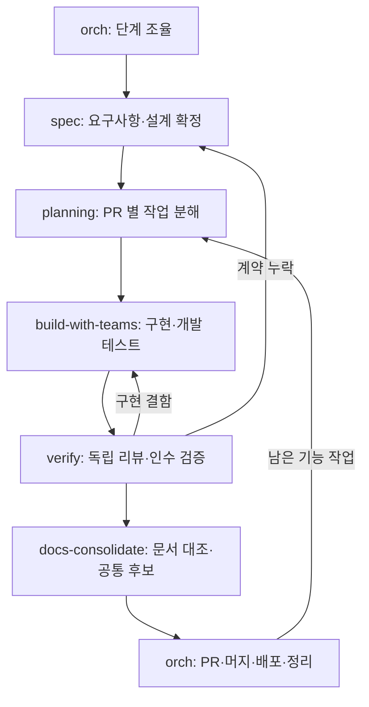

# fos-skills

기능 하나의 스펙을 정하고, 구현하고, 실제 동작을 검증하고, 문서를 맞추는 스킬 모음이에요.
`orch` 가 전체 루프를 제어하고 각 스킬은 자기 단계의 결과를 다음 단계에 넘겨요.

## 기능 하나를 끝내는 흐름



| 단계 | 해결하는 것 | 다음으로 가는 기준 |
| --- | --- | --- |
| `spec` | 기능의 범위, 인수 조건과 필요한 API·데이터·테스트 설계 | 구현 결과를 바꿀 미결정이 없어요 |
| `planning` | 지금 구현할 PR 의 작업·테스트·변경 파일 | 스펙과 요구사항이 연결된 계획을 검토했어요 |
| `build-with-teams` | 계획한 구현과 개발 테스트 | 구현 결과와 검증 증거를 넘겼어요 |
| `verify` | 코드·문서 리뷰와 실제 API·화면·작업 검증 | 이번 PR 의 인수 조건을 확인했고 완료를 막는 문제가 없어요 |
| `docs-consolidate` | 기능 문서 정합성과 공통화 후보 | 문서가 맞고 후보 또는 후보 없음이 남았어요 |

기능 스펙 하나가 PR 여러 개로 나뉠 수 있어요. `plan 하나 = PR 하나` 는 유지하고, 마지막에 기능 전체의 인수 조건을 확인해요.
공통 후보는 기능마다 추출하고, 실제 공통화는 관련 기능 묶음이 끝났거나 정리를 요청했을 때 별도 작업으로 해요.
`orch` 는 이 흐름과 기존 worker·머지 큐를 연결해요. 별도 스케줄러나 상태 머신을 추가하지 않아요.

### 문서는 기능별로 나눠요

새 기능은 `docs/features/<기능>/spec.md` 에 요구사항과 설계를 둬요. 설계가 길면 `design.md` 로 나눠요.
공유 계약은 기존 원본 또는 `docs/contracts/` 가 소유하고 기능 문서는 참조해요.
전역 PRD·흐름·스키마를 기능마다 함께 고치거나 중앙 진행표에 기록하지 않아요.
정확한 API·DB 스키마는 저장소의 원본을 참조하고, 문서에는 동작과 설계 이유를 남겨요.
기존 문서는 일괄 이동하지 않고 관련 기능을 고칠 때 필요한 부분만 정리해요.

### 처음 실행하기

```text
/fos-skills:orch 작업 취소 기능을 스펙부터 구현·검증까지 진행해 줘
/fos-skills:spec 작업 취소의 요구사항과 설계를 정리해 줘
/fos-skills:planning docs/features/run-cancel/spec.md 를 구현 계획으로 만들어 줘
```

기존 `index.json` 에 `spec` 이 없는 계획은 이전 절차로 이어 가요. 새 기능부터 기능 스펙 경로를 적용해요.
BMAD 의 요구사항 연결, Superpowers 의 스펙·실행 계획 분리, gstack 의 실제 동작 QA 원칙을 참고했어요.
외부 프레임워크 전체를 설치하거나 중첩하지 않아요. [문서와 단계 인계](spec/references/feature-docs.md)에 상세 규칙이 있어요.

## 만든 이유

에이전트가 코드를 빠르게 만들어도 기능 하나를 끝내려면 요구사항, 설계, 구현, 검증과 문서가 이어져야 해요.
계획에 모든 결정을 한꺼번에 담으면 논의가 커지고, 구현에만 집중하면 무엇을 만족해야 끝인지 흐려져요.
테스트 통과와 코드 리뷰만으로 실제 사용 흐름까지 확인했다고 보기 어렵고, 여러 기능의 문서를 공통 파일에 모으면 충돌을 푸는 데 시간이 들어요.

fos-skills 는 소프트웨어 개발의 각 단계를 연결하는 종합 스킬 모음이에요.
기능별로 필요한 결정을 끝낸 스펙을 만들고, 검증 가능한 작업으로 구현하고, 인수 조건을 실제 실행으로 확인해요.
그 결과를 문서에 반영하고 반복되는 규칙을 공통화 후보로 남겨 다음 개발에 활용해요.
`orch` 는 이 흐름을 제어하고 각 스킬은 자기 단계에 집중해요.
처음부터 모든 예외를 다루기보다 기능 하나를 끝까지 완성하고 사용하면서 절차를 다듬어요.

## 핵심 가치

- **기능을 끝까지 완성:** 스펙부터 구현·검증·문서까지 연결해 사용자에게 필요한 기능을 완료해요
- **스펙으로 결정하고 증거로 확인:** 요구사항과 인수 조건을 구현 전에 정하고, 테스트·리뷰·실제 동작으로 확인해요
- **역할은 작게, 흐름은 연결:** 스펙·계획·구현·독립 검증·문서 정리를 나누고 orch 가 결과에 따라 다음 단계를 이어 줘요
- **문서는 기능별로, 계약은 한곳에:** 기능 문서를 나눠 병렬 작업의 충돌을 줄이고 공유하는 규칙은 원본을 참조해요
- **사용하며 개선:** 공통 후보와 실제 실패에서 배워 필요한 규칙만 더해요. 공통화는 근거가 쌓였을 때 해요
- **공통 절차와 프로젝트 맥락:** 개발 절차는 함께 쓰고 검증 명령·환경·도메인 차이는 오버레이로 적용해요

## 화면

worker 여럿에게 일을 맡기면 `/board` 창에서 오늘 목표, 정할 것, 진행 중인 일을 한눈에 볼 수 있어요.
버튼이나 단축키를 누르면 「오늘 시작」, 「정할 것 묻기」 요청이 입력란에 채워져요.


데모 저장소에서 2026-10-27 에 찍은 화면이에요. 실제 저장소의 설정과 대화 예시는 [`orch/README.md`](orch/README.md) 에 있어요.

## 스킬 목록

기능 개발 루프는 작게 시작하고 실제 사용에서 드러난 문제부터 고쳐요.
기존 계획과 worker 운영 절차는 호환 경로로 유지해요.

| 스킬 | 하는 일 |
| --- | --- |
| [`spec`](spec/README.md) | 기능의 요구사항·인수 조건과 필요한 설계를 확정해요 |
| [`planning`](planning/README.md) | 기능 스펙을 PR 하나의 실행 계획으로 나눠요 |
| [`build-with-teams`](build-with-teams/README.md) | 구현과 개발 테스트를 수행해요 |
| [`verify`](verify/README.md) | 독립 리뷰와 스펙 기준 실행 검증을 해요 |
| [`docs-consolidate`](docs-consolidate/README.md) | 기능 문서를 맞추고 공통 후보를 추출하거나 별도 공통화를 해요 |
| [`orch`](orch/README.md) | 전체 개발 루프의 전이와 worker 실행·PR·머지·정리를 조율해요 |
| [`pr-review`](pr-review/README.md) | 남의 PR 에 코드 리뷰를 쓰고 등록해요 |
| [`review-fix`](review-fix/README.md) | PR 에 이미 달린 리뷰를 읽고 코드에 반영해요 |
| [`docs-check`](docs-check/README.md) | 저장소 문서가 코드와 맞는지 감사하고, 승인받은 것만 고쳐요 |
| [`harness-cleanup`](harness-cleanup/README.md) | 하네스 지침이 현재 설정과 실행 결과에 맞는지 감사하고, 승인받은 것만 고쳐요 |
| [`mac-cleanup`](mac-cleanup/README.md) | 맥의 디스크, 메모리, 스왑과 오래된 세션, 머지된 브랜치를 조사하고 승인받은 것만 정리해요 |
| [`presentation`](presentation/README.md) | 발표 자료를 HTML 슬라이드 덱 한 파일로 만들고, 장 수와 노트, 금지어, 세로 넘침을 검사해요 |

플러그인은 위 표의 스킬과 `/board` 창을 함께 실어요.
[`content-preview`](content-preview/README.md) 와 [`korean-check`](korean-check/README.md) 의 원본도 여기 있지만, 스킬로는 팀 저장소의 플러그인으로 받아요.
그 플러그인을 받을 수 없는 환경에서는 두 스킬이 목록에 뜨지 않아요.

## 처음 써 보기

**1.** Claude Code 플러그인으로 설치해요.

```bash
claude plugin marketplace add jon890/fos-skills
claude plugin install fos-skills@fos-skills
```

**2.** 스킬은 `fos-skills:` 접두사로 불러요. 이름을 몰라도 하려는 일을 말하면 맞는 스킬이 떠요.

```text
/fos-skills:planning 로그인 실패 횟수 제한을 설계해 보자
이 PR 리뷰해 줘
리뷰 달린 거 반영해 줘
```

**3.** 일을 worker 에게 나눠 맡기려면 Orca 앱과 `gh` 로그인이 필요해요. 준비물은 [`orch/README.md`](orch/README.md) 의 「준비」 에 있어요.

### 갱신

플러그인에 버전을 쓰지 않아서, 버전을 올리지 않아도 main 의 새 커밋을 받아요.

```bash
claude plugin update fos-skills@fos-skills
```

### 링크로 설치

플러그인 시스템이 없는 에이전트에서는 스킬 디렉터리를 글로벌 스킬 디렉터리에 심링크해요.

```bash
ln -sfn ~/personal/fos-skills/planning ~/.claude/skills/planning
```

플러그인과 같은 이름의 링크를 함께 두면 스킬이 둘씩 떠요.
링크에서 플러그인으로 옮기는 순서는 [링크 설치에서 옮기기](docs/flow.md#링크-설치에서-옮기기) 를 따라요.

공용 도구를 전역에서도 부르려면 함께 걸어요.

```bash
ln -sfn ~/personal/fos-skills/tools/browser-driver/browser_driver.py ~/.claude/scripts/browser-driver
```

## 공용 도구

`tools/` 에는 스킬이 아닌 공용 도구를 둬요.
스킬 하나가 소유하기에는 다른 스킬도 쓰고, 전역에 두기에는 이 저장소가 관리해야 하는 것이에요.

| 도구 | 하는 일 | 쓰는 스킬 |
| --- | --- | --- |
| `tools/browser-driver` | 브라우저 백엔드가 달라도 같은 명령으로 조작해요. 실패를 종료 코드로 드러내요 | `content-preview` |

스킬은 이 도구를 저장소 안에서 찾고, 없으면 개인이 걸어 둔 것으로 내려가요.
이 플러그인은 `bin/` 을 두지 않아 `browser-driver` 를 PATH 명령으로 싣지 않아요. 근거는 [ADR-004](docs/adr/004-no-plugin-bin.md) 에 있어요.

`work-board/` 는 작업 현황 창 `/board` 를 그리는 mod 예요.
orch 스킬이 보드를 고치는 `work-board/bin/board.ts` 도 여기 있어요. 동작은 [`work-board/README.md`](work-board/README.md) 에 있어요.

`scripts/` 에는 이 저장소를 관리하는 명령과, 어느 스킬도 소유하지 않는 검사기를 둬요.

| 스크립트 | 하는 일 |
| --- | --- |
| `scripts/export-to-team.sh` | 공용 스킬을 팀 저장소로 내보내고 어긋남을 판정해요. 커밋을 고르는 `--source-ref` 는 머리 주석에 있어요 |
| `scripts/install-hooks.sh` | `hooks/` 의 훅을 `.git/hooks` 에 걸어요 |
| `scripts/test-plugin-install.sh` | 격리된 설정 폴더에서 플러그인 설치를 테스트해요 |
| `scripts/check-shell-korean.py` | 셸 스크립트에서 `$변수` 뒤에 한글이 붙은 자리를 찾아요. 셸에 따라 죽는 이식성 결함이에요 |
| `scripts/check-skill-docs.py` | 스킬 README 와 CHANGELOG 가 아래 「스킬 README」, 「버전과 변경 이력」 의 형식을 따르는지 검사해요 |

`check-shell-korean.py` 가 `korean-check` 에 없는 것은 그 스킬이 마크다운 전용으로 경계를 정해 두었기 때문이에요.
판정 근거는 그 파일의 docstring 에 있어요.

## 기여

PR 은 draft 없이 열어요. CI 가 PR 과 main push 에서 돌아요.

CI 는 Claude Code CLI 2.1.309 를 npm 으로 설치해 저장소 루트에서 `claude plugin test .` 를 실행해요.
이 명령은 `claude-code/testing` 을 쓰는 TypeScript 테스트를 실행하며, 로그인이나 API 키가 필요하지 않아요.
Python 테스트는 저장소 루트에서 `python3 -m unittest discover -s mac-cleanup/tests` 처럼 각 `tests/` 폴더를 주어 실행해요. 다른 위치에서 상대 경로로 부르면 `ImportError` 로 끝나는 스킬이 있어요.
orch 와 work-board 의 TypeScript 테스트는 Node 24 이상에서 `node --test --test-concurrency=4 "orch/tests/*.spec.ts" "work-board/tests/*.spec.ts"` 로 실행해요.
저장소별 PR 설정은 [orch 오버레이](.orch/overlay.md)에 둬요.

### 고치는 동안

설치본은 main 에 push 한 뒤에만 바뀌어요.
그래서 고치는 동안에는 작업 트리를 그 세션에만 로드해요.

```bash
claude --plugin-dir "$(git rev-parse --show-toplevel)"
```

로드가 맞는지 판정하는 방법은 [고치는 동안의 확인](docs/flow.md#고치는-동안의-확인) 에 있어요.

### 스킬을 더할 때

아래를 함께 고쳐요.

- `.claude-plugin/plugin.json` 의 `skills` 배열
- `.codex-plugin/plugin.json` 의 `skills` 배열. Codex 가 읽는 매니페스트라 hook 은 싣지 않아요([ADR-007](docs/adr/007-codex-manifest-without-hooks.md))
- 이 README 의 스킬 목록 표
- 팀에도 내보낼 스킬이면 `scripts/export-to-team.sh` 의 `SHARED_SKILLS`

두 `skills` 배열 가운데 하나라도 빠뜨리면 `python3 -m unittest discover -s scripts/tests` 가 실패해요.
내보내기 전용 원본은 [`scripts/export-only-skills.json`](scripts/export-only-skills.json) 에 적고 배열에서 빼요.

### 코어와 오버레이

- **코어**(이 저장소): 도메인과 무관한 워크플로예요. 단계 뼈대, 핵심 원칙, 검증기가 여기 있어요.
- **오버레이**(각 프로젝트의 `.claude/planning-overlay.md`, `.orch/overlay.md` 같은 파일): 저장소 고유의 단계 변형, 문서 관례, 검증 경로, 실행 명령이 여기 있어요.

코어 SKILL 이 시작할 때 현재 저장소의 오버레이를 읽어 채워요.
오버레이가 없으면 코어 기본값으로 동작해요.

## 스킬 README

스킬 README 의 독자는 스킬을 쓰는 사람이에요.
이 스킬이 무엇을 덜어 주는지, 언제 부르는지, 부르면 무엇이 오가는지를 알려요.
절은 아래 순서로 둬요. 필요하면 다른 절을 더해도 돼요.

| 절 | 담는 것 |
| --- | --- |
| 첫 문단 | 이 스킬이 덜어 주는 수고. 제목 바로 밑에 절 제목 없이 둬요 |
| `## 이럴 때 쓴다` | 쓰는 상황과 스킬을 부르는 말 |
| `## 사용 예시` | 요청, 스킬이 하는 일, 받는 결과를 짧은 대화로 보여요 |
| `## 받는 것` | 끝났을 때 사용자에게 남는 것 |
| `## 준비` | 설치, 로그인, 개인 설정이 필요할 때만 둬요 |
| `## 함께 쓰는 스킬` | 이 스킬이 맡지 않는 일과 그 일을 맡는 스킬 |

**파일 목록(`## 구성`)은 두지 않아요.**
실행 절차는 `SKILL.md`, 스크립트 동작은 각 파일의 docstring 과 `--help` 가 소유해요. README 에 한 벌 더 두면 한쪽만 고쳐져요.
테스트 실행 명령은 「기여」 절에 둬요.

## 버전과 변경 이력

각 스킬은 `SKILL.md` frontmatter 의 `metadata.version` 과 같은 디렉터리의 `CHANGELOG.md` 로 이력을 남겨요.

**이 버전은 배포 핀이 아니에요.** 플러그인에는 버전을 쓰지 않아 커밋 SHA 가 버전이 되고, 설치한 쪽은 main 의 새 커밋을 갱신으로 받아요.
스킬 버전은 무엇이 언제 왜 바뀌었는지 추적하는 데만 써요.
이 점을 잊으면 태그와 릴리스까지 붙는 과설계로 가요. 근거는 [ADR-002](docs/adr/002-plugin-version-is-commit-sha.md) 에 있어요.

올리는 기준은 아래 표를 따라요.

| 등급 | 언제 | 예 |
| --- | --- | --- |
| major | 워크플로 단계가 바뀌어 기존 오버레이나 task 형식과 안 맞아요 | 단계 수를 8에서 6으로 줄여요 |
| minor | 지시를 추가하거나 제거해요 | 스폰 폴백 단계화를 넣어요 |
| patch | 문구만 다듬어요 | 표현을 고치고 오타를 바로잡아요 |

**CHANGELOG 에는 스킬을 쓰는 사람이 알아야 할 변화만 적어요.**

- 버전 하나는 `## X.Y.Z (YYYY-MM-DD)` 제목 밑에 목록 항목 몇 개로 써요. 새 명령, 바뀐 동작, 고친 문제가 여기 들어가요.
- 기존 사용법이 깨지면 그 항목을 `호환성:` 으로 시작해요.
- 경위, 실측 수치, 내부 리팩터링, 테스트 추가는 적지 않아요. 커밋 메시지와 PR 본문이 이것을 가져요.
- major 를 올리면 이전 major 의 버전들을 `## N.x` 한 절로 줄여요.

항목 수와 줄 길이의 상한은 `scripts/check-skill-docs.py` 가 소유하고, `python3 -m unittest discover -s scripts/tests` 가 README 형식과 함께 검사해요.

이력을 두는 자리와 태그는 아래를 따라요.

- 저장소 루트에는 CHANGELOG 를 두지 않아요. 갱신 지점이 갈려 한쪽이 먼저 낡아요.
- git 태그는 만들지 않아요. 설치한 쪽이 main 의 커밋을 받으므로 태그가 아무것도 고정하지 못해요.
