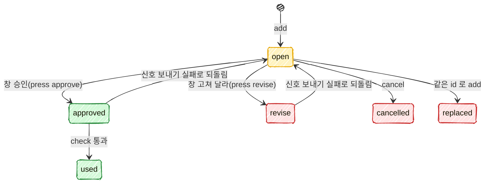

# 보드: 사용자 승인 대기와 버튼 승인 기술 설계

스펙: [spec.md](spec.md)

## 요구사항 연결

| ID | 해결 방법 | PR |
| --- | --- | --- |
| REQ1 | `orch board approval add` 를 명령 표(`lib/commands.ts`)의 두 낱말 동작 행으로 더하고 `scripts/board/board-approval.ts` 가 받는다. 인자 검사와 종류별 필수 칸은 순수 함수 `core/approvals.ts` 의 `validateAdd` 가, 파일 쓰기와 해시는 `lib/approvals.ts` 가 맡는다. Run 은 명령 표의 `run` 문맥(`run-current`)으로 채우되 필수로 두지 않는다. 비면 스크립트가 종료 코드 1 로 끝내고 저장하지 않는다(진입점의 필수 문맥은 종료 코드 2 라 REQ1 과 어긋난다). 터미널은 `ORCA_TERMINAL_HANDLE` 을 읽고, 그 터미널이 worker 면 거절한다(스펙 DECISION17) | PR1 |
| REQ2 | 버전은 저장 파일 전체에서 하나씩 늘어나는 번호 `seq` 다. 같은 id 의 열린 대기가 있으면 잠금 안에서 `replaced` 로 닫고 새 기록을 더한다. 끝난 기록은 건드리지 않는다. 버튼 키, 기록, 신호 제목과 payload, `check` 가 모두 `<id>` 와 `<버전>` 을 함께 쓴다. 창의 누름 처리(`bin/approvals.ts press`)는 잠금 안에서 그 id 의 가장 늦은 기록이 그 버전이고 열려 있을 때만 쓴다 | PR1(저장, 바꾸기), PR2(누름) |
| REQ3 | `list`, `list --full`, `cancel` 을 같은 스크립트가 받는다. 줄 꼴은 `core/approvals.ts` 의 `formatLine` 이 소유한다 | PR1 |
| REQ4 | 명령 표에 `approval add`, `list`, `cancel`, `check` 넷만 둔다. 승인과 고쳐 달라 상태를 만드는 순수 함수는 `core/approvals.ts` 의 `applyPress` 하나, 그것을 부르는 곳은 `lib/approvals.ts` 의 `recordPress` 하나, 그것을 부르는 곳은 창 전용 스크립트 `extensions/work-board/bin/approvals.ts press` 하나, 그 스크립트를 부르는 곳은 `register.js` 의 버튼 누름 처리 하나다. 테스트가 네 곳을 정적으로 확인한다. 에이전트의 Bash 도구가 `approvals.ts press` 를 부르면 PreToolUse hook(`hooks/block-approval-press.ts`)이 거부한다. 창의 `$.process.run` 은 Bash 도구를 거치지 않는다 | PR1(표), PR2(누름 길, hook) |
| REQ5 | `register.js` 가 5초마다 승인 파일을 읽어(`$.fs.read`) 「승인 대기」 상자와 상태 줄의 「승인 n」 을 그린다. 파일 경로는 세션 시작 때 `bin/approvals.ts where` 로 한 번 받는다 | PR2 |
| REQ6 | 「승인」 버튼은 `bin/approvals.ts press <id> <버전> approve` 를 부른다. 이 스크립트가 기록을 쓰고, 올린 Run 으로 `APPROVED <id> <버전>` 을 보내고, 보내지 못하면 기록을 되돌린다. 창이 worker 터미널인지는 `bin/approvals.ts self` 가 정하고, worker 거나 정하지 못하면 버튼을 그리지 않는다. `self`, `press`, `check` 는 같은 판정 꼴(아래 「worker 판정 꼴」)을 쓴다 | PR2 |
| REQ7 | 「고쳐 달라」 는 그 대기 자리에 글칸(`Input`)을 연다. 보낸 글이 공백뿐이면 아무것도 부르지 않는다. 글이 있으면 `press <id> <버전> revise --note <글>` 을 부른다 | PR2 |
| REQ8 | `real` 대기는 대상 환경, 바꿀 것, 되돌리는 법을 빨간 글로 그린다. 첫 누름은 창 메모리에 `armed = { key, until: 지금 + 10초 }` 만 남기고, 기한 안의 같은 키 누름만 `press` 를 부른다 | PR2 |
| REQ9 | `command` 대기는 「명령 채우기」 버튼 하나다. `self` 가 낸 창의 터미널이 기록의 `terminal` 과 같을 때만 그린다. 누르면 `$.prompt.fill` 로 `! <명령>` 을 채운다. 기록도 신호도 쓰지 않는다 | PR2 |
| REQ10 | `check <id> [--version <버전>]` 은 잠금 없이 읽은 기록으로 Orca 조회(신호 메시지 읽기, worker 터미널 판정)를 끝낸 뒤, 잠금 안에서 다시 읽어 같은 기록이 그대로일 때만 `used` 로 닫는다. 판정은 순수 함수 `core/approvals.ts` 의 `checkVerdict` 가 한다. 코디네이터 규칙은 `references/replying.md` 의 새 절 「보드 승인」 이 소유하고 `waiting.md` 가 가리킨다 | PR1 |
| REQ11 | 쓰기마다(add, cancel, check 의 used, press) 잠금 안에서 끝난 지 7일이 지난 기록을 지운다. 기한으로 닫는 코드는 없다 | PR1 |
| REQ12 | 코디네이터 규칙(`replying.md` 「보드 승인」)에 `STEP-READY ask` 를 받으면 `step-<항목>-<번호>` 로 올리는 처리를 적는다. 「열려 있으면 다시 올리지 않는다」 는 `add --keep-open` 이 잠금 안에서 지킨다. 열린 대기가 있으면 바꾸지 않고 `APPROVAL-ADD <id> <kind> <지금 버전> kept` 와 0 이다. 루프 코드(`loop/`)는 승인 파일을 읽지도 쓰지도 않는다 | PR1 |
| REQ13 | `replying.md` 「보드 승인」 에 막는 것, 막지 못하는 것, 「승인 파일을 직접 고치지 않는다」 를 적는다. 창 전용 스크립트를 hook 을 피해 부르는 것도 같은 한계에 든다고 적는다(아래 「막는 것과 막지 못하는 것」) | PR1 |

## 책임과 경계

```text
코디네이터 ── orch board approval add/list/cancel/check ──┐
                                                         ▼
                              skills/orch/scripts/board/board-approval.ts (명령)
                                         │
                         lib/approvals.ts (파일, 잠금, 해시, Orca 조회)
                                         │
                         core/approvals.ts (순수: 검사, 상태 바꾸기, 판정, 줄 꼴)
                                         ▲
extensions/work-board/bin/approvals.ts (창 전용: where, self, press) ──┘
                                         ▲
extensions/work-board/hooks/register.js (그리기, 누름, 글칸, real 두 번, 명령 채우기)
```

- **`core/approvals.ts`(신규, PR1)**: 저장 꼴의 타입, `validateAdd`, `applyAdd`(바꾸기와 `--keep-open` 포함), `applyCancel`, `checkVerdict`, `applyUsed`, `prune`, `formatLine`. PR2 가 `applyPress`, `revertPress` 를 더한다. 파일과 프로세스를 모르고 시각은 인자로 받는다. [ADR-028](../../adr/028-orch-core-layer.md) 의 `core/` 규칙을 따른다.
- **`lib/approvals.ts`(신규, PR1)**: 승인 파일 경로(`pathOf('state', repo)` 아래 `approvals.json`), 잠금을 잡고 읽고 바꾸고 옆 파일에 쓴 뒤 이름 바꾸기, 깨진 파일 옮기기, 미리보기 해시(SHA-256), 신호 메시지 읽기. PR2 가 `recordPress`(누름 기록과 신호 보내기, 실패 시 되돌리기)를 더한다. worker 터미널 판정은 아래 `lib/worker-terminal.ts` 를 부른다.
- **`lib/worker-terminal.ts`(신규, PR1)**: 터미널 handle 이 어느 Run 의 worker 인지 정하는 조회 한 벌. 지금 `hooks/block-worker-terminal-send.ts` 머리 주석의 「worker 판정 범위」 가운데 worker 목록 조회(1단계 active, 3단계 남은 터미널 상태, 5단계 `run-list` 뒤 Run 마다 `worker-list`, `lib/worker-run-cache.ts`)를 옮긴다. 판정 꼴 둘을 둔다(아래 「worker 판정 꼴」). hook 고유의 지름길(2단계 `agentIdentity`, `send-hook-cache.json` 기억), 시간 한도, 첫 화면 승인 예외는 hook 에 남긴다. hook 의 판정이 바뀌지 않는 것은 기존 `coordinator-hooks.spec.ts` 가 본다.
- **`scripts/board/board-approval.ts`(신규, PR1)**: 인자 풀이와 출력, 종료 코드만 맡는다. 동작 넷을 `prepend` 로 받는다.
- **`extensions/work-board/bin/approvals.ts`(신규, PR2)**: 창이 부르는 세 동작. `where`(승인 파일의 절대경로 한 줄), `self`(이 프로세스의 `ORCA_TERMINAL_HANDLE` 과 worker 여부를 JSON 한 줄), `press`(승인·고쳐 달라 기록과 신호). orch 의 `lib/approvals.ts` 를 import 한다. 이 의존 방향(work-board → orch lib)은 `bin/worker-marks.ts` 가 `lib/movement.ts` 를 쓰는 것과 같다. orch 명령 표에는 넣지 않는다.
- **`hooks/block-approval-press.ts`(신규, PR2)**: Bash PreToolUse hook. 명령에 `approvals.ts` 와 `press` 가 함께 든 Bash 호출을 거부한다. `block-worker-terminal-send.ts` 와 같은 자리, 같은 꼴(`skills/orch/hooks/`, 거부할 때만 deny 를 낸다)이다. 에이전트가 승인 기록을 쓰는 가장 쉬운 길을 막는다. 셸 밖에서 우회하는 것은 막지 못한다.
- **`register.js`(PR2)**: 그리기와 사람 입력만 맡는다. 판정 규칙(누가 누를 수 있나, 버전이 맞나)은 스크립트가 다시 확인하므로, 창의 판정은 버튼을 그릴지 정하는 데만 쓴다.
- **루프(`loop/`)**: 바꾸지 않는다. 승인 대기를 만들지 않는다(스펙 「범위 밖」, DECISION10).
- **보드 파일(`board.json`)**: 승인 대기를 담지 않는다(스펙 DECISION12). `--item`, `--step` 은 글로만 남기고 보드에 그 항목과 단계가 있는지 보지 않는다. 보드를 읽으면 보드 잠금과 얽히고, 틀린 번호는 코디네이터가 `list` 와 창에서 바로 본다.

### 막는 것과 막지 못하는 것

스펙 REQ13 과 DECISION4 의 범위를 코드 자리에 옮긴 것이다.

| 시도 | 막는 자리 | 결과 |
| --- | --- | --- |
| worker 가 `APPROVED <id> <버전>` 제목으로 Run 에 보낸다 | `check` 가 기록 상태를 먼저 본다 | 누른 기록이 없어 「아직 누르지 않음」 |
| worker 터미널에서 연 창의 버튼을 누른다 | 창이 버튼을 그리지 않는다. `press` 도 자기 터미널이 worker 면 거절한다 | 기록도 신호도 없다 |
| 에이전트(코디네이터든 worker 든)가 Bash 도구로 창 전용 스크립트 `press` 를 부른다 | PreToolUse hook `block-approval-press.ts` 가 거부한다. worker 터미널이면 `press` 1단계도 거절한다 | 기록도 신호도 없다 |
| worker 가 다른 세션의 승인을 `check` 로 소모한다 | `check` 가 부른 터미널도 worker 판정한다 | 「worker 가 보냄」, 조회 실패는 「신호를 읽지 못함」 이며 승인 상태 유지 |
| worker 가 승인 대기를 올리거나 거둔다 | `add`, `cancel` 이 자기 터미널을 worker 판정해 거절한다. `check` 는 올린 터미널(`terminal`)이 worker 인 기록도 「worker 가 보냄」 으로 거절한다 | 종료 코드 1 |
| 코디네이터가 승인됐다고 짐작해 실행한다 | 규칙 문서: 실행 직전 `check` 통과만 승인으로 본다(채팅 승인 제외) | 문서로 막는다 |
| 승인 뒤 미리보기를 고쳐 등록한다 | `check` 가 해시를 다시 잰다 | 「미리보기가 바뀜」 |
| 한 승인으로 두 번 등록한다 | `check` 가 통과할 때 `used` 로 닫는다 | 둘째 `check` 는 「이미 사용함」 |
| 같은 사용자 권한으로 승인 파일과 Orca 메시지를 함께 꾸민다. hook 이 읽지 못하는 꼴(스크립트 파일 안, 다른 이름의 사본)로 `press` 를 부른다. `ORCA_TERMINAL_HANDLE` 을 바꿔 부른다 | 없음 | 막지 못함. 문서에 한계로 적는다 |

한계 하나 더: 코디네이터 터미널 자체가 어느 Run 의 worker 목록에 있으면(넘김으로 띄운 코디네이터, 중첩 코디네이터) 그 터미널에서 부른 `check` 와 그 터미널이 올린 승인 대기는 늘 「worker 가 보냄」 으로 거절한다. 스펙 DECISION21 이 「worker 목록에 있는 터미널」 을 거절하기로 한 결과다. 그런 코디네이터는 채팅 승인을 쓴다.

## 인터페이스와 데이터

### 명령

명령 표(`lib/commands.ts`)에 더하는 행. 두 낱말 동작은 지금 `queue reserve prune` 과 같은 방식으로 푼다.

| 동작 | 스크립트와 앞 인자 | 문맥 | usage |
| --- | --- | --- | --- |
| `approval add` | `board/board-approval.ts add` | `repo`, `run`(`run-current`, 필수 아님) | `orch board approval add <id> --title <제목> --kind <post\|spec\|step\|real\|command> [--keep-open] [...]` |
| `approval list` | `board/board-approval.ts list` | `repo` | `orch board approval list [--full]` |
| `approval cancel` | `board/board-approval.ts cancel` | `repo` | `orch board approval cancel <id> [--reason <이유>]` |
| `approval check` | `board/board-approval.ts check` | `repo` | `orch board approval check <id> [--version <버전>]` |

출력과 종료 코드는 스펙 REQ1~3, REQ10 을 그대로 쓴다. `orch board approval --help` 는 지금 진입점이 `approval` 을 동작으로 보지 않아 종료 코드 2 로 끝나므로, 두 낱말 동작의 앞 낱말 뒤 `--help` 를 그 낱말로 시작하는 동작의 usage 로 답하게 진입점과 `helpText` 를 넓힌다(스펙 REQ4 인수 조건). id 는 `^[A-Za-z0-9][A-Za-z0-9._-]*$` 꼴만 받는다. 공백이나 `:` 는 한 줄 출력과 버튼 키를 깬다. `--full` 은 진입점(`skills/orch/bin/orch.ts` 의 `stripFull`)이 떼고 `ORCH_OUTPUT=full` 로 넘기므로 스크립트는 `lib/output.ts` 의 `fullAsked()` 로 읽는다. `add`, `cancel` 은 자기 `ORCA_TERMINAL_HANDLE` 을 「approval 꼴」 로 판정해 worker 거나 판정하지 못하면 종료 코드 1 이다. 터미널 변수가 없는 셸은 worker 가 아니므로 받되 `command` 종류만 거절한다(버튼이 그 터미널을 쓴다). 기다린 시간은 `bin/worker-marks.ts` 의 멈춤 시간과 같은 꼴(`N분`, 60분부터 `N시간`, 하루부터 `N일`)이다. `list --full` 의 끝난 줄은 `APPROVAL <id> <kind> <상태> v<버전> <제목>` 이다. 상태 낱말은 아래 표의 영문 값이다.

### 저장 꼴

위치는 `<orch 루트>/state/approvals.json` 이다. 저장소마다 하나이고, 그 저장소의 모든 Run 이 함께 쓴다(스펙 DECISION23). `docs/data-schema.md` 「orch 루트에 더하는 파일」 에 행을 더한다.

```json
{
  "seq": 12,
  "entries": [
    {
      "id": "post-361-done",
      "version": 12,
      "kind": "post",
      "title": "361 마무리 댓글 등록",
      "state": "open",
      "run": "run_67445446b89f",
      "terminal": "term_b02d94c2-...",
      "preview": { "path": "/abs/.omc/previews/361-done.html", "sha256": "…" },
      "item": null, "step": null, "then": "두레이 361 에 댓글 등록",
      "real": null, "command": null,
      "createdAt": "2026-11-10T03:00:00.000Z",
      "closedAt": null,
      "press": null,
      "note": null,
      "reason": null
    }
  ]
}
```

| 칸 | 뜻 |
| --- | --- |
| `seq` | 마지막으로 매긴 버전. `add` 마다 1 늘린다. 기록을 7일 뒤 지워도 줄지 않으므로 같은 id 로 다시 올려도 버전이 겹치지 않는다 |
| `state` | `open`(열림), `approved`(승인, 아직 안 씀), `used`(사용함), `revise`(고쳐 달라), `cancelled`(취소), `replaced`(바뀜) |
| `preview` | `command` 는 null. 경로는 `add` 때 절대경로로 바꿔 둔다 |
| `real` | `real` 종류만 `{ target, change, rollback }` |
| `press` | 창이 쓴다. `{ action: "approve"\|"revise", terminal, origin, at, nonce }`. `terminal` 은 `press` 스크립트가 읽은 자기 `ORCA_TERMINAL_HANDLE`, `origin` 은 창이 받은 누름 이벤트의 `origin.kind`(없으면 `"none"`), `nonce` 는 누를 때 만든 임의 값(`randomUUID`)이고 신호 payload 에 같이 실린다 |
| `closedAt` | 끝난 시각. `approved`, `revise` 는 누른 시각, `used` 는 `check` 통과 시각, 나머지는 그 명령의 시각이다. 7일 정리의 기준이다 |
| `note` | 고쳐 달라 글 |
| `reason` | `cancel --reason` 의 값 |

상태 바꾸기:



`cancel` 은 열린 대기만 닫는다. 승인됐지만 아직 쓰지 않은 대기에 `cancel` 을 부르면 「열린 대기가 없다」 로 거절한다(종료 코드 1). 채팅 승인으로 닫는 경우(스펙 REQ10)는 창의 버튼을 누르기 전이라 열려 있다.

### 창이 부르는 스크립트 (PR2)

```text
node bin/approvals.ts where --repo <주 checkout>      → 승인 파일 절대경로 한 줄
node bin/approvals.ts self                              → {"terminal":"term_…"|null,"worker":true|false|null}
node bin/approvals.ts press <id> <버전> approve|revise [--note <글>] --origin <kind> --repo <주 checkout>
                                                         → 0 이면 PRESS-OK <메시지 id>, 1 이면 stderr 한 줄 이유
```

- `self` 의 `worker` 는 「approval 꼴」 판정이다. 조회가 실패하면 null 이다. 창은 null 과 true 를 같게 보고 버튼을 숨긴다. `terminal` 이 null 이면(Orca 밖에서 연 창) worker 가 아닌 것으로 보고 버튼을 보인다. Orca worker 는 늘 Orca 터미널 변수를 갖기 때문이다(사용자 2026-11-10). 창은 세션 시작 때 한 번 released 까지 읽고, 그 뒤 60초마다 `self --live`(active 와 남은 터미널 상태만)로 다시 읽는다. 일반 터미널이 `worker-start --terminal` 로 worker 가 될 수 있고, worker 가 released 가 되려면 먼저 그 상태들을 지나기 때문이다. 한 번 worker 로 본 터미널은 그 세션 동안 worker 로 둔다. 버튼을 숨긴 이유는 「코디네이터 창이나 다른 창에서 누르세요」 한 줄로 보인다. 그사이 빠진 경우도 `press` 가 released 까지 다시 판정해 거절한다.
- `press` 차례:
  1. 자기 `ORCA_TERMINAL_HANDLE` 이 있으면 「approval 꼴」 로 판정해 worker 거나 실패면 거절한다. 없으면(Orca 밖 창) 판정 없이 지나가고 `press.terminal` 은 null 이다.
  2. 잠금 안에서 그 id 의 가장 늦은 기록이 그 버전이고 `open` 인지 본다. 아니면 그 기록의 상태로 이유를 고른다: 다른 버전이면 「내용이 바뀌었어요」, `approved`·`revise` 면 「다른 창에서 이미 눌렀어요」, `cancelled` 면 「코디네이터가 거뒀어요」. 맞으면 `state`, `closedAt`, `press`(nonce 포함)를 쓰고 잠금을 푼다.
  3. 잠금 밖에서 `orca orchestration send --to run:<기록의 run> --type status --subject "APPROVED <id> <버전>"`(고쳐 달라면 `REVISE`)과 `--payload {"source":"board-approval","action","id","version","nonce"}` 를 보낸다. `--from` 은 주지 않는다. Orca 터미널에서는 보낸 쪽이 그 터미널로 정해진다(`lib/questions.ts` 머리 주석: 터미널에서는 `--from run:` 이 거부돼 보낸 쪽이 `term_*` 다). 실제 `from_handle` 은 PR1 실측으로 확인한다. 본문은 제목, `then`, 미리보기 경로, 고쳐 달라 글이다.
  4. 실패하면 잠금 안에서, 그 기록이 아직 2단계에서 쓴 `press.nonce` 그대로일 때만 `open` 으로 되돌리고 `press`, `closedAt` 을 지운다. 이유를 내고 1 로 끝난다.
  5. 성공하면 기록을 다시 쓰지 않는다. 메시지는 `check` 가 payload 의 nonce 로 찾는다.
- 창은 0 이면 다음 읽기를 기다리지 않고 그 대기를 상자에서 뺀다. 1 이면 toast 에 이유를 보이고 상자는 그대로다.

### 버튼과 누른 사람 이벤트 (PR2)

- 버튼 키는 `approval:<id>:<버전>:<approve|revise|fill>` 이다. 다시 그릴 때 버전이 바뀌면 키도 바뀐다.
- `register.js` 는 이미 `ui.press`, `ui.input` 훅(`recordInput`)을 건다. 이 훅에서 마지막 이벤트의 `origin?.kind ?? 'none'` 을 메모리에 남기고, 승인 버튼의 `onPress` 가 그 값을 `--origin` 으로 넘긴다. 이 값은 판정이 아니라 나중에 확인할 기록이다. 버튼을 막는 조건으로 쓰지 않는다. 훅이 `onPress` 보다 먼저 도는지, 이벤트에 어떤 필드가 있는지 확인되지 않았고(`behavior.md` 「네트워크 조회」 는 `ui.press` 에 출처 필드가 없다고 적는다), 가정이 틀리면 모든 버튼이 멈추기 때문이다. 모델은 창의 버튼을 누를 수 없고 플러그인 코드만 누름을 만든다. PR2 첫 작업으로 Claude Code 의 실제 이벤트 꼴과 순서를 재고, 출처가 믿을 만하면 그때 막는 조건으로 올릴지 정한다.
- 미리보기 링크는 `Link` 에 `file://` 주소를 준다. 터미널에서 로컬 파일이 열리는지는 PR2 에서 잰다. 열리지 않으면 링크 대신 경로를 보이고 버튼 하나가 `$.process.run(['open', <경로>])` 를 부른다.
- 「고쳐 달라」 의 글칸은 같은 자리에 `Input`(label 「고칠 내용」, submitLabel 「보내기」, rows 3)을 그린다. 제출 이벤트(`ui.input`)도 같은 방식으로 `origin` 을 남긴다.

### 신호와 `check` 의 판정

`check <id> [--version <버전>]` 차례. `--version` 은 코디네이터가 받은 신호 제목의 버전이다:

1. 잠금 없이 읽는다. 그 id 의 가장 늦은 기록을 고른다.
2. 기록 상태로 거절 이유를 정한다: 없음 → 「기록 없음」, `open` → 「아직 누르지 않음」, `used` → 「이미 사용함」, `revise` → 「고쳐 달라」, `cancelled` → 「취소됨」. `approved` 만 다음으로 간다.
3. 미리보기 해시를 다시 잰다. 파일이 없거나 다르면 「미리보기가 바뀜」.
4. `--version` 을 받았고 기록의 버전과 다르면 「버전이 다름」. 코디네이터가 v12 신호를 들고 있는 사이 v13 이 승인돼도 v12 기준으로 실행하지 않게 한다.
5. 신호 메시지를 읽는다. 기록의 Run 메일함에서 payload 가 `{source: board-approval, action: approve, id, version, nonce}` 와 같은 메시지를 찾는다. 찾지 못하거나 조회가 실패하면 「신호를 읽지 못함」. 읽는 필드는 `core/message-fields.ts` 의 `senderOf` 와 새로 더하는 `subjectOf`, `payloadOf` 다(아래). 조회 명령은 `orca orchestration check --run <Run> --all --types status --json` 과 `orca orchestration inbox --terminal run:<Run> --limit <n> --full --json` 가운데 PR1 첫 작업의 실측으로 고른다. 기준은 승인 신호를 놓치지 않는 범위와 걸린 시간이다.
6. 메시지를 보낸 터미널(`senderOf`, 비어 있으면 뺀다), `press.terminal`, 기록의 `terminal`(올린 터미널), `check` 를 부른 터미널(`ORCA_TERMINAL_HANDLE`, 있으면)을 「approval 꼴」 로 함께 판정한다. 하나라도 worker 면 「worker 가 보냄」. 조회가 실패하면 「신호를 읽지 못함」.
7. 잠금을 잡고 다시 읽는다. 먼저 그 id 의 가장 늦은 기록(`latest`)이 1단계에서 고른 버전과 같은지 본다. 다르면(조회하는 동안 같은 id 로 다시 올렸다) 새 기록의 상태로 2단계 이유를 낸다. 새 기록은 `open` 이라 보통 「아직 누르지 않음」 이다. 같으면 그 기록이 아직 `approved` 이고 `press.nonce` 가 같은지 본다. 미리보기 해시도 잠금 안에서 다시 재어 다르거나 읽지 못하면 「미리보기가 바뀜」 으로 거절한다. 이 조건이 모두 맞을 때만 `used` 와 `closedAt` 을 쓰고 `APPROVAL-OK <id>` 다. 그 사이 상태가 바뀌었으면 바뀐 상태로 2단계 이유를 낸다. 앞 버전에 눌린 승인이 새 내용에 쓰이지 않게 한다(스펙 REQ2).

Orca 조회(5, 6단계)를 잠금 밖에서 하는 것은 조회가 몇 초 걸려 다른 쓰기의 5초 기다림을 넘길 수 있어서다. 7단계의 다시 읽기가 그 사이의 변경을 막는다. 보드 명령 스펙(#421) REQ11 의 「미리 읽은 목록 저장 거절」 과 같은 생각이다.

`core/message-fields.ts` 에 더하는 함수:

```ts
export function subjectOf(message: Json): string   // subject, title
export function payloadOf(message: Json): Json      // payload 가 문자열이면 JSON 으로 푼다
```

`inbox --terminal run:<Run> --limit 200` 을 고른다. 2026-11-10 실측에서 최근 메시지부터 왔다(표본 200건의 sequence 가 45650 → 44602로 모두 내림차순). 이미 읽은 메시지도 소비 없이 읽으며 0.56초였다. 비교한 `check --all` 은 100건, 0.58초였다. 승인 뒤 조회 한도보다 많은 메시지가 쌓인 Run 에서는 5단계가 「신호를 읽지 못함」 이 된다. 이때 코디네이터는 규칙대로 사용자에게 묻고 같은 id 로 다시 올린다.

Orca 밖 창에서 누른 승인은 `press.terminal` 이 null 이고 보낸 쪽도 비거나 Orca 가 정한 값일 수 있어, 보낸 터미널을 대조하지 못한다. 이때 worker 판정은 올린 터미널과 (있으면) 보낸 쪽만 본다. 스펙 REQ13 의 막지 못하는 것에 든다.

보낸 쪽(`from_handle`)과 누른 터미널이 같은지는 보지 않는다. Orca 가 보낸 쪽을 어떻게 정하는지 실측 전이고, 다르게 정하면 정상 승인이 모두 거절되기 때문이다. 둘 다 worker 판정을 받으므로 worker 가 보낸 신호는 어느 쪽으로든 걸린다.

### worker 판정 꼴

`lib/worker-terminal.ts` 의 판정 꼴 둘:

| 꼴 | 읽는 터미널 상태 | 지름길과 기억 | 쓰는 곳 |
| --- | --- | --- | --- |
| hook 꼴 | active, 남은 터미널 상태(reclaimable, release_unknown, release_pending, retained) | hook 이 자기 쪽에서 `agentIdentity` 지름길과 `send-hook-cache.json` 을 쓴다 | `block-worker-terminal-send.ts` |
| approval 꼴 | 위에 released 를 더한다 | 쓰지 않는다. 에이전트가 끝난 worker 터미널도 찾아야 하고(스펙 DECISION21), 「worker 아님」 기억은 released 조회를 건너뛰게 한다 | `add`, `cancel`, `check`, `self`, `press` |

세션 동안 바뀌지 않는 「끝난 Run」 은 `lib/worker-run-cache.ts` 를 함께 쓴다. released 행은 많다(hook 머리 주석의 실측: 2243행 45쪽). approval 꼴의 시간 한도는 PR1 실측으로 정하고, 한도를 넘으면 판정 실패(거절 쪽)다.

## 실패와 일관성

- **잠금**: 승인 파일 옆 `approvals.json.lock`. 보드 명령 설계가 「보드가 아닌 파일에도 쓸 수 있다」 며 내놓은 `extensions/work-board/bin/file-lock.ts` 의 `withFileLock(대상 파일, 할 일, { waitMs, staleMs })` 를 기본값(5초, 30초)으로 쓴다. 스펙 DECISION12 의 「#421 과 같은 방식」 그대로다. 5초 안에 못 잡으면 종료 코드 1 이다. 승인 파일을 쓰는 코드는 모두 node 스크립트(명령과 창 전용 `press`)라 창(`register.js`)이 잠금을 직접 다룰 일은 없다. 잠금 안에서 읽고, 바꾸고, 옆 파일에 쓴 뒤 이름을 바꾼다. 잠금 안에서는 Orca 나 git 을 부르지 않는다.
- **신호 보내기 실패**: `press` 4단계가 되돌린다(스펙 DECISION14). 되돌리기 전에 `press.nonce` 를 대조해, 그 사이 다른 쓰기가 같은 기록을 바꿨으면 되돌리지 않는다. 되돌리기 자체가 잠금을 못 잡아 실패하면 기록은 `approved` 로 남고 신호는 가지 않는다. 이때 nonce 가 든 메시지가 없어 `check` 는 「신호를 읽지 못함」 으로 거절하고, 상자에서는 빠진다. 창은 toast 에 「승인 기록을 되돌리지 못했어요. 코디네이터에게 다시 올려 달라고 하세요」 를 보인다.
- **신호가 기록보다 먼저 닿는 경쟁**: 기록(2단계)을 먼저 쓰고 신호(3단계)를 보내며, 보낸 뒤 기록을 다시 쓰지 않는다. 코디네이터가 신호를 받자마자 `check` 를 불러도 기록과 nonce 가 이미 있다.
- **같은 대기를 두 창에서 동시에 누른다**: `press` 2단계가 잠금 안에서 `open` 을 보므로 하나만 쓴다. 다른 쪽은 「다른 창에서 이미 눌렀어요」 toast 다.
- **`add` 와 누름이 겹친다**: `add` 가 먼저면 누름은 버전이 달라 거절된다. 누름이 먼저면 `add` 는 열린 기록이 없으니 `replaced` 없이 새로 연다. 앞 승인 신호는 코디네이터에게 가지만 `check` 는 새 기록(`open`)을 보고 「아직 누르지 않음」 이다(스펙 REQ2).
- **7일 정리**: 쓰기마다 잠금 안에서 `closedAt` 이 7일 전보다 이른 기록을 지운다. 누른 뒤 7일 동안 `check` 를 부르지 않은 `approved` 기록도 누른 시각 기준으로 지워지고, 그 뒤 `check` 는 「기록 없음」 이다.
- **파일이 깨졌을 때**: JSON 으로 읽지 못하면 `list`, `cancel`, `check` 는 종료 코드 1 과 파일 경로를 내고 고치지 않는다. `add` 는 잠금 안에서 깨진 파일을 `approvals.json.broken-<시각>` 으로 옮기고 `seq` 를 지금 시각(epoch ms)으로 시작하는 새 파일을 연 뒤, stderr 에 옮긴 경로를 알린다. 옮긴 파일은 지우지 않는다. 옛 기록의 버전보다 새 버전이 커서 옛 화면의 버튼과 겹치지 않는다. 사람이나 에이전트가 파일을 직접 고칠 일을 만들지 않는다(스펙 REQ13). 창은 상자 자리에 「승인 대기를 읽지 못했어요」 를 흐리게 보인다.
- **배포 순서**: 보드 명령 구현 PR1(`file-lock.ts`) → 이 기능 PR1 → PR2. 보드 명령 PR1 은 다른 PR 에 기대지 않는 첫 PR 이다. 이 기능은 그 잠금 함수 하나에만 기대고 보드 파일이나 보드 명령에는 기대지 않는다. PR1 만 있는 동안 창은 승인 파일을 모르므로 아무것도 그리지 않고, 승인은 채팅으로 한다(스펙 「범위」). PR2 는 PR1 의 저장 꼴을 읽기만 더한다.
- **호환**: 새 파일과 새 명령만 더한다. 기존 명령의 출력과 종료 코드는 그대로다. `block-worker-terminal-send.ts` 는 판정 조회를 `lib/worker-terminal.ts` 로 옮기지만 판정과 거부 문구는 같다.

## 검증 전략

| ID | 경계 | 방법 |
| --- | --- | --- |
| REQ1, REQ3 | 명령(`board-approval.ts`)과 임시 저장소 | 자식 프로세스로 명령을 부르는 테스트. 필수 인자, 종료 코드, 한 줄 출력, 저장 파일 내용 |
| REQ2, REQ11 | `core/approvals.ts` | 순수 함수 표 테스트(바꾸기, 끝난 id 다시 올리기, 버전, 7일 정리). 누름의 버전 거절은 PR2 의 `press` 테스트 |
| REQ4 | 명령 표와 소스 | 명령 표에 approve·revise 동작이 없는지 보는 테스트와, 승인 상태를 쓰는 곳이 `core/approvals.ts` 밖에 없는지 보는 정적 테스트. PR2 가 `applyPress` → `recordPress` → `bin/approvals.ts press` → `register.js` 의 사슬과 hook 거부 테스트를 더한다 |
| REQ5~REQ9 | `register.js` 와 실제 Claude Code 창 | PR2: 그리기 함수 단위 테스트(`pane.test.ts` 방식)와 사람이 보는 실측(창 상자, real 두 번, 글칸, worker 창의 버튼 숨김, 다른 세션 창에서 승인) |
| REQ10 | `check` 와 가짜 orca, 실제 Orca | `PATH` 앞의 가짜 `orca`(기존 `coordinator-hooks.spec.ts` 방식)로 메시지와 worker 목록을 꾸며 거절 이유 아홉 가지와 통과 뒤 「이미 사용함」 을 본다. 실제 Orca 는 PR1 첫 작업으로 잰다: 코디네이터 터미널, 다른 Run 에 묶인 터미널, Run 이 없는 터미널에서 `--to run:<R>` 로 보낸 메시지의 `from_handle`, 메시지 찾기 명령 둘의 범위와 시간, approval 꼴 판정의 시간. 결과는 `core/message-fields.ts` 머리 주석에 남긴다 |
| REQ12, REQ13 | 문서 | `replying.md`, `waiting.md` 에 규칙 낱말이 있는지 보는 문서 테스트. 루프 코드에 `approvals` 를 부르는 곳이 없는지 정적 테스트 |

## 보드 명령 설계와 맞출 것

보드 명령 설계(`docs/features/orch-board-cli/design.md`)는 처음 쓸 때 없었고, 그 뒤 나온 초안(워크트리 `orch-board-cli-design`, 커밋 a6c394e9, c7983782, 리뷰 전)과 대조했다. 초안도 확정이 아니어서 아래는 여전히 가정이다. 그 설계가 머지되면 다시 대조한다.

| 자리 | 이 설계의 가정 | 어긋나면 |
| --- | --- | --- |
| 잠금 | 보드 명령 설계 초안(「뒤 기능이 기대는 자리」 의 잠금 행)대로 `file-lock.ts` 의 `withFileLock` 을 쓴다. 그 초안은 창이 같은 규약을 「한 번 해 보고 안 되면 그만두는」 꼴로 쓸 수 있다고 적었지만, 이 설계에서는 창이 파일을 직접 쓰지 않으므로 그 꼴은 필요 없다 | 함수 이름이나 옵션이 바뀌면 `lib/approvals.ts` 의 부르는 자리만 맞춘다. 보드 명령 설계에 「창 쪽 규약은 승인 버튼에서 쓰지 않는다」 를 알린다 |
| 줄 읽기(`board.ts view`) | 보드 명령 설계는 승인 대기의 `--item`, `--step` 이 `view` 의 줄을 읽을 수 있다고 적었다. 이 설계는 보드를 읽지 않는다(DECISION10) | 승인 대기가 보드 줄을 확인하기로 바뀌면 `view` 를 쓴다 |
| 명령 표 | 보드 명령이 `board` 묶음에 한 낱말 동작(`set`, `step`, `add-step`, `show`)을 더하고 두 낱말 동작 풀이를 바꾸지 않는다 | 두 낱말 풀이가 바뀌면 `approval <동작>` 행을 그 꼴로 옮긴다. `approval` 이라는 동작 이름을 보드 명령이 쓰면 이름을 맞춘다 |
| 출력과 종료 코드 | `BOARD-*` 처럼 한 줄 머리말, 0 반영, 1 거절, 2 사용법 오류, `--full` 로 자세히 | 보드 명령이 다른 꼴(예: stderr 이유의 머리말)을 정하면 `APPROVAL-*` 도 같게 바꾼다 |
| 저장 파일 찾기 | 승인 파일은 orch 루트의 `state/` 아래라 `finish.board` 와 관계없다. 주 checkout 은 `lib/git.ts` 의 `mainCheckout` 으로 같다 | 보드 명령이 orch 루트 찾기를 바꾸면 `pathOf` 를 그대로 따른다 |
| 미리 읽은 값 저장 거절 | `check` 와 `press` 가 잠금 밖에서 읽은 뒤 잠금 안에서 다시 대조한다. 보드 명령의 거절 방식(항목 줄 비교)과 같은 생각이고 코드는 따로다 | 보드 명령이 공용 「다시 읽고 대조」 함수를 내면 그것을 쓴다 |
| `step` 의 `ask` 표시와 `STEP-READY ask` | REQ12 의 코디네이터 규칙은 자동 진행 구현(`board-auto-advance`)이 보내는 `STEP-READY ask` 를 받는다. 승인 대기는 보드 줄의 `[ask]` 표시를 바꾸지 않는다 | 자동 진행 설계가 `STEP-READY` 본문 꼴(항목 id, 표시, 단계 글)을 바꾸면 규칙 문서의 id 짓기(`step-<항목>-<번호>`)를 그 꼴에 맞춘다 |

## PR 나누기와 순서

스펙 DECISION11 의 둘을 그대로 쓴다. 보드 명령 구현 PR1(`file-lock.ts`)이 먼저 머지된다는 전제다. 기대는 것은 그 잠금 함수 하나다.

| 순서 | PR | 담는 것 | 계획서 |
| --- | --- | --- | --- |
| 1 | PR1 명령·저장·규칙 | `core/approvals.ts`, `lib/approvals.ts`, `lib/worker-terminal.ts`(hook 에서 옮김), `core/message-fields.ts` 의 두 함수, `board/board-approval.ts`, 명령 표 네 행, `data-schema.md`, `replying.md`, `waiting.md`, `board.md` 의 명령 안내, orch 변경 조각 | 구현 PR 본문의 검증 근거(구현한 계획서는 해당 PR에서 삭제) |
| 2 | PR2 창 | `bin/approvals.ts`(`where`, `self`, `press`), `core/approvals.ts` 의 `applyPress`·`revertPress`, `lib/approvals.ts` 의 `recordPress`, `hooks/block-approval-press.ts`, `register.js` 의 상자·버튼·글칸·real 두 번·명령 채우기, `behavior.md`, README, 창 실측 | PR1 머지 뒤에 쓴다 |

`recordPress` 를 PR2 에 두는 것은 PR1 만 머지된 동안 승인 기록을 쓰는 길이 하나도 없게 하려는 것이다. 그동안 `check` 는 늘 「아직 누르지 않음」 이고 코디네이터는 채팅 승인을 쓴다.

## 결정

| ID | 결정 | 답 | 누가 | 근거 |
| --- | --- | --- | --- | --- |
| DECISION1 | 승인 파일 위치 | 승인 파일은 `<orch 루트>/state/approvals.json` 하나 | 작성자 | 스펙 DECISION12 가 「orch 상태 폴더의 파일 하나」 로 정했다. 같은 폴더의 다른 상태 파일과 같이 `pathOf('state')` 로 찾고 워크트리에서 불러도 주 checkout 의 것을 쓴다 |
| DECISION2 | 버전 번호 | 버전은 파일 전체에서 하나씩 늘어나는 `seq` | 작성자 | id 별 최대값에 1을 더하면 7일 정리 뒤 같은 id 의 버전이 1로 돌아가 오래 열린 화면의 버튼과 겹칠 수 있다. 전체 번호는 정리와 무관하다 |
| DECISION3 | 승인 기록을 쓰는 길 | 승인 기록을 쓰는 길은 창 전용 스크립트 `bin/approvals.ts press` 하나이고 orch 명령 표에 넣지 않는다. 에이전트의 Bash 도구로 부르는 것은 PreToolUse hook 이 거부한다 | 작성자 | 창(`register.js`)은 `$.fs` 에 쓰기가 없어(`$.fs.read`, `$.fs.exists` 만 쓴다) 파일을 쓰려면 프로세스를 불러야 한다. hook 이 없으면 코디네이터가 한 줄로 스스로 승인할 수 있다(독립 검토 발견 2). 같은 꼴의 hook `block-worker-terminal-send.ts` 가 이미 있다. hook 을 피하는 길은 REQ13 의 막지 못하는 범위로 적는다 |
| DECISION4 | 기록과 신호의 순서 | `press` 가 nonce 를 담은 기록을 먼저 쓰고 신호를 보낸다. 실패하면 되돌리고, 성공하면 기록을 다시 쓰지 않는다 | 작성자 | 기록만 남고 신호가 없는 상태를 줄인다(스펙 DECISION14). 보낸 뒤 메시지 id 를 쓰면 그 사이 `check` 가 「신호를 읽지 못함」 이 되고, 그 쓰기가 실패하면 승인을 영영 못 쓴다(독립 검토 발견 7) |
| DECISION5 | worker 터미널 판정 | hook 의 worker 목록 조회를 `lib/worker-terminal.ts` 로 옮겨 함께 쓴다. `add`, `cancel`, `check`, `self`, `press` 는 모두 released 까지 읽고 지름길과 기억을 쓰지 않는 approval 꼴을 쓴다 | 작성자 | 같은 규칙을 두 벌 두지 않는다. 창과 `check` 의 범위가 다르면 버튼은 보이는데 `check` 가 거절해 스펙 DECISION26 이 없애려던 멈춤이 생긴다(독립 검토 발견 3). hook 은 7초 한도 때문에 지금 범위를 지킨다 |
| DECISION6 | 신호 메시지 찾기 | `check` 는 신호 메시지를 payload 의 `{id, version, nonce}` 로 찾고, 보낸 터미널, 누른 터미널, 올린 터미널을 모두 worker 판정한다. 보낸 터미널과 누른 터미널이 같은지는 보지 않는다. 받은 신호의 버전은 `--version` 으로 받는다 | 작성자 | 제목만으로 찾으면 worker 가 같은 제목을 보낸 메시지와 섞인다. Orca 가 보낸 쪽을 정하는 방식은 실측 전이라 같음을 요구하면 정상 승인이 모두 막힐 수 있다(독립 검토 발견 5, 6). 스펙 REQ10 의 「메시지의 버전」 은 코디네이터가 받은 신호의 버전이다 |
| DECISION7 | Orca 조회와 잠금 | Orca 조회는 잠금 밖, 상태 바꾸기는 잠금 안에서 다시 대조 | 작성자 | 잠금 기다림 5초 안에 Orca 조회가 끝난다는 보장이 없다 |
| DECISION8 | 버튼을 숨기는 창 | worker 터미널이거나 worker 여부를 정하지 못한 Orca 터미널은 버튼을 숨긴다. Orca 밖에서 연 창(터미널 변수 없음)은 worker 가 아닌 것으로 보고 버튼을 보인다 | 사용자 2026-11-10 | 스펙 REQ6·DECISION26 그대로다. 조회 실패는 worker 일 수 있어 숨긴다. Orca worker 는 늘 Orca 터미널 변수를 가지므로 변수가 없는 창은 worker 가 아니다. 그런 창의 신호는 보낸 터미널을 대조하지 못하는 한계를 스펙 REQ13 에 적었다. PR 리뷰(Codex) 지적 2 에 사용자가 답했다(코디네이터 중계) |
| DECISION9 | 누른 사람 이벤트 | 누른 사람 이벤트는 `ui.press`·`ui.input` 훅에서 받은 `origin.kind` 를 `press.origin` 으로 남기기만 한다. 버튼을 막는 조건으로 쓰지 않는다 | 작성자 | 스펙 「조사한 사실」 의 출처 구분을 기록으로 남긴다. 이벤트 꼴과 순서가 확인되지 않아 조건으로 걸면 모든 버튼이 멈출 수 있다(독립 검토 발견 9). PR2 에서 실제 꼴을 잰다 |
| DECISION10 | 보드 항목 확인 | `--item`, `--step` 이 보드에 있는지 보지 않는다 | 작성자 | 보드 잠금과 얽히지 않는다. 틀린 값은 `list` 와 창에서 보인다 |
| DECISION11 | `cancel` 범위 | `cancel` 은 열린 대기만 닫는다 | 작성자 | 승인된 대기를 거두는 일은 `check` 로 쓰거나 같은 id 로 다시 올리는 것으로 충분하다. 승인 기록을 코디네이터가 지우는 길을 만들지 않는다 |
| DECISION12 | 코디네이터 규칙 자리 | 코디네이터 규칙은 `references/replying.md` 의 새 절이 소유하고 `waiting.md` 는 가리키기만 한다 | 작성자 | 스펙 REQ10 이 둘 중 하나를 원했다. 사용자에게 묻고 답을 받는 절차가 `replying.md` 에 모여 있다 |

| DECISION13 | 승인 파일 잠금 | 보드 명령 설계의 `file-lock.ts` `withFileLock` 을 쓴다 | 작성자 | 스펙 DECISION12 가 「#421 과 같은 방식」 을 정했고, 보드 명령 설계 초안이 이 파일을 위해 그 함수를 보드 밖에서도 쓰게 내놓았다. 처음에는 독립 검토 발견 1 에 따라 `lib/events.ts` 잠금으로 바꿨으나, 초안이 나와 잠금 규약을 한 벌로 두는 쪽으로 되돌렸다. 기다리는 것은 다른 PR 에 기대지 않는 보드 명령 PR1 하나다 |
| DECISION14 | worker 의 `add`·`cancel` | 자기 터미널이 worker 면 거절하고, `check` 도 올린 터미널이 worker 인 기록을 거절한다 | 작성자 | 스펙 DECISION17 이 올리는 쪽을 코디네이터로 정했다. worker 가 올리면 `run-current` 가 코디네이터의 Run 을 줘 worker 의 `then` 이 승인으로 이어질 수 있다(독립 검토 발견 8) |
| DECISION15 | `add --keep-open` | 같은 id 의 열린 대기가 있으면 바꾸지 않고 `kept` 로 0 을 낸다 | 작성자 | 스펙 REQ12·DECISION24 의 「열려 있으면 다시 올리지 않는다」 를 `list` 로 보고 올리면 그 사이 경쟁이 남는다. 잠금 안에서 지킨다 |
| DECISION16 | 깨진 승인 파일 | `add` 가 옆 이름으로 옮기고 새로 연다. 다른 동작은 거절만 한다 | 작성자 | 스펙 REQ13 이 파일을 직접 고치지 못하게 해 되살릴 길이 필요하다. 옮기기만 해 기록을 잃지 않는다 |
ADR 은 남기지 않는다. 승인 파일 위치와 「사람만 승인」 의 한계는 스펙 결정이고, 위 결정은 이 기능 안에서 되돌리기 쉬운 배치다.
