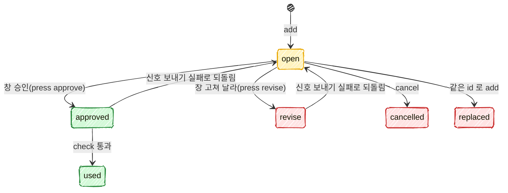

# 보드: 사용자 승인 대기와 버튼 승인 기술 설계

스펙: [spec.md](spec.md)

## 요구사항 연결

| ID | 해결 방법 | PR |
| --- | --- | --- |
| REQ1 | `orch board approval add` 를 명령 표(`lib/commands.ts`)의 두 낱말 동작 행으로 더하고 `scripts/board/board-approval.ts` 가 받는다. 인자 검사와 종류별 필수 칸은 순수 함수 `core/approvals.ts` 의 `validateAdd` 가, 파일 쓰기와 해시는 `lib/approvals.ts` 가 맡는다. Run 은 명령 표의 `run` 문맥(`run-current`)으로 받고, 터미널은 `ORCA_TERMINAL_HANDLE` 을 읽는다 | PR1 |
| REQ2 | 버전은 저장 파일 전체에서 하나씩 늘어나는 번호 `seq` 다. 같은 id 의 열린 대기가 있으면 잠금 안에서 `replaced` 로 닫고 새 기록을 더한다. 끝난 기록은 건드리지 않는다. 버튼 키, 기록, 신호 제목과 payload, `check` 가 모두 `<id>` 와 `<버전>` 을 함께 쓴다. 창의 누름 처리(`bin/approvals.ts press`)는 잠금 안에서 그 id 의 가장 늦은 기록이 그 버전이고 열려 있을 때만 쓴다 | PR1(저장, 바꾸기), PR2(누름) |
| REQ3 | `list`, `list --full`, `cancel` 을 같은 스크립트가 받는다. 줄 꼴은 `core/approvals.ts` 의 `formatLine` 이 소유한다 | PR1 |
| REQ4 | 명령 표에 `approval add`, `list`, `cancel`, `check` 넷만 둔다. 승인과 고쳐 달라를 쓰는 함수는 `lib/approvals.ts` 의 `recordPress` 하나이고, 그것을 부르는 곳은 창 전용 스크립트 `extensions/work-board/bin/approvals.ts press` 하나, 그 스크립트를 부르는 곳은 `register.js` 의 버튼 누름 처리 하나다. 테스트가 세 곳을 정적으로 확인한다 | PR1(표), PR2(누름 길) |
| REQ5 | `register.js` 가 5초마다 승인 파일을 읽어(`$.fs.read`) 「승인 대기」 상자와 상태 줄의 「승인 n」 을 그린다. 파일 경로는 세션 시작 때 `bin/approvals.ts where` 로 한 번 받는다 | PR2 |
| REQ6 | 「승인」 버튼은 `bin/approvals.ts press <id> <버전> approve` 를 부른다. 이 스크립트가 기록을 쓰고, 올린 Run 으로 `APPROVED <id> <버전>` 을 보내고, 보내지 못하면 기록을 되돌린다. 창이 worker 터미널인지는 `bin/approvals.ts self` 가 정하고, worker 거나 정하지 못하면 버튼을 그리지 않는다 | PR2 |
| REQ7 | 「고쳐 달라」 는 그 대기 자리에 글칸(`Input`)을 연다. 보낸 글이 공백뿐이면 아무것도 부르지 않는다. 글이 있으면 `press <id> <버전> revise --note <글>` 을 부른다 | PR2 |
| REQ8 | `real` 대기는 대상 환경, 바꿀 것, 되돌리는 법을 빨간 글로 그린다. 첫 누름은 창 메모리에 `armed = { key, until: 지금 + 10초 }` 만 남기고, 기한 안의 같은 키 누름만 `press` 를 부른다 | PR2 |
| REQ9 | `command` 대기는 「명령 채우기」 버튼 하나다. `self` 가 낸 창의 터미널이 기록의 `terminal` 과 같을 때만 그린다. 누르면 `$.prompt.fill` 로 `! <명령>` 을 채운다. 기록도 신호도 쓰지 않는다 | PR2 |
| REQ10 | `check` 는 잠금 없이 읽은 기록으로 Orca 조회(신호 메시지 읽기, worker 터미널 판정)를 끝낸 뒤, 잠금 안에서 다시 읽어 같은 기록이 그대로일 때만 `used` 로 닫는다. 판정은 순수 함수 `core/approvals.ts` 의 `checkVerdict` 가 한다. 코디네이터 규칙은 `references/replying.md` 의 새 절 「보드 승인」 이 소유하고 `waiting.md` 가 가리킨다 | PR1 |
| REQ11 | 쓰기마다(add, cancel, check 의 used, press) 잠금 안에서 끝난 지 7일이 지난 기록을 지운다. 기한으로 닫는 코드는 없다 | PR1 |
| REQ12 | 코디네이터 규칙(`replying.md` 「보드 승인」)에 `STEP-READY ask` 를 받으면 `step-<항목>-<번호>` 로 올리는 처리와 「열려 있으면 다시 올리지 않는다」 를 적는다. 열려 있는지는 `list` 로 본다. 루프 코드(`loop/`)는 승인 파일을 읽지도 쓰지도 않는다 | PR1 |
| REQ13 | `replying.md` 「보드 승인」 에 막는 것, 막지 못하는 것, 「승인 파일을 직접 고치지 않는다」 를 적는다. 창 전용 스크립트를 부르는 것도 같은 한계에 든다고 적는다(아래 「막는 것과 막지 못하는 것」) | PR1 |

## 책임과 경계

```text
코디네이터 ── orch board approval add/list/cancel/check ──┐
                                                         ▼
                              skills/orch/scripts/board/board-approval.ts (명령)
                                         │
                         lib/approvals.ts (파일, 잠금, 해시, Orca 조회)
                                         │
                         core/approvals.ts (순수: 검사, 상태 바꾸기, 판정, 줄 꼴)
                                         ▲
extensions/work-board/bin/approvals.ts (창 전용: where, self, press) ──┘
                                         ▲
extensions/work-board/hooks/register.js (그리기, 누름, 글칸, real 두 번, 명령 채우기)
```

- **`core/approvals.ts`(신규, PR1)**: 저장 꼴의 타입, `validateAdd`, `applyAdd`(바꾸기 포함), `applyCancel`, `applyPress`, `revertPress`, `checkVerdict`, `prune`, `formatLine`. 파일과 프로세스를 모른다. [ADR-028](../../adr/028-orch-core-layer.md) 의 `core/` 규칙을 따른다.
- **`lib/approvals.ts`(신규, PR1)**: 승인 파일 경로(`pathOf('state', repo)` 아래 `approvals.json`), 잠금을 잡고 읽고 바꾸고 옆 파일에 쓴 뒤 이름 바꾸기, 미리보기 해시(SHA-256), 신호 메시지 읽기, `recordPress`(누름 기록과 신호 보내기, 실패 시 되돌리기). worker 터미널 판정은 아래 `lib/worker-terminal.ts` 를 부른다.
- **`lib/worker-terminal.ts`(신규, PR1)**: 터미널 handle 이 어느 Run 의 worker 인지 정하는 조회 한 벌. 지금 `hooks/block-worker-terminal-send.ts` 머리 주석의 「worker 판정 범위」 1~5단계(active, 남은 터미널 상태, `run-list` 뒤 Run 마다 `worker-list`, `lib/worker-run-cache.ts`)를 그대로 옮기고, 읽을 터미널 상태를 인자로 받는다. hook 은 지금 범위(released 제외)로, `check` 는 released 까지 읽는다. hook 의 시간 한도와 첫 화면 승인 예외는 hook 에 남긴다. hook 의 판정이 바뀌지 않는 것은 기존 `coordinator-hooks.spec.ts` 가 본다.
- **`scripts/board/board-approval.ts`(신규, PR1)**: 인자 풀이와 출력, 종료 코드만 맡는다. 동작 넷을 `prepend` 로 받는다.
- **`extensions/work-board/bin/approvals.ts`(신규, PR2)**: 창이 부르는 세 동작. `where`(승인 파일의 절대경로 한 줄), `self`(이 프로세스의 `ORCA_TERMINAL_HANDLE` 과 worker 여부를 JSON 한 줄), `press`(승인·고쳐 달라 기록과 신호). orch 의 `lib/approvals.ts` 를 import 한다. 이 의존 방향(work-board → orch lib)은 `bin/worker-marks.ts` 가 `lib/movement.ts` 를 쓰는 것과 같다. orch 명령 표에는 넣지 않는다.
- **`register.js`(PR2)**: 그리기와 사람 입력만 맡는다. 판정 규칙(누가 누를 수 있나, 버전이 맞나)은 스크립트가 다시 확인하므로, 창의 판정은 버튼을 그릴지 정하는 데만 쓴다.
- **루프(`loop/`)**: 바꾸지 않는다. 승인 대기를 만들지 않는다(스펙 「범위 밖」, DECISION10).
- **보드 파일(`board.json`)**: 승인 대기를 담지 않는다(스펙 DECISION12). `--item`, `--step` 은 글로만 남기고 보드에 그 항목과 단계가 있는지 보지 않는다. 보드를 읽으면 보드 잠금과 얽히고, 틀린 번호는 코디네이터가 `list` 와 창에서 바로 본다.

### 막는 것과 막지 못하는 것

스펙 REQ13 과 DECISION4 의 범위를 코드 자리에 옮긴 것이다.

| 시도 | 막는 자리 | 결과 |
| --- | --- | --- |
| worker 가 `APPROVED <id> <버전>` 제목으로 Run 에 보낸다 | `check` 가 기록 상태를 먼저 본다 | 누른 기록이 없어 「아직 누르지 않음」 |
| worker 터미널에서 연 창의 버튼을 누른다 | 창이 버튼을 그리지 않는다. `press` 도 자기 터미널이 worker 면 거절한다 | 기록도 신호도 없다 |
| worker 가 창 전용 스크립트 `press` 를 직접 부른다 | `press` 가 자기 `ORCA_TERMINAL_HANDLE` 을 worker 판정해 거절한다. 환경 변수를 바꿔 부르면 막지 못한다 | 바꾸지 않으면 거절, 바꾸면 아래 「막지 못함」 |
| 코디네이터가 승인됐다고 짐작해 실행한다 | 규칙 문서: 실행 직전 `check` 통과만 승인으로 본다(채팅 승인 제외) | 문서로 막는다 |
| 승인 뒤 미리보기를 고쳐 등록한다 | `check` 가 해시를 다시 잰다 | 「미리보기가 바뀜」 |
| 한 승인으로 두 번 등록한다 | `check` 가 통과할 때 `used` 로 닫는다 | 둘째 `check` 는 「이미 사용함」 |
| 같은 사용자 권한으로 승인 파일과 Orca 메시지를 함께 꾸민다, 또는 `ORCA_TERMINAL_HANDLE` 을 코디네이터 값으로 바꿔 `press` 를 부른다 | 없음 | 막지 못함. 문서에 한계로 적는다 |

## 인터페이스와 데이터

### 명령

명령 표(`lib/commands.ts`)에 더하는 행. 두 낱말 동작은 지금 `queue reserve prune` 과 같은 방식으로 푼다.

| 동작 | 스크립트와 앞 인자 | 문맥 | usage |
| --- | --- | --- | --- |
| `approval add` | `board/board-approval.ts add` | `repo`, `run`(`run-current`, 필수) | `orch board approval add <id> --title <제목> --kind <post\|spec\|step\|real\|command> [...]` |
| `approval list` | `board/board-approval.ts list` | `repo` | `orch board approval list [--full]` |
| `approval cancel` | `board/board-approval.ts cancel` | `repo` | `orch board approval cancel <id> [--reason <이유>]` |
| `approval check` | `board/board-approval.ts check` | `repo` | `orch board approval check <id>` |

출력과 종료 코드는 스펙 REQ1~3, REQ10 을 그대로 쓴다. 기다린 시간은 `bin/worker-marks.ts` 의 멈춤 시간과 같은 꼴(`N분`, 60분부터 `N시간`, 하루부터 `N일`)이다. `list --full` 의 끝난 줄은 `APPROVAL <id> <kind> <상태> v<버전> <제목>` 이다. 상태 낱말은 아래 표의 영문 값이다.

### 저장 꼴

위치는 `<orch 루트>/state/approvals.json` 이다. 저장소마다 하나이고, 그 저장소의 모든 Run 이 함께 쓴다(스펙 DECISION23). `docs/data-schema.md` 「orch 루트에 더하는 파일」 에 행을 더한다.

```json
{
  "seq": 12,
  "entries": [
    {
      "id": "post-361-done",
      "version": 12,
      "kind": "post",
      "title": "361 마무리 댓글 등록",
      "state": "open",
      "run": "run_67445446b89f",
      "terminal": "term_b02d94c2-...",
      "preview": { "path": "/abs/.omc/previews/361-done.html", "sha256": "…" },
      "item": null, "step": null, "then": "두레이 361 에 댓글 등록",
      "real": null, "command": null,
      "createdAt": "2026-11-10T03:00:00.000Z",
      "closedAt": null,
      "press": null,
      "note": null,
      "reason": null
    }
  ]
}
```

| 칸 | 뜻 |
| --- | --- |
| `seq` | 마지막으로 매긴 버전. `add` 마다 1 늘린다. 기록을 7일 뒤 지워도 줄지 않으므로 같은 id 로 다시 올려도 버전이 겹치지 않는다 |
| `state` | `open`(열림), `approved`(승인, 아직 안 씀), `used`(사용함), `revise`(고쳐 달라), `cancelled`(취소), `replaced`(바뀜) |
| `preview` | `command` 는 null. 경로는 `add` 때 절대경로로 바꿔 둔다 |
| `real` | `real` 종류만 `{ target, change, rollback }` |
| `press` | 창이 쓴다. `{ action: "approve"\|"revise", terminal, origin, at, message }`. `terminal` 은 `press` 스크립트가 읽은 자기 `ORCA_TERMINAL_HANDLE`, `origin` 은 창이 받은 누름 이벤트의 `origin.kind`(없으면 `"none"`), `message` 는 보낸 Orca 메시지 id 다 |
| `note` | 고쳐 달라 글 |
| `reason` | `cancel --reason` 의 값 |

상태 바꾸기:



`cancel` 은 열린 대기만 닫는다. 승인됐지만 아직 쓰지 않은 대기에 `cancel` 을 부르면 「열린 대기가 없다」 로 거절한다(종료 코드 1). 채팅 승인으로 닫는 경우(스펙 REQ10)는 창의 버튼을 누르기 전이라 열려 있다.

### 창이 부르는 스크립트 (PR2)

```text
node bin/approvals.ts where --repo <주 checkout>      → 승인 파일 절대경로 한 줄
node bin/approvals.ts self                              → {"terminal":"term_…"|null,"worker":true|false|null}
node bin/approvals.ts press <id> <버전> approve|revise [--note <글>] --origin <kind> --repo <주 checkout>
                                                         → 0 이면 PRESS-OK <메시지 id>, 1 이면 stderr 한 줄 이유
```

- `self` 의 `worker` 는 `lib/worker-terminal.ts` 로 active 와 남은 터미널 상태만 읽어 정한다. 조회가 실패하면 null 이다. 창은 null 과 true 를 같게 보고 버튼을 숨긴다. `terminal` 이 null 이면(Orca 밖에서 연 창) 버튼을 숨긴다. 창은 이 값을 60초마다 다시 읽는다. 일반 터미널이 `worker-start --terminal` 로 worker 가 될 수 있기 때문이다. 버튼을 숨긴 이유는 「코디네이터 창이나 다른 창에서 누르세요」 한 줄로 보인다.
- `press` 차례:
  1. 자기 `ORCA_TERMINAL_HANDLE` 이 없거나 worker 면(판정 실패 포함) 거절한다.
  2. 잠금 안에서 그 id 의 가장 늦은 기록이 그 버전이고 `open` 인지 본다. 아니면 「내용이 바뀌었어요」 로 거절한다. 맞으면 `state` 와 `press`(message 없음)를 쓰고 잠금을 푼다.
  3. 잠금 밖에서 `orca orchestration send --to run:<기록의 run> --type status --from <자기 터미널> --subject "APPROVED <id> <버전>"`(고쳐 달라면 `REVISE`)과 `--payload {"source":"board-approval","action","id","version"}` 를 보낸다. 본문은 제목, `then`, 미리보기 경로, 고쳐 달라 글이다.
  4. 실패하면 잠금 안에서, 그 기록이 아직 2단계에서 쓴 `press.at` 그대로일 때만 `open` 으로 되돌리고 `press` 를 지운다. 이유를 내고 1 로 끝난다.
  5. 성공하면 잠금 안에서 `press.message` 에 메시지 id 를 쓴다.
- 창은 0 이면 다음 읽기를 기다리지 않고 그 대기를 상자에서 뺀다. 1 이면 toast 에 이유를 보이고 상자는 그대로다.

### 버튼과 누른 사람 이벤트 (PR2)

- 버튼 키는 `approval:<id>:<버전>:<approve|revise|fill>` 이다. 다시 그릴 때 버전이 바뀌면 키도 바뀐다.
- `register.js` 는 이미 `ui.press`, `ui.input` 훅(`recordInput`)을 건다. 이 훅에서 마지막 누름 `{ element, origin: e.origin?.kind ?? 'none' }` 를 메모리에 남긴다. 승인 버튼의 `onPress` 는 남긴 `element` 가 자기 키일 때만 `press` 를 부르고 `--origin` 으로 그 값을 넘긴다. `origin` 이 있고 `person` 이 아니면 부르지 않는다. 지금 문서(`behavior.md` 「네트워크 조회」)는 `ui.press` 에 출처 필드가 없다고 적고 있어 PR2 첫 작업으로 Claude Code 2.1.322 의 실제 이벤트 꼴을 잰다. 출처가 없으면 `none` 으로 남긴다. 모델은 창의 버튼을 누를 수 없고 플러그인 코드만 누름을 만들 수 있으므로, 이 값은 판정이 아니라 나중에 확인할 기록이다.
- 「고쳐 달라」 의 글칸은 같은 자리에 `Input`(label 「고칠 내용」, submitLabel 「보내기」, rows 3)을 그린다. 제출 이벤트(`ui.input`)도 같은 방식으로 `origin` 을 남긴다.

### 신호와 `check` 의 판정

`check <id>` 차례:

1. 잠금 없이 읽는다. 그 id 의 가장 늦은 기록을 고른다.
2. 기록 상태로 거절 이유를 정한다: 없음 → 「기록 없음」, `open` → 「아직 누르지 않음」, `used` → 「이미 사용함」, `revise` → 「고쳐 달라」, `cancelled` → 「취소됨」. `approved` 만 다음으로 간다.
3. 미리보기 해시를 다시 잰다. 파일이 없거나 다르면 「미리보기가 바뀜」.
4. 신호 메시지를 읽는다. 코디네이터 터미널에서 `orca orchestration check --run <기록의 run> --all --types status --json` 을 부르고 id 가 `press.message` 인 메시지를 찾는다. `press.message` 가 없거나, 찾지 못하거나, 조회가 실패하면 「신호를 읽지 못함」. 읽는 필드는 `core/message-fields.ts` 의 `senderOf` 와 새로 더하는 `subjectOf`, `payloadOf` 다(아래).
5. 메시지 제목과 payload 의 버전이 기록의 버전과 다르면 「버전이 다름」.
6. 메시지를 보낸 터미널(`senderOf`)과 `press.terminal` 을 `lib/worker-terminal.ts` 로 판정한다(released 포함). 둘 가운데 하나라도 worker 면 「worker 가 보냄」. 조회가 실패하면 「신호를 읽지 못함」. 두 값이 다르면(누른 터미널과 보낸 터미널이 다르다) 「신호를 읽지 못함」.
7. 잠금을 잡고 다시 읽는다. 같은 버전 기록이 아직 `approved` 이고 `press.message` 가 같으면 `used` 와 `closedAt` 을 쓰고 `APPROVAL-OK <id>` 다. 그 사이 바뀌었으면 바뀐 상태로 2단계 이유를 낸다.

Orca 조회(4, 6단계)를 잠금 밖에서 하는 것은 조회가 몇 초 걸려 다른 쓰기의 5초 기다림을 넘길 수 있어서다. 7단계의 다시 읽기가 그 사이의 변경을 막는다. 보드 명령 스펙(#421) REQ11 의 「미리 읽은 목록 저장 거절」 과 같은 생각이다.

`core/message-fields.ts` 에 더하는 함수:

```ts
export function subjectOf(message: Json): string   // subject, title
export function payloadOf(message: Json): Json      // payload 가 문자열이면 JSON 으로 푼다
```

`check --all` 이 최근 100건까지만 돌려주므로 승인 뒤 100건 넘게 메시지가 쌓인 Run 에서는 4단계가 「신호를 읽지 못함」 이 된다. 이때 코디네이터는 규칙대로 사용자에게 묻고 같은 id 로 다시 올린다.

## 실패와 일관성

- **잠금**: 승인 파일 옆 `approvals.json.lock`. 보드 명령 구현(#421 REQ11)과 같은 잠금 함수를 쓴다. 5초 안에 못 잡으면 종료 코드 1, 30초 넘은 잠금은 무시한다. 잠금 안에서 읽고, 바꾸고, 옆 파일에 쓴 뒤 이름을 바꾼다. 잠금 안에서는 Orca 나 git 을 부르지 않는다.
- **신호 보내기 실패**: `press` 4단계가 되돌린다(스펙 DECISION14). 되돌리기 전에 `press.at` 을 대조해, 그 사이 다른 쓰기가 같은 기록을 바꿨으면 되돌리지 않는다. 되돌리기 자체가 잠금을 못 잡아 실패하면 기록은 `approved` 로 남고 신호는 가지 않는다. 이때 `press.message` 가 없어 `check` 는 「신호를 읽지 못함」 으로 거절하고, 상자에서는 빠진다. 창은 toast 에 「승인 기록을 되돌리지 못했어요. 코디네이터에게 다시 올려 달라고 하세요」 를 보인다.
- **보낸 뒤 메시지 id 쓰기 실패**: 신호는 갔는데 `press.message` 가 비면 `check` 가 「신호를 읽지 못함」 으로 거절한다. 실행되지 않는 쪽으로 실패한다. 코디네이터가 사용자에게 묻고 다시 올린다.
- **같은 대기를 두 창에서 동시에 누른다**: `press` 2단계가 잠금 안에서 `open` 을 보므로 하나만 쓴다. 다른 쪽은 「내용이 바뀌었어요」 toast 다.
- **`add` 와 누름이 겹친다**: `add` 가 먼저면 누름은 버전이 달라 거절된다. 누름이 먼저면 `add` 는 열린 기록이 없으니 `replaced` 없이 새로 연다. 앞 승인 신호는 코디네이터에게 가지만 `check` 는 새 기록(`open`)을 보고 「아직 누르지 않음」 이다(스펙 REQ2).
- **7일 정리**: 쓰기마다 잠금 안에서 `closedAt` 이 7일 전보다 이른 기록을 지운다. `approved` 로 7일 남은 기록도 지운다. 그 뒤 `check` 는 「기록 없음」 이다.
- **파일이 깨졌을 때**: JSON 으로 읽지 못하면 쓰기 명령은 종료 코드 1 과 파일 경로를 내고 고치지 않는다. 창은 상자 자리에 「승인 대기를 읽지 못했어요」 를 흐리게 보인다. 덮어써서 기록을 잃지 않게 한다.
- **배포 순서**: 보드 명령 구현 PR(잠금 함수) → PR1 → PR2. PR1 만 있는 동안 창은 승인 파일을 모르므로 아무것도 그리지 않고, 승인은 채팅으로 한다(스펙 「범위」). PR2 는 PR1 의 저장 꼴을 읽기만 더한다.
- **호환**: 새 파일과 새 명령만 더한다. 기존 명령의 출력과 종료 코드는 그대로다. `block-worker-terminal-send.ts` 는 판정 조회를 `lib/worker-terminal.ts` 로 옮기지만 판정과 거부 문구는 같다.

## 검증 전략

| ID | 경계 | 방법 |
| --- | --- | --- |
| REQ1, REQ3 | 명령(`board-approval.ts`)과 임시 저장소 | 자식 프로세스로 명령을 부르는 테스트. 필수 인자, 종료 코드, 한 줄 출력, 저장 파일 내용 |
| REQ2, REQ11 | `core/approvals.ts` | 순수 함수 표 테스트(바꾸기, 끝난 id 다시 올리기, 버전, 7일 정리). 누름의 버전 거절은 PR2 의 `press` 테스트 |
| REQ4 | 명령 표와 소스 | 명령 표에 approve·revise 동작이 없는지, `recordPress` 를 부르는 곳이 `bin/approvals.ts` 하나인지 보는 정적 테스트. 창 쪽은 PR2 |
| REQ5~REQ9 | `register.js` 와 실제 Claude Code 창 | PR2: 그리기 함수 단위 테스트(`pane.test.ts` 방식)와 사람이 보는 실측(창 상자, real 두 번, 글칸, worker 창의 버튼 숨김, 다른 세션 창에서 승인) |
| REQ10 | `check` 와 가짜 orca | `PATH` 앞의 가짜 `orca`(기존 `coordinator-hooks.spec.ts` 방식)로 메시지와 worker 목록을 꾸며 거절 이유 아홉 가지와 통과 뒤 「이미 사용함」 을 본다. 실제 Orca 로 `check --all` 의 메시지 꼴은 PR1 에서 한 번 잰다 |
| REQ12, REQ13 | 문서 | `replying.md`, `waiting.md` 에 규칙 낱말이 있는지 보는 문서 테스트. 루프 코드에 `approvals` 를 부르는 곳이 없는지 정적 테스트 |

## 보드 명령 설계와 맞출 것

보드 명령 설계(`docs/features/orch-board-cli/design.md`)가 아직 없어(2026-11-10, `origin/docs/orch-board-cli-design` 없음) 그 스펙(#421)을 기준으로 아래를 가정했다. 그 설계가 나오면 이 표를 대조해 맞춘다.

| 자리 | 이 설계의 가정 | 어긋나면 |
| --- | --- | --- |
| 잠금 함수 | #421 REQ11 의 잠금(5초 기다림, 30초 넘은 잠금 무시)이 보드 파일이 아닌 파일에도 쓸 수 있는 함수 하나로 나온다. 함수 이름과 자리는 보드 명령 설계를 따른다 | 보드 전용으로 묶여 내보내지 않으면 PR1 이 동작을 바꾸지 않고 내보내기만 더한다. 새 잠금 꼴을 따로 만들지 않는다 |
| 명령 표 | 보드 명령이 `board` 묶음에 한 낱말 동작(`set`, `step`, `add-step`, `show`)을 더하고 두 낱말 동작 풀이를 바꾸지 않는다 | 두 낱말 풀이가 바뀌면 `approval <동작>` 행을 그 꼴로 옮긴다. `approval` 이라는 동작 이름을 보드 명령이 쓰면 이름을 맞춘다 |
| 출력과 종료 코드 | `BOARD-*` 처럼 한 줄 머리말, 0 반영, 1 거절, 2 사용법 오류, `--full` 로 자세히 | 보드 명령이 다른 꼴(예: stderr 이유의 머리말)을 정하면 `APPROVAL-*` 도 같게 바꾼다 |
| 저장 파일 찾기 | 승인 파일은 orch 루트의 `state/` 아래라 `finish.board` 와 관계없다. 주 checkout 은 `lib/git.ts` 의 `mainCheckout` 으로 같다 | 보드 명령이 orch 루트 찾기를 바꾸면 `pathOf` 를 그대로 따른다 |
| 미리 읽은 값 저장 거절 | `check` 와 `press` 가 잠금 밖에서 읽은 뒤 잠금 안에서 다시 대조한다. 보드 명령의 거절 방식(항목 줄 비교)과 같은 생각이고 코드는 따로다 | 보드 명령이 공용 「다시 읽고 대조」 함수를 내면 그것을 쓴다 |
| `step` 의 `ask` 표시와 `STEP-READY ask` | REQ12 의 코디네이터 규칙은 자동 진행 구현(`board-auto-advance`)이 보내는 `STEP-READY ask` 를 받는다. 승인 대기는 보드 줄의 `[ask]` 표시를 바꾸지 않는다 | 자동 진행 설계가 `STEP-READY` 본문 꼴(항목 id, 표시, 단계 글)을 바꾸면 규칙 문서의 id 짓기(`step-<항목>-<번호>`)를 그 꼴에 맞춘다 |

## PR 나누기와 순서

스펙 DECISION11 의 둘을 그대로 쓴다. 보드 명령 구현 PR(잠금 함수)이 먼저 머지된다는 전제다.

| 순서 | PR | 담는 것 | 계획서 |
| --- | --- | --- | --- |
| 0 | 보드 명령 구현 (다른 기능) | `board.ts` 잠금 함수 | 보드 명령 기능이 소유 |
| 1 | PR1 명령·저장·규칙 | `core/approvals.ts`, `lib/approvals.ts`, `lib/worker-terminal.ts`(hook 에서 옮김), `core/message-fields.ts` 의 두 함수, `board/board-approval.ts`, 명령 표 네 행, `data-schema.md`, `replying.md`, `waiting.md`, `board.md` 의 명령 안내, orch 변경 조각 | [tasks/approval-store](tasks/approval-store/index.json) |
| 2 | PR2 창 | `bin/approvals.ts`(`where`, `self`, `press`), `lib/approvals.ts` 의 `recordPress`, `register.js` 의 상자·버튼·글칸·real 두 번·명령 채우기, `behavior.md`, README, 창 실측 | PR1 머지 뒤에 쓴다 |

`recordPress` 를 PR2 에 두는 것은 PR1 만 머지된 동안 승인 기록을 쓰는 길이 하나도 없게 하려는 것이다. 그동안 `check` 는 늘 「아직 누르지 않음」 이고 코디네이터는 채팅 승인을 쓴다.

## 결정

| ID | 결정 | 답 | 누가 | 근거 |
| --- | --- | --- | --- | --- |
| DECISION1 | 승인 파일 위치 | 승인 파일은 `<orch 루트>/state/approvals.json` 하나 | 작성자 | 스펙 DECISION12 가 「orch 상태 폴더의 파일 하나」 로 정했다. 같은 폴더의 다른 상태 파일과 같이 `pathOf('state')` 로 찾고 워크트리에서 불러도 주 checkout 의 것을 쓴다 |
| DECISION2 | 버전 번호 | 버전은 파일 전체에서 하나씩 늘어나는 `seq` | 작성자 | id 별 최대값에 1을 더하면 7일 정리 뒤 같은 id 의 버전이 1로 돌아가 오래 열린 화면의 버튼과 겹칠 수 있다. 전체 번호는 정리와 무관하다 |
| DECISION3 | 승인 기록을 쓰는 길 | 승인 기록을 쓰는 길은 창 전용 스크립트 `bin/approvals.ts press` 하나이고 orch 명령 표에 넣지 않는다 | 작성자 | 창(`register.js`)은 `$.fs` 에 쓰기가 없어(`$.fs.read`, `$.fs.exists` 만 쓴다) 파일을 쓰려면 프로세스를 불러야 한다. 스펙 REQ4 의 「CLI 가 없다」 는 orch 명령과 도움말의 계약으로 지키고, 스크립트를 직접 부르는 것은 REQ13 의 막지 못하는 범위로 문서에 적는다 |
| DECISION4 | 기록과 신호의 순서 | `press` 가 기록과 신호를 한 프로세스에서 하고 실패하면 되돌린다 | 작성자 | 기록만 남고 신호가 없는 상태를 줄인다(스펙 DECISION14). 순서를 TS 한 곳에 두면 테스트할 수 있다 |
| DECISION5 | worker 터미널 판정 | `check` 의 worker 판정은 hook 의 조회를 `lib/worker-terminal.ts` 로 옮겨 함께 쓰고, `check` 만 released 까지 읽는다 | 작성자 | 같은 규칙을 두 벌 두지 않는다. 스펙 DECISION21 이 끝난 worker 도 거절하라고 했다. hook 은 7초 한도 때문에 released 를 읽지 않는 지금 범위를 지킨다 |
| DECISION6 | 신호 메시지 찾기 | `check` 는 신호 메시지를 `press.message` id 로 찾고, 보낸 터미널과 누른 터미널을 모두 판정한다 | 작성자 | 제목만으로 찾으면 worker 가 같은 제목을 보낸 메시지와 섞인다. 두 터미널이 다르면 둘 중 하나가 꾸민 값이라 통과시키지 않는다 |
| DECISION7 | Orca 조회와 잠금 | Orca 조회는 잠금 밖, 상태 바꾸기는 잠금 안에서 다시 대조 | 작성자 | 잠금 기다림 5초 안에 Orca 조회가 끝난다는 보장이 없다 |
| DECISION8 | 버튼을 숨기는 창 | 창은 자기 터미널을 모르거나 worker 여부를 정하지 못하면 버튼을 숨긴다 | 작성자 | 스펙 DECISION26 이 worker 터미널에서는 승인을 받지 않기로 했다. 정하지 못한 터미널은 worker 일 수 있어 같게 다룬다. 숨긴 이유를 한 줄로 보여 다른 창으로 가게 한다 |
| DECISION9 | 누른 사람 이벤트 | 누른 사람 이벤트는 `ui.press`·`ui.input` 훅에서 받은 `origin.kind` 를 `press.origin` 으로 남기고, `person` 이 아닌 출처가 있으면 부르지 않는다 | 작성자 | 스펙 「조사한 사실」 의 출처 구분을 기록으로 남긴다. 지금 문서가 `ui.press` 에 출처가 없다고 적어 PR2 에서 실제 꼴을 잰다 |
| DECISION10 | 보드 항목 확인 | `--item`, `--step` 이 보드에 있는지 보지 않는다 | 작성자 | 보드 잠금과 얽히지 않는다. 틀린 값은 `list` 와 창에서 보인다 |
| DECISION11 | `cancel` 범위 | `cancel` 은 열린 대기만 닫는다 | 작성자 | 승인된 대기를 거두는 일은 `check` 로 쓰거나 같은 id 로 다시 올리는 것으로 충분하다. 승인 기록을 코디네이터가 지우는 길을 만들지 않는다 |
| DECISION12 | 코디네이터 규칙 자리 | 코디네이터 규칙은 `references/replying.md` 의 새 절이 소유하고 `waiting.md` 는 가리키기만 한다 | 작성자 | 스펙 REQ10 이 둘 중 하나를 원했다. 사용자에게 묻고 답을 받는 절차가 `replying.md` 에 모여 있다 |

ADR 은 남기지 않는다. 승인 파일 위치와 「사람만 승인」 의 한계는 스펙 결정이고, 위 결정은 이 기능 안에서 되돌리기 쉬운 배치다.
