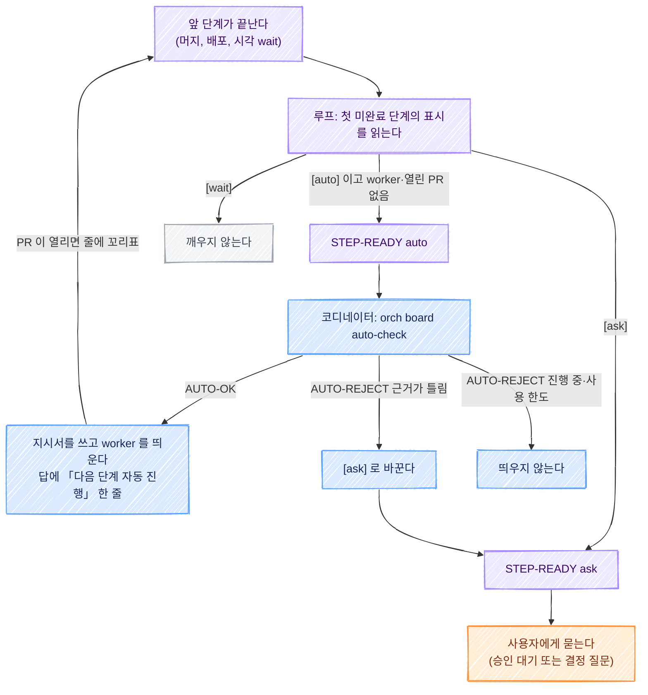

# 보드의 다음 단계 이어 가기 기술 설계

스펙: [spec.md](spec.md). 요구사항(REQ)과 제품 결정(DECISION)은 스펙이 소유한다. 이 문서는 그것을 어느 코드와 문서가 맡는지 정한다.

이 설계는 보드 명령([orch-board-cli/spec.md](../orch-board-cli/spec.md))의 파일 잠금, 보드 파일 찾기, `orch board step` 위에 선다. 보드 명령 설계는 이 문서를 쓰는 시점에 리뷰 중이다(PR #430, 브랜치 `docs/orch-board-cli-design`). 그 설계와 대조한 결과와 남은 가정은 아래 「보드 명령 설계와 맞출 것」 에 모았다.

## 한눈에 보기



보라는 루프, 파랑은 코디네이터, 주황은 사용자, 회색은 아무 일도 하지 않는 자리다.

## 요구사항 연결

| ID | 해결 방법 | PR |
| --- | --- | --- |
| REQ1 | 표시의 꼴을 `extensions/work-board/hooks/step-marks.js` 한 곳이 읽고 쓴다(`parseStepMark`, `withStepMark`). 번호 뒤 맨 앞의 `[auto]`, `[ask]`, `[wait]`, `[wait: <조건>]` 만 표시이고 그 밖의 대괄호 글은 표시 없는 줄이다. 항목의 `stages` 필드에 든 번호의 줄(사건 단계)은 표시를 읽지 않는다. worker 가 남은 PR 목록을 `worker_done` 에 적는 규칙은 공통 지시서 틀(`templates/spec-common.md`)에 더한다 | A |
| REQ2 | 붙여도 되는 일, 안 되는 일, 근거 꼴은 `references/board.md` 의 새 절 「자동 진행 표시」 가 소유한다. 근거 꼴(`(스펙: …)`, `(계획: …)`, `(앞 사건: #N 사건)`)은 순수 함수 `core/evidence.ts` 의 `parseEvidence` 가 읽는다. `(앞 사건: …)` 은 줄 끝 사건 꼬리표 정규식(`event-tags.js` 의 `EVENT_TAG`)에 맞지 않는다. 줄 글의 `#N` 으로 줄을 끝내는 `core/board.ts` 의 `prSteps` 는 근거 괄호 안의 번호를 세지 않게 고친다(아래 「근거 괄호의 PR 번호」) | A |
| REQ3 | 띄우기 직전 확인은 글 규칙이 아니라 명령 `orch board auto-check <항목>` 이 한다. 판정은 `core/auto-advance.ts` 의 `judgeAdvance` 가 하고, 보드와 파일, worker 목록 읽기는 `lib/auto-advance.ts` 가 한다 | A |
| REQ4 | 루프 틱에 새 단계 `loop/steps/step-ready.ts` 를 움직임 확인 바로 뒤에 둔다. 판정은 `core/step-ready.ts`, 알림 기록은 `state/step-ready.json` 이다 | B |
| REQ5 | 멈춘 단계 판정(`core/movement.ts` 의 `stalledStages`)이 lib 이 미리 읽은 표시와 띄운 기록을 받는다. `[wait]` 와 `[ask]` 는 건너뛴다. `[auto]` 는 띄운 기록(`state/step-launches.jsonl`)이 있을 때만 보되, 표시 없는 줄의 상태·필드 조건이 아니라 스펙이 정한 「살아 있는 worker 도 열린 PR 도 없음」 으로 본다 | B |
| REQ6 | 시각 wait 는 보드 동기화(`board/board-sync.ts`)가 줄 끝 사건 꼬리표를 끝내는 자리 옆에서 끝낸다. 시각 읽기는 `step-marks.js` 의 `waitTimeMs` 가 맡는다 | B |
| REQ7 | 코디네이터 절차는 `references/replying.md` 의 새 절 「다음 단계 이어 가기」 가 소유하고 `waiting.md` 는 가리키기만 한다. PR A 는 머지와 배포를 보고 이어 가는 길을, PR B 는 `STEP-READY` 를 받는 길을 적는다 | A, B |
| REQ8 | 같은 절에 `다음 단계 자동 진행: <무엇을>, <agent·모델>, <묻지 않은 이유(근거)>` 꼴을 적는다. `auto-check` 의 `AUTO-OK` 줄이 근거 글을 돌려줘 그대로 옮긴다 | A |
| REQ9 | 「한 번만」 은 띄울 때 남기는 기록(`state/step-launches.jsonl`)을 `auto-check` 가 읽어 막는다. 사용 한도는 루프가 한도 알림 시각을 머신 폴더에 남기고, `auto-check` 가 30분 안이면 거절하며, 루프가 30분 뒤 한 번 더 알린다 | A(한 번만), B(한도) |
| REQ10 | 표시 없는 줄은 어느 코드도 다르게 다루지 않는다. 판정 함수마다 「표시가 없으면 지금 규칙」 사례를 테스트로 둔다 | A, B |
| REQ11 | 설정 `board.auto_advance`(기본 `true`)를 `core/auto-advance.ts` 의 `autoAdvanceOf` 가 읽는다. `false` 면 `auto-check` 가 거절하고(A), 루프가 `STEP-READY` 를 보내지 않으며 `[auto]`·`[ask]` 를 표시 없는 줄로 본다(B) | A, B |
| REQ12 | 규칙은 orch 스킬 문서와 스크립트에만 둔다. 저장소 오버레이를 읽는 코드가 없다 | A, B |

PR A 와 B 는 아래 「PR 나누기와 순서」 의 이름이다.

## 책임과 경계

### 표시의 꼴은 한 파일이 소유한다

`extensions/work-board/hooks/step-marks.js` 를 새로 둔다. 줄 끝 사건 꼬리표를 읽는 `event-tags.js` 옆이다. 보드 도구(`board.ts`), 보드 창, orch 가 이미 그 폴더의 파일을 함께 읽는다. 보드 명령 설계 초안도 표시 읽는 함수의 자리를 이 폴더로 잡았다.

- `parseStepMark(text)`: 단계 줄이면 `{ number, mark, condition, body }` 를, 아니면 `null` 을 돌려준다. `mark` 는 `'auto'`, `'ask'`, `'wait'`, `null` 중 하나다. `[Auto]`, `[maybe]`, `[auto: x]` 처럼 꼴이 다른 것은 `null` 이다.
- `withStepMark(text, mark, condition)`: 표시만 바꾼 새 줄을 돌려준다. `mark` 가 `null` 이면 표시를 지운다. 보드 명령의 표시 전용 동작(보드 명령 스펙 REQ10)이 이 함수를 부른다.
- `waitTimeMs(condition)`: `YYYY-MM-DD HH:MM` 이면 그 로컬 시각을 ms 로, 아니면 `null` 을 돌려준다. 없는 날짜(`2026-13-40`)도 `null` 이다. 쓰는 곳이 시각 wait 뿐이라 PR B 가 더한다.

읽는 쪽과 쓰는 쪽이 같은 파일을 쓰므로 「붙인 표시를 루프가 못 읽는」 일이 생기지 않는다.

### 판정은 core, 읽기는 lib, 틱은 steps

orch 의 층 규칙([ADR-028](../../adr/028-orch-core-layer.md))을 그대로 따른다. `core/` 는 `core/` 안의 파일만 가져올 수 있어(`tests/core-boundary.spec.ts`) `step-marks.js` 와 `event-tags.js` 를 읽지 못한다. 그래서 **lib 이 `parseStepMark` 와 `parseEventTag` 로 줄을 미리 읽어 `{ number, done, mark, condition, tag }` 값으로 넘기고, core 는 그 값만 본다.** 표시와 꼬리표의 정규식이 core 에 한 벌 더 생기지 않는다.

| 파일 | 맡는 일 | PR |
| --- | --- | --- |
| `core/evidence.ts`(신규) | 근거 괄호 읽기(`parseEvidence`)와 떼기(`withoutEvidence`). `core/board.ts` 가 가져와 쓴다 | A |
| `core/auto-advance.ts`(신규) | 앞 사건이 끝났는지(`eventDone`), 그 항목에 worker 나 열린 PR 이 있는지(`itemBusy`), 띄워도 되는지(`judgeAdvance`), 설정 읽기(`autoAdvanceOf`) | A |
| `lib/auto-advance.ts`(신규) | 보드와 근거 파일, worker 목록, 열린 PR 읽기. 첫 미완료 단계 고르기(`pendingMarkedStep`). `judgeAdvance` 에 넘길 값 모으기 | A |
| `lib/step-launches.ts`(신규) | 띄운 기록 쓰기와 읽기 | A |
| `board/auto-check.ts`(신규) | 명령 `orch board auto-check`. 인자 읽기와 한 줄 출력만 한다 | A |
| `core/step-ready.ts`(신규) | 알릴 단계 고르기(`readySteps`), 알림 기록과 다시 알릴 때 정하기(`readyNotices`) | B |
| `loop/steps/step-ready.ts`(신규) | 틱에서 읽기, 기록, 알리기 | B |
| `core/movement.ts`, `lib/movement.ts` | `stalledStages` 가 미리 읽은 표시를 받는다. 읽기는 `collectStages` 가 한다 | B |
| `board/board-sync.ts` | 시각 wait 줄 끝내기 | B |

**첫 미완료 단계를 고르는 함수는 둘이고 쓰임이 다르다.**

- 표시를 읽을 때: 보드 도구의 `board.ts steps <항목>`(`lib/board.ts` 의 `boardSteps`)이 내는 단계 목록에서 끝나지 않은 첫 줄이다. 번호 줄만 세고 details 에 없으면 next 를 보는 규칙(`board.ts` 의 `stepSource`)이 그대로 적용된다. 같은 규칙을 orch 에 한 벌 더 쓰지 않는다. 줄 글에 `[auto]`, `[ask]`, `[wait` 가 하나도 없는 항목은 보드 도구를 부르지 않고 건너뛴다. 표시 없는 보드는 비용이 늘지 않는다.
- 표시 없는 줄의 멈춤 판정과 `STAGE-STALLED` 글: 지금의 `pendingStep`(`core/movement.ts`, details 의 끝나지 않은 첫 줄. 번호 없는 줄도 고른다)을 그대로 쓴다. 바꾸면 표시 없는 보드의 알림이 달라져 스펙 REQ10 에 어긋난다.

### 보드를 고치는 쪽은 늘지 않는다

- 루프의 새 단계는 보드를 읽기만 한다. 항목 상태도 줄도 바꾸지 않는다.
- 시각 wait 를 끝내는 쓰기는 보드 동기화가 `board.ts step` 으로 한다. 지금 사건 줄을 끝내는 길과 같아 보드 명령의 잠금(보드 명령 스펙 REQ11)을 그대로 받는다.
- `auto-check` 는 보드를 고치지 않는다. `[ask]` 로 바꾸는 일은 코디네이터가 보드 명령으로 한다.
- worker 는 지금처럼 보드를 고치지 않는다.

### 코디네이터 규칙의 자리

| 문서 | 소유하는 것 |
| --- | --- |
| `references/board.md` 「자동 진행 표시」 | 표시 세 가지의 꼴과 뜻, 붙여도 되는 일과 안 되는 일(스펙 DECISION1, DECISION2), 근거 꼴, 꼬리표와 함께 쓸 때의 제약, 루프가 표시를 읽는 규칙 |
| `references/replying.md` 「다음 단계 이어 가기」 | 띄우기 전 확인, 띄운 뒤 남기는 한 줄, 띄운 단계의 줄을 끝내는 법, 거절 이유마다 할 일, 실패한 worker, 멈추기 |
| `references/waiting.md` 「루프 알림」 | `STEP-READY` 가 바로 보내는 알림이라는 것과 위 절을 가리키는 한 줄 |

승인 버튼 설계 초안이 승인 규칙을 `replying.md` 「보드 승인」 에 두기로 해서, 사용자에게 묻고 답을 받는 절차가 한 문서에 모인다.

## 인터페이스와 데이터

### 단계 줄

```text
2. [auto] PR4 회차 추이 API (계획: docs/features/x/tasks/pr4)
3. [ask] real 활성화
4. [wait: 2026-11-10 19:00] real 19:00 회차
5. [wait] 기획 답 (#665 merge)
6. [auto] 회차 뒤 다시 재기 (앞 사건: #665 deploy)
```

- 표시는 번호 바로 뒤에 한 번만 온다. 줄 끝 사건 꼬리표 `(#N 사건)` 은 지금처럼 그 줄을 끝낸다.
- 근거는 줄 어디에든 괄호로 적는다. 여러 개를 적으면 모두 맞아야 한다.
- **꼬리표 줄이 하나라도 있는 항목은 지금 규칙대로 꼬리표 줄만 스크립트가 끝낸다.** 그 항목의 PR 연결, 머지 반영, `merged-pr` 기록, done 으로 바꾸기를 보드 동기화와 마무리가 하지 않는다(`board-sync.ts` 의 꼬리표 갈래, `finish-pr.ts` 의 `taggedBoardItem`). 그래서 직접 쓴 항목에서는 PR 이 끝낼 줄마다 꼬리표를 붙이고 항목 상태는 코디네이터가 바꾼다. 띄우기가 만든 마일스톤 항목(`stages` 필드가 있다)에는 꼬리표를 붙이지 않는다. 붙이면 `stages` 의 단계가 저절로 끝나지 않는다. 이 제약을 `board.md` 「자동 진행 표시」 에 적는다.
- 마일스톤 항목에서는 표시 줄을 done 지점(`board.done_after`) 뒤 번호에 둔다. 앞 번호의 수동 줄은 마지막 PR 이 done 지점에 닿을 때 함께 끝난다(`core/milestones.ts` 의 `advanceCommands`). 이 규칙은 바꾸지 않고 `board.md` 에 적는다.

### 단계 글을 비교할 때

띄운 기록과 알림 기록은 「같은 항목, 같은 단계 글」 로 맞춘다. 비교하는 글은 **줄 끝 사건 꼬리표를 뗀 글**(`event-tags.js` 의 `hideEventTag`)이다. 코디네이터가 띄운 단계의 줄에 PR 꼬리표를 붙여도(아래 「자동으로 띄운 단계의 줄을 끝내는 법」) 같은 단계로 본다. 표시나 본문, 근거가 바뀌면 다른 단계다.

### 근거 괄호의 PR 번호

직접 쓴 항목의 머지 반영은 줄 글에 `#N` 이 적힌 끝나지 않은 줄을 끝낸다(`core/board.ts` 의 `prSteps`. `board-sync.ts` 와 `finish-pr.ts` 가 부른다). 보드 명령의 마지막 PR 규칙(PR #430 이 그 스펙에 더하는 REQ15)이 들어오면 이 길이 직접 쓴 항목의 유일한 규칙이 된다. 그대로 두면 `4. [auto] PR4 (앞 사건: #665 merge)` 가 #665 머지 때 띄우기도 전에 끝난다. 스펙 REQ2 의 인수 조건과 어긋난다.

`prSteps` 가 `#N` 을 찾기 전에 근거 괄호 `(앞 사건: …)` 를 뗀 글을 보게 한다. 괄호를 떼는 순수 함수는 `core/evidence.ts` 의 `withoutEvidence(text)` 이고 `parseEvidence` 와 같은 정규식을 쓴다. 근거 괄호가 없는 줄은 결과가 지금과 같다(스펙 REQ10).

### `orch board auto-check <항목>`

코디네이터가 `[auto]` 단계를 띄우기 직전에 부른다. 보드와 상태 파일을 고치지 않는다.

| 결과 | stdout 한 줄 | 종료 코드 |
| --- | --- | --- |
| 띄워도 된다 | `AUTO-OK <항목> <번호> <근거 글>` | 0 |
| 띄우면 안 된다 | `AUTO-REJECT <항목> <번호 또는 -> <이유>` | 1 |
| 인자나 설정이 틀렸다 | 사용법이나 설정 오류 글(stderr) | 2 |

`--full` 은 단계 글과 근거마다의 확인 결과를 이어 낸다. 확인 순서와 이유는 아래와 같고, 처음 걸린 것 하나만 낸다.

| 순서 | 확인 | 거절 이유 | 코디네이터가 할 일 |
| --- | --- | --- | --- |
| 1 | `board.auto_advance` 가 `false` 가 아니다 | `자동 진행이 꺼져 있다` | 띄우지 않는다 |
| 2 | 항목이 있고 상태가 doing 이나 wait 다 | `항목이 없다`, `상태가 doing 이나 wait 가 아니다` | 띄우지 않는다 |
| 3 | 첫 미완료 단계가 `[auto]` 다 | `첫 미완료 단계가 [auto] 가 아니다` | 띄우지 않는다. 보드가 이미 바뀌었다 |
| 4 | 그 항목에 살아 있는 worker 도 열린 PR 도 없다 | `worker 나 열린 PR 이 있다`, `worker 나 PR 을 확인하지 못했다` | 띄우지 않는다. 그 일이 진행 중이거나, 잠시 뒤 다시 확인한다 |
| 5 | 같은 항목, 같은 단계 글로 띄운 기록이 없다 | `이미 한 번 띄웠다` | 그 일이 끝났으면(머지, `worker_done` 확인) 줄을 끝낸다. 끝내지 못했으면 `[ask]` 로 바꿔 묻는다 |
| 6 | 근거가 하나 이상 있다 | `근거가 없다` | `[ask]` 로 바꿔 묻는다 |
| 7 | 근거가 모두 맞다(아래) | `스펙 파일이 없다`, `스펙에 확인 줄이 없다`, `계획 파일이 없다`, `앞 사건이 끝나지 않았다` | `[ask]` 로 바꿔 묻는다 |
| 8 | 마지막 사용 한도 알림에서 30분이 지났다(PR B) | `사용 한도 알림 뒤 30분이 지나지 않았다` | 띄우지 않고 사용자에게 알린다. 표시는 그대로 둔다 |

4번이 없으면 같은 일을 둘 띄울 수 있다. 앞 worker 가 아직 일하는 동안(머지 뒤 확인, 지시서가 정한 뒷일) 코디네이터가 그 단계를 또 띄우게 된다. 판정은 루프와 같은 순수 함수 `itemBusy` 를 쓴다.

- 살아 있는 worker: 그 저장소 루프에 등록된 Run(`lib/loop.ts` 의 `registeredRuns`)과 `--run` 의 worker 목록에서, 항목의 worktree(이름)나 branch 의 워크트리에 열린 dispatch 가 있는지 본다. 고르는 규칙은 지금 멈춘 단계 판정과 같다. 그 단계의 띄운 기록에 적힌 dispatch 가 열려 있어도 살아 있는 것이다.
- 열린 PR: 항목의 `pr` 필드 번호, 항목 브랜치, 띄운 기록의 브랜치 가운데 하나에 열린 PR 이 있는지 gh 로 한 번 본다.
- Run 을 하나도 모르거나 목록을 못 읽으면 「없다」 로 보지 않고 `worker 나 PR 을 확인하지 못했다` 로 거절한다.

근거를 한도보다 먼저 본다. 근거가 틀린 단계를 30분 미뤘다가 다시 거절하지 않게 하려는 것이다.

근거 확인(스펙 REQ3, DECISION22):

- 스펙: 파일이 있고 제목과 첫 `##` 사이에 `확인: YYYY-MM-DD` 줄이 있다. 지시서 검사(`spec-lint.ts` 의 `confirmProblem`)와 같은 함수를 쓴다. 그 함수를 `lib/spec-confirm.ts` 로 옮겨 둘이 함께 부른다.
- 계획: 그 경로에 파일이나 폴더가 있다.
- 경로: 절대경로는 그대로, 상대경로는 저장소 기본 checkout 의 디스크 기준이다(`lib/git.ts` 의 `mainCheckout`). 지시서 검사는 지시서의 `루프를 쓴다(스펙: <상대경로>)` 를 기준 브랜치의 커밋된 내용으로 읽는다(orch-loop-gate 스펙 D10). 그래서 커밋하지 않은 스펙은 `auto-check` 를 통과해도 띄울 때 지시서 검사에 걸린다. `replying.md` 에 「커밋하지 않은 스펙은 지시서에 절대경로로 적는다」 를 적는다.
- 앞 사건 `(앞 사건: #N 사건)`: 보드의 어느 항목에든 아래 중 하나가 있으면 된다.
  - 끝난 단계 줄의 끝에 `(#N 사건)` 꼬리표가 있다. 사건 넷 모두 이 길로 확인한다.
  - `merge`: `merged-pr` 필드에 N 이 있다. `merged-pr` 은 스크립트가 gh 로 머지를 확인한 뒤에만 쓰므로 `stages` 가 없는 직접 쓴 항목도 이 길로 받는다. 그래서 줄 끝 꼬리표도 `stages` 도 없는 항목을 확인 대상에서 빼지 않는다. 그런 항목은 단계 목록 읽기만 건너뛴다.
  - `pr`: `pr` 이나 `merged-pr` 필드에 N 이 있고 `stages` 의 pr 번호 줄이 끝났다.
  - `deploy`, `release`: 그 항목의 PR 이 N 하나뿐일 때만(`pr` 과 `merged-pr` 을 합쳐 N 뿐) `stages` 의 그 사건 번호 줄이 끝난 것을 받는다. PR 이 여럿인 항목은 앞 PR 의 배포가 그 줄을 이미 끝냈을 수 있어, 끝난 꼬리표 줄만 받는다.

### 띄운 기록 `state/step-launches.jsonl`

worker 를 띄우는 두 곳(`launch-worker.ts`, 후속 지시서를 보내는 `send-to-worker.ts`)이, 지시서의 `보드 항목 id:` 줄(`lib/spec.ts` 의 `boardIdOf`)이 가리키는 항목의 첫 미완료 단계가 `[auto]` 이고 지시서 머리의 `자동 진행 단계: <번호>` 와 같을 때만 한 줄을 덧붙인다. 같은 항목의 다른 실행은 기록하지 않는다.

```json
{"at": "2026-11-10T07:00:00.000Z", "item": "trait-memory", "number": 4, "step": "4. [auto] PR4 회차 추이 API (계획: …)", "dispatch": "ctx_…", "branch": "feat/x-pr4"}
```

- `step` 은 꼬리표를 뗀 단계 글이다(위 「단계 글을 비교할 때」). `branch` 는 띄운 worker 의 브랜치이고 모르면 `null` 이다.
- `dispatch` 와 `branch` 는 「그 단계가 진행 중인가」 를 볼 때도 쓴다. 보드 잇기가 실패해 항목의 worktree·branch 필드가 비어 있어도, 띄운 dispatch 가 열려 있거나 그 브랜치에 열린 PR 이 있으면 진행 중이다.
- 보드에 항목을 잇는 쓰기(`registerBoard`)와 따로 한다. 그 쓰기가 잠금을 못 잡아 실패해도 기록은 남긴다. 실패하면 「한 번만」 과 멈춤 알림을 함께 잃기 때문이다.
- 덧붙이기만 한다. 한 줄이 짧아 겹쳐 써도 줄이 섞이지 않는다.
- 읽는 쪽은 `auto-check`(이미 띄웠는지)와 멈춘 단계 판정(스펙 REQ5)이다.
- 띄운 것을 코디네이터가 따로 적지 않는다. 지시서 머리에 `보드 항목 id:` 와 `자동 진행 단계:` 를 함께 명시한 실행만 남는다. 그래서 자동 진행 지시서에는 그 줄을 꼭 적는다(`replying.md` 에 적는다).
- 형식은 `docs/data-schema.md` 「orch 루트에 더하는 파일」 에 행을 더한다.

### 자동으로 띄운 단계의 줄을 끝내는 법

`[auto]` 줄은 꼬리표 없는 수동 단계라 스크립트가 끝내지 않는다. 그 단계의 PR 이 머지돼도 줄이 남아 있으면 다음 `[auto]` 단계가 첫 미완료가 되지 못한다. 스펙은 수동 단계를 코디네이터가 끝낸다고 정했다(`board.md` 「갱신 담당」). 이 설계는 그 일을 아래로 정한다.

| 띄운 일 | 코디네이터가 하는 일 | 줄이 끝나는 때 |
| --- | --- | --- |
| PR 을 여는 일, 직접 쓴 항목 | worker 가 PR 번호를 알린 턴(`준비됨`)에 `orch board step <항목> <번호> text "<줄>" --on "<PR> merge"` 로 꼬리표를 붙인다 | PR 이 머지되면 보드 동기화가 지금 규칙으로 끝낸다 |
| PR 을 여는 일, 마일스톤 항목(`stages` 필드가 있다) | 꼬리표를 붙이지 않는다. 머지를 확인한 턴에 `orch board step <항목> <번호> done` | 코디네이터가 끝낸 때 |
| PR 이 없는 일(정리, 다시 재기) | `worker_done` 을 확인한 턴에 `orch board step <항목> <번호> done` | 코디네이터가 끝낸 때 |

잊었을 때 알려 주는 것이 둘 있다.

- 직접 쓴 항목의 PR 이 머지됐는데 끝낼 줄이 없으면 보드 명령의 `BOARD-UNMATCHED`(보드 명령 스펙 REQ12)가 온다. 푸는 길이 위 표의 꼬리표 붙이기와 같다. 다만 꼬리표 줄이 이미 있는 항목(연속 PR 의 둘째 PR 부터가 그렇다)은 보드 동기화가 이 판정을 하지 않고 마무리(`finish-pr`)만 한다(보드 명령 설계의 판정 자리 표와 DECISION12). 마무리 없이 머지된 PR 에는 이 알림이 오지 않는다.
- 어느 경우든 띄운 `[auto]` 단계가 worker 도 열린 PR 도 없이 30분 남으면 `STAGE-STALLED` 가 온다(스펙 REQ5, DECISION15). 마지막 안전망이다.

스크립트가 PR 이 열릴 때 꼬리표를 대신 붙이는 안은 넣지 않았다(DECISION13).

### 알림 `STEP-READY`(PR B)

- 제목: `STEP-READY <항목> <auto 또는 ask> <단계 글>`. 본문은 제목에서 kind 를 뺀 글이다(스펙 REQ4).
- 받는 곳: 주 Run. 보드는 저장소가 함께 쓰는 것이라 `STAGE-STALLED`, `DECISION-PENDING` 과 같다.
- 방식: 그 틱에 바로 보낸다. 모아 보내는 목록(`lib/notice-digest.ts` 의 `DIGEST_KINDS`)에 넣지 않는다. 코디네이터가 할 일이 있는 알림이다.
- payload: 지금의 `source`, `kind`, `pr` 에 `repo`(저장소 기본 checkout 경로)를 더한다. 한 Run 이 여러 저장소의 루프를 맡을 때 어느 저장소의 보드인지 알 수 있다. 제목과 본문은 스펙 꼴 그대로다.

### 알림 기록 `state/step-ready.json`(PR B)

```json
{
  "notices": {
    "trait-memory": { "step": "4. [auto] PR4 …", "mark": "auto", "at": 1794000300000, "again": null }
  }
}
```

- `notices[<항목>]`: 그 항목에 마지막으로 알린 단계 글(꼬리표를 뗀 글), 표시, 시각이다. `again` 은 사용 한도 뒤 다시 알릴 때 쓴 한도 알림 시각이고 처음에는 `null` 이다.
- 틱 자식이 옆 파일에 쓴 뒤 이름을 바꾼다. 쓰는 쪽은 이 단계 하나다.
- `movement.json` 에 넣지 않는다. 움직임 확인이 그 파일을 통째로 다시 써서 모르는 칸이 지워진다. 움직임 확인은 `pipeline.idle_min` 이 0 이면 돌지 않는데, 이 알림은 그 값과 무관하게 돌아야 한다.

### 사용 한도 알림 시각 `<머신 폴더>/worker-limited.json`(PR B)

- `{"at": <ms>}` 하나다. 루프가 마지막으로 `WORKER-LIMITED` 를 보낸 시각이다.
- 저장소 폴더가 아니라 머신 폴더(`lib/machine.ts` 의 `machineDir`)에 둔다. 사용 한도는 계정에 걸려 저장소를 가리지 않는다. 한 저장소의 worker 가 한도에 걸리면 다른 저장소의 `auto-check` 도 30분 동안 거절한다.
- 쓰는 쪽: 새 단계가 이번 틱의 멈춤 기록(`stalls`)을 앞 틱의 것(`loop.json`)과 비교해, `limitedNotified` 가 새로 켜진 dispatch 가 있으면 지금 시각을 쓴다. 지금 멈춤 기록의 `since` 는 한도 화면 동안 틱마다 다시 써서 알린 시각이 아니다. 멈춤 확인 단계(`stalls.ts`)는 고치지 않는다.
- 여러 저장소의 루프가 함께 쓴다. 옆 파일에 쓴 뒤 이름을 바꾸고, 이미 더 늦은 시각이 있으면 쓰지 않는다. 읽는 쪽은 새 단계와 `auto-check` 다.

### 루프의 새 단계(PR B)

틱 순서에서 `6-1. 움직임 확인` 바로 뒤 `6-2. 다음 단계 알림` 이다. 그 틱의 보드 동기화(3)가 머지 줄과 시각 wait 를 끝낸 뒤라, 줄이 끝난 틱에 바로 알린다.

1. `board.auto_advance` 가 `false` 거나 보드 파일이 없으면 아무것도 하지 않는다.
2. 보드를 읽어 상태가 doing 이나 wait 인 항목의 첫 미완료 단계를 고른다. worktree·branch 필드가 비어 있어도 본다.
3. `[ask]` 면 알릴 후보다.
4. `[auto]` 면 아래를 모두 채울 때만 후보다(`itemBusy`).
   - 맡은 Run 의 worker 목록을 모두 읽었고, 그 항목의 worktree(이름)나 branch 의 워크트리에 열린 dispatch 가 없다.
   - 열린 PR 목록을 읽었고, 항목의 `pr` 필드 번호도 그 항목 브랜치의 PR 도 열려 있지 않다. 루프가 틱마다 읽는 목록은 내가 연 PR 뿐이다(`loop/steps/prs.ts`). 다른 사람이 그 브랜치에 연 PR 은 보지 못한다. worker 가 여는 PR 은 내 PR 이라 이 기능의 대상에서는 차이가 없다.
   - 목록을 못 읽은 틱에는 `[auto]` 를 판단하지 않고 기록도 그대로 둔다. 모르는 것을 「없다」 로 보지 않는다.
   - 멈춘 단계 판정이 보는 「워크트리 파일이 최근에 바뀌지 않았다」 는 보지 않는다. 스펙 REQ4 의 조건이 worker 와 PR 둘이고, 알림은 띄우기가 아니라 `auto-check` 가 다시 확인한다.
5. 후보마다 기록과 비교한다.
   - 기록이 없거나 단계 글이 다르면 알리고 기록한다.
   - 단계 글이 같으면 알리지 않는다. 다만 아래를 모두 채우면 한 번 더 알리고 `again` 에 그 한도 알림 시각을 적는다(스펙 REQ9, DECISION16).
     - `[auto]` 이고 띄운 기록이 없다.
     - 한도 알림 시각에서 30분이 지났다.
     - 기록의 알린 시각이 한도 알림 시각에서 30분이 되기 전이다. 30분이 지난 뒤 처음 알린 단계를 다음 틱에 또 알리지 않는다.
     - `again` 이 그 한도 알림 시각이 아니다.
6. 기록은 그 항목의 첫 미완료 단계 글이 기록과 같은 동안 남긴다. worker 가 떠서 후보에서 빠져도 지우지 않는다. 지우면 worker 가 끝난 뒤 같은 단계를 다시 알리게 된다. 글이 바뀌거나 항목이 끝나면 지운다.
7. 보내지 못한 알림은 기록하지 않아 다음 틱이 다시 보낸다.

오류 출처 이름은 `step-ready` 이고 공유 출처(`errors.ts` 의 `SHARED_SOURCES`)에 더한다.

### 멈춘 단계 판정의 변화(PR B)

`stalledStages` 가 항목을 보는 길이 둘로 나뉜다. lib 이 항목마다 「첫 미완료 단계의 표시」 와 「그 단계의 띄운 기록」 을 넘긴다.

**길 1. 표시 없는 줄(지금 규칙 그대로)**: 상태 doing, worktree 나 branch 필드 있음, 살아 있는 worker 없음, 최근 파일 변화 없음. 단계 글은 지금의 `pendingStep` 이다. 아래 표에서 「표시 없는 줄로 본다」 는 이 길이다.

**길 2. 띄운 기록이 있는 `[auto]` 단계(스펙 REQ5)**: 길 1 의 상태와 필드 조건을 쓰지 않는다. 그 조건을 그대로 쓰면 알림이 빠지는 경우가 둘 있다. 띄울 때 보드 잇기(`registerBoard`)가 잠금을 못 잡아 worktree·branch 필드가 빈 항목과, 상태가 wait 인 항목이다. 길 2 의 조건은 아래다.

- 상태가 doing 이나 wait 다(루프가 표시를 읽는 범위와 같다. 스펙 REQ4). worktree·branch 필드가 비어 있어도 본다.
- 그 단계가 진행 중이 아니다(`itemBusy` 가 거짓). 띄운 기록의 dispatch 가 열려 있지 않고, 항목 필드로 찾은 worker 도 없고, 항목의 `pr` 필드나 항목·띄운 기록의 브랜치에 열린 PR 이 없다.
- 열린 PR 목록을 모르면 판단하지 않는다.
- 워크트리 경로를 아는 항목은 길 1 처럼 최근 파일 변화도 본다. 모르면 보지 않는다.

이 상태가 `pipeline.idle_min` 분 이어지면 `STAGE-STALLED` 를 한 번 보낸다. 알림 글과 기록(`movement.json` 의 `stages`)은 지금 꼴 그대로이고, 글의 worktree 자리는 필드가 비었으면 `-` 다.

| 표시 | `auto_advance` 켜짐 | `auto_advance` 꺼짐 |
| --- | --- | --- |
| 없음 | 길 1 | 길 1 |
| `[wait]` | 건너뛴다 | 건너뛴다 |
| `[ask]` | 건너뛴다 | 표시 없는 줄로 본다(길 1) |
| `[auto]`, 띄운 기록 없음 | 건너뛴다 | 표시 없는 줄로 본다(길 1) |
| `[auto]`, 띄운 기록 있음 | 길 2 | 표시 없는 줄로 본다(길 1) |

- `stalledStages` 에 항목마다의 `{ mark, launches, openPrs }` 를 주는 인자를 더한다. `launches` 는 그 단계의 띄운 기록(dispatch 와 브랜치), `openPrs` 는 열린 PR 목록이거나 모름이다.
- 읽기는 `lib/movement.ts` 의 `collectStages` 가 한다. 설정과 띄운 기록은 스스로 읽고, 열린 PR 목록과 열린 dispatch 목록은 인자로 받는다.
- 부르는 쪽 셋: 루프의 움직임 확인(`loop/steps/movement.ts`)은 그 틱의 열린 PR 목록과 열린 dispatch 를 넘긴다. `orch loop stalled`(`loop/stalled-workers.ts`)와 `orch status`(`status/orch-status.ts`)는 PR 목록이 없어 넘기지 않는다. 그러면 길 2 는 「모름」 이라 멈춘 단계로 보이지 않는다. 모르는 것을 멈춤으로 알리지 않는 지금 원칙과 같다.
- 보드 창의 worker 줄 표시(`extensions/work-board/bin/worker-marks.ts`)는 `judgeWorker` 만 써서 바뀌지 않는다.

### 시각 wait(PR B)

보드 동기화가 done 이 아닌 모든 항목에서, 끝나지 않은 단계 가운데 표시가 `[wait: YYYY-MM-DD HH:MM]` 이고 그 시각이 지난 줄을 `board.ts step <항목> <번호>` 로 끝낸다. 첫 미완료 단계가 아니어도 끝낸다. 조건이 시각뿐이라 앞 단계와 무관하게 참이고, 줄 끝 사건 꼬리표도 순서와 무관하게 끝난다. 항목 상태는 바꾸지 않는다.

### 설정

| 절 | 키 | 값 | 기본 | 뜻 |
| --- | --- | --- | --- | --- |
| `board` | `auto_advance` | `true` 나 `false`. 아니면 설정 오류다 | `true` | `false` 면 `STEP-READY` 와 자동 띄우기를 끈다. `[wait]` 는 그대로 깨우지 않고 시각 wait 도 그대로 끝낸다 |

- `core/config.ts` 의 `BOARD_KEYS` 에 키를 더한다. 값은 새 함수 `autoAdvanceOf(config)` 가 읽는다. board 절의 다른 값을 읽는 `boardSettingsFromConfig` 에는 넣지 않는다. 넣으면 이 값 하나가 틀렸을 때 보드 동기화의 머지 반영과 띄울 때의 보드 잇기까지 함께 실패한다.
- 값이 틀리면 `auto-check` 는 종료 코드 2 로 끝난다. 루프는 시작할 때 설정을 읽는 `loop/steps/context.ts` 의 `context()` 에서 함께 읽어, 다른 설정 오류처럼 시작하지 않고 종료 코드 2 로 끝난다(PR B).
- `docs/data-schema.md` 와 `references/overlay.md` 의 설정 표에 더한다.

### `[ask]` 단계와 승인 대기

`STEP-READY ask` 를 받은 코디네이터가 무엇으로 묻는지는 승인 버튼 기능이 머지됐는지에 달렸다.

- 승인 버튼 PR1 이 아직 없으면 `replying.md` 「다음 단계 이어 가기」 의 「`[ask]` 단계」 문단이 「결정 질문 형식으로 사용자에게 묻는다」 로 적는다(스펙 REQ7).
- 승인 버튼 PR1 이 그 문단을 「`orch board approval add step-<항목>-<번호> --kind step …` 으로 승인 대기를 올린다」 로 바꾼다(승인 버튼 스펙 REQ12). 승인 버튼 설계 초안도 이 처리를 `replying.md` 에 두기로 했다.
- 루프는 어느 쪽이든 승인 파일을 읽지도 쓰지도 않는다.

승인받아 그 단계를 띄우면 코디네이터가 그 줄의 표시를 지운다(DECISION9). `[ask]` 가 남아 있으면 띄운 worker 가 조용히 끝나도 멈춤 알림이 가지 않는다.

### 머지를 worker 에게 알리는 글

코디네이터가 넘긴 설계 입력이다(2026-11-10. 사용자가 보드 설계에 넘기기로 정했다). 머지 알림 두 곳(`queue/finish-pr.ts` 의 `tellMerged`, `loop/steps/merged.ts`)이 조건 없이 「worker_done 을 보내고 끝낸다」 를 보낸다. 완료 기준에 머지 뒤 확인이 남은 worker 도 끝나 버린다.

글을 `core/` 의 함수 하나로 모으고 아래로 바꾼다.

```text
PR #<N> 이 MERGED 됐다(머지 커밋 <SHA>). gh pr view 로 확인한다. 지시서의 완료 기준에 머지 뒤에 할 일이 남았으면 그 일을 마친 뒤에, 없으면 바로 worker_done 을 보내고 끝낸다.
```

- 남은 일이 있는지는 그 worker 의 지시서만 안다. 보드의 남은 단계가 그 worker 의 일인지 다음 worker 의 일인지 스크립트는 가릴 수 없다. 그래서 스크립트가 판단하지 않고 지시서의 완료 기준을 따르게 한다.
- 글에 「다음 PR」 을 넣지 않는다. orch 의 원칙은 지시서 하나가 PR 하나를 맡고 다음 PR 은 코디네이터가 새 worker 로 띄우는 것이다(`SKILL.md`, `references/spec-writing.md` 의 「완료 기준은 PR 하나의 MERGED 다」, `references/cleanup.md`). 지시서의 참고 절에 적힌 뒤 PR 목록을 worker 가 남은 일로 읽으면 다음 `[auto]` 단계와 겹친다.
- 자동 진행과 부딪치지 않는다. worker 가 머지 뒤 확인을 하는 동안에는 그 항목에 살아 있는 worker 가 있어 루프는 `STEP-READY auto` 를 보내지 않고 `auto-check` 는 4번에서 거절한다. worker 가 끝나면 다음 틱에 알림이 간다.
- 마무리(`finish-pr`)는 알린 뒤 지금처럼 10분까지만 기다리고 정리로 넘어간다. 살아 있는 worker 의 워크트리는 정리가 건너뛴다.
- 이 변경은 표시와 무관하게 혼자 설 수 있어 따로 작은 PR 로 낸다(아래 「PR 나누기와 순서」 의 PR M). 글을 단언하는 테스트 둘(`finish-pr.spec.ts`, `orch-loop-ci.spec.ts`)을 함께 고친다.

## 실패와 일관성

- **보드를 겹쳐 쓰는 일**: 이 기능이 더하는 보드 쓰기는 시각 wait 하나이고 `board.ts step` 을 지난다. 잠금은 보드 명령 구현이 `board.ts` 안에 둔다. 잠금을 못 잡아 실패한 시각 wait 는 다음 틱이 다시 끝낸다.
- **알림과 기록의 순서**: 보낸 뒤에 기록한다. 보내고 기록하기 전에 틱이 죽으면 같은 알림이 한 번 더 간다. 반대 순서면 알림을 잃는다. 한 번 더 가는 쪽이 낫고, 코디네이터가 `auto-check` 로 다시 확인하므로 두 번 띄우지 않는다.
- **루프를 다시 띄운 뒤**: 기록이 파일에 있어 같은 항목, 같은 단계 글로 다시 알리지 않는다(스펙 DECISION23).
- **여러 저장소의 루프가 한 Run 을 맡을 때**: 지금 중복 억제(`lib/run-notice.ts`)는 Run, kind, 본문이 같으면 다른 저장소가 보낸 것으로 보고 버린다. 보드 항목은 저장소마다 다르므로 `STEP-READY` 는 그 해시에 저장소를 넣어, 두 저장소의 같은 꼴 단계가 서로를 지우지 않게 한다. 보드 결정 알림이 본문에 저장소를 넣어 같은 문제를 푼 것(#424)과 같은 뜻이다.
- **띄운 기록이 빠지는 경우**: 지시서에 `보드 항목 id:` 줄이 없으면 기록이 남지 않는다. 그러면 「이미 띄웠다」 를 못 막고 멈춤 알림도 가지 않는다. `replying.md` 가 그 줄을 필수로 적게 하고, `auto-check` 가 `AUTO-OK` 뒤에 그 줄이 든 지시서로 띄우라는 안내를 `--full` 에 낸다. 그래도 빠졌을 때는 `auto-check` 의 4번이 살아 있는 worker 와 열린 PR 을 보고 두 번째 띄우기를 막는다. 그 worker 가 끝나고 PR 도 닫힌 뒤에는 막을 기록이 없어, 줄이 그대로면 다시 띄울 수 있다.
- **코디네이터가 `STEP-READY auto` 를 받고도 띄우지 않은 경우**: 표시는 그대로이고 띄운 기록도 없어 다시 알리지 않는다. 메시지는 Run 메일함에 남고, 보드 창은 worker 없는 단계의 지난 시간을 보인다. 사용 한도 알림이 온 뒤에는 한 번 더 간다. 그 밖에 다시 깨우는 길은 스펙이 두지 않았다. 구현 뒤에도 이렇게 멈추는 일이 보이면 스펙으로 돌려 정한다.
- **마지막 PR 이 표시 줄을 끝내 버리는 처리**: 아래 「보드 명령 설계와 맞출 것」 3번. 보드 명령의 그 규칙이 PR A 보다 먼저 머지돼야 한다.
- **`--board-id` 로 항목을 정한 마무리**: 지금처럼 남은 줄과 상관없이 done 으로 바꾼다(보드 명령 설계 초안도 그대로 둔다). 사람이 항목을 골라 닫는 길이라 표시 줄도 함께 닫힌다. `board.md` 에 적는다.
- **호환과 배포 순서**: 표시 없는 보드는 동작이 그대로다. 플러그인을 갱신해도 떠 있는 루프는 옛 코드로 돈다. PR B 뒤에는 `orch doctor` 가 알리는 대로 루프를 다시 띄워야 `STEP-READY` 가 온다(`waiting.md` 「플러그인을 갱신한 뒤」).
- **PR A 만 머지된 동안**: 표시를 붙여도 루프는 표시 없는 줄로 본다. 스펙과 다른 점은 아래 「PR 나누기와 순서」 의 「PR A 만 머지된 동안」 표에 모았다.

## 검증 전략

| 요구사항 | 어디서 확인하나 |
| --- | --- |
| REQ1 | `step-marks.js` 단위 테스트(work-board 테스트 폴더). 표시 넷, 모르는 표시, 줄 끝 꼬리표와 함께 쓴 줄, 앞 완료 표시가 붙은 옛 줄 |
| REQ2, REQ3 | 근거 괄호가 든 `[auto]` 줄이 그 PR 의 머지 반영에서 끝나지 않는지 보는 `board-sync.spec.ts`, `finish-pr.spec.ts` 사례. `core/auto-advance.ts` 순수 테스트(근거 꼴, 앞 사건 판정, 진행 중 판정, 거절 순서)와 `orch board auto-check` 를 임시 저장소, 임시 보드, 가짜 `orca`·`gh` 로 돌리는 테스트(스펙 확인 줄, 절대경로와 상대경로, 종료 코드) |
| REQ4 | `core/step-ready.ts` 순수 테스트와, 가짜 `orca`·`gh` 로 틱 한 번을 돌리는 루프 테스트(지금 `orch-loop-*.spec.ts` 방식). 한 번만 옴, 글이 바뀌면 다시 옴, 꼬리표만 붙으면 다시 안 옴, worker·PR 이 있으면 `[auto]` 는 안 옴, `[ask]` 는 옴, 루프를 다시 띄운 뒤 안 옴 |
| REQ5 | `lib-movement.spec.ts` 에 표의 다섯 줄과 「열린 PR 모름」 사례. 번호 없는 참고 줄이 단계 앞에 있는 `[wait]` 항목이 알림을 받지 않는 사례. 길 2 의 두 사례: 보드 잇기가 실패해 worktree·branch 필드가 빈 항목과 상태가 wait 인 항목이, 띄운 worker 가 끝난 뒤 30분에 `STAGE-STALLED` 를 받는다. 루프 테스트로도 한 번 본다 |
| REQ6 | `board-sync.spec.ts` 에 지난 시각, 안 지난 시각, 꼴이 틀린 시각, wait 상태 항목. 같은 틱에 다음 `[auto]` 가 알려지는지는 루프 테스트 |
| REQ7, REQ8 | 문서에 규칙 낱말이 있는지 보는 문서 테스트(`docs-contract.spec.ts` 방식). 거절 이유 글은 코드의 상수를 가져와 문서에 모두 있는지 본다 |
| REQ9 | `auto-check` 테스트(띄운 기록이 있으면 거절, 한도 30분 안이면 거절)와 루프 테스트(한도 30분 뒤 한 번 더, 그 뒤 처음 알린 단계는 다시 안 옴) |
| REQ10 | 판정 테스트마다 표시 없는 보드 사례. 기존 `lib-movement`, `board-sync`, 루프 테스트가 고치지 않고 통과 |
| REQ11 | 설정 테스트(boolean 이 아니면 오류), `auto-check` 와 루프 테스트의 `false` 사례 |
| REQ12 | 실제 다른 저장소에서 확인한다. 플러그인을 갱신하고 그 저장소 루프를 다시 띄운 뒤 표시를 붙인 항목에 알림이 오는지 코디네이터가 본다(PR B 머지 뒤) |
| 머지 알림 글 | `finish-pr.spec.ts`, `orch-loop-ci.spec.ts` 의 글 단언 |

테스트 명령과 순서는 plan 이 정한다.

## 보드 명령 설계와 맞출 것

보드 명령 설계(PR #430, `docs/orch-board-cli-design` 브랜치의 커밋 `9a6d66f6`. 리뷰 반영분까지)와 대조했다. 표의 「초안이 정한 것」 은 그 커밋의 내용이다. 그 설계가 머지 전에 더 바뀌면 이 표를 다시 대조하고 어긋난 자리는 이 문서를 고친다. 보드 명령 설계와 다른 꼴을 여기서 새로 정하지 않는다.

| 번호 | 자리 | 초안이 정한 것 | 이 설계가 기대는 것과 남은 일 |
| --- | --- | --- | --- |
| 1 | 표시 전용 동작(보드 명령 스펙 REQ10) | 그 설계의 PR5. `board.ts step-mark` 와 `orch board step <항목> <번호> auto\|ask\|wait ["<조건>"]\|plain`. 표시를 읽는 함수는 `extensions/work-board/hooks/` 에 두고 읽는 코드는 자동 진행 구현이 만든다 | 자리가 같다. PR A 가 읽는 함수와 함께 표시만 바꾼 글을 만드는 `withStepMark` 도 내놓는다. 초안은 그 함수를 PR5 가 더한다고 적었다. PR5 의 계획을 쓸 때 이미 있는 함수를 쓰게 맞춘다 |
| 2 | 표시를 거절할 줄 | 줄 글에 줄 앞 꼬리표가 있거나 항목의 `stages` 필드가 그 번호를 가리키는 줄(그 설계 DECISION21) | 같다. 이 설계는 `stages` 에 든 번호의 줄에서 표시를 읽지 않는다. 줄 글에 `[merge]` 가 적힌 줄은 표시 넷이 아니라 저절로 표시 없는 줄이다 |
| 3 | 마지막 PR 과 남은 단계 | 그 설계의 PR4(PR #430 이 보드 명령 스펙에 더하는 REQ15, 사용자 결정). 직접 쓴 항목은 마지막 PR 이어도 그 PR 번호가 적힌 줄만 끝내고, 남은 단계가 있으면 done 으로 바꾸지 않는다. `--board-id` 로 정한 마무리는 지금처럼 done 이다. 마일스톤 항목은 그대로다 | 이 기능이 바라던 「끝나지 않은 표시 줄이 남은 항목을 마지막 PR 이 닫지 않는다」 가 직접 쓴 항목에서 채워진다. **그 PR4 가 PR A 보다 먼저 머지돼야 한다.** 표시를 붙이기 시작하는 때가 PR A 다. 마일스톤 항목의 done 지점 앞 수동 줄과 `--board-id` 는 위 「단계 줄」 과 「실패와 일관성」 에 적은 대로 문서로 알린다 |
| 4 | 표시를 바꾸는 임시 길 | PR5 전에는 `orch board step <항목> <번호> text "<줄 전체>"`. 꼬리표는 `--on "<PR> <사건>"`. 옛 줄에 있던 꼬리표가 새 글에 없으면 거절한다 | `replying.md` 가 이 명령을 적는다. 꼬리표가 붙은 줄의 표시를 바꿀 때는 새 글에도 꼬리표를 넣는다고 적는다. PR5 가 그 문장을 전용 동작으로 바꾼다 |
| 5 | 보드 파일 찾기 | 그 설계의 PR2. `boardPath` 를 `lib/board-file.ts` 로 옮기고 `finish.board` 를 읽게 한다 | `auto-check` 와 루프는 그 함수만 쓴다. 지금 자리(`lib/paths.ts`)가 아니라 옮긴 자리에서 가져온다 |
| 6 | 잠금 | 그 설계의 PR1. `board.ts` 의 쓰는 동작이 스스로 잠근다. 5초 안에 못 잡으면 종료 코드 1. `board.ts step <id> <번호>` 는 인자와 출력이 그대로다 | 시각 wait 는 `board.ts step` 을 부르므로 잠금을 따로 잡지 않는다. 줄 하나만 고쳐 낡은 목록 거절(`--if-rev`)의 대상이 아니다. 상태 파일 셋은 보드 잠금을 쓰지 않는다 |
| 7 | 단계 읽기 | `board.ts steps` 는 그대로이고 `board.ts view` 가 항목을 JSON 한 줄로 낸다 | 첫 미완료 단계를 지금 있는 `board.ts steps` 로 읽는다. `stepSource` 규칙을 orch 에 한 벌 더 두지 않는다 |
| 8 | 명령 표 | 그 설계의 PR3. `set`, `step`, `add-step`, `show` 를 `board/board-edit.ts` 로 푼다 | `orch board auto-check` 는 다른 스크립트(`board/auto-check.ts`)의 한 행이다. 이름이 겹치지 않는다 |
| 9 | 짧은 출력 | `BOARD-SET`, `BOARD-STEP`, `BOARD-STEP-ADD`, `BOARD`, `BOARD-UNMATCHED` | 이 기능은 `AUTO-OK`, `AUTO-REJECT`, `STEP-READY` 만 더한다. 겹치지 않는다 |
| 10 | 못 맞춘 머지 알림 | 그 설계의 PR4. 직접 쓴 항목의 PR 이 머지됐는데 가리키는 줄이 없으면 `BOARD-UNMATCHED` 를 바로 보낸다. 꼬리표 줄이 있는 항목은 마무리(`finish-pr`)만 판정한다. 푸는 길은 그 줄에 `--on "<PR> merge"` 꼬리표를 붙이는 것이다 | 위 「자동으로 띄운 단계의 줄을 끝내는 법」 의 안전망으로 기댄다. 그 알림의 조건, 판정 자리, 푸는 길이 바뀌면 그 절을 고친다 |
| 11 | 줄 글의 PR 번호로 줄 끝내기 | 그 설계의 PR4 가 끝낼 줄과 「머지가 가리키는 줄」 을 `core/board.ts` 의 `prSteps` 판정 하나로 본다. 같은 뜻의 함수를 따로 만들지 않고, 근거 괄호 안의 번호를 빼는 고침은 이 기능의 첫 PR 에 맡긴다고 적었다 | 같다. PR A 가 `prSteps` 에서 근거 괄호 안의 번호를 뺀다(위 「근거 괄호의 PR 번호」). 판정이 하나라 끝낼 줄과 가리키는 줄에 함께 듣는다 |

## PR 나누기와 순서

스펙 DECISION13 의 처음 답은 PR 하나였다. 설계에서 띄우기 전 확인 명령과 띄운 기록이 더해져 한 PR 의 크기(plan 스킬의 phase 6개, 하루 안에 머지)를 넘는다. 사용자가 설계 리뷰 뒤 PR 셋으로 고쳤고(2026-11-10) 스펙 DECISION13 도 그렇게 바꿨다. 다 머지된 뒤의 동작은 스펙과 같다. 사이의 동작은 아래 「PR A 만 머지된 동안」 에 적는다.

| 순서 | PR | 담는 것 | 선행 조건 |
| --- | --- | --- | --- |
| 언제든 | PR M 「머지 알림 글」 | 머지를 worker 에게 알리는 글을 함수 하나로 모으고 바꾼다. 테스트 둘의 글 단언 | 없음. 표시와 무관하다 |
| 0 | 보드 명령 구현(다른 기능) | 그 설계의 PR1~PR4: 잠금, 보드 파일 찾기, `orch board set`·`step`·`add-step`·`show`, 마지막 PR 규칙과 `BOARD-UNMATCHED` | 없음 |
| 1 | PR A 「표시와 코디네이터 규칙」 | `step-marks.js`, `core/evidence.ts`, `core/auto-advance.ts`, `prSteps` 의 근거 괄호 빼기, `orch board auto-check`, 띄운 기록, `board.auto_advance`, `board.md`·`replying.md`·`waiting.md` 규칙과 공통 지시서 틀의 한 줄. 계획: [tasks/marks-and-rules](tasks/marks-and-rules/index.json) | 0 이 머지됨 |
| 2 | PR B 「루프 알림」 | `STEP-READY`, 알림 기록, 멈춘 단계 판정, 시각 wait(`waitTimeMs` 포함), 사용 한도 시각과 다시 알림, `auto-check` 의 한도 거절 | 1 이 머지됨 |
| 그 뒤 | 보드 명령의 표시 전용 동작(다른 기능, 그 설계의 PR5) | `step … auto\|ask\|wait\|plain` | 1 이 머지됨 |
| 그 뒤 | 승인 버튼 PR1(다른 기능) | `[ask]` 문단을 승인 대기로 바꾸기 | 1 이 머지됨. 먼저 머지되면 PR A 가 승인 대기 꼴로 바로 적는다 |

규칙을 먼저 내는 이유는 두 가지다. 알림만 먼저 나가면 코디네이터가 `STEP-READY` 를 받고도 따를 규칙이 없다. 규칙만 먼저 나간 동안에는 표시 줄이 지금처럼 30분 뒤 멈춤 알림을 받아 조용히 멈추지 않는다.

### PR A 만 머지된 동안

PR A 와 PR B 사이에는 스펙의 동작 가운데 아래가 아직 없다. `board.md` 「자동 진행 표시」 가 그 시점의 동작으로 적고, PR B 가 그 문장을 고친다.

| 스펙의 동작 | PR A 만 머지된 동안 |
| --- | --- |
| `[auto]`·`[ask]` 가 첫 미완료가 되면 `STEP-READY`(REQ4) | 알림이 없다. 코디네이터가 `worker_done`, 머지·배포 알림을 받은 턴에 보드를 보고 이어 간다 |
| 표시가 붙은 단계에는 멈춤 알림을 보내지 않고 `[wait]` 는 깨우지 않는다(REQ5) | 루프가 표시를 읽지 않아 `[wait]` 를 포함한 표시 줄도 표시 없는 줄처럼 30분 뒤 `STAGE-STALLED` 를 받는다 |
| `[wait: 시각]` 이 지나면 루프가 그 줄을 끝낸다(REQ6) | 끝내지 않는다. 코디네이터가 끝낸다 |
| 사용 한도 알림 뒤 30분은 띄우지 않는다(REQ9) | `auto-check` 가 확인하지 않는다. `replying.md` 의 글 규칙으로 지킨다 |
| `board.auto_advance: false`(REQ11) | `auto-check` 만 거절한다. 루프의 알림은 위와 같다 |

이 기간에 알림이 더 오는 쪽(`[wait]` 의 멈춤 알림)으로만 어긋나고, 조용히 멈추는 쪽으로는 어긋나지 않는다.

## 결정

ADR 은 새로 쓰지 않는다. 표시의 뜻과 근거는 스펙이, 지금 규칙은 `references/board.md` 가 소유하고, 사건 단계 결정([ADR-018](../../adr/018-board-milestone-steps.md))은 바뀌지 않는다.

| ID | 결정 | 답 | 누가 | 근거 |
| --- | --- | --- | --- | --- |
| DECISION1 | `STEP-READY` 를 내는 자리 | 새 단계 `loop/steps/step-ready.ts` 를 움직임 확인 뒤에 둔다. 알림 기록은 `state/step-ready.json` 이다 | 작성자 | 움직임 확인에 넣으면 `pipeline.idle_min` 이 0 일 때 함께 꺼지고, `movement.json` 은 통째로 다시 써서 칸을 더하기 어렵다. 보드 동기화 뒤에 둬야 줄이 끝난 틱에 알린다 |
| DECISION2 | 띄우기 직전 확인의 자리 | 명령 `orch board auto-check` 가 확인한다. 규칙 문서는 이 명령을 부르라고 적는다 | 작성자 | 글 규칙만으로는 바쁠 때 건너뛴다는 것이 확인받지 않은 스펙으로 구현을 띄운 일의 교훈이다([orch-loop-gate](../orch-loop-gate/spec.md)). 띄우기 스크립트 안에서 막는 안은 지시서를 다 쓴 뒤에야 거절돼 버렸고, 지시서에 새 머리 줄이 필요해 기각했다 |
| DECISION3 | 「한 번만」 을 아는 법 | 띄울 때 항목과 단계 글을 `state/step-launches.jsonl` 에 남긴다. 보드 쓰기의 성공과 따로 한다 | 작성자 | 루프가 worker 를 본 것으로 짐작하는 안은 틱 사이에 뜨고 죽은 worker 를 놓친다. `auto-check` 가 통과할 때 기록하는 안은 확인만 두 번 불러도 「이미 띄웠다」 가 된다. 띄우기 이력(`launch-history.jsonl`)에 칸을 더하는 안은 그 파일의 계약을 다른 설계(orch-routing)가 소유해 건드리지 않았다 |
| DECISION4 | 표시의 꼴을 두는 파일 | `extensions/work-board/hooks/step-marks.js`. core 에는 lib 이 미리 읽은 값만 넘긴다 | 작성자 | 줄 끝 사건 꼬리표(`event-tags.js`)와 같은 자리이고 보드 명령 설계 초안도 같은 폴더를 골랐다. orch 의 `core/` 는 폴더 밖 파일을 읽을 수 없다 |
| DECISION5 | 사용 한도 시각을 두는 곳 | 머신 폴더의 `worker-limited.json`. 새 단계가 멈춤 기록의 `limitedNotified` 가 새로 켜진 것을 보고 쓴다 | 작성자 | 사용 한도는 계정에 걸려 저장소를 가리지 않는다. 지금 멈춤 기록의 `since` 는 한도 화면 동안 틱마다 다시 써서 알린 시각이 아니다 |
| DECISION6 | 사용 한도 뒤 다시 알릴 단계 | 30분이 지난 틱에, 그 전에 알렸지만 띄운 기록이 없는 `[auto]` 단계 모두 | 작성자 | 루프는 코디네이터가 무엇을 미뤘는지 모른다. 다른 이유로 안 띄운 단계는 `[ask]` 로 바뀌어 글이 달라지므로, 남은 `[auto]` 는 미뤘거나 놓친 것이다 |
| DECISION7 | 시각 wait 를 끝내는 줄 | 첫 미완료 단계가 아니어도 시각이 지나면 끝낸다 | 작성자 | 줄 끝 사건 꼬리표도 순서와 무관하게 그 줄만 끝낸다 |
| DECISION8 | PR 나누기 | 표시와 코디네이터 규칙(PR A), 루프 알림(PR B), 머지 알림 글(PR M)로 나눈다 | 사용자 2026-11-10 | 설계 리뷰 뒤의 사용자 답이다. 위 「PR 나누기와 순서」. 스펙 DECISION13 의 처음 답(PR 하나)을 사용자가 고쳤다. 한 PR 로는 phase 6개를 넘는다. PR A 만 머지된 동안의 동작도 그 절에 있다 |
| DECISION9 | 승인받은 `[ask]` 단계의 표시 | 띄우면 코디네이터가 표시를 지운다 | 작성자 | `[ask]` 가 남으면 띄운 worker 가 끝나도 멈춤 알림이 없다. 스펙 DECISION15 가 `[auto]` 에 막은 것과 같은 구멍이다. 스펙이 정하지 않은 코디네이터 절차라 여기서 정했고, 코디네이터에게 알린다 |
| DECISION10 | 머지를 worker 에게 알리는 글 | 「완료 기준에 머지 뒤에 할 일이 남았으면 마친 뒤에, 없으면 바로 `worker_done`」 으로 바꾸고 두 곳이 같은 함수를 쓴다. 「다음 PR」 은 넣지 않는다. 따로 작은 PR 로 낸다 | 작성자 | 코디네이터가 넘긴 입력(2026-11-10, 사용자가 보드 설계에 넘기기로 정함). 남은 일은 지시서만 안다. worker 하나가 PR 여럿을 이어 맡지 않는 것이 orch 의 원칙이라 다음 PR 을 이어 하라는 글은 그 원칙과 부딪친다 |
| DECISION11 | `STEP-READY` 의 여러 저장소 중복 억제 | 억제 해시에 저장소를 넣고 payload 에 `repo` 를 더한다. 제목과 본문은 스펙 꼴 그대로다 | 작성자 | 보드 항목은 저장소마다 다르다(#424 와 같은 문제) |
| DECISION12 | 앞 사건 근거를 찾는 범위 | 보드의 모든 항목. `deploy` 와 `release` 는 PR 이 여럿인 항목에서 끝난 꼬리표 줄만 받는다 | 작성자 | 다른 항목의 PR 을 기다리는 단계가 있다(스펙 배경의 「선행 조건 충족」). PR 이 여럿인 마일스톤 항목은 앞 PR 의 배포가 배포 줄을 이미 끝냈을 수 있다 |
| DECISION13 | 자동으로 띄운 단계의 줄을 끝내는 쪽 | 코디네이터가 끝낸다. PR 을 여는 일은 PR 번호를 받은 턴에 꼬리표를 붙여 머지 때 저절로 끝나게 한다 | 작성자 | 스펙이 수동 단계를 코디네이터가 끝낸다고 정했고 잊었을 때의 안전망(스펙 DECISION15 의 멈춤 알림, 보드 명령의 `BOARD-UNMATCHED`)이 있다. 스크립트가 PR 이 열릴 때 꼬리표를 대신 붙이는 안은 루프가 줄 글을 고치는 새 동작이라 스펙 범위를 넘는다. 구현 뒤에도 줄을 못 끝내 멈추는 일이 남으면 스펙으로 돌려 정한다 |
| DECISION14 | 띄우기 전에 진행 중인지 보기 | `auto-check` 가 그 항목의 살아 있는 worker 와 열린 PR 을 본다 | 작성자 | 스펙 REQ4 가 루프에 둔 조건이다. 코디네이터가 머지를 보고 바로 이어 가는 길(스펙 REQ7)에는 그 조건이 없어, 일을 이어서 하는 worker 와 겹쳐 띄울 수 있다 |
| DECISION15 | 단계 글 비교 | 줄 끝 사건 꼬리표를 뗀 글로 비교한다 | 작성자 | 띄운 단계에 꼬리표를 붙이면(DECISION13) 글이 바뀐다. 그대로 비교하면 같은 단계를 새 단계로 보고 다시 알리거나 두 번 띄운다 |
| DECISION16 | `board.auto_advance` 를 읽는 함수 | board 절의 다른 값과 따로 읽는다 | 작성자 | 한 값의 오류가 보드 동기화와 띄우기의 보드 잇기까지 멈추지 않게 한다 |
| DECISION17 | 근거 괄호의 PR 번호 | `prSteps` 가 근거 괄호를 뗀 글에서 `#N` 을 찾는다 | 작성자 | 그대로 두면 `(앞 사건: #N 사건)` 근거를 단 줄이 그 PR 의 머지 때 끝난다. 스펙 REQ2 의 인수 조건(「#665 가 머지돼도 끝나지 않고」)을 지킨다 |
