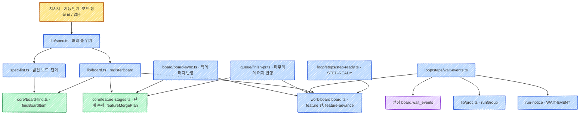

# 기능 단위 보드 항목 기술 설계

스펙: [spec.md](spec.md)

보드 항목이 기능 하나의 단계를 끝까지 따라가게 하고, 띄울 때 항목을 찾지 못하면 막고, 사건으로 대기를 푼다.
기존 장치(`[ask]` 단계 알림, 시각 대기, 지시서 검사 `spec-lint`, 보드 잠금)를 재사용한다. 새 상태는 만들지 않는다.

## 요구사항 연결

| ID | 해결 방법 |
| --- | --- |
| REQ1 | 보드 항목에 새 칸 `feature`(기능 폴더 경로)와 `feature-repo`(그 폴더가 있는 주 checkout 실경로)를 둔다. 기능 항목인지는 `core/feature-stages.ts` 의 `isFeatureItem` 이 정한다. 두레이 업무는 기존 `task-ref` 칸을 그대로 쓴다. 띄우기(`lib/board.ts` 의 `registerBoard`)가 지시서의 루프 줄 스펙 경로에서 폴더를 읽어 채운다. 기능이 아닌 일은 지금 경로 그대로다 |
| REQ2 | 지시서 머리의 `기능 단계:` 줄이 그 PR 이 맡는 단계를 정하고, 띄우기가 단계마다 `N. 기능 <단계>` 줄을 쓰고 그 번호들을 worker 줄의 새 칸 `feature-steps` 에 남긴다. PR 머지를 반영하는 두 경로(`board/board-sync.ts`, `queue/finish-pr.ts`)가 같은 core 함수 `featureMergePlan` 으로 그 줄들만 끝내고, 마지막 단계가 아니면 done 대신 `[ask] 기능 <다음 단계>` 줄을 더한다. 쓰기는 새 보드 명령 `feature-advance` 한 번이다. `[ask]` 줄은 기존 `STEP-READY` 알림이 코디네이터에게 알린다 |
| REQ3 | 항목 찾기 규칙을 순수 함수 `core/board-find.ts` 의 `findBoardItem` 하나로 모은다. `spec-lint` 의 새 발견 `보드` 가 워크트리를 만들기 전에 이 함수로 찾고, 못 찾으면 막는다. `registerBoard` 도 같은 함수로 붙일 항목을 정한다. 기능 폴더가 다른 항목은 어느 단계에서도 후보가 아니다. `보드 항목 없음: <이유>` 줄은 `lib/spec.ts` 가 읽는다 |
| REQ4 | 대기 줄의 조건을 `[wait: 사건 <이름>]` 꼴로 쓰면 사건 대기다. 설정 `board.wait_events` 가 사건 이름마다 확인 명령과 시간 상한을 둔다. 새 루프 단계 `loop/steps/wait-events.ts` 가 느린 틱마다 자기 저장소가 맡은 항목의 줄만 확인한다. 명령은 그룹 종료를 보장하는 새 실행 함수로 돈다. 종료 코드 0 이면 그 줄을 끝내고 `WAIT-EVENT` 를 알리고, 실패 알림은 보드별 기록으로 한 번만 보낸다 |
| REQ5 | 보드 파일을 흉내 내는 기존 테스트 틀(`skills/orch/tests/board-sync.spec.ts`, `board-attach.spec.ts`, `spec-lint` 테스트, `finish-pr` 테스트)에 경우를 더한다. 사건 대기는 가짜 명령 스크립트로 본다. 아래 「검증 전략」 |

## 책임과 경계



| 모듈 | 소유하는 것 | 바뀌는 점 |
| --- | --- | --- |
| `modules/work-board/item.ts`, `extensions/work-board/bin/board.ts` | 항목 칸 목록과 쓰기 | `FIELDS` 에 `feature`, `feature-repo` 를 더한다. worker 줄에 `feature-steps` 칸, 새 명령 `feature-advance` 를 더한다. 창은 그리지 않는다 |
| `lib/spec.ts` | 지시서 머리 줄 판독 | `featureStagesOf`(`기능 단계:`), `boardNoneOf`(`보드 항목 없음:`), 루프 줄의 스펙 경로에서 기능 폴더 읽기 |
| 새 `core/feature-stages.ts` | 기능 단계 순서, 다음 단계, 머지 반영 계획 | 순수 함수. 파일과 프로세스를 읽지 않는다 |
| 새 `core/board-find.ts` | 지시서에 id 가 없을 때 붙일 항목 고르기 | 순수 함수. `registerBoard` 와 `spec-lint` 가 같이 쓴다 |
| `spec/spec-lint.ts` | 띄우기 전 거부 | 발견 `보드`(항목 못 찾음, 기능 폴더 불일치, 보드의 대기 단계와 불일치), `단계`(`기능 단계:` 꼴) |
| `lib/board.ts` | 띄울 때 항목 만들기와 붙이기 | 기능 항목이면 단계 줄과 `feature-steps` 를 쓰고, 찾기는 `findBoardItem` 에 맡긴다 |
| `board/board-sync.ts`, `queue/finish-pr.ts` | PR 머지 반영 | 기능 항목이면 마일스톤 규칙 대신 `featureMergePlan` 을 쓴다 |
| `lib/proc.ts` | 자식 프로세스 실행 | 그룹이 끝날 때까지 기다리고 결과 종류를 돌려주는 `runGroup` 을 더한다 |
| 새 `loop/steps/wait-events.ts`, 새 `lib/wait-events.ts`, `loop/orch-loop.ts` | 사건 확인 명령 실행과 알림 기록 | 느린 틱에 보드 맞추기 뒤에 돈다. `orch-loop.ts` 의 느린 틱 목록에 단계를 넣는다 |
| `core/config-schema.ts`, `core/config.ts` | 설정 검사 | `BOARD_KEYS` 에 `wait_events` 를 더하고 값을 검사한다 |

의존 방향은 지금과 같다. core 는 lib 와 파일을 읽지 않고, 보드 쓰기는 모두 `board.ts` 명령에 맡긴다.

## 인터페이스와 데이터

### 기능 폴더 칸과 기능 항목 판단

- `feature`: 저장소 루트 기준 기능 폴더 경로(`docs/features/board-feature-items`). 끝 `/` 와 `spec.md` 는 떼고 저장한다.
- `feature-repo`: 그 폴더가 있는 저장소의 주 checkout 실경로. 여러 저장소가 보드 하나를 함께 쓰면 같은 상대 경로가 생길 수 있어 둘을 짝으로 비교한다. 기능 폴더가 같다는 것은 두 칸이 모두 같다는 뜻이다.
- 값을 채우는 곳: `registerBoard` 가 지시서 `## 할 일` 첫 줄 `루프를 쓴다(스펙: <경로>)` 의 경로에서 `dirname` 을 구한다. 절대경로면 저장소 루트 기준으로 바꾸고, 루트 밖이면 채우지 않는다. 빈 칸만 채운다. 이미 다른 기능이 적힌 항목은 띄우기 전에 `spec-lint` 가 막아 여기까지 오지 않는다(「띄울 때 항목 찾기」).
- `루프를 쓴다(스펙: 새로 쓴다)` 는 폴더를 아직 모른다. 이때는 칸을 비우고 단계 줄로 기능 항목임을 표시한다. spec 단계 PR 의 머지를 반영할 때 `featureMergePlan` 이 그 PR 이 더한 `docs/features/<기능>/spec.md` 하나로 칸을 채운다. 파일 목록은 부르는 쪽이 `gh pr view --json files` 로 읽어 넘긴다. 둘 이상이거나 없으면 채우지 않고 `BOARD <id> feature-unknown` 한 줄을 낸다.
- 기능 항목: `feature` 칸이 비지 않았거나, 단계 줄 가운데 `기능 <단계>` 꼴이 있는 항목이다.
- 기존 칸 재사용을 하지 않은 이유: `task` 는 업무 주소, `task-ref` 는 업무 번호로 창과 업무 연동이 이미 뜻을 정해 쓴다. 기능 폴더를 넣으면 두레이 업무가 있는 기능에서 둘이 부딪친다. `branch`, `worktree` 는 단계마다 바뀐다.

### 기능 단계

순서는 [feature-loop](../../../skills/orch/references/feature-loop.md) 와 같다. `spec` → `technical-design` → `implementation` → `verify` → `docs-consolidate`. 스펙의 「plan·implementation」 은 한 PR 이라 단계 이름은 `implementation` 하나로 둔다.

지시서 머리(첫 `## ` 앞) 줄:

```text
기능 단계: technical-design
기능 단계: implementation 2/3
기능 단계: implementation 3/3 verify docs-consolidate
```

- 첫 낱말들이 그 PR 이 맡는 단계다. 순서대로, 건너뛰지 않고 적는다. `implementation` 만 `k/n` 을 붙여 몇 번째 구현 PR 인지 적고, 없으면 `1/1` 이다.
- `spec-lint` 의 발견 `단계`: `## 할 일` 첫 줄이 `루프를 쓴다(...)` 인데 `기능 단계:` 줄이 없거나, 모르는 단계 이름, 거꾸로 된 순서, `k > n` 이면 막는다. `루프 없이:`, `리뷰 PR:`, `중간 과정:` 지시서는 보지 않는다. 보드와 대조하는 시작 단계 규칙은 「띄울 때 항목 찾기」 에 있다.
- 단계 줄: 띄우기가 맡은 단계마다 `N. 기능 <단계>` 줄을 쓴다(`implementation` 은 `기능 implementation 2/3`). 시작 단계와 같은 `[ask] 기능 <단계>` 줄이 이미 있으면 새로 더하지 않고 그 줄의 `[ask]` 를 지운다. 기능 항목에는 기본 마일스톤(`[pr] PR`, `[merge] 머지`)과 항목 `stages` 칸을 만들지 않는다.
- PR 이 맡은 줄 기록: `worker-add --feature-steps 3,4` 로 그 worker 줄에 단계 줄 번호를 남긴다. 같은 워크트리를 다시 띄우면(재시도, `--resume-remote`) 기존 값을 그대로 둔다. 머지 반영은 PR 번호로 worker 줄(`pr`)을 찾아 이 번호들만 끝낸다. 번호 범위가 아니라 목록이라, 앞에 남은 다른 대기 줄이나 수동 줄을 끝내지 않는다. `clear-done` 은 `stages` 처럼 이 번호도 새 번호로 바꾼다.
- 다음 단계 계산(`nextFeatureStage(covered)`): 맡은 단계 가운데 마지막이 `implementation k/n` 이고 `k < n` 이면 `implementation k+1/n`, 그 밖에는 순서상 다음 단계다. `docs-consolidate` 를 맡았으면 다음이 없고 기능의 마지막 단계다.

### 단계 PR 머지 뒤

PR 머지는 두 경로가 반영한다. 마무리(`finish-pr`)가 돌고 있으면 보드 맞추기는 그 PR 을 넘기고, 마무리가 먼저 반영해 `merged-pr` 에 적으면 다음 틱도 다시 보지 않는다. 그래서 두 경로가 같은 core 함수를 부른다.

`featureMergePlan(item, steps, pr, files)` 는 아래를 돌려준다. 기능 항목이면 두 경로 모두 마일스톤 규칙(`mergedCommands`)과 업무 마지막 PR 판정으로 항목 상태를 정하지 않는다.

1. PR 번호의 worker 줄에서 `feature-steps` 를 읽는다. 없으면(옛 항목, 띄우기를 거치지 않고 연결한 PR) 계획 없음을 돌려주고 부르는 쪽은 지금 규칙으로 반영한다.
2. 끝낼 줄: `feature-steps` 의 번호 가운데 끝나지 않은 줄.
3. 그 줄들의 `기능 <단계>` 로 `nextFeatureStage` 를 구한다. 다음 단계가 있으면 더할 줄 `[ask] 기능 <다음 단계>` 와 상태 `doing` 을 낸다. 같은 글의 줄이 이미 있으면 더하지 않는다. 없으면 상태 `done` 이고 worktree 칸을 비운다. 남은 수동 줄이 있으면 done 대신 doing 이다(지금의 마일스톤 규칙과 같다).
4. `merged-pr` 에 PR 을 더하고 `pr` 칸에서 뺀다. `feature` 칸이 비었으면 위 규칙으로 채운다.

쓰기는 새 보드 명령 한 번이다.

```text
board.ts feature-advance <id> --pr <N> --done 3,4 [--add "[ask] 기능 implementation 1/1"] --status doing|done [--feature <폴더> --feature-repo <경로>] --if-rev <지문>
```

- `worker-link` 처럼 한 잠금 안에서 읽고 한 번 저장한다. 줄 끝내기, 줄 더하기, 상태, `pr`·`merged-pr` 칸이 함께 저장되거나 함께 저장되지 않는다.
- `--if-rev` 는 부르는 쪽이 읽은 줄 지문이다. 다르면 저장하지 않고 다음 틱(마무리는 다음 재시도)에 다시 읽어 계획한다. `merged-pr` 에 PR 이 이미 있으면 할 일이 없다는 뜻이라 종료 코드 0 으로 아무것도 하지 않는다.

`[ask]` 줄이라 `board.auto_advance` 가 켜져 있으면 다음 틱의 `STEP-READY <id> ask 기능 <다음 단계>` 가 코디네이터에게 간다. 꺼져 있으면 알림도 꺼진다. 사용자가 단계 알림을 끈 설정을 그대로 따른다. worker 는 띄우지 않는다(스펙 DECISION2).

마무리(`finish-pr`)의 업무 판정:

| 자리 | 기능 항목에서의 값 |
| --- | --- |
| `after-deploy` 이벤트의 `last_of_task` | 업무 마지막 PR 판정(`judgeLastPr`)이 참이고, 이 PR 로 기능의 마지막 단계가 끝날 때만 참이다. 설계 PR 머지로 두레이 업무 완료 명령이 돌지 않게 한다 |
| 요청 자동 완료(`completeRequest`) | 지금처럼 항목이 done 으로 닫혔을 때만 완료로 본다. 기능 항목은 마지막 단계 머지에서만 done 이 된다 |
| 배포 확인 | 지금과 같다. 단계 줄과 무관하다 |

### 띄울 때 항목 찾기

`findBoardItem(items, { worktree, branch, ref, feature })` 는 `{ item }`, `{ none: true }`, `{ many: id[] }`, `{ conflict: id }` 중 하나를 돌려준다. `feature` 는 `{ path, repo }` 짝이다. `decide`, `done` 항목은 보지 않는다.

먼저 후보를 좁힌다. 지시서가 기능 폴더를 가리키면, 다른 기능 폴더가 적힌 항목은 모든 단계에서 후보가 아니다. 칸이 빈 항목은 후보로 남는다. 그다음 순서대로 보고 앞에서 하나를 찾으면 멈춘다.

1. 같은 워크트리의 worker 줄이 있는 항목(지금 `current`)
2. 같은 워크트리나 브랜치의 항목(`worktree`, `branch` 칸과 worker 줄의 브랜치)
3. 같은 `task-ref` 의 항목, 그다음 `task-ref` 가 빈 항목 가운데 제목에 업무 번호가 든 항목(지금 `hasTask`)
4. 같은 기능 폴더의 항목

예를 들어 두레이 업무 하나에 기능 A 와 B 가 연결돼 있고 A 항목만 있으면, B 지시서는 3단계에서 A 를 찾지 않는다. A 는 다른 기능 폴더라 처음에 빠지고, B 는 `none` 으로 막혀 새 항목 id 를 적게 된다.
한 단계에서 둘 이상이면 가장 최근 `stepAt` 을 고르던 지금 규칙을 1, 2 단계에만 남긴다. 3, 4 단계에서 둘 이상이면 `many` 다. 업무와 기능은 같은 값의 항목이 둘이면 잘못 만든 것이라 고르지 않는다.

지시서 머리 줄과 동작:

| 지시서 | spec-lint `보드` | registerBoard |
| --- | --- | --- |
| `보드 항목 id: <id>` | 그 항목에 다른 기능 폴더가 적혀 있으면 `conflict` 로 막는다. 없는 id 는 보지 않는다 | 지금과 같다(없으면 만들고, done 이면 다시 연다) |
| `보드 항목: 새로` | 보지 않는다 | 지금과 같다 |
| `보드 항목 없음: <이유>` | 이유가 비면 막는다 | 항목을 만들지 않고 `null` 을 돌려준다 |
| 셋 다 없음 | `findBoardItem` 이 `item` 이 아니면 막는다 | `findBoardItem` 의 항목에 붙는다 |

이 규칙은 루프를 쓰지 않는 일에도 같다. `루프 없이:` 인 버그 수정은 `보드 항목 id:` 로 새 항목을 만들 수 있고, id 없이 붙일 항목도 없으면 `보드` 발견으로 막힌다.

시작 단계와 보드 대조(발견 `보드`): 찾거나 지정한 항목이 기능 항목이면 `기능 단계:` 의 첫 단계를 보드와 맞춘다.

| 보드의 항목 | 허용하는 첫 단계 |
| --- | --- |
| 끝나지 않은 `[ask] 기능 <X>` 줄이 있다 | `X` 하나. `implementation` 은 차수 `k/n` 까지 같아야 한다 |
| 기능 단계 줄이 없다(새 항목, 기능이 아닌 일로 만든 항목) | `루프를 쓴다(스펙: 새로 쓴다)` 면 `spec`. 확인된 스펙이면 `technical-design`, 그 기능 폴더에 `design.md` 가 시작 브랜치에 있으면 `implementation 1/n` 도 받는다 |
| 기능 단계 줄이 모두 끝났고 `[ask]` 줄이 없다 | 막는다. 코디네이터가 단계 줄을 정리하거나 `보드 항목 id:` 로 다른 항목을 고른다 |

거부 문구(`spec-lint` 한 줄):

```text
<지시서>:<줄>: 보드: 붙일 보드 항목을 찾지 못했다(브랜치 <b>, 업무 <ref 또는 없음>, 기능 폴더 <f 또는 없음>). 지시서 머리에 `보드 항목 id: <id>` 나 `보드 항목 없음: <이유>` 를 적는다
<지시서>:<줄>: 보드: 붙일 보드 항목이 둘 이상이다(<id>, <id>). 지시서 머리에 `보드 항목 id: <id>` 를 적는다
<지시서>:<줄>: 보드: 항목 <id> 는 다른 기능 폴더 <f> 를 따라간다. 이 기능의 항목 id 를 적는다
<지시서>:<줄>: 보드: 항목 <id> 의 다음 단계는 <X> 인데 지시서는 <Y> 부터 시작한다
```

- 종료 코드: 다른 막음 발견과 같이 `spec-lint` 는 1 로 끝나고, `launch-worker` 가 이를 받아 띄우기를 멈추고 종료 코드 5 로 끝난다. `spec-lint` 가 5 를 직접 내면 `launch-worker` 는 검사 실패로 보고 경고만 낸 뒤 띄우므로, 새 발견도 1 을 쓴다.
- 보드 파일이 없는 저장소, `리뷰 PR:` 와 `중간 과정:` 지시서(지금의 자체 찾기 규칙이 있다), `--active` 지시서는 보지 않는다.
- 브랜치는 지시서의 `브랜치:` 줄(`branchesOf`)에서 읽는다. `--worktree` 로 이어 띄우면 그 워크트리를 워크트리 값으로 준다.
- 다른 발견처럼 `--lint-ack "<이유>"` 로 넘길 수 있다. 그때 `registerBoard` 는 지금처럼 워크트리 이름으로 항목을 만든다.
- `보드 항목 없음:` 은 첫 `## ` 앞 머리에서만 읽는다(`보드 항목: 새로` 와 같은 범위).

### 사건 대기

- 줄 꼴: `[wait: 사건 <이름>]`. 이름은 `[a-z0-9][a-z0-9-]*` 이고 32자 안이다. 보드의 기다림 줄 규칙(40자 안, 쉼표·마침표·화살표 없음)을 그대로 지킨다. 판독은 `core/step-ready.ts` 의 `waitTimeMs` 옆에 `waitEventOf(condition)` 로 둔다.
- 설정(`<orch 루트>/config.json`):

```json
{ "board": { "wait_events": { "dev-eval": { "command": "node scripts/dev-eval-done.ts", "timeout_sec": 60 } } } }
```

  - `command`: 비지 않은 문자열. 주 checkout 에서 `sh -c` 로 돈다. 종료 코드 0 이 「끝났다」, 1 이 「아직」 이다.
  - `timeout_sec`: 1 이상 600 이하의 정수. 기본 60.
  - 이름 규칙이 틀리거나 다른 키가 있으면 설정 오류다. 판정은 `core/config-schema.ts` 가 소유하고 설명은 [overlay.md](../../../skills/orch/references/overlay.md) 「마무리 설정 파일」 표와 [data-schema.md](../../data-schema.md) 의 `board` 행이 갖는다.
- 확인할 저장소: 줄마다 한 루프만 확인한다. 항목을 띄운 저장소(`lib/board.ts` 의 `boardOwnership`, 띄우기 이력의 dispatch 로 정한다)가 맡는다. 띄운 저장소가 없는 항목(보드 명령으로 직접 만든 항목)은 보드 파일이 든 저장소가 맡는다. 홈 보드(`~/.orch/board.json`)처럼 그것도 없으면 아무도 확인하지 않고 「확인할 저장소 없음」 실패로 한 번 알린다. 다른 루프는 그 줄을 건너뛴다. 명령은 맡은 저장소의 설정에서만 찾는다.
- 루프 단계: 느린 틱에 보드 맞추기(`syncBoard`) 뒤에 돈다. 시각 대기가 같은 틱의 `board-sync` 에서 풀리므로 보드를 같은 주기로 본다. 맡은 줄 가운데 사건 대기 줄을 모두 모으고, 같은 이름은 한 번만 돌린다. 이름들은 동시에 돌린다.
- 실행(`lib/proc.ts` 의 새 `runGroup`): 새 프로세스 그룹으로 띄운다. 시간 상한이 지나면 그룹에 TERM, 유예(`killGraceMs`) 뒤 KILL 을 보내고, 그룹이 사라질 때까지 확인한 뒤 돌아온다. 결과는 종료 코드 숫자가 아니라 종류로 돌려준다.

| 결과 종류 | 뜻 |
| --- | --- |
| `exit` | 셸이 스스로 끝났다. 코드를 함께 준다 |
| `timeout` | 시간 상한으로 끝냈다 |
| `overflow` | 출력 한도를 넘어 끝냈다 |
| `spawn` | 띄우지 못했다 |
| `orphan` | KILL 뒤에도 그룹에 프로세스가 남았다 |

  지금의 `runAsync` 는 셸이 끝나면 돌아와 TERM 을 무시한 하위 프로세스가 남고, 출력 한도 초과도 코드 1 로 돌려줘 「아직」 과 구분되지 않는다. `runGroup` 은 이 둘을 막으려고 따로 둔다.
- 남은 시간: 틱은 느린 틱 상한(`loop/lifecycle.ts` 의 `slowTickLimitMs`, 환경 변수로 줄일 수 있다)이 끝나는 시각을 단계에 넘긴다. 명령마다 `min(timeout_sec, 남은 시간 - 30초)` 를 상한으로 쓴다. 30초는 KILL 유예와 줄 끝내기, 알림 전송 몫이다. 남은 시간이 40초보다 적으면 이번 틱에는 돌리지 않고 다음 느린 틱으로 넘긴다. 이것은 실패로 알리지 않는다.
- 결과:

| 결과 | 줄 | 알림 |
| --- | --- | --- |
| `exit` 0 | `board.ts step <id> <번호>` 로 그 줄만 끝낸다. 항목 상태는 그대로다(시각 대기와 같다) | `WAIT-EVENT <id> <번호> <이름>` 을 주 Run 에 보낸다 |
| `exit` 1 | 그대로 | 없음 |
| 설정에 이름이 없음, 확인할 저장소 없음, `exit` 의 다른 코드, `timeout`, `overflow`, `spawn`, `orphan` | 그대로 | `WAIT-EVENT-ERROR <id> <번호> <이름>: <종류와 이유 한 줄>` 을 한 번 |

- 한 번 알림 기록: `<머신 폴더>/wait-events.json` 의 `{ boards: { <보드 실경로>: { "<id>#<줄 글>": "<이유 종류>" } } }`. 같은 보드를 여러 저장소의 루프가 보는 경우를 다음 단계 알림 기록(`lib/step-ready.ts`)처럼 잠금 하나로 묶는다. 줄이 끝나거나 글이 바뀌면 기록을 지워 다시 생기면 다시 알린다. 같은 줄에서 이유 종류가 바뀌면(시간 초과에서 명령 없음) 다시 알린다.
- `board.auto_advance: false` 와 무관하게 돈다. 시각 대기와 같다.

## 실패와 일관성

- 기능 항목의 머지 반영은 `feature-advance` 한 번으로 저장한다. 보드 잠금([ADR-029](../../adr/029-board-write-lock.md)) 안에서 `--if-rev` 를 확인하므로, 단계 완료와 `merged-pr` 기록 가운데 하나만 저장돼 다음 틱이 그 PR 을 다시 보지 않는 경우가 생기지 않는다. 지문이 바뀌어 저장하지 않으면 `merged-pr` 에도 적히지 않아 다음 반영 때 다시 계획한다.
- 마무리와 보드 맞추기가 같은 PR 을 반영하는 순서는 두 가지다. 마무리가 돌고 있으면 보드 맞추기는 지금처럼 넘긴다. 어느 쪽이 먼저 저장하든 뒤에 오는 쪽은 `merged-pr` 에 그 PR 이 있어 아무것도 하지 않는다.
- 사건 명령 실패는 대기를 풀지 않는다. 줄을 끝냈는데 알림 전송이 실패하면 오류 줄(`wait-events@<주 Run>`)에 남기고 다시 보내지 않는다. 줄이 이미 끝나 있어 대기는 풀린 상태다.
- 옛 보드와의 호환:
  - `feature` 칸, `기능 <단계>` 줄, `feature-steps` 가 없는 항목은 지금 규칙 그대로다. 기존 항목을 한꺼번에 옮기지 않는다.
  - 진행 중인 기능을 옮기려면 코디네이터가 `board.ts set <id> --feature <폴더> --feature-repo <경로>` 를 쓰고, 다음 지시서부터 `기능 단계:` 를 적는다. 그 전의 마일스톤 줄은 남겨 둔다.
  - 이미 떠 있는 worker 의 지시서(`--active`)는 `보드`, `단계` 발견을 보지 않는다. `--resume-remote` 와 재시도는 지시서 브랜치에 이미 항목이 있어 2단계에서 찾는다.
  - 옛 번들의 설정 검사기는 `board.wait_events` 를 모르는 키로 읽어 설정 오류를 낸다. [overlay.md](../../../skills/orch/references/overlay.md) 「업무 도구 설정」 처럼 새 번들을 설치하고 루프를 다시 띄운 뒤에 넣으라고 적는다.
  - 옛 `board.ts` 는 `feature-advance` 를 모른다. orch 와 work-board 는 같은 플러그인 번들로 함께 갱신되므로 따로 맞출 것이 없다.

### 진행 중인 버그 수정과 겹치는 곳

같은 요청의 버그 수정 브랜치 `fix/board-r39-bugs` 가 같은 자리를 고친다.

| 자리 | 그 브랜치의 변경 | 이 설계와의 관계 |
| --- | --- | --- |
| `lib/board.ts` 의 `milestones()` | `커밋·PR 없음` 지시서면 단계를 `보고 받기(worker_done)` 하나로 만든다 | 기능 단계 분기도 같은 함수에 든다. 기능 단계 줄이 먼저고, `PR 없음` 지시서는 기능 단계에 쓰지 않는다(루프 단계는 PR 을 낸다) |
| `board/board-sync.ts` 의 분기 순서 | 리뷰 분기 다음, 사건 꼬리표 분기 앞에 「보고 받기」 분기를 둔다 | 기능 분기는 PR 머지 반영 안이라 그 분기와 겹치지 않는다. PR 1 은 그 브랜치가 머지된 main 위에서 시작한다 |

## 검증 전략

| ID | 경계 | 확인 |
| --- | --- | --- |
| REQ1 | `board-attach.spec.ts`(가짜 보드와 `registerBoard`) | 루프 줄 스펙 경로로 `feature`, `feature-repo` 칸이 채워진다. 기능이 아닌 지시서는 칸이 비고 지금의 마일스톤 줄이 생긴다 |
| REQ2 | `board-sync.spec.ts`(가짜 gh 와 보드) | 「`기능 technical-design` 단계 PR 머지 → 항목 doing, `[ask] 기능 implementation 1/1` 줄이 생긴다」. `implementation 2/3` 머지 뒤 `3/3` 줄, `docs-consolidate` 머지 뒤 done. 같은 틱을 두 번 돌려도 줄이 하나다 |
| REQ2 | `board-sync.spec.ts` | `implementation 1/2 verify` 를 맡은 중간 PR 의 머지는 그 두 줄만 끝내고, 앞에 남은 `[wait]` 줄과 수동 줄은 남긴다 |
| REQ2 | `finish-pr` 테스트 | 마무리가 먼저 돈 경우에도 같은 결과다. 그 뒤 `board-sync` 는 아무것도 하지 않는다. 설계 PR 의 `after-deploy` 입력 `last_of_task` 가 거짓이다 |
| REQ2 | `board.spec.ts`(work-board) | `feature-advance` 가 `--if-rev` 가 다르면 아무것도 저장하지 않고, 같으면 줄, 상태, `merged-pr` 를 한 번에 저장한다 |
| REQ2 | `core/feature-stages.ts` 단위 테스트 | 다음 단계 계산, `featureMergePlan`, `기능 단계:` 판독의 경계값 |
| REQ3 | `spec-lint` 테스트, `findBoardItem` 단위 테스트 | 순서 1–4 의 각 경우, `many`, `none`, `conflict`, 같은 업무의 다른 기능 항목을 고르지 않음, 같은 상대 경로의 다른 저장소 항목을 고르지 않음, `보드 항목 없음:` 빈 이유, 보드 파일 없음, 리뷰·중간 과정 지시서 제외, 거부 문구 형식, 막을 때 종료 코드 1 |
| REQ3 | `spec-lint` 테스트 | 보드의 `[ask] 기능 technical-design` 항목에 `기능 단계: implementation 1/1` 지시서를 막는다. 새 항목의 시작 단계 규칙 |
| REQ3 | `launch-worker` 테스트 | `루프 없이:` 버그 수정이 `보드 항목 id:` 로 새 항목을 만든다. id 도 붙일 항목도 없으면 종료 코드 5 로 멈추고 워크트리를 만들지 않는다 |
| REQ4 | `wait-events` 단계 테스트(가짜 명령 스크립트, 가짜 보드, 가짜 알림) | 0 이면 줄이 끝나고 알림 하나, 1 이면 그대로, 명령 없음·시간 초과·출력 초과는 알림 한 번이고 두 번째 틱엔 없음. 다른 저장소가 띄운 항목의 줄은 돌리지 않는다. 남은 시간이 모자라면 돌리지 않는다. 설정 검사 테스트 |
| REQ4 | `proc` 테스트 | TERM 을 무시하는 하위 프로세스를 남기는 명령이 `timeout` 으로 끝나고 돌아온 뒤 그룹에 프로세스가 없다. 출력 한도 초과가 `overflow` 다 |
| REQ5 | 위 테스트 모두 `claude plugin test .` 에서 돈다 | 실제 보드와 gh 는 쓰지 않는다 |

## 도메인 규칙

| 바뀐 규칙 | 적용 자리 | 값의 원본 |
| --- | --- | --- |
| 보드 항목은 기능 하나의 진행이다. 기능이 아닌 일은 지금 뜻 그대로다 | `core/feature-stages.ts`, `lib/board.ts`, `board/board-sync.ts`, `queue/finish-pr.ts` | [ADR-039](../../adr/039-board-item-per-feature.md), [board.md](../../../skills/orch/references/board.md) 의 새 「기능 항목」 절 |
| 지시서 머리 줄 `기능 단계:`, `보드 항목 없음:` | `lib/spec.ts`, `spec-lint.ts` | [spec-writing.md](../../../skills/orch/references/spec-writing.md), `spec-lint.ts` 머리 주석 |
| 사건 대기와 확인 명령 | `lib/wait-events.ts`, 설정 검사 | [board.md](../../../skills/orch/references/board.md) 「자동 진행 표시」, [overlay.md](../../../skills/orch/references/overlay.md) |
| 단계 머지 뒤 다음 단계 알림 | `[ask]` 줄과 `STEP-READY` | [feature-loop.md](../../../skills/orch/references/feature-loop.md) 「전이」 |

## PR 분해

| 순서 | PR | 요구사항 | 고치는 곳 | 의존 |
| --- | --- | --- | --- | --- |
| 1 | 항목 단위와 다음 단계 줄 | REQ1, REQ2, REQ5 | work-board 칸과 `feature-advance`, `lib/spec.ts` 의 `기능 단계:`, `core/feature-stages.ts`, `registerBoard` 의 단계 줄, `board-sync` 와 `finish-pr` 의 기능 분기, `spec-lint` 의 `단계`, board.md 「기능 항목」 절, spec-writing.md, feature-loop.md, [ADR-039](../../adr/039-board-item-per-feature.md) | `fix/board-r39-bugs` 머지 뒤 |
| 2 | 띄울 때 항목 찾기 | REQ3, REQ5 | `core/board-find.ts`, `spec-lint` 의 `보드`(시작 단계 대조 포함), `registerBoard` 의 찾기, `보드 항목 없음:`, launch.md, spec-writing.md | PR 1(`feature` 칸, 단계 줄) |
| 3 | 사건 대기 | REQ4, REQ5 | `waitEventOf`, `lib/proc.ts` 의 `runGroup`, `lib/wait-events.ts`, `loop/steps/wait-events.ts`, `loop/orch-loop.ts` 의 느린 틱 목록, 설정 검사, overlay.md, data-schema.md, board.md 「자동 진행 표시」 절 | 없음. PR 1, 2 와 병행할 수 있다 |

공유 문서 `board.md` 는 PR 1 이 「기능 항목」 절을, PR 3 이 「자동 진행 표시」 절의 사건 대기 부분을 맡는다. spec-writing.md 는 PR 1 이 `기능 단계:` 를, PR 2 가 `보드 항목 없음:` 을 쓴다. 먼저 머지된 쪽 위에서 뒤 PR 이 main 을 합친다.

## 결정

| 결정 | 종류 | ADR 또는 필요 없음의 이유 | 현재 규칙의 원본 |
| --- | --- | --- | --- |
| 보드 항목을 기능 하나의 진행으로 본다 | domain-policy | [ADR-039](../../adr/039-board-item-per-feature.md). 여러 스킬(orch, work-board, feature-loop)이 따르고 [ADR-018](../../adr/018-board-milestone-steps.md) 의 done 지점과 맞물린다 | board.md 「기능 항목」 |

| ID | 결정 | 답 | 누가 | 근거 |
| --- | --- | --- | --- | --- |
| DECISION1 | 기능 폴더를 둘 칸 | 새 칸 `feature` 와 `feature-repo`. `task`, `task-ref` 는 재사용하지 않는다 | 작성자 | 두 칸은 업무 연동이 뜻을 정해 쓰고 있어, 업무가 있는 기능에서 값이 부딪친다. 공유 보드에서는 상대 경로만으로 기능을 구분하지 못한다 |
| DECISION2 | PR 이 맡는 단계를 아는 법 | 지시서 머리 `기능 단계:` 줄과, 띄울 때 worker 줄에 남기는 단계 줄 번호 목록 | 작성자 | 구현 PR 이 여럿이면 산출물만으로는 몇 번째 PR 인지 알 수 없다. 번호 범위로 끝내면 앞에 남은 다른 줄까지 끝낸다 |
| DECISION3 | 다음 단계 알림 | 다음 단계 줄을 `[ask]` 로 더해 기존 `STEP-READY` 로 알린다 | 작성자 | 알림 기록, 한 번만 보내기, 보드 공유가 이미 있다. 새 알림 종류를 만들지 않는다 |
| DECISION4 | 항목 찾기 거부를 하는 곳 | `spec-lint` 의 발견 `보드`. 검사기는 1, 띄우기는 5 로 끝난다 | 작성자 | 스펙 DECISION3 「지시서 검사의 다른 줄과 같은 방식」. 워크트리를 만들기 전에 막는다 |
| DECISION5 | 업무·기능으로 찾은 항목이 둘 이상일 때 | 고르지 않고 거부한다 | 작성자 | 같은 업무나 기능의 열린 항목이 둘이면 이미 잘못 만든 것이라 최근 것을 고르면 엇갈린 항목에 붙는다 |
| DECISION6 | 사건 대기 확인 주기 | 느린 틱, 보드 맞추기 뒤 | 작성자 | 시각 대기가 같은 틱에 풀린다. 외부 명령을 빠른 틱마다 돌리지 않는다 |
| DECISION7 | 사건 명령 결과의 뜻 | 셸이 스스로 끝난 0 은 끝남, 1 은 아직, 그 밖의 코드와 시간 초과, 출력 초과, 실행 실패, 남은 프로세스는 실패 | 작성자 | 스펙의 「실패하면 오류를 한 번 알린다」 와 「아직」 을 나눠야 매 틱 오류가 나지 않는다. 숫자만 보면 출력 초과가 「아직」 으로 읽힌다 |
| DECISION8 | 사건으로 대기가 풀린 뒤 항목 상태 | 그 줄만 끝내고 상태는 그대로 둔다 | 작성자 | 시각 대기와 같은 규칙이다. 다음 일은 알림을 받은 코디네이터가 정한다 |
| DECISION9 | 두 머지 반영 경로 | `board-sync` 와 `finish-pr` 가 같은 `featureMergePlan` 과 `feature-advance` 를 쓴다 | 작성자 | 마무리가 돌면 보드 맞추기는 그 PR 을 넘기고 다시 보지 않는다. 한쪽만 고치면 마무리를 거친 설계 PR 뒤에 다음 단계 줄이 생기지 않는다 |
| DECISION10 | 기능 항목의 업무 완료 | `after-deploy` 의 `last_of_task` 는 업무 마지막 PR 이면서 기능의 마지막 단계일 때만 참이다 | 작성자 | 두레이 업무는 기능 하나에 연결된다(스펙 DECISION1). 설계 PR 머지로 업무 완료 명령이 돌면 기능이 끝나기 전에 업무가 닫힌다 |
| DECISION11 | 공유 보드의 사건 대기를 확인하는 저장소 | 항목을 띄운 저장소, 없으면 보드 파일이 든 저장소 하나 | 작성자 | 저장소마다 같은 이름에 다른 명령을 둘 수 있다. 알림 기록의 잠금만으로는 어느 명령으로 확인할지 정해지지 않는다 |
