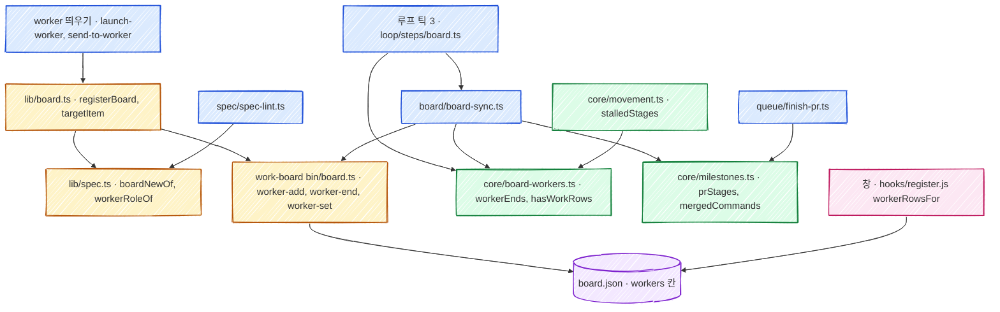

# 보드 항목 하위 worker 기술 설계

스펙: [spec.md](spec.md)

PR 은 둘이다(스펙 DECISION20). 계획은 PR1 [tasks/attach-workers/](tasks/attach-workers/index.json), PR2 [tasks/multi-pr-window/](tasks/multi-pr-window/index.json) 이다.
장기 결정은 [ADR-033](../../adr/033-board-item-worker-rows.md) 이 소유한다.

## 요구사항 연결

| ID | 해결 방법 |
| --- | --- |
| REQ1 | 보드 항목에 `workers` 필드(worker 줄 목록)를 둔다. 줄을 쓰는 명령은 보드 명령 `extensions/work-board/bin/board.ts` 의 새 `worker-add`, `worker-end` 다. 대표 칸(`worktree`·`branch`)은 두 명령이 같은 잠금 안에서 고친다(「대표 칸」, 「보드 명령」). `workers` 필드가 없는 옛 항목은 지금 읽는 그대로 읽는다. PR1 |
| REQ2 | `skills/orch/scripts/lib/board.ts` 의 `registerBoard` 가 역할을 먼저 정한다(「역할 정하기」). 리뷰·검증이면 새 함수 `targetItem` 이 대상 항목을 고르고 `worker-add` 만 부른다. 상태·단계·대표 칸은 고치지 않는다. 못 찾으면 지금처럼 새 항목을 만든다. PR1 |
| REQ3 | `registerBoard` 의 지금 찾기 순서(같은 워크트리·브랜치, 같은 업무 번호)로 기존 항목을 찾으면 `worker-add` 로 후속 줄을 더한다. 원래 줄은 그대로 둔다. `registerBoard` 가 붙인 결과를 돌려주고 `launch-worker.ts` 가 `BOARD-ATTACH <항목> <역할>` 을 낸다. PR1 |
| REQ4 | 새 브랜치의 후속 줄이 자기 사건 단계 묶음(`stages`)을 갖는다. 보드 맞추기가 PR 칸의 PR 마다 묶음을 골라 단계를 끝낸다(「PR 여럿이 열린 항목」). PR2 |
| REQ5 | `lib/spec.ts` 의 새 `boardNewOf` 가 `보드 항목: 새로` 줄을 읽는다. `registerBoard` 는 그 줄이 있으면 자동 붙이기를 건너뛴다. `spec/spec-lint.ts` 가 그 줄과 `보드 항목 id:` 가 함께 있으면 오류를 낸다. PR1 |
| REQ6 | 창(`extensions/work-board/hooks/register.js`)의 `workerFor` 를 줄 목록을 돌려주는 `workerRowsFor` 로 바꾸고, 접힌 보기와 펼친 보기의 그리기를 나눈다(「창」). PR2 |
| REQ7 | 줄 끝내기는 보드 맞추기(`board/board-sync.ts`)가 한다. 루프의 보드 단계(`loop/steps/board.ts`)가 worker_done 과 Orca 행에서 끝난 dispatch 를 모아 `--worker-ends` 로 넘기고, 사라진 워크트리는 보드 맞추기가 직접 본다(「루프가 넘기는 끝남」). 리뷰 항목 판정과 멈춘 단계 판정은 「리뷰 항목 판정」, 「대표 칸을 읽는 곳」 대로 바꾼다. 창의 몫은 PR2 다(스펙 DECISION23) |
| REQ8 | PR1: `docs/data-schema.md` 의 새 절, `skills/orch/references/board.md`, `skills/orch/references/spec-writing.md`, `skills/orch/templates/spec-review.md`, 새 `skills/orch/templates/spec-verify.md`, `board.ts` 머리 주석과 도움말. PR2: `extensions/work-board/references/behavior.md` 의 창 설명과 `board.md` 의 동시 PR 단락 |

## 책임과 경계



- **줄 목록과 대표 칸을 함께 쓰는 곳은 보드 명령 하나다.** 줄을 더하고 끝낼 때 대표 칸을 다시 정하는 규칙(스펙 DECISION8)은 `board.ts` 의 `worker-add`, `worker-end` 가 보드 잠금 안에서 함께 적용한다([ADR-029](../../adr/029-board-write-lock.md)). orch 가 줄을 읽고 대표를 계산해 `set --worktree` 로 따로 쓰면, 두 쓰기 사이에 다른 쓰기가 끼어 대표 칸이 줄 목록과 어긋난다. 새 항목을 만드는 `set` 과 항목을 닫거나 사라진 워크트리를 비우는 지금의 쓰기만 대표 칸을 따로 쓴다(「대표 칸」).
- **어느 항목에 어느 역할로 붙을지는 orch 가 정한다.** 지시서를 읽는 일은 `lib/spec.ts`, 항목 고르기는 `lib/board.ts` 의 `registerBoard` 가 맡는다. 보드 명령은 지시서를 모른다.
- **dispatch 가 끝났는지는 orch core 가 판정한다.** Orca 행의 꼴을 읽는 기존 판정(`core/lost-workers.ts` 의 `lostWorkers`)을 새 `core/board-workers.ts` 의 `workerEnds` 가 재사용한다. 보드 맞추기는 받은 결과로 `worker-end` 를 부르기만 한다. 값 판정과 외부 실행의 층 규칙은 [ADR-028](../../adr/028-orch-core-layer.md) 을 따른다.
- **창은 줄 목록을 읽기만 한다.** 끝남 판정은 보드 맞추기가 하고 창은 저장된 `status` 와 Orca 의 실시간 상태를 함께 그린다. 창이 따로 판정하면 루프와 창의 결과가 갈린다.
- **부모·자식 항목은 만들지 않는다(스펙 DECISION2).** 단계, 진행률, done 판정은 지금처럼 항목 하나가 갖는다.

## 인터페이스와 데이터

### worker 줄

`board.json` 항목의 `workers` 필드는 줄 객체의 목록이다. 필드가 없으면 옛 항목이다.

| 칸 | 값 | 뜻 |
| --- | --- | --- |
| `role` | `impl`, `follow`, `review`, `verify` | 구현, 후속, 리뷰, 검증. 창은 한국어로 그린다 |
| `dispatch` | dispatch id 문자열 또는 `null` | 끝남을 판정하는 열쇠. 옛 항목에서 옮겨 적었는데 띄우기 이력에서 dispatch 를 찾지 못한 줄만 `null` 이다 |
| `worktree` | 워크트리 이름 | 대표 칸과 같은 꼴(폴더 이름). 줄의 열쇠다 |
| `branch` | 브랜치 이름 또는 `null` | 띄우기가 넘긴 브랜치(`launch-worker` 는 워크트리의 실제 브랜치, `send-to-worker` 는 지시서의 `브랜치:` 값). 다시 띄울 때 값이 있으면 바꾼다 |
| `pr` | PR 번호(숫자) 또는 `null` | 리뷰·검증은 대상 PR, 구현·후속은 자기 PR. 구현·후속의 값은 PR2 의 보드 맞추기가 채운다 |
| `stages` | `pr=N,merge=M` 또는 없음 | PR2. 앞 PR 이 열린 채 새 브랜치로 붙은 후속 줄의 사건 단계 묶음 |
| `status` | `working`, `done`, `lost` | 작업 중, 끝남, 끊김(worker_done 없이 끝남) |
| `at` | ISO 8601 UTC | 더하거나 다시 띄운 시각. 「가장 최근」 은 이 값으로 정한다 |
| `endedAt` | ISO 8601 UTC 또는 `null` | 끝난 시각 |

줄의 열쇠는 `worktree` 하나다. 같은 워크트리로 다시 띄우면(재시도, 충돌 풀기, 원격 이어받기, `send-to-worker`) 그 줄의 `dispatch`, `at`, `status`(`working`)를 바꾸고 새 줄을 더하지 않는다(스펙 DECISION18). 워크트리 하나에는 worker 가 한 번에 하나라 브랜치까지 열쇠로 삼지 않는다. `send-to-worker` 는 브랜치를 지시서에서 읽어 `launch-worker` 와 값이 다를 수 있다. 역할은 처음 값을 둔다.
`workers` 필드 쓰기는 `stepAt` 과 줄 지문(`linesRev`, `details`·`next` 만 본다)을 바꾸지 않는다. 창의 「worker 없음」 경과 시간은 단계가 바뀐 때부터 재고, 보드 맞추기의 `--if-rev` 가드와 부딪히지 않는다.

### 대표 칸

- 대표 워크트리가 바뀌고 새 줄의 브랜치가 없으면 대표 브랜치 값을 지운다. 같은 워크트리 재시도에서는 기존 값을 둔다.
- 대표 칸(`worktree`·`branch`)은 가장 최근(`at`)의 작업 중 구현·후속 줄 값이다. 작업 중 구현·후속 줄이 없으면 마지막 값을 그대로 둔다(스펙 DECISION8).
- **리뷰만 하는 항목**(줄이 있고 모두 리뷰·검증 줄)은 예외다. 대상 항목을 못 찾아 리뷰 지시서로 새로 만든 항목은 지금처럼 리뷰 worker 를 대표 칸에 둔다(스펙 REQ2 「못 찾으면 지금처럼 새 항목을 만든다」). PR1 의 창이 지금처럼 그 worker 를 항목 아래 그리고, PR #487 의 닫기가 그대로 돈다.
- 대표 칸을 비우는 지금의 자리는 그대로 둔다. done 으로 바꿀 때의 `--worktree ''`(`core/milestones.ts` 의 `advanceCommands`, `board-sync.ts` 의 닫기 갈래들)와, 대표 워크트리가 사라지고 그 워크트리의 작업 중 줄이 없을 때의 비우기(`board-sync.ts` 325행)다. 「마지막 값을 둔다」 는 worker 줄이 끝날 때의 규칙이고, 항목이 끝나거나 워크트리가 사라진 뒤의 비우기를 막지 않는다.
- 대표 칸을 줄과 함께 고치는 쓰기는 보드 명령(`worker-add`, `worker-end`) 하나가 맡는다. `registerBoard` 가 기존 항목에 붙는 갈래(`중간 과정:`, 다시 열기, 기존 항목)의 `set` 에서는 `--worktree`·`--branch` 를 뺀다. 새 항목 갈래만 `set` 이 대표 칸을 쓰고, 이어 부르는 `worker-add` 가 같은 값을 쓴다.

### 보드 명령

```text
board.ts worker-add <id> <impl|follow|review|verify> --worktree W [--branch B] [--dispatch D] [--pr N] [--stages S] [--keep-current <role>] [--keep-dispatch D]
board.ts worker-end <id> <done|lost> (--dispatch D | --worktree W) [--clear]
board.ts worker-set <id> --worktree W [--pr N]        # PR2
```

- `worker-add` 는 워크트리 열쇠로 줄을 더하거나 바꾼다. 역할이 `impl`·`follow` 면 대표 칸을 그 줄 값으로 바꾼다. `review`·`verify` 는 대표 칸, `status`, 단계를 건드리지 않는다. done 항목에도 더한다(스펙 DECISION17).
- `--keep-current <role>` 은 `workers` 필드가 없는 옛 항목에 붙을 때 쓴다. 지금 대표 칸(`worktree`, `branch`)을 먼저 그 역할의 줄로 옮겨 적는다. `registerBoard` 가 역할을 정한다. 옛 판정(`lib/review.ts` 의 `reviewPrOfItem`)이 리뷰 항목이라고 하면 `review`, 아니면 `impl` 이다. 그래서 옛 리뷰 항목에 재리뷰가 붙어도 리뷰 항목으로 남아 PR #487 대로 닫힌다. `--keep-dispatch` 는 `registerBoard` 가 띄우기 이력(`lib/launch-history.ts`)에서 그 워크트리의 가장 최근 dispatch 를 찾아 넘긴 값이다. 찾지 못했으면 `null` 이다. dispatch 이력이 없거나 현재 조회 결과 끝났으면 `status` 를 `done` 으로 적는다. dispatch 없는 작업 중 줄은 워크트리를 지울 때까지 끝나지 않아 「worker 없음」 을 영영 가린다. 대표 워크트리가 비었으면 옛 대표 줄은 만들지 않는다. 옛 대표를 작업 중으로 옮기려면 이력의 워크트리가 남아 있고 해당 Run 의 Orca dispatch 가 현재 살아 있어야 한다. 끝난 상태이면 dispatch 를 넘기지 않아 끝난 줄로 남긴다. Orca 조회가 실패하거나 응답 형식을 읽지 못하면 이력의 dispatch 를 작업 중으로 옮겨 다음 동기화에서 다시 확인한다.
- `worker-end` 는 맞는 `working` 줄을 끝낸다. 끝난 줄이 대표였고 다른 `working` 구현·후속 줄이 있으면 그중 `at` 이 가장 늦은 줄로 대표 칸을 바꾼다. 없으면 대표 칸을 그대로 두고, `--clear` 를 줬으면 비운다. 보드 맞추기는 워크트리가 사라져 끝낼 때만 `--clear` 를 준다. 맞는 줄이 없으면 종료 코드 0 으로 아무것도 하지 않는다. 보드 맞추기가 같은 끝남을 다음 틱에 다시 보내도 된다.
- `worker-set` 은 PR2 에서 보드 맞추기가 구현·후속 줄의 `pr` 을 채울 때 쓴다. `status` 를 바꾸지 않아 끝난 줄을 되살리지 않는다.
- `item`, `items` 출력에 `workers` 를 넣는다. 사용법 오류는 종료 코드 2, 없는 항목은 1 이다.

### 역할 정하기

`registerBoard(repo, spec, worktree, name, branch, dispatch)` 는 아래 순서로 역할을 정한다(스펙 DECISION9). `dispatch` 인자를 더하고, 붙인 결과 `{ item, role, attached }`(보드를 쓰지 않았으면 `null`)를 돌려준다.

1. `worker 역할: 검증` 줄(`lib/spec.ts` 의 새 `workerRoleOf`) → `verify`
2. `리뷰 PR:` 줄(`lib/review.ts` 의 `reviewPrOfSpec`) → `review`
3. `중간 과정:` 줄 → `follow`. 지금처럼 PR·브랜치로 찾은 항목 하나에 `중간 과정:` 줄을 쓰고(대표 칸은 빼고), 그 앞에 `worker-add follow`(단계 묶음 없음)를 부른다
4. 기존 항목에 붙으면 `follow`, 새 항목이면 `impl`. 같은 워크트리로 다시 띄우면 그 줄의 역할을 둔다

기존 항목에 붙는 갈래는 `worker-add` 를 먼저 부르고 그 뒤 `set`(상태, 다시 열기의 단계, 업무 칸)을 부른다. `set` 은 대표 칸을 쓰지 않는다(「대표 칸」).

리뷰·검증의 대상 항목(`targetItem`)은 이 순서로 처음 찾은 것이다.

1. 같은 워크트리의 줄이 있는 항목(같은 줄로 다시 띄움)
2. `보드 항목 id:` 가 가리키는 항목(done 포함). 리뷰 줄로 붙고 항목을 닫지 않는다(스펙 DECISION15)
3. `리뷰 PR: #N` 이 있으면 `pr` 필드에 N 이 든 항목, 없으면 `merged-pr` 필드에 N 이 든 항목(done 포함, 스펙 DECISION10)
4. `리뷰 PR: #N` 이 있고 3 에서 못 찾았으면 PR N 의 head 브랜치(`gh pr view N --json headRefName` 한 번. 실패하면 건너뛴다)가 대표 칸이나 줄의 브랜치와 같은 열린 항목. 루프가 PR 을 항목에 잇기 전에 리뷰를 띄운 경우다
5. 검증이고 `리뷰 PR:` 이 없으면 같은 브랜치(대표 칸이나 줄), 그다음 같은 업무 번호의 열린 항목

후보가 둘 이상이면 `stepAt` 이 가장 늦은 항목을 고른다. 값이 같거나 없으면 파일에서 뒤에 있는 항목이다(스펙 DECISION10, 스펙 DECISION19). `stepAt` 은 상태와 단계가 바뀐 시각이라 「가장 최근에 바뀐」 은 이 뜻이다. `pr` 필드나 worker 줄 쓰기는 반영하지 않는다.
못 찾으면 지금처럼 새 항목을 만들고(대표 칸은 리뷰 worker) 그 항목에 `review`·`verify` 줄 하나를 둔다. 이 항목은 리뷰만 하는 항목이다(스펙 DECISION21).

`보드 항목: 새로` 줄(`boardNewOf`)이 있으면 2-5 와, 구현·후속 갈래의 같은 브랜치·같은 업무 번호 찾기를 하지 않는다. 같은 워크트리로 다시 띄운 경우만 지금처럼 그 항목을 잇는다. 스펙 DECISION6 의 「다시 띄워도 같은 결과」 를 지키려면 같은 지시서로 다시 띄울 때 항목이 또 생기면 안 되기 때문이다. id 는 `--name`, 워크트리 이름 순이다.

### 띄우기 출력

`launch-worker.ts` 는 `registerBoard` 가 `attached: true`(기존 항목에 새 줄을 더함)를 돌려주면 `BOARD-ATTACH <항목 id> <역할>` 한 줄을 낸다. 역할은 줄의 `role` 값(`follow`, `review`, `verify`)이다. 대문자 판정 줄이라 짧은 출력에서도 나간다. 새 항목과 같은 줄을 바꾼 경우에는 내지 않는다. `send-to-worker.ts` 는 같은 워크트리를 쓰므로 언제나 줄을 바꾸고 출력하지 않는다.

### 루프가 넘기는 끝남

`loop/steps/board.ts` 가 보드 맞추기에 `--worker-ends '{"<dispatch>":"done"|"lost"}'` 를 더한다. `core/board-workers.ts` 의 `workerEnds(rows, reported, watched)` 가 만든다. `watched` 는 보드의 작업 중 줄의 dispatch 다.

- `done`: worker_done 을 보낸 dispatch(`ctx.completions` 의 모든 메시지. 그 Run 의 worker_done 전부다. outcome 이 failed 여도 worker_done 을 보냈으니 끝남이다), 그리고 Orca 행의 `projection.outcome` 이 `succeeded` 인 dispatch
- `lost`: 그 밖에 끝난 dispatch. `dispatchStatus` 가 `failed`·`abandoned`·`completed` 거나, `workerState` 가 `abandoned`·`failed`·`stopped` 거나, `projection.outcome` 이 `cancelled`·`failed` 거나, `lostWorkers` 가 낸 dispatch(`terminal_missing`, `liveness_exited`)
- 행은 `rowsOf(run, ctx.lookup)` 로 이번 틱의 Run 마다 한 번 읽은 것을 쓴다. 읽지 못한 Run 의 dispatch 는 넣지 않는다. 오래 움직이지 않는 것은 끝남이 아니다(스펙 DECISION14)

보드 맞추기는 항목마다(done, goal 포함) `working` 줄 가운데 `dispatch` 가 이 목록에 있으면 그 값으로 `worker-end` 를 부른다. 워크트리 목록을 읽었고 줄의 `worktree` 가 목록에 없으면 `worker-end <id> lost --worktree W --clear` 를 부른다. 그 워크트리의 작업 중 줄이 있으면 325행의 `set --worktree ''` 는 내지 않는다. 줄 끝내기가 대표 칸을 다른 작업 중 줄로 바꾸거나 비운다. 틱 처음에 읽은 값으로 비우면 새 대표를 지운다. 줄 끝내기 명령은 그 항목의 다른 명령보다 앞에 둔다.

### 리뷰 항목 판정

core 의 `hasWorkRows`는 구현·후속 줄의 존재만 알려 준다. 항목의 생성 목적은 lib/review.ts 의 `reviewOriginsByItem`과 `isReviewItem`이 정하고 보드 동기화와 루프가 함께 쓴다([ADR-028](../../adr/028-orch-core-layer.md)).

- 항목 id 의 첫 띄우기 이력이 리뷰·검증 지시서인지를 본다. 구현 이력이나 구현·후속 줄, 구현 PR 칸이 있으면 리뷰 항목이 아니다. 첫 리뷰 전에 이미 있던 구현 단계도 보호한다.
- 최초 이력을 확인하지 못하면 줄의 역할만으로 리뷰 항목으로 보지 않는다. 영구 이력 도입 전의 리뷰 id 형식만 기존처럼 읽는다.
- 리뷰 전용 항목은 이번 동기화에서 마지막 작업 중 줄을 끝냈을 때 닫는다. 완료와 끊김을 모두 끝남으로 본다.
- 앞 틱에서 줄만 끝나고 항목 닫기를 놓쳤으면, 줄의 endedAt 이 항목의 마지막 상태·단계 변경(stepAt)보다 뒤인 경우에만 복구한다. 다시 열거나 단계를 바꾼 항목은 지난 끝남으로 닫지 않는다.
- worker 줄이 있는 항목은 지난 `--completed-items`나 `--completed-reviews`만으로 닫지 않는다. 루프가 현재 작업 중 줄의 dispatch 를 `--worker-ends`로 넘긴 결과를 쓴다.

### 대표 칸을 읽는 곳

조사한 사실 「대표 칸을 읽는 곳」 의 자리와, 검토에서 더 찾은 `pr` 필드·사건 단계를 읽는 자리마다 이렇게 바꾼다.

| 자리 | 지금 | 바꾼 뒤 | PR |
| --- | --- | --- | --- |
| 리뷰 항목 판정(`board-sync.ts` 의 `reviewPrOfItem` 호출, `loop/steps/board.ts` 의 `openItems`) | id 꼴이나 최근 지시서의 `리뷰 PR:` | 「리뷰 항목 판정」 | PR1 |
| 단계를 모두 끝낸 doing 항목 닫기(`board-sync.ts` 481-497행) | 대표 칸의 워크트리·브랜치가 살아 있으면 닫지 않는다 | 그대로 대표 칸만 본다. 리뷰·검증은 대표가 되지 않아 닫기를 붙잡지 않는다(스펙 DECISION15) | 바꾸지 않음 |
| 사라진 워크트리 비우기(`board-sync.ts` 325행) | 대표 칸이 목록에 없으면 비운다 | 그 워크트리의 작업 중 줄이 있으면 `worker-end --clear` 가 맡고 이 비우기는 내지 않는다. 없으면 그대로 비운다 | PR1 |
| 멈춘 단계 알림(`core/movement.ts` 의 `stalledStages`) | 자동 진행 갈래는 `itemBusy`, 그 밖은 대표 칸의 worker 가 살아 있는지 | 두 갈래보다 먼저, 역할과 상관없이 `working` 줄 하나라도 살아 있는 worker 위에 있으면(`liveWorkerOn`) 알리지 않는다(REQ7) | PR1 |
| 자동 진행의 바쁨 판정(`core/auto-advance.ts` 의 `itemBusy`) | 대표 칸, 띄운 기록, `pr` 필드 | 그대로 둔다. 리뷰·검증은 대표가 되지 않아 자동 진행을 붙잡지 않는다(스펙 DECISION15). 예외로, 자동 진행이 띄운 단계의 dispatch(`state/step-launches.jsonl`)는 역할과 상관없이 붙잡는다. 같은 단계를 두 번 띄우지 않으려는 지금 동작이다 | 바꾸지 않음 |
| PR 잇기(`board-sync.ts` 378-397행, `lib/board.ts` 의 `linkBoardPr`·`findBoardItems`, 이를 부르는 `loop/completion-watch.ts`, `queue/finish-pr.ts`, `loop/steps/auto-merge.ts`) | `pr` 필드가 비었을 때 대표 브랜치(또는 워크트리)로 하나 | PR1 은 그대로다. PR2 는 「PR 여럿이 열린 항목」 의 「PR 잇기」 | PR2 |
| 사건 단계인지(`core/milestones.ts` 의 `stagesOf` 를 쓰는 `lib/auto-advance.ts` 의 `firstPendingStep`, `board-sync.ts` 의 `staleSteps`·시각 대기 갈래, `extensions/work-board/bin/board.ts` 의 `stageNumbers`) | 항목 `stages` 번호만 사건 단계 | 항목 `stages` 와 줄 `stages` 를 합친 번호(`eventNumbers(item)`, bin 은 같은 규칙을 자기 안에 둔다) | PR2 |
| 사건 단계가 끝났는지(`core/auto-advance.ts` 의 `eventDone`) | PR 이 하나인 항목만 `stages` 번호로 본다 | `prStages` 로 그 PR 의 묶음 번호를 본다 | PR2 |
| 마지막 PR 판정과 단계 끝내기(`board-sync.ts` 의 마일스톤 갈래, `queue/finish-pr.ts`, `board/board-release.ts`) | `pr` 필드의 첫 PR 하나 | 「PR 여럿이 열린 항목」 | PR2 |
| 창의 worker 줄(`register.js` 의 `workerFor`, `unmappedWorkers`, 「worker 없음」) | 대표 칸의 worker 하나 | PR1 은 그대로다(스펙 DECISION23). PR2 는 「창」 | PR2 |

### PR 여럿이 열린 항목

PR2 의 규칙이다. 원본은 `core/milestones.ts` 머리 주석이 갖는다.

- **단계 더하기(REQ4, 스펙 DECISION7, 스펙 DECISION16).** 마일스톤 항목(`stages` 칸이 있음)에 후속 줄이 새 브랜치(대표 브랜치와 어느 구현·후속 줄의 브랜치와도 다름, 같은 워크트리의 재시도가 아님)로 붙고 항목 `pr` 필드에 열린 PR 이 있으면, 마일스톤 정의의 `[pr]`·`[merge]` 줄 글로 두 단계를 다음 번호로 더한다. 글은 정의 글 뒤에 `(<워크트리>)` 를 붙인다(스펙 DECISION25). 그 번호를 줄의 `stages`(`pr=N,merge=N+1`)로 적는다. 마일스톤 정의에 `[pr]`·`[merge]` 가 없으면 기본값의 글을 쓴다. 스펙 DECISION22 가 이 규칙을 「앞 PR 이 아직 열려 있을 때만」 쓰라고 정했다. 그 밖의 경우는 지금 동작 그대로다. 다시 열기 조건(done 을 id 로 정함, 또는 merged-pr 이 있고 단계를 모두 끝낸 doing)이면 마일스톤 전체를 붙인다. 앞 PR 이 아직 없거나 머지됐는데 단계가 남았으면 단계를 더하지 않는다. 리뷰·검증은 단계를 더하지 않는다.
- **PR 의 묶음(`prStages(item, pr)`).** `pr` 이 그 PR 이고 `stages` 가 있는 줄이 있으면 그 줄의 `pr`·`merge` 번호에 항목 `stages` 의 `deploy`·`release` 번호를 더한 값이다. 없으면 항목 `stages` 다. 배포와 릴리스 단계는 항목에 하나씩이다.
- **PR 잇기.** `stages` 가 있는 후속 줄은 줄의 브랜치로 PR 을 찾아 줄의 `pr`(`worker-set`)과 항목 `pr` 필드 목록에 더한다. 항목 `stages` 묶음의 PR 은 지금 규칙으로 잇되, 조건을 「`pr` 필드가 비었을 때」 에서 「`pr` 필드에 묶음 없는 PR 이 없을 때」 로, 브랜치를 「대표 브랜치」 에서 「`stages` 가 없는 가장 최근 구현·후속 줄의 브랜치(줄이 없으면 대표 브랜치)」 로 바꾼다. `findBoardItems` 가 브랜치·워크트리로 찾을 때도 같은 두 갈래로 본다. 그래서 대표가 후속 줄로 바뀐 뒤에도 앞 줄의 PR 을 머지 마무리와 완료 확인이 찾는다.
- **PR 필드.** 열린 PR 이 여럿이면 `pr` 필드는 `"492, 495"` 다. 보드 맞추기는 그 PR 을 번호 순으로 하나씩 본다. 열린 PR 은 그 묶음의 `[pr]` 단계를 끝낸다.
- **머지 반영.** 한 틱에 항목마다 머지된 PR 하나만 반영한다(번호가 작은 것). `guardedCommands` 는 한 항목의 명령에서 마지막 `set --detail` 하나만 남기므로 둘을 한 번에 쓰면 앞 PR 의 남은 일 줄 갱신이 사라진다.
  - 필드에 다른 열린 PR(머지됐지만 아직 반영하지 않은 PR 과 상태를 읽지 못한 PR 도 센다)이 남았으면 「마지막 PR」 판정은 거짓이다. 판정 함수(`judgeLastPr`)를 부르지 않고 그 묶음의 `[pr]`·`[merge]` 단계만 끝낸다. 배포 성공을 보지 않는다. `pr` 필드에서 그 PR 만 빼고 `merged-pr` 에 더한다.
  - 남은 열린 PR 이 없으면 지금처럼 판정한다. 배포 단계는 이 마지막 PR 의 배포로 끝낸다(스펙 DECISION22).
  - 남은 PR 의 상태를 읽지 못했으면 그 항목은 이번 틱에 고치지 않는다(지금의 「다시 판정」 과 같다).
- **done 지점.** 마지막 PR 의 묶음에서 done 지점(`board.done_after`)을 정한다. 닫을 때 끝내는 것은 끝나지 않은 수동 단계 가운데 그 번호까지의 것과, 모든 묶음의 사건 단계 가운데 종류가 done 지점의 종류 이하인 것이다. done 지점보다 늦은 종류(배포, 릴리스)의 사건 단계는 번호가 앞서도 남긴다. 그래서 `advanceCommands` 에 항목의 모든 사건 번호와 종류(`eventKinds`)를 넘긴다. 남은 수동 단계가 있으면 done 으로 가지 않는 지금 규칙은 그대로다.
- **`queue/finish-pr.ts`** 와 **`board/board-release.ts`** 도 같은 `prStages`, `eventKinds`, 「남은 열린 PR」 규칙을 쓴다. 둘 다 `mergedCommands` 를 부른다. `mergedCommands` 의 중간 PR 명령은 `--pr ''` 대신 남은 PR 목록을 쓴다.

### 창

PR2 의 그리기다. 원본은 `extensions/work-board/references/behavior.md` 가 갖는다.

- `workerRowsFor(item, liveWorkers)` 는 `workers` 필드가 있으면 그 줄을, 없으면 지금처럼 대표 칸 하나를 줄로 돌려준다. 줄마다 Orca 의 살아 있는 worker 를 `dispatch`, 없으면 `worktree` 로 맞춰 실시간 상태를 붙인다.
- 작업 중 줄 하나는 `⚙ <역할> <워크트리>  PR #N CI …  <Orca 상태>` 다. 리뷰·검증 줄의 PR 은 줄의 `pr`(대상 PR), 구현·후속은 줄의 `pr` 이 있으면 그것, 없으면 지금의 `prFor` 다. 멈춤·오류 글은 지금처럼 그 worker 줄 끝에 붙인다.
- 접힌 보기는 작업 중 줄을 한 줄씩, 「끊김」 줄을 한 줄씩 빨간 글자로(스펙 DECISION24), `done` 줄은 「✓ 끝난 worker N」 한 줄로 그린다. 펼친 보기(d)는 모든 줄을 `at` 순으로 그린다.
- 「worker 없음」 은 작업 중 줄이 없을 때만 그린다(REQ7). 옛 항목은 지금과 같다.
- done 항목은 접힌 보기와 펼친 보기 모두 작업 중 줄만 그린다(REQ7, 스펙 DECISION26).
- `unmappedWorkers` 는 열린 항목의 대표 칸과, 모든 항목(done 포함)의 작업 중 줄의 `dispatch`·`worktree` 를 붙은 것으로 센다.

## 실패와 일관성

- **동시 쓰기.** 줄 쓰기는 모두 보드 잠금 안이다([ADR-029](../../adr/029-board-write-lock.md)). 기존 항목에 붙는 `registerBoard` 는 `worker-add` 뒤 `set` 을 부르고, `set` 은 대표 칸을 쓰지 않는다. 그래서 두 쓰기 사이에 다른 쓰기가 끼어도 대표 칸은 `worker-add` 가 잠금 안에서 정한 값이다. `worker-add` 가 실패하면 stderr 에 한 줄을 남기고, 뒤의 `set` 에 지금처럼 `--worktree`·`--branch` 를 붙여 대표 칸만은 지금 동작대로 쓴다. 띄우기는 실패하지 않는다. 줄 없는 항목은 옛 항목과 같게 읽힌다.
- **끝남을 놓친 틱.** 루프가 꺼진 동안 worker_done 이 지나가도 Orca 행의 outcome 이 succeeded 로 남아 다음 틱에 `done` 이 된다. 행이 사라졌으면 워크트리 정리 뒤 `lost` 가 된다. 이 경우 worker_done 을 보냈어도 끊김으로 보일 수 있다. 오래 움직이지 않는 worker 는 끝내지 않는다(스펙 DECISION14).
- **옛 번들과 섞임.** 옛 창과 다른 저장소의 옛 루프는 `workers` 필드를 모른다. 대표 칸이 스펙 DECISION8 대로 남으므로 지금처럼 대표 worker 하나를 본다. 옛 `board.ts` 는 항목 객체를 통째로 읽고 쓰고 `FIELDS` 의 칸만 고치므로 `workers` 필드를 남긴다(PR1 테스트가 확인한다). PR2 뒤 옛 번들은 후속 묶음 단계를 수동 단계로 본다. 그 번들의 보드 맞추기는 그 단계를 끝내지 못하고, 그 항목을 done 으로 바꾸지 않는다. 같은 저장소의 루프와 창은 같은 플러그인 번들에서 함께 갱신되므로 이 섞임은 갱신 사이의 짧은 동안이다.
- **배포 순서.** PR1 이 데이터와 판정을, PR2 가 동시 PR 단계와 창을 낸다(스펙 DECISION20). PR1 만 머지된 동안 새 브랜치 후속 worker 는 지금처럼 대표 칸만 바꾸고 단계를 더하지 않는다. 창은 지금처럼 대표 worker 하나와 「안 붙은 worker」 칸을 보인다(스펙 DECISION23).
- **앞 PR 이 아직 이어지지 않은 후속.** 루프가 앞 PR 을 `pr` 필드에 잇기 전에 후속을 띄우면 단계를 더하지 않는다(앞 PR 이 열렸는지 띄울 때 gh 를 부르지 않는다). 그 항목은 지금 동작과 같다. 퇴행은 아니지만 스펙 REQ4 를 덮지 못하는 틈이라 PR2 의 verify 가 실제 빈도를 본다.
- **띄우기 이력의 순서.** `launch-worker` 는 이력을 `registerBoard` 보다 먼저 쓴다. 옛 항목의 리뷰 판정(`--keep-current` 의 역할)은 지금 띄우는 dispatch 의 이력 줄을 빼고 한다.
- **리뷰 항목 판정의 이행.** PR1 뒤 새로 띄운 구현 worker 는 언제나 `impl` 줄을 갖는다. PR1 전에 만든 구현 항목에 `보드 항목 id:` 리뷰 지시서가 붙으면 `--keep-current impl` 로 옮겨 적은 줄 때문에 리뷰 항목으로 읽히지 않는다. PR1 전에 만든 리뷰 항목은 `--keep-current review` 로 옮겨 리뷰 항목으로 남는다.

## 검증 전략

| 요구사항 | 경계 | 환경 |
| --- | --- | --- |
| REQ1 | `board.ts` 의 `worker-add`, `worker-end` 를 임시 보드로 부른다. 워크트리 열쇠, 대표 칸, `--keep-current` 의 역할과 dispatch, `--clear`, 옛 칸 보존 | `extensions/work-board/tests/` 의 실행 도우미 |
| REQ2, REQ3, REQ5 | `registerBoard` 를 지시서 꼴마다 부르고 `board.json` 을 읽는다. `BOARD-ATTACH` 는 `launch-worker` 테스트로 본다. spec-lint 는 지시서 두 줄 사례 | `skills/orch/tests/` 의 가짜 orca 와 임시 저장소 |
| REQ4 | `prStages`, `eventNumbers`, `advanceCommands`, `mergedCommands` 의 순수 함수 테스트와, 가짜 `gh` 로 두 PR 을 연 보드 맞추기·머지 마무리·릴리스 확인 테스트 | 같은 곳 |
| REQ6 | 창의 순수 함수(`workerRowsFor`, 줄 글 함수)와 그리기 테스트 | `extensions/work-board/tests/live.test.ts`, `pane.test.ts` |
| REQ7 | `workerEnds`·`hasWorkRows` 순수 함수, `--worker-ends` 를 준 보드 맞추기(대표 워크트리가 사라지고 후속 줄이 작업 중인 사례, 리뷰만 하는 항목이 worker_done 으로 닫히는 사례, 옛 리뷰 항목에 재리뷰가 붙은 사례), `stalledStages` 의 리뷰만 도는 항목 사례(자동 진행 갈래 포함) | 같은 곳 |
| REQ8 | 문서 검사와 문서 내용 대조 | `node scripts/run-tests.ts`, verify 의 문서 검토 |

실제 Orca 로 worker 둘을 붙여 보는 인수 검증은 코디네이터가 맡는다(각 계획의 `verification-plan.md`).

## 결정

| ID | 결정 | 답 | 누가 | 근거 |
| --- | --- | --- | --- | --- |
| DECISION1 | 줄 쓰기와 대표 칸 | 보드 명령의 새 `worker-add`·`worker-end` 가 한 잠금 안에서 함께 쓴다. 기존 항목에 붙는 `set` 은 대표 칸을 쓰지 않는다 | 작성자 | 두 값이 어긋나지 않는다. 기각: orch 가 계산해 `set --worktree` 로 쓰기(쓰기 둘 사이의 경쟁), `set` 에 줄 옵션 더하기(대표 칸을 바꾸지 않는 리뷰 줄과 의미가 섞인다) |
| DECISION2 | 후속 PR 의 단계 번호 | 그 후속 줄의 `stages` 가 PR·머지 번호를 갖고, 배포·릴리스는 항목 `stages` 에 하나씩 둔다. 사건 단계를 알아보는 자리는 줄 `stages` 도 합쳐 본다 | 작성자 | PR 과 단계 묶음이 같은 줄에 있어 PR 을 이을 때 묶음을 바로 찾는다. 기각 이유는 [ADR-033](../../adr/033-board-item-worker-rows.md) |
| DECISION3 | 끝남 판정 자리 | 루프 보드 단계가 모아 `--worker-ends` 로 넘기고, 보드 맞추기가 줄을 끝낸다 | 작성자 | worker_done 과 Orca 행은 루프가 이미 읽는다. 보드 맞추기가 Orca 를 다시 읽으면 틱마다 조회가 는다 |
| DECISION4 | 한 틱의 머지 반영 | 항목마다 머지 하나만 반영한다 | 작성자 | `guardedCommands` 가 한 항목의 마지막 `set --detail` 하나만 남겨 둘을 한 번에 쓰면 앞 PR 의 남은 일 줄 갱신이 사라진다. 다음 틱에 반영해도 늦어지는 것은 1분 남짓이다 |
| DECISION5 | 옛 항목에 처음 붙기 | 대표 칸을 줄로 옮겨 적는다. 역할은 옛 리뷰 판정으로 `review` 나 `impl`, dispatch 는 띄우기 이력에서 찾고 못 찾으면 `done` 으로 적는다 | 작성자 | 원래 worker 줄이 남고(REQ3), 옛 구현 항목은 리뷰 항목으로, 옛 리뷰 항목은 구현 항목으로 잘못 읽히지 않는다(스펙 DECISION21). dispatch 없는 작업 중 줄은 끝날 길이 없다 |
| DECISION6 | 후속 단계의 글 | 마일스톤 정의의 `[pr]`·`[merge]` 글 뒤에 `(<워크트리>)` 를 붙인다 | 사용자 2026-11-13 | 스펙 DECISION25. 같은 이름의 단계가 둘 보여도 어느 PR 의 단계인지 알아본다. 단계 이름은 지금처럼 마일스톤 정의가 정한다 |
| DECISION7 | `BOARD-ATTACH` 의 역할 낱말 | 저장 값(`follow`, `review`, `verify`)으로 낸다 | 작성자 | 출력을 읽는 스크립트가 줄 값과 같은 낱말로 맞춘다. 사람에게 보이는 창만 한국어로 그린다 |
| DECISION8 | 펼친 보기의 done 항목 | 접힌 보기와 같이 작업 중 줄만 그린다 | 사용자 2026-11-13 | 스펙 DECISION26. 완료 칸은 항목이 많아 끝난 줄까지 그리면 길어진다 |
| DECISION9 | 줄의 열쇠 | 워크트리 하나 | 작성자 | 워크트리 하나에 worker 는 한 번에 하나다. `send-to-worker` 는 브랜치를 지시서에서 읽어 `launch-worker` 와 값이 달라질 수 있어, 브랜치까지 열쇠로 삼으면 같은 worker 가 두 줄이 된다 |
| DECISION10 | 리뷰만 하는 항목의 대표 칸 | 지금처럼 리뷰 worker 를 대표 칸에 둔다 | 작성자 | 스펙 REQ2 가 「못 찾으면 지금처럼 새 항목」 이라 했다. PR1 의 창과 PR #487 의 닫기가 그대로 돈다. 스펙 DECISION8 의 「리뷰·검증은 대표가 되지 않는다」 는 구현 항목에 붙은 줄의 규칙이다 |
