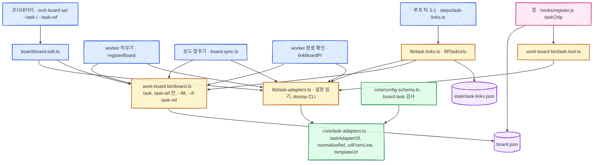

# work-board 업무 링크 기술 설계

스펙: [spec.md](spec.md)

PR 은 하나다(스펙 DECISION9). 구현은 PR #486 이고 검증 기록은 [verification.md](verification.md) 다.

## 요구사항 연결

| ID | 해결 방법 |
| --- | --- |
| REQ1 | 보드 명령 `extensions/work-board/bin/board.ts` 의 칸 목록(`FIELDS`)에 `task-ref` 를 더한다. `set` 에 「빈 칸만 채우기」(`--fill`)와 「번호가 같을 때만」(`--if-task-ref`)을 더한다. `orch board set`(`skills/orch/scripts/board/board-edit.ts`)은 상태 인자를 선택으로 바꾸고 `--task`, `--task-ref` 를 받아 `board.ts set --exact` 에 넘긴다. 번호는 넘기기 전에 어댑터로 맞춘다(「번호 맞추기」) |
| REQ2 | 창(`extensions/work-board/hooks/register.js`)의 `titleChildren` 과 `splitTaskNumber` 를 없애고, 순수 함수 `taskChip(item, tool)` 이 칩의 글과 주소를 정한다. 머리 줄은 칩이 있으면 첫 줄에 「표시 → 칩」, 다음 줄에 들여 쓴 제목을 그리고(칩이 없으면 「표시 제목」 한 줄), 제목 버튼에는 제목만 넣는다. 도구 이름은 새 명령 `extensions/work-board/bin/task-tool.ts` 가 낸다 |
| REQ3 | 설정 `board.task` 객체에 어댑터를 둔다. 값 판정은 새 core 모듈 `skills/orch/scripts/core/task-adapters.ts` 의 `taskAdapterOf` 하나가 소유하고, 설정 검사표(`core/config-schema.ts`)가 같은 함수를 부른다 |
| REQ4 | `skills/orch/scripts/lib/board.ts` 의 `taskOf` 가 업무 연결 줄 전체(`line`)도 돌려준다. `registerBoard` 가 그 줄에서 번호와, 어댑터 주소 호스트와 같은 첫 주소를 골라 네 길 모두의 `board.ts set` 에 `--fill` 로 붙인다. 업무 도구는 부르지 않는다 |
| REQ5 | `lib/board.ts` 의 새 `prTaskRef(repo, title)` 가 `finish.task_pattern` 으로 PR 제목에서 번호를 뽑고 맞춘다. 보드 맞추기(`board/board-sync.ts`)가 PR 을 찾아 `--pr` 을 쓰는 명령과 `linkBoardPr`(worker 완료 확인)가 그 번호를 `--fill --task-ref` 로 함께 쓴다 |
| REQ6 | 새 루프 단계 `loop/steps/task-links.ts` 가 보드 맞추기와 결정 알림 뒤(틱 3-1)에 `lib/task-links.ts` 의 `fillTaskUrls` 를 부른다. 실패 기록은 `<orch 루트>/state/task-links.json` 에 남겨 30분 간격과 한 번만 남기는 로그를 루프가 다시 떠도 잇는다 |
| REQ7 | 자동 경로의 쓰기는 모두 `board.ts set --fill` 이다. 루프의 주소 쓰기는 `--if-task-ref <읽은 번호>` 도 붙인다. 판정은 보드 잠금([ADR-029](../../adr/029-board-write-lock.md)) 안에서 `board.ts` 가 한다 |
| REQ8 | `docs/data-schema.md`(`board.task` 행, `state/task-links.json` 행, `board.task_line` 행 고침), `skills/orch/references/overlay.md`, `skills/orch/references/board.md`, `extensions/work-board/references/behavior.md`, `board.ts` 머리 주석과 도움말을 고친다 |
| REQ9 | `registerBoard` 의 같은 업무 찾기가 번호 칸(`task-ref`)이 같은 항목을 먼저 보고, 없으면 번호 칸이 빈 항목만 지금처럼 제목(`hasTask`)으로 본다. `specTitle` 은 번호를 제목 앞에 붙이지 않는다 |

## 책임과 경계



- **업무 도구를 아는 코드는 orch 의 어댑터 두 파일뿐이다.** 번호를 맞추고 주소를 만드는 판정은 `core/task-adapters.ts`, 설정 파일 읽기와 `dooray` CLI 호출은 `lib/task-adapters.ts` 가 맡는다(값 판정과 외부 실행의 층 규칙, [ADR-028](../../adr/028-orch-core-layer.md)). 경계를 고른 이유는 [ADR-031](../../adr/031-board-task-adapter.md) 이 소유한다.
- **보드 명령은 도구를 모른다.** `board.ts` 는 두 칸을 받은 그대로 저장하고, 주소가 `http`·`https` 인지와 칸이 비었는지만 본다. 쓰기는 지금처럼 보드 잠금 안에서 한다([ADR-029](../../adr/029-board-write-lock.md)).
- **창은 설정을 읽지 않는다.** 창이 승인 파일 경로를 `bin/approvals.ts where` 로 받는 것처럼, 도구 이름을 `bin/task-tool.ts` 로 받는다. 창은 TypeScript 와 `node:fs` 를 import 하지 못해 명령 출력만 읽는다(`bin/merge-queue.ts` 머리 주석).
- **번호를 읽는 규칙은 지금 자리에 둔다(스펙 DECISION16).** 지시서는 `board.task_line`(`lib/board.ts` 의 `taskOf`), PR 제목은 `finish.task_pattern` 이 읽는다. 어댑터는 읽은 번호를 맞추고 주소로 바꾸기만 한다.
- **inbox 스킬의 dooray 어댑터와 코드를 나누지 않는다.** 스킬은 폴더째 따로 내보내므로 orch 가 inbox 스킬을 import 하면 orch 만 가져간 저장소에서 깨진다. 같은 것은 주소 꼴(`<web_url>/project/tasks/<postId>`) 하나뿐이다.

## 인터페이스와 데이터

### 보드 항목 칸

| 칸 | 값 | 쓰는 곳 |
| --- | --- | --- |
| `task` | `http`·`https` 로 시작하는 업무 주소. 지금 칸 그대로다 | `orch board set --task`, 띄울 때(지시서 주소), 루프의 주소 만들기 |
| `task-ref` | 업무 번호 문자열. 빈 값이 아니고 공백·줄바꿈이 없다. 어댑터가 맞춘 꼴로 저장한다(`AI-스마트홈-AI/458`, `PROJ-12`) | `orch board set --task-ref`, 띄울 때, PR 연결 때 |

`task-ref` 는 `FIELDS` 에 들어가므로 `board.ts get <id> task-ref`, `orch board get`, `item`, `items` 출력에 함께 나온다.

### `board.ts set` 에 더하는 것

```text
board.ts set <id> [<status>] [--task URL] [--task-ref REF] [--fill] [--if-task-ref REF] ...
```

- `--fill`: 항목의 업무 칸 둘(`task`, `task-ref`)이 모두 비었을 때만 이 호출의 `--task`, `--task-ref` 를 쓴다. 하나라도 차 있으면 업무 칸은 건드리지 않고 성공(종료 코드 0)이다. 주소만 있는 항목에 다른 업무의 번호가 붙어 칩 글과 링크가 서로 다른 업무를 가리키지 않게 하려는 것이다(스펙 DECISION11). `--if-task-ref` 와 함께 주면 번호가 맞는 항목의 빈 `task` 만 채운다(루프의 주소 쓰기). 다른 칸(`--worktree` 따위)은 지금과 같다. `--fill` 과 빈 값(`--task ''`)을 함께 주면 사용법 오류(2)다.
- `--if-task-ref REF`: 항목의 `task-ref` 가 `REF` 와 다르면 거절(1)한다. 루프가 번호를 읽은 뒤 코디네이터가 번호를 바꾼 항목에 옛 번호의 주소를 쓰지 않으려는 것이다.
- `--task-ref` 에 공백이나 줄바꿈이 든 값은 거절(1)한다.
- 진행률이 없는 doing 항목은 지금처럼 `set` 전체가 거절된다(`apply` 의 진행률 검사). 업무 칸만 넣는 호출도 같다.

### `orch board set`

```text
orch board set <항목> [<상태>] [--task <주소>] [--task-ref <번호>]
```

- 상태, `--task`, `--task-ref` 가운데 하나는 있어야 한다(옵션은 빈 값도 준 것으로 센다). 없으면 사용법 오류(2)다.
- `board.ts set <id> [<상태>] --exact [--task …] [--task-ref …]` 로 넘긴다. `--exact` 라 없는 항목은 만들지 않고 거절(1)한다.
- `--task-ref` 의 값은 넘기기 전에 `normalizeRef` 로 맞춘다. 빈 값(`''`)은 맞추지 않고 그대로 넘겨 칸을 지운다.
- 설정(`board.task`)을 읽지 못하면 `--task-ref` 를 준 호출만 설정 오류(2)로 끝난다. 번호를 어떤 꼴로 저장할지 정할 수 없어서다.
- 출력은 지금처럼 `BOARD-SET <id> <상태>` 한 줄이다. 저장된 번호는 `orch board get <id> task-ref` 로 본다.

### 설정 `board.task`

새 절을 만들지 않고 `board` 절에 키 `task` 를 더한다(`core/config.ts` 의 `BOARD_KEYS`). 보드 항목의 업무 링크를 다루는 설정이라 그 절에 둔다.

```json
{
  "board": {
    "task": { "adapter": "dooray", "web_url": "https://<사내 두레이>", "project": "AI-스마트홈-AI" }
  }
}
```

```json
{
  "board": {
    "task": { "adapter": "url-template", "url": "https://jira.example.com/browse/{number}", "name": "Jira" }
  }
}
```

| 어댑터 | 키 | 값 | 필수 |
| --- | --- | --- | --- |
| 공통 | `adapter` | `dooray` 나 `url-template` | 예 |
| `dooray` | `web_url` | `http`·`https` 주소. 끝의 `/` 는 뗀다 | 예 |
| `dooray` | `project` | 비지 않은 프로젝트 코드. `/` 가 없는 번호 앞에 붙인다 | 예 |
| `url-template` | `url` | `http`·`https` 주소이고 `{number}` 가 한 번 이상 든다 | 예 |
| `url-template` | `name` | 비지 않은 문자열. 칩의 도구 이름이다 | 아니요. 없으면 「업무」 |

- `taskAdapterOf(config)` 는 절이 없으면 `null`, 틀리면 `ConfigError` 다. 모르는 어댑터, 빠진 키, 그 어댑터의 키가 아닌 키(`dooray` 에 `url`)는 틀린 값이다.
- 설정 검사표는 `KEYS.board.task` 에 이 함수를 감싼 core 판정을 둔다(`viaConfig` 와 같은 꼴). 그래서 `orch config set` 과 `orch doctor` 가 읽는 쪽과 같은 기준으로 거절한다. 세 키를 함께 넣을 때는 `orch config set board.task.adapter dooray board.task.web_url <주소> board.task.project <코드>` 처럼 한 호출에 짝으로 준다.
- 설정 파일은 `orch config` 의 쓰기 잠금으로만 바뀐다. 이 기능은 설정을 쓰지 않는다.

### core 어댑터(`core/task-adapters.ts`)

| 함수 | 하는 일 |
| --- | --- |
| `taskAdapterOf(config)` | 위 표의 판정. `{ kind, name, host, … }` 를 돌려준다. `dooray` 의 이름은 「두레이」, `url-template` 은 `name` 이나 「업무」 다. `host` 는 `web_url` 이나 `url` 의 호스트다 |
| `normalizeRef(adapter, ref)` | `dooray` 는 `/` 가 없는 번호 앞에 `<project>/` 를 붙인다. `url-template` 과 어댑터 없음(`null`)은 그대로다 |
| `urlFromLine(adapter, line)` | 줄의 `http`·`https` 주소 가운데 호스트가 `adapter.host` 와 같은 첫 주소. 없거나 어댑터가 `null` 이면 `null` 이다(스펙 DECISION17) |
| `templateUrl(adapter, ref)` | `url-template` 의 `{number}` 를 `encodeURIComponent(ref)` 로 바꾼다. `/` 는 그대로 둔다 |
| `doorayParts(ref)` | 마지막 `/` 앞을 프로젝트, 뒤를 번호로 나눈다. 번호가 숫자가 아니면 `null` 이다 |
| `TASK_ADAPTERS` | 어댑터 이름에서 위 판정 묶음으로 가는 표. 어댑터를 더하면 이 표의 줄 하나와 lib 의 주소 만들기 하나가 는다 |

### lib 어댑터(`lib/task-adapters.ts`)

- `taskAdapter(repo)`: `loadConfig(repo)` 로 읽고 `taskAdapterOf` 를 부른다. `ConfigError` 는 그대로 던진다. 부르는 쪽이 다룬다(「실패와 일관성」).
- `resolveTaskUrl(adapter, ref)`: 주소를 만든다. `url-template` 은 `templateUrl` 이다. `dooray` 는 `doorayParts` 로 나눈 뒤 `dooray --json post get <프로젝트> <번호>` 를 15초 제한으로 부르고 응답의 `id`(postId)로 `<web_url>/project/tasks/<postId>` 를 만든다. 실패하면 이유 한 줄을 담은 `Error` 다. 이유에 토큰이나 응답 본문을 넣지 않고 CLI 의 첫 줄 오류만 넣는다.

### 띄울 때(`registerBoard`)

- `taskOf(text, pattern)` 는 `{ number, title, line }` 을 돌려준다. `line` 은 `number` 묶음이 든 줄 전체다. 맞은 자리의 시작(`index`)으로 자르면 안 된다. 기본 정규식의 `^\s*` 가 앞 빈 줄의 줄바꿈까지 먹어 빈 줄을 고른다.
- `taskArgs = ['--fill', '--task-ref', normalizeRef(adapter, number), ...(url ? ['--task', url] : [])]`. `url` 은 `urlFromLine(adapter, line)` 이다. 사용자 정의 `task_line` 이 공백 든 번호를 뽑으면 `taskArgs` 를 비우고 stderr 에 한 줄 남긴다. 보드 등록 전체가 거절되지 않게 한다.
- 네 길(중간 과정 줄, 다시 열기, 기존 항목, 새 항목)의 `write([...])` 에 `taskArgs` 를 붙인다. 새 항목은 칸이 비어 있어 그대로 들어간다.
- 같은 업무 찾기: `open` 가운데 decide·goal 이 아닌 항목에서 `row['task-ref'] === ref` 를 먼저 찾고, 없으면 번호 칸(`task-ref`)이 빈 항목만 `hasTask(row.title, task.number)` 로 찾는다. 찾는 차례(지시서 id, 같은 워크트리·브랜치, 같은 업무, `--name`, 워크트리 이름)는 그대로다.
- `specTitle` 의 끝 줄(번호를 앞에 붙이기)을 지운다. 고르는 순서 1~5 는 그대로다.

### PR 연결 때

- `prTaskRef(repo, title)`: `rulesFrom(finish, repo).taskPattern` 의 첫 묶음을 번호로 읽는다. 번호는 `[\p{L}\p{N}._/-]+` 만 받는다. 마지막 PR 판정의 `extractTaskNumber` 는 영문만 받아 한글 프로젝트 코드(`AI-스마트홈-AI/458`)를 버리므로 쓰지 않는다. 그 뒤 `normalizeRef` 로 맞춘다. 규칙이 없거나 맞지 않거나 설정을 읽지 못하면 `null` 이다.
- 보드 맞추기: 열린 PR 목록에 `title` 을 더한다. 루프가 넘기는 `--open-prs`(`loop/steps/board.ts`)와 `board-sync.ts` 가 직접 부르는 두 `gh pr list` 의 `--json` 에 `title` 을 넣는다. PR 을 찾아 쓰는 `['set', id, '--pr', …, '--branch', …]` 에 번호가 있으면 `--fill --task-ref <번호>` 를 붙인다.
- worker 완료 확인: `linkBoardPr(file, number, branch, ref)` 로 넷째 인자를 더한다. `completion-watch.ts` 가 이미 읽은 `pr.title` 로 `prTaskRef` 를 부른다. 인자가 없는 기존 호출은 지금과 같다.
- PR 칸이 이미 찬 항목은 두 길 모두 PR 을 다시 쓰지 않으므로 번호도 쓰지 않는다(스펙 REQ5).

### 루프의 주소 만들기(`fillTaskUrls`)

틱 3(보드 맞추기와 결정 알림) 뒤, 틱 4(정리) 앞에 3-1 로 둔다. 같은 틱에 PR 연결로 들어간 번호의 주소를 바로 만든다. 저장소 공유 일이라 틱마다 한 번이다.

1. 보드 파일이 없거나 어댑터가 `null` 이면 아무것도 하지 않는다(스펙 DECISION19).
2. done 이 아니고 `task-ref` 가 있고 `task` 가 빈 항목을 보드 순서로 고른다(스펙 DECISION20).
3. 기록에 같은 항목·같은 번호의 실패가 있고 30분이 지나지 않았으면 건너뛴다.
4. 틱마다 업무 도구 호출에 쓰는 시간은 60초까지다. 호출마다 15초 제한이고 `runAsync`(제한을 넘기면 KILL 까지 보낸다)로 부른다. 동기 `run` 은 TERM 을 무시하는 자식에서 제한을 지키지 못한다(`lib/proc.ts` 머리 주석). 예산이 다 되면 남은 항목은 다음 틱이 한다. 보통 호출은 1초 안팎이라 열린 항목 십여 개는 한 틱에 채워진다(스펙 REQ6 「다음 틱 뒤」).
5. 주소를 만들면 `board.ts set <id> --exact --fill --if-task-ref <번호> --task <주소>` 로 쓰고 기록을 지운다. 루프 로그에 `TASK-LINK <id> <번호>` 한 줄을 남긴다.
6. 실패하면 기록에 `{ ref, at, reason }` 를 둔다. 같은 항목·번호의 기록이 없던 첫 실패만 `TASK-LINK-FAIL <id> <번호> <이유>` 를 남긴다. 다시 실패하면 `at` 만 바꾼다.
7. `--if-task-ref` 거절(번호가 바뀌었다)과 항목 없음 거절은 실패로 세지 않고 조용히 넘어간다. 다음 틱이 다시 본다.
8. 끝에 보드에 없거나, done 이거나, 번호가 바뀌었거나, `task` 가 찬 항목의 기록을 지운다.

### 상태 파일 `state/task-links.json`

```json
{ "items": { "<항목 id>": { "ref": "AI-스마트홈-AI/458", "at": "2026-11-13T09:00:00.000Z", "reason": "dooray post get: …" } } }
```

틱이 옆 파일에 쓴 뒤 이름을 바꾼다(`state/movement.json` 과 같은 쓰기). 깨진 파일은 빈 기록으로 읽고 다음 쓰기에서 고친다. 읽는 곳은 이 단계 하나다.

### 창

- `bin/task-tool.ts --repo <저장소>` 는 `{"name": "두레이"|"Jira"|…|null, "error": null|"<이유>"}` 한 줄을 낸다. 어댑터가 없으면 `name` 은 `null` 이다. 창은 보드 저장소가 바뀔 때와 `/board` 를 열 때 한 번 부른다.
- `taskChip(item, tool)`: 번호(`task-ref`)와 주소(`task`, `http`·`https` 만)로 칩을 정한다. 둘 다 없으면 `null` 이다. 글은 `[<이름> <번호>]`, 번호가 없으면 `[<이름>]` 다. 이름은 `tool.name`, 없으면 지금 `taskTag(url)`(두레이 주소면 「두레이」, 그 밖은 「업무」), 주소도 없으면 「업무」 다(스펙 DECISION15). 주소가 있으면 링크, 없으면 흐린 글자다(스펙 DECISION2).
- 머리 줄: 칩이 있으면 첫 줄에 표시(`section.mark`)와 칩(줄어들지 않는 상자 안), 다음 줄에 왼쪽 여백 2칸으로 들여 쓴 제목을 둔다. 좁은 창에서 제목이 폭을 차지해 칩이 눌리지 않게 한다(사용자 2026-11-13). 진행 중·대기 항목은 제목만 `Button` 에 넣는다. 지금은 표시도 버튼 안에 있다. 칩을 버튼 앞에 두려면 표시가 버튼 밖으로 나와야 한다(스펙 DECISION23). 칩이 없는 항목은 「표시 제목」 가로 한 줄이고, 제목만 누르는 자리는 칩 유무와 관계없이 같다.
- 완료·목표·결정 항목의 머리 줄도 같은 `taskChip` 을 쓴다(스펙 DECISION22). `itemView` 하나가 모든 항목을 그리므로 한 곳만 고친다. 완료 줄의 칩은 취소선 없이 흐리게 그린다. 링크 색과 밑줄은 그대로다.
- 도구 이름은 `/board` 를 열 때와 저장소가 바뀔 때만 다시 받는다. 창을 연 채 설정을 바꾸면 다시 열 때 새 이름이 보인다.

## 실패와 일관성

| 경우 | 동작 |
| --- | --- |
| 자동 경로(띄울 때, PR 연결, 루프)에서 `board.task` 가 틀렸다 | 어댑터 없음으로 본다. 띄우기와 보드 맞추기는 stderr 에 한 줄, 루프는 `TASK-LINK-CONFIG <이유>` 를 틱마다가 아니라 이유가 바뀔 때만 남긴다. 번호는 맞추지 않은 그대로 저장한다. 업무 링크 설정이 틀렸다고 worker 띄우기나 보드 맞추기를 멈추지 않는다 |
| `orch board set --task-ref` 에서 `board.task` 가 틀렸다 | 설정 오류(2)다. 사람이 고쳐 다시 부른다 |
| 코디네이터가 같은 때 `orch board set` 으로 칸을 바꿨다 | 쓰기는 모두 보드 잠금 안에서 다시 읽고 판정한다. `--fill` 은 그때 칸이 찼으면 쓰지 않고, 루프는 `--if-task-ref` 로 바뀐 번호에 옛 주소를 쓰지 않는다 |
| `registerBoard` 의 `--if-rev` 거절 | 지금처럼 한 번 다시 읽고 다시 판정한다. `taskArgs` 도 다시 만든다 |
| 업무 도구가 오래 막혔다 | 항목·번호마다 로그 한 줄, 30분마다 다시 시도한다. 기록이 파일이라 루프를 다시 띄워도 간격이 이어진다(스펙 DECISION12) |
| `dooray` CLI 가 없다 | 실패의 한 갈래다. 이유는 「dooray 명령을 찾지 못했다」 다 |

**호환과 배포 순서:**

- 옛 번들은 `board.task` 를 모르는 키로 보고 `board` 절 전체를 설정 오류로 읽는다(`core/config.ts` 의 `section`). 그러면 띄울 때 보드 등록과 마일스톤 반영이 멈춘다. 설치 전에 띄운 상주 루프도 옛 번들로 돈다. 그래서 `board.task` 는 이 PR 의 번들을 설치하고 루프를 다시 띄운 뒤에 넣는다. `inbox` 절과 같은 안내를 `overlay.md` 에 두고, `board.task` 를 `RESTART_KEYS` 에 넣어 `orch config set` 이 재시작을 안내하게 한다.
- 어댑터를 바꿀 때는 남은 옛 어댑터 키가 거절되므로 `orch config set board.task --json '{…}'` 로 통째 바꾼다.
- 옛 항목은 `task-ref` 가 없어 지금처럼 제목으로 같은 업무를 찾는다(스펙 REQ9). 제목은 바꾸지 않는다.
- 옛 창(새 번들 전 세션)은 `task-ref` 를 모르고 지금처럼 그린다. 새 창은 옛 보드 파일도 그대로 읽는다. 보드 파일 꼴은 칸 하나가 늘 뿐이다.
- `task` 만 있고 제목에 `#342` 가 있던 항목은 링크가 제목 안에서 칩(`[두레이]`)으로 옮겨 간다(스펙 DECISION14).

## 검증 전략

| ID | 경계 | 확인 |
| --- | --- | --- |
| REQ1 | `board.ts`, `orch board set` 을 임시 보드 파일로 실행 | 두 칸을 넣고 고치고 지우며 상태가 그대로인지, `--fill`·`--if-task-ref`·주소 거절·번호 맞추기 |
| REQ2 | 창 렌더 테스트(`claude plugin test .` 의 `pane.test.ts`)와 `taskChip` 단위 테스트 | 네 경우의 칩, 흐린 글자, 제목 안 `#342` 비링크, 결정 줄, 제목 누르기 동작 |
| REQ3 | `taskAdapterOf` 단위 테스트, 설정 검사표 테스트, `orch config set` 명령 테스트 | 두 어댑터 통과, 모르는 이름·빠진 값·남의 키 거절 |
| REQ4 | `launch-worker.spec.ts` 의 가짜 orca 와 임시 보드 | 네 길에서 번호·주소가 빈 칸에만 들어가고 위키 주소가 안 들어가며 업무 도구 호출이 없는지 |
| REQ5 | `board-sync.spec.ts`(가짜 gh), `completion-watch.spec.ts` | 두 길에서 빈 번호 칸이 채워지고 찬 PR 칸·찬 번호 칸은 그대로인지 |
| REQ6 | 루프 단계 단위 테스트(바꿔 넣은 주소 만들기와 고정 시각), 가짜 `dooray` 로 `orch loop run --once` 을 두 번 돌리는 사례 | 주소 채우기, 첫 실패 한 줄, 30분 간격, 상태 파일로 이어지기, 설정 없음, done 제외, 시간 예산 |
| REQ7 | REQ4·5·6 의 테스트에 이미 값이 든 항목을 둔다 | 번호 A 항목에 번호 B 가 오지 않고 A 로 주소를 만드는지 |
| REQ8 | 설정 문서 검사(`config-docs.spec.ts` 에 `board.task` 단언을 더한다)와 diff 검토 | 문서 표에 `board.task` 와 `state/task-links.json` 이 있는지 |
| REQ9 | `launch-worker.spec.ts` | 새 제목에 번호 없음, 번호 칸으로 찾기, 번호 칸이 빈 옛 항목의 제목 찾기 |

실제 사내 `dooray` 와 실제 창은 worker 환경에서 확인할 수 없다. 머지 뒤 ai-analysis 보드에서 확인한 것과 남은 것은 [검증 기록](verification.md)에 있다.

## 결정

| ID | 결정 | 답 | 누가 | 근거 |
| --- | --- | --- | --- | --- |
| DECISION1 | 어댑터 설정의 자리 | `board` 절의 `task` 객체. 새 최상위 절을 만들지 않는다 | 작성자 | 보드 항목 링크만 쓰는 설정이다. 키 판정을 한 core 함수가 소유해 `viaConfig` 꼴로 검사표에 넣을 수 있다 |
| DECISION2 | 업무 도구 코드의 자리 | orch 의 `core/task-adapters.ts`(판정)와 `lib/task-adapters.ts`(설정 읽기, CLI). 보드 명령과 창은 도구를 모른다 | 작성자 | [ADR-031](../../adr/031-board-task-adapter.md) |
| DECISION3 | 자동 경로의 덮어쓰기 막기 | `board.ts set` 의 `--fill`(업무 칸이 모두 빌 때만)과 `--if-task-ref`. 판정은 보드 잠금 안에서 한다 | 작성자 | 부르는 쪽이 미리 읽고 판정하면 잠금 밖이라 코디네이터의 쓰기와 겹친다. 칸마다 따로 채우면 이미 있는 주소와 다른 업무의 번호가 짝지어진다(스펙 DECISION11) |
| DECISION4 | 창이 도구 이름을 얻는 길 | 새 명령 `bin/task-tool.ts` 를 저장소가 바뀔 때 한 번 부른다 | 작성자 | 창은 설정 파일 위치(orch 루트) 규칙을 계산하지 않는다. `bin/approvals.ts where` 와 같은 꼴이다. 항목마다 이름을 저장하면 설정을 바꿔도 옛 이름이 남는다 |
| DECISION5 | PR 제목에서 읽은 번호의 허용 글자 | 문자·숫자와 `._/-`(유니코드). `extractTaskNumber` 는 쓰지 않는다 | 작성자 | 그 함수는 영문만 받아 한글 프로젝트 코드를 버린다. 마지막 PR 판정의 동작은 이 기능 범위 밖이라 바꾸지 않는다 |
| DECISION6 | 자동 경로의 틀린 설정 | 어댑터 없음으로 보고 한 줄 알린다. `orch board set --task-ref` 만 설정 오류로 끝난다 | 작성자 | 업무 링크 설정 하나가 띄우기와 보드 맞추기를 멈추면 피해가 더 크다. 사람이 직접 넣을 때는 저장할 꼴을 정할 수 없어 멈춘다 |
| DECISION7 | 루프 단계의 자리와 상한 | 틱 3(보드 맞추기와 결정 알림) 바로 뒤. 틱마다 업무 도구 호출 시간 60초, 호출마다 15초 | 작성자 | 같은 틱에 PR 연결로 들어간 번호를 바로 잇는다. 건수 상한은 기존 항목에 번호를 한꺼번에 넣을 때 여러 틱이 걸려 스펙 REQ6 「다음 틱 뒤」 와 어긋난다. 시간 예산은 `dooray` 가 멈출 때만 걸린다 |
| DECISION8 | 머리 줄의 누르는 자리 | 표시를 버튼 밖으로 꺼내고 버튼에는 제목만 둔다. 칩이 없는 항목도 같다 | 작성자 | 칩을 제목 앞, 버튼 밖에 두라는 스펙 DECISION23 을 지키려면 표시와 제목 사이에 칩이 와야 한다. 표시를 눌러 요청문을 채우던 동작만 없어지고 제목 누르기는 그대로다 |
| DECISION9 | `dooray` 의 기본 프로젝트와 `url-template` 의 이름 | `project` 는 필수, `name` 은 선택(기본 「업무」) | 작성자 | `/` 없는 번호를 맞출 기준이 늘 있어야 한다. 이름이 없으면 설정 없는 저장소와 같은 「업무」 로 보인다(스펙 DECISION15) |
| DECISION10 | ADR | [ADR-031](../../adr/031-board-task-adapter.md) 을 남긴다 | 작성자 | 다른 도구(Jira, Notion) 어댑터가 따를 경계이고, 보드 명령에 도구 지식을 넣는 대안을 기각한 이유가 코드에 남지 않는다 |

| 결정 | 종류 | ADR 또는 필요 없음의 이유 | 현재 규칙의 원본 |
| --- | --- | --- | --- |
| 스펙 DECISION7, 이 설계 DECISION2 | architecture | [ADR-031](../../adr/031-board-task-adapter.md) | 이 설계 「책임과 경계」, `skills/orch/scripts/core/task-adapters.ts` |
