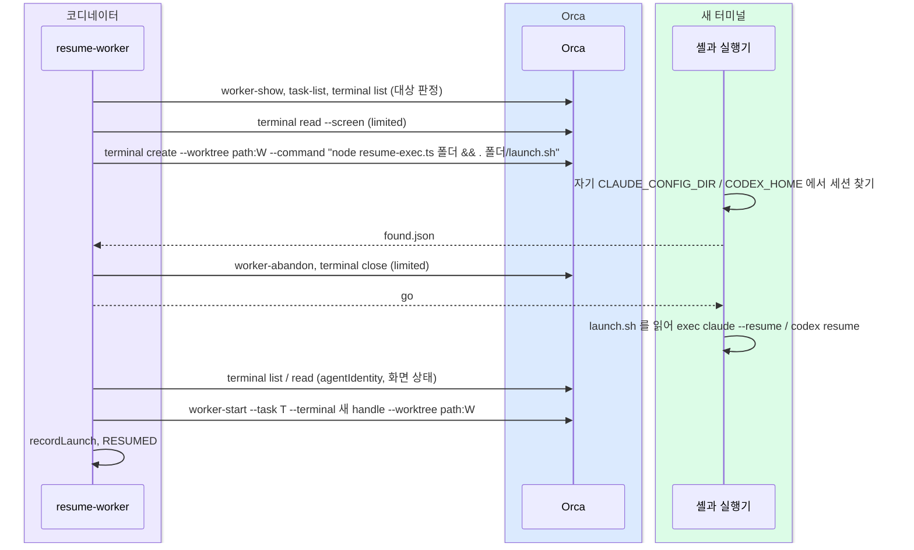

# orch: 사용 한도로 멈춘 worker 를 resume 으로 다시 띄우는 기술 설계

스펙: [spec.md](spec.md)

## 요구사항 연결

| ID | 해결 방법 |
| --- | --- |
| REQ1 | 새 명령 `orch worker resume --dispatch <id>` 가 같은 워크트리에 Orca 터미널을 연다. 그 셸에서 도는 실행기가 터미널 자신의 계정 환경에서 세션을 찾고, 출발 신호 뒤 셸이 `exec` 로 `claude --resume` / `codex resume` 을 띄운다. 코디네이터 쪽은 에이전트가 입력을 받을 수 있게 되면 `worker-start --task --terminal` 로 같은 Task 에 잇는다 |
| REQ2 | 대상 판정의 `restart`(터미널이 닫힌 failed dispatch)는 화면 읽기, abandon, 닫기를 건너뛴다. 나머지 단계는 REQ1 과 같다 |
| REQ3 | 「찾기 → 옛 dispatch 정리 → 에이전트 띄우기」 순서. 새 터미널에는 세션을 찾는 동안 에이전트가 없다. 코디네이터가 옛 dispatch abandon 과 옛 터미널 닫기를 마친 뒤 출발 신호를 써야 에이전트가 세션에 붙는다 |
| REQ4 | 단계마다 `RESUME-FAIL <단계> <이유>` 와 `NEXT <명령>` 을 내고 0 이 아닌 종료 코드로 끝난다(아래 「명령」). 재시도와 자동 대체는 없다 |
| REQ5 | `lib/sessions.ts` 의 `limitedWorkers`, `restartable` 이 새 명령 한 줄을 `commands` 로 낸다. 상주 루프의 `WORKER-LIMITED` 알림 문구와 `agent-selection.md` 「사용 한도에 걸렸을 때」 가 스펙 DECISION13 의 순서를 안내한다 |

## 책임과 경계

- **`lib/resume.ts`(새 파일)**: 세션 찾기, 실행 줄 만들기, 요청 폴더의 파일 형식과 잠금을 소유한다. 바깥 명령(orca, git, gh)을 부르지 않고 다른 orch lib 를 import 하지 않는다. 실행기가 새 터미널에서 가볍게 뜨고, 단위 테스트가 가짜 폴더만으로 돌게 하려는 것이다.
  - `claudeProjectDir(home, worktree)`: `<home>/projects/<실경로의 영숫자 밖 글자를 - 로 바꾼 이름>`. 실측: `/private/var/.../T/resume-spike-UT1n` 이 `-private-var-...-T-resume-spike-UT1n` 이 됐고 `_` 도 `-` 가 된다.
  - `findClaudeSession(home, worktree, dispatch)`: 그 폴더의 `*.jsonl` 가운데 dispatch id 문자열이 든 파일을 고친 시각 내림차순으로 고른다. 세션 id 는 파일 이름이다.
  - `findCodexSession(home, worktree, dispatch)`: `<home>/state_5.sqlite` 의 `threads` 에서 `cwd` 가 워크트리 실경로인 행을 `updated_at` 내림차순으로 읽고, `rollout_path` 파일에 dispatch id 가 든 첫 행의 `id` 를 고른다. sqlite 는 Node 24 의 `node:sqlite` 를 읽기 전용으로 연다. DB 가 없거나 열지 못하거나 맞는 행이 없으면 `sessions/` 아래 최근 14일 날짜 폴더의 `rollout-*.jsonl` 첫 줄(`session_meta` 의 `cwd`, `id`)로 찾는다.
  - `claudeResumeArgv(session, launch, pluginDir)`: `claude --plugin-dir <pluginDir> --permission-mode auto --model <m> --effort <e> --resume <id>`.
  - `codexResumeArgv(session, launch, env)`: `codex resume <id> --no-daemon -c shell_environment_policy.set.ORCA_*=<터미널 자신의 값> -c check_for_update_on_startup=false -c disable_paste_burst=true --dangerously-bypass-approvals-and-sandbox -m <m> -c model_reasoning_effort=<e>`. ORCA_* 는 `ORCA_USER_DATA_PATH`, `ORCA_WORKSPACE_ID`, `ORCA_WORKTREE_ID`, `ORCA_PANE_KEY`, `ORCA_TERMINAL_HANDLE` 이고 실행기의 환경에서 읽는다.
  - `shellLine(argv)`: 실행 줄을 `exec` 로 시작하는 셸 한 줄로 쓴다(낱말마다 작은따옴표).
- **실행기 `resume-exec.ts`(새 파일)**: `lib/resume.ts` 만 import 한다. 새 터미널의 셸이 `node <resume-exec.ts> <요청 폴더> && . <요청 폴더>/launch.sh` 로 부른다.
  1. `request.json` 을 읽고, 자기 `CLAUDE_CONFIG_DIR`(없으면 `~/.claude`) 또는 `CODEX_HOME`(없으면 `~/.codex`)에서 세션을 찾는다.
  2. Claude 면 `--plugin-dir` 폴더를 정한다. 자기 환경의 `ORCA_CLAUDE_AGENT_VIEW_PLUGIN_DIR` 이 있고 폴더가 있으면 그것, 없으면 `request.json` 의 `pluginDir`(옛 에이전트 프로세스의 실행 줄에서 읽은 값)이다. 둘 다 없으면 실패로 쓴다. 실측(2026-11-05): 일반 Orca 터미널의 환경에 이 변수가 있고 값이 Orca 가 띄운 Claude 의 `--plugin-dir` 과 같았다. 이 기계의 `claude-agent-view` 아래에는 해시 폴더가 다섯 개라 폴더 고르기로는 정할 수 없다. Codex 면 `ORCA_WORKSPACE_ID`, `ORCA_WORKTREE_ID`, `ORCA_PANE_KEY`, `ORCA_TERMINAL_HANDLE`, `ORCA_USER_DATA_PATH` 가 모두 있어야 하고, 하나라도 없으면 실패로 쓴다.
  3. `found.json` 에 결과(성공이면 세션 id, 기록 폴더, 자기 터미널 handle)를 쓴다. 실패면 0 이 아닌 코드로 끝나 셸이 `launch.sh` 를 부르지 않는다.
  4. `go` 를 기다린다. 시한은 `request.json` 의 `goDeadline`(절대 시각)이다. 시한이 지나면 `launch.sh` 를 쓰지 않고 0 이 아닌 코드로 끝난다.
  5. `launch.sh` 에 `shellLine(argv)` 를 쓰고 0 으로 끝난다. 셸이 그 파일을 읽어 `exec` 로 에이전트가 된다. 에이전트가 터미널의 직접 프로세스라 node 래퍼가 남지 않고 Ctrl-C 같은 신호도 에이전트가 받는다.
- **`resume-worker.ts`(새 진입 스크립트, 명령 표의 `worker resume`)**: 코디네이터 쪽 차례를 돈다. `--dispatch` 값은 `lib/launched.ts` 와 같은 규칙(`^[\w.-]+$`, `.` 으로 시작하지 않음)으로 검사한다. 요청 폴더 경로와 재귀 삭제에 쓰이기 때문이다. 새 터미널의 명령은 이 프로세스의 node(`process.execPath`)로 실행기를 부른다. 로그인 셸의 PATH 에 있는 node 는 `node:sqlite` 와 타입 제거를 보장하지 못한다. Orca 호출은 `lib/orca.ts`, 화면 판정은 `lib/screen.ts`, 한도 판정은 `lib/sessions.ts` 의 `limitedScreen`, 터미널 목록은 `terminalRows` 를 쓴다.
- **명령 표 `lib/commands.ts`**: `worker resume` 한 행을 더한다. 문맥은 `repo` 만이다. Run 은 옛 dispatch 의 `runId` 를 쓴다. 문맥이 지금 Run 을 채우면 다른 Run 의 worker(`adopt-sessions` 는 모든 Run 에서 대상을 찾는다)를 엉뚱한 Run 으로 조회하거나 이을 수 있다. `--run` 을 주면 `runId` 와 같은지만 보고 다르면 `target` 에서 거부한다. 스크립트 경로는 구현 시점(orch-cli PR3 뒤)의 폴더 배치를 따른다. `resume-exec.ts` 는 명령 표에 넣지 않고 `resume-worker.ts` 와 같은 폴더에 둔다.
- **`lib/sessions.ts`**: `limitedWorkers`, `restartable` 의 `commands` 를 `` `${orchWord()} worker resume --dispatch ${shQuote(id)}` `` 한 줄로 바꾼다(스펙 DECISION5, 같은 파일의 `adoptHint` 와 같은 앞 낱말 규칙). 판정 줄과 `Stuck` 의 다른 키는 그대로다. `restartable` 에 「그 dispatch 의 터미널이 열려 있지 않음」 조건을 더한다.
- **`orch-loop.ts`**: `WORKER-LIMITED` 알림 본문만 바꾼다(스펙 DECISION13). 구조화 worker(터미널 없음)는 resume 대상이 아니므로 지금 문구(제공자나 모델을 바꿔 이어받기)를 그대로 낸다. 루프는 여전히 입력하지 않는다.
- **`lib/launched.ts`**: 새 dispatch 를 `recordLaunch` 로 기록한다. `spec` 은 옛 dispatch 의 기록(`readLaunch`)에서, `branch` 는 git 의 워크트리 목록(`worktreePaths`)에서 채운다. 옛 기록이 없어 `spec` 을 못 채우면 `RESUME-WARN spec 기록 없음` 을 낸다.

의존 방향: `resume-worker.ts` → `lib/resume.ts`, `lib/sessions.ts`, `lib/screen.ts`, `lib/orca.ts`, `lib/launched.ts`. `resume-exec.ts` → `lib/resume.ts` 만.

## 인터페이스와 데이터

### 명령

```text
orch worker resume --dispatch <옛 dispatch id> [--run <Run>] [--repo DIR] [--timeout-ms N]
```

`--timeout-ms` 는 찾기와 에이전트 준비 대기를 합친 시한이다. 기본 100000(100초)으로 Bash 도구의 기본 제한(120초) 안에 든다.

| 줄 | 뜻 |
| --- | --- |
| `RESUME-TARGET <dispatch> kind=<limited|restart|settled> task=<Task> worktree=<경로> agent=<claude|codex>` | 대상 판정 |
| `RESUME-SCREEN` 과 들여 쓴 줄 | 옛 터미널 화면 끝 20줄(`limited` 만). 닫기 전에 남긴다 |
| `RESUME-SESSION <세션 id> home=<기록 폴더> terminal=<새 터미널>` | 새 터미널의 실행기가 찾은 세션 |
| `RESUME-WARN <이유>` | 진행은 하지만 알릴 것(기록에 지시서 경로 없음 같은 것) |
| `RESUMED <새 dispatch> <새 터미널> <세션 id>` | 성공. 종료 코드 0 |
| `RESUME-FAIL <단계> <이유>` 다음 `NEXT <명령>` | 실패 |

| 단계 | 종료 코드 | 옛 dispatch | 새 터미널 | NEXT |
| --- | --- | --- | --- | --- |
| `target` | 3(조회 실패는 1) | 그대로 | 없음 | 대상이 아닌 이유(살아 있는 정상 worker, 같은 Task 의 더 새 dispatch, 구조화 worker, 진행 중인 앞 실행)와 `orch worker adopt` |
| `find` | 3 | 그대로 | 닫는다 | 계정을 옛 worker 의 계정으로 되돌린 뒤 같은 명령, 또는 `references/launch.md` 「끊긴 worker 다시 띄우기」(새 worker 와 재개 절) |
| `cleanup` | 3 | abandon 실패면 그대로 | 닫는다 | 같은 명령 |
| `start-agent` | 3 | 정리됨 | 닫는다 | 같은 명령(정리된 dispatch 를 `settled` 로 받는다) |
| `link` | 1 | 정리됨 | 닫지 않는다. handle 을 낸다 | `worker-start --task <T> --terminal <handle> --worktree path:<경로> --run <Run> --json` 하나. 같은 명령은 안내하지 않는다 |

`link` 는 `adopt-sessions.ts`, `launch-worker.ts` 의 `worker-start` 실패와 같은 1 이다. 나머지 실패는 「안전하게 이어 붙일 수 없어 사람이 골라야 함」 이라 `adopt-sessions` 의 3 과 같은 뜻으로 둔다.

### 요청 폴더

`<orch 루트>/state/resume/<옛 dispatch>/` 아래 둔다. 성공하면 지우고, 실패하면 진단을 위해 남긴다.

| 파일 | 쓰는 쪽 | 내용 |
| --- | --- | --- |
| `lock` | 코디네이터 | `O_EXCL` 로 만든다. `{ pid, startedAt, terminal }`(`terminal` 은 새 터미널을 연 뒤 채운다) |
| `request.json` | 코디네이터 | `{ dispatch, worktree, agent, model, effort, pluginDir, goDeadline }` |
| `found.json` | 실행기 | `{ ok: true, session, home, terminal }` 또는 `{ ok: false, reason }` |
| `go` | 코디네이터 | 빈 파일. 옛 dispatch 정리를 마쳤다는 신호 |
| `launch.sh` | 실행기 | `exec …` 한 줄 |

잠금 판정: 명령 시작 때 `lock` 이 있으면, 그 `pid` 가 살아 있거나 `terminal` 이 `terminal list` 에 열려 있으면 앞 실행이 진행 중이거나 그 결과 터미널이 남은 것으로 보고 `RESUME-FAIL target` 을 낸다. 둘 다 아니면 옛 폴더를 지우고 새로 잡는다. 그래서 `link` 실패로 남은 터미널이 열려 있는 동안에는 같은 명령이 같은 세션에 두 번째 프로세스를 띄우지 않는다.

### 대상 판정

`worker-show --dispatch <id> --full`, `task-list --run <dispatch 의 runId>`, `terminal list` 로 정한다. 조회가 실패하면(`terminalRows` 의 예외 포함) 종료 코드 1 이다.

| 판정 | 조건 | 할 단계 |
| --- | --- | --- |
| `limited` | dispatch 가 살아 있고(`LIVE_DISPATCH`), 터미널이 열려 있고, 화면이 `limitedScreen` | 전부 |
| `restart` | dispatch 가 `failed`, Task 가 `ready`, 그 Task 의 마지막 dispatch, 그 dispatch 의 터미널이 열려 있지 않음 | 화면·abandon·닫기 건너뜀 |
| `settled` | dispatch 가 `abandoned`, 그 Task 의 마지막 dispatch, 그 dispatch 의 터미널이 열려 있지 않음 | 화면·abandon·닫기 건너뜀(스펙 DECISION12 의 다시 부르기) |
| 거부 | 그 밖(정상 작업 중인 살아 있는 dispatch, 터미널이 열린 failed·abandoned dispatch, 구조화 worker, 더 새 dispatch 가 있음) | `RESUME-FAIL target` |

에이전트, 모델, effort 는 `worker.startOptions.launch.effective` 다. 없으면 `requested`, 그것도 없으면 `RESUME-FAIL target`.
`limited` 의 Claude worker 는 옛 터미널의 에이전트 프로세스 실행 줄(`ps`, 터미널 `processId` 의 자손 가운데 `claude`)에서 `--plugin-dir` 값을 읽어 `pluginDir` 로 넘긴다. 못 읽으면 비워 두고 실행기가 2단계 규칙으로 정한다.

## 호출과 상태



1. 잠금을 잡고 대상을 판정한다. `limited` 면 화면 끝 20줄을 읽어 `RESUME-SCREEN` 으로 낸다.
2. `request.json` 을 쓰고 `orca terminal create --worktree path:<W> --title resume --command "node <resume-exec.ts> <폴더> && . <폴더>/launch.sh"` 로 새 터미널을 연다. 새 handle 을 `lock` 에 적는다. `goDeadline` 은 지금부터 `--timeout-ms` 에 30초를 더한 시각이다.
3. `found.json` 을 기다린다(시한의 3할). `ok: false` 거나 시간이 지나면 새 터미널을 닫고 `RESUME-FAIL find`.
4. `limited` 면 `worker-abandon --dispatch <옛>` 뒤 `terminal close --terminal <옛 터미널>`. 실패하면 새 터미널을 닫고 `RESUME-FAIL cleanup`.
5. `go` 를 쓴다.
6. 새 터미널의 `agentIdentity` 가 요청한 에이전트이고, 화면이 `working`, `permission`, `draft`, `unknown` 이 아닐 때(곧 `idle`, `error`, `interrupted`)까지 남은 시한만큼 기다린다. resume 한 화면은 앞 대화의 마지막 묶음(한도 오류 줄 같은 것)이 다시 그려져 `error` 로 보일 수 있다. 실측(2026-11-05): 셸에 입력한 `claude --plugin-dir …orca-agent-view` 를 Orca 가 `agentIdentity: claude` 로 알아봤다. 시한이 지나면 새 터미널을 닫고 `RESUME-FAIL start-agent` 에 화면 끝 줄과 마지막 판정 상태를 넣는다.
7. Task 상태를 다시 읽는다. `ready` 면 `--retry-of` 없이, `failed` 나 `blocked` 면 `--retry-of <옛 dispatch>` 로 `worker-start --task <T> --terminal <새> --worktree path:<W> --run <Run> --json` 을 부른다(`references/launch.md` 「끊긴 worker 다시 띄우기」 표와 같은 규칙). 실패하면 터미널을 남기고 `RESUME-FAIL link`. 자동 재시도하지 않는다.
8. `recordLaunch` 뒤 `RESUMED`. 요청 폴더를 지운다.

## 실패와 일관성

- **동시 쓰기**: 에이전트는 `go` 뒤에 셸이 `exec` 로 띄운다. 옛 터미널을 닫은 뒤에만 같은 세션 기록에 새 프로세스가 붙는다(스펙 REQ3, DECISION2). `restart`, `settled` 는 옛 터미널이 열려 있으면 대상에서 거부한다.
- **고아 실행기**: 코디네이터가 2단계에서 5단계 사이에 끝나도 실행기는 `goDeadline` 이 지나면 에이전트를 띄우지 않고 끝난다. 남은 셸 터미널은 다음 같은 명령의 잠금 판정이 「터미널이 열려 있음」 으로 알린다. 그 터미널을 닫으면 다시 부를 수 있다.
- **계정 판정**: 세션을 새 터미널 안에서 찾으므로 코디네이터 셸과 Orca 가 고른 계정이 달라도 「찾았는데 열리지 않음」 이 없다(스펙 DECISION10). 실측(2026-11-05): 일반 Orca 터미널의 환경에 지금 고른 Claude 프로필의 `CLAUDE_CONFIG_DIR` 과 Codex 계정의 `CODEX_HOME` 이 들어 있었다.
- **계정 전환과 기록**: Claude 는 `projects` 를 공유하는 프로필끼리면 찾는다. 공유하지 않는 프로필과 Codex 계정 전환은 `RESUME-FAIL find` 다(스펙 DECISION14). 다른 계정에서 `--resume` 한 세션이 앞 대화를 이어 답한 것은 실측했다.
- **부분 실패**: 3단계부터 6단계까지의 실패는 새 터미널을 닫아 남는 자원이 없다. 7 단계는 연결이 이미 일어났을 수 있어 터미널을 남긴다(`adopt-sessions.ts` 와 같은 원칙).
- **Orca 실행 줄의 사본**: `claudeResumeArgv`, `codexResumeArgv` 는 Orca 가 쓰는 실행 줄(2026-11-05 `ps` 실측)을 따라 만든다. Orca 가 실행 줄을 바꾸면 이 사본이 낡는다. 6 단계의 `agentIdentity` 확인이 그때 실패로 드러낸다.
- **셸 차이**: 터미널 명령은 로그인 셸(zsh)에 입력된다. `&&` 와 `.`(source)은 zsh, bash 에서 같다. Windows 호스트는 범위 밖이다.
- **호환**: `adopt-sessions` 의 판정 줄 형식은 그대로다. `--json` 의 `commands` 배열 내용만 바뀐다(스펙 DECISION5).

## 검증 전략

| 요구사항 | 경계 | 환경 |
| --- | --- | --- |
| REQ1, REQ2 | `lib/resume.ts` 의 찾기와 실행 줄: 임시 폴더에 가짜 `projects/<이름>/*.jsonl`, `node:sqlite` 로 만든 가짜 `state_5.sqlite` 와 rollout 을 두고 단위 테스트. 실행기: 가짜 홈으로 `found.json`, `go` 시한, `launch.sh` 내용을 본다. 대상 판정과 단계 차례: `tests/fixtures/fake-bin.ts` 의 가짜 `orca` 로 `limited`, `restart`, `settled`, 거부를 돌린다 | 로컬 node 테스트 |
| REQ1 실제(Claude) | 실제 Orca 에서 Haiku worker 하나를 띄워 짧은 단어를 기억시키고, 그 dispatch 를 직접 abandon 하고 터미널을 닫은 뒤(`settled`) 명령을 돌린다. 새 worker 가 단어를 답하는지, `RESUMED` 가 나는지 본다 | 로컬 Orca, PR 전 |
| REQ1 실제(Codex) | 같은 절차를 `gpt-6-luna` worker 로 돌려 `codex resume` 화면 판정과 `agentIdentity: codex` 인식을 본다 | 로컬 Orca, PR 전 |
| REQ3 | 가짜 `orca` 호출 기록에서 `worker-abandon`, `terminal close` 가 `go` 쓰기보다 앞인지 본다. 잠금이 살아 있는 터미널을 가리키면 거부하는지 본다 | 로컬 node 테스트 |
| REQ4 | 단계마다 실패를 주입해 `RESUME-FAIL <단계>`, `NEXT`, 종료 코드, 새 터미널 닫기 여부를 본다 | 로컬 node 테스트 |
| REQ5 | `tests/adopt-sessions.spec.ts` 의 `LIMITED`, `RESTART` 기대 줄을 새 명령으로 바꾼다. 루프 알림 문구는 `tests/orch-loop-stall.spec.ts` 의 `WORKER-LIMITED` 기대값으로 본다 | 로컬 node 테스트 |

## 도메인 규칙

해당 없음: 스펙에 도메인 규칙 변경이 없다.

## 결정

| ID | 결정 | 답 | 누가 | 근거 |
| --- | --- | --- | --- | --- |
| DECISION1 | 세션을 찾는 자리 | 새 터미널 안의 실행기가 자기 환경에서 찾는다 | 작성자 | 스펙 DECISION10 을 짐작 없이 지킨다. Orca 가 Codex 의 현재 계정을 알려 주는 공개 파일이 없다(`codex-pane-accounts.json` 은 창별 기록) |
| DECISION2 | 정리 전에 세션부터 찾는다 | 찾기 → 정리 → 에이전트 띄우기 | 작성자 | 기록이 없으면 옛 worker 를 건드리지 않고 끝난다. 에이전트는 정리 뒤에 붙으므로 스펙 DECISION2 를 지킨다 |
| DECISION3 | Codex 세션 찾기 | `state_5.sqlite` 를 `node:sqlite` 로 읽고, 없거나 맞는 행이 없으면 최근 rollout 파일 | 작성자 | DB 에 `rollout_migration_state` 표가 있고 Orca 기본 홈의 DB 는 `threads` 가 비어 있었다. DB 만 믿지 않고 파일도 본다 |
| DECISION4 | 정리된 dispatch 받기 | 그 Task 의 마지막 dispatch 이고 터미널이 닫혔으면 `settled` 로 받는다 | 작성자 | 스펙 DECISION12 의 「같은 명령을 다시 부른다」 |
| DECISION5 | 새 명령 이름 | `orch worker resume` | 작성자 | 같은 묶음의 `worker adopt` 옆이다. 짧은 명령 체계(`docs/features/orch-cli/design.md`)를 따른다 |
| DECISION6 | 에이전트를 띄우는 주체 | 실행기는 `launch.sh` 를 쓰고 끝나며, 셸이 `exec` 로 에이전트가 된다 | 작성자 | node 래퍼 아래 자식으로 두면 래퍼가 worker 수명 내내 남고 Ctrl-C 가 래퍼를 먼저 끝낼 수 있다. 실측한 인식 경로(셸에 입력한 `claude`)와 같다 |
| DECISION7 | `--plugin-dir` 값 | 새 터미널의 `ORCA_CLAUDE_AGENT_VIEW_PLUGIN_DIR`, 없으면 옛 에이전트의 실행 줄. 둘 다 없으면 `find` 에서 실패 | 작성자 | Orca 가 터미널마다 넣는 값이라 짐작이 없다(실측). 해시 폴더가 여럿이라 폴더 고르기는 쓸 수 없다. 정리 전에 실패해야 옛 worker 가 남는다 |
| DECISION9 | 명령의 Run | 옛 dispatch 의 `runId`. 명령 표 문맥에서 `run` 을 뺀다 | 작성자 | 다른 Run 의 worker 를 지금 Run 으로 잇지 않게 한다 |
| DECISION8 | 실행기의 출발 신호 대기 | `goDeadline` 까지만 기다린다 | 작성자 | 코디네이터가 중간에 끝나면 실행기가 영원히 기다려 터미널이 남는다 |
