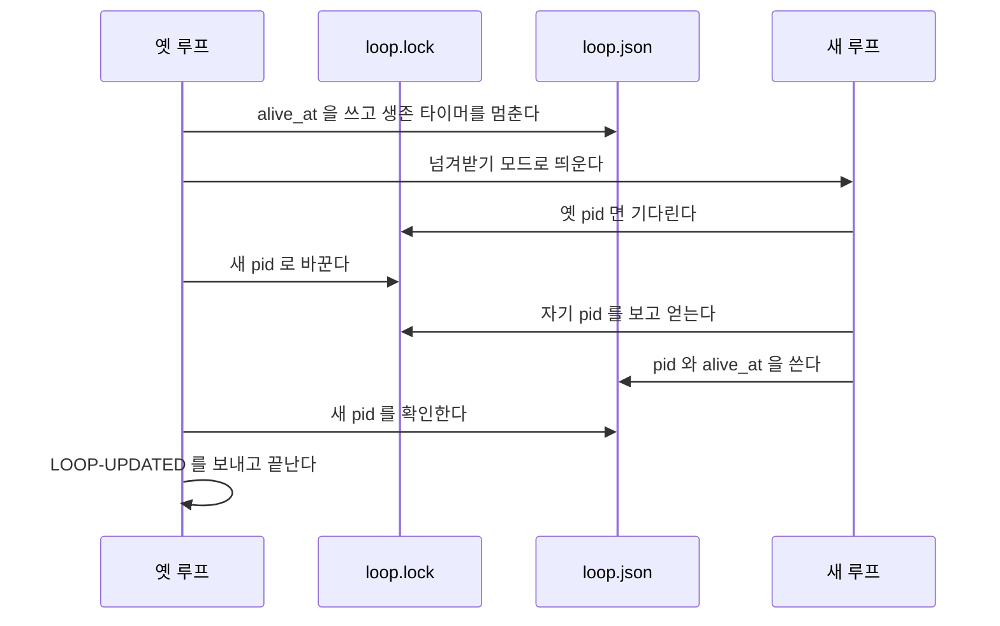

# orch: 상주 루프가 옛 번들로 돌면 스스로 새 설치본으로 다시 뜨는 기술 설계

스펙: [spec.md](spec.md). PR 하나로 낸다(스펙 DECISION5).

## 요구사항 연결

| ID | 해결 방법 |
| --- | --- |
| REQ1 | 부모 루프가 틱 자식이 끝난 직후, 틱 출력을 loop.log 로 옮기기 전에 `selfUpdate.check()` 를 부른다. 지금 설치본이 자기 번들과 다르면 처음 한 번 `LOOP-STALE` 줄을 쓰고, 그 뒤로는 틱 출력의 `STALE-BUNDLE` 줄을 옮기지 않는다(「옛 번들 판정」) |
| REQ2 | 「다시 뜨는 차례」. 옛 루프가 새 설치본의 `orch-loop.ts --foreground` 를 넘겨받기 모드로 띄우고 잠금을 넘긴다. 새 루프는 등록을 지우지 않고, 새 루프가 `loop.json` 을 쓴 것을 본 뒤에 옛 루프가 끝난다 |
| REQ3 | 「다시 뜨는 때」. 이 저장소의 마무리 pid 파일과 이 저장소를 대상으로 도는 머지 큐 프로세스를 본다. 처음 알아챈 때부터 60분이 지났거나 방금 틱이 종료 코드 2 면 기다리지 않는다. 마무리 프로세스에는 신호를 보내지 않는다 |
| REQ4 | 옛 루프가 새 루프를 확인한 뒤 끝나기 전에, 등록된 Run 마다 `LOOP-UPDATED` 를 바로 보낸다(모아 보내기 kind 가 아니다) |
| REQ5 | 새 루프가 시작 대기 한도(`ORCH_LOOP_START_WAIT_SEC`, 기본 10초) 안에 `loop.json` 에 자기 pid 를 쓰지 않으면 옛 루프가 새 루프를 끝내고 잠금을 되찾아 계속 돈다. `LOOP-UPDATE-FAIL` 을 바로 보내고, 그 진입점을 메모리에 기억해 다시 시도하지 않는다 |
| REQ6 | 부모의 `tick` 출처에 `watchStreak` 를 쓴다. 이유는 틱 출력의 원인 줄로 정하고 숫자 묶음을 지운 꼴로 비교한다. `STREAK_LIMIT` 판정을 「넘으면」 에서 「닿으면」 으로 바꿔 단계 출처도 3번째 틱에 보낸다 |
| REQ7 | 루프가 시작할 때 자기 번들의 `plugin.json` 버전을 `loop.json` 의 `bundle_version` 에 적는다. `orch loop status` 와 `orch status` 가 `LOOP-ALIVE` 줄 끝에 `bundle=<값 또는 ->` 를 더한다 |
| REQ8 | `references/waiting.md`, `SKILL.md`, `docs/data-schema.md`, `orch-loop.ts`·`lifecycle.ts` 의 파일 맨 위 설명을 고치고, 변경 조각 `skills/orch/changes/loop-self-update.minor.md` 에 첫 배포의 한 번 수동 재시작을 적는다 |

## 책임과 경계

- **`lib/bundle.ts`**: 「지금 설치본은 어느 번들인가」 의 판정을 그대로 소유한다. 같은 판정을 루프에 다시 쓰지 않는다(스펙 DECISION6).
  - `ownBundle()`: 이 파일이 든 번들 루트. 지금 모듈 안의 `bundle` 상수를 내보낸다. 이름이 비슷한 `bundleRoot()`(스킬 폴더를 낸다)는 그대로 둔다.
  - `currentBundle(own, configDir)`: own 이 `plugins/cache` 안이고 `selectBundle` 이 고른 번들이 own 과 다르면 그 번들 경로, 아니면 null. `staleBundleWarning` 은 이 함수로 다시 쓴다. 출력은 지금과 같다.
  - `bundleVersion(bundle)`: `<bundle>/.claude-plugin/plugin.json` 의 `version`. 읽지 못하거나 문자열이 아니면 null. 캐시 설치와 개발용 설치를 같은 규칙으로 읽는다(스펙 DECISION14).
- **`loop/self-update.ts`(새 파일)**: 옛 루프 쪽의 일 전부를 소유한다. 부모(`lifecycle.ts`)만 import 한다.
  - 메모리 상태 `SelfUpdate`: `target`(지금 설치본 경로), `since`(처음 알아챈 시각), `failed`(실패한 진입점 경로). 프로세스가 끝나면 사라진다. 사람이 루프를 다시 띄우면 기억이 지워진다는 스펙 DECISION11 을 이것으로 지킨다.
  - `decide(input)`: 값만으로 `none`, `wait <이유>`, `go` 를 낸다. 입력은 target, failed, since, 지금 시각, 바쁜 이유, 방금 틱의 종료 코드다. 단위 테스트의 중심이다.
  - `busyReason(repo)`: 「다시 뜨는 때」 의 판정. 바깥 명령은 `PS`(기본 `ps`) 하나다.
  - `handOver(...)`: 「다시 뜨는 차례」 의 옛 루프 쪽 1-6 단계.
  - 알림 문구 `updatedText`, `failedText`.
- **`loop/lifecycle.ts`**: 부모의 틱 고리와 새 루프 쪽 동작을 고친다.
  - 틱이 끝날 때 `selfUpdate.check()` 를 부르고, `go` 면 `handOver` 를 부른다. 성공하면 `foreground` 가 0 을 낸다. `--once` 는 부르지 않는다.
  - `tickResult` 가 `STALE-BUNDLE` 줄을 빼고(알아챈 뒤에만) 원인 줄을 낸다(「틱 실패의 원인 줄」).
  - 넘겨받기 모드(`ORCH_LOOP_HANDOVER`)의 `takeLock` 과 시작 처리(「새 루프 쪽」).
  - `status()` 와 `loop.json` 의 `bundle_version`.
  - 신호를 받으면, 넘겨받는 중인 새 루프가 있을 때 그 pid 에도 TERM 을 보낸다(「실패와 일관성」).
- **`lib/notice-digest.ts`**: `watchStreak` 의 판정을 `count >= STREAK_LIMIT` 로 바꾼다. 값 3 과 `markStreakSent` 의 뜻은 그대로다.
- **`status/orch-status.ts`**: `LOOP-ALIVE` 줄 끝에 `bundle=` 를 더한다. 값은 `loop.json` 에서 읽는다.
- **`orch-loop.ts`**: 코드는 고치지 않는다. 파일 맨 위 설명의 `--status` 줄과 「알림 방식」 의 연속 기준만 고친다. 같은 파일을 고치는 보드 업무 링크 작업(`feat/board-task-link`)과는 설명 줄만 겹친다.

의존 방향: `lifecycle.ts` → `self-update.ts` → `lib/bundle.ts`, `lib/install-record.ts`, `lib/loop.ts`, `lib/run-notice.ts`, `lib/process.ts`, `lib/paths.ts`, `lib/git.ts`(`mainCheckout`). `self-update.ts` 는 `lifecycle.ts` 를 import 하지 않는다. 잠금 파일 읽기·쓰기 helper 는 `lifecycle.ts` 가 인자로 넘긴다.

## 인터페이스와 데이터

### 옛 번들 판정

- 부모가 틱 자식이 끝날 때마다 `currentBundle(ownBundle(), configDir)` 를 부른다. `configDir` 은 부모가 뜰 때의 `CLAUDE_CONFIG_DIR`(없으면 `~/.claude`)이다. 설치 기록 파일 하나를 읽는 비용이라 틱마다 불러도 된다.
- null 이면 상태를 비운다(설치본이 다시 자기 번들로 돌아온 경우). 경로가 바뀌면 `target` 을 바꾸고 `failed` 를 지우며 `LOOP-STALE` 줄을 다시 쓴다. `since` 는 처음 알아챈 시각을 그대로 둔다. 60분 상한이 설치본을 거듭 바꾸는 동안 늘어나지 않게 하려는 것이다.
- loop.log 줄: `LOOP-STALE <옛 버전> <새 버전> <새 진입점>`. 버전은 `bundleVersion` 이고 못 읽으면 `-` 다. 새 진입점은 다시 뜰 때 실제로 띄울 `<새 번들>/skills/orch/scripts/loop/orch-loop.ts` 다. `STALE-BUNDLE` 줄의 `현재 진입점`(`bin/orch.ts`)과 다르다. 루프는 `bin/orch.ts` 를 거치지 않고 띄우므로 실제 경로를 적어야 실패를 따라갈 수 있다.
- `orch status` 와 doctor 의 `LOOP-STALE <repo> <pid> <번들>` 줄과 이름이 같다. 둘 다 「이 루프가 옛 번들로 돈다」 는 같은 사실이라 스펙대로 같은 낱말을 쓴다. loop.log 줄은 칸이 다르다.

### 다시 뜨는 때

`decide` 의 순서다. 위에서 처음 맞는 줄이 결과다.

| 조건 | 결과 |
| --- | --- |
| target 이 없다 | `none` |
| target 의 진입점이 `failed` 와 같다 | `none`(스펙 DECISION11) |
| 방금 틱의 종료 코드가 2 다 | `go`(스펙 DECISION2) |
| since 에서 60분이 지났다 | `go`(스펙 DECISION4) |
| `busyReason` 이 있다 | `wait <이유>`. 이유가 바뀔 때만 loop.log 에 `LOOP-STALE-WAIT <이유>` 를 쓴다 |
| 그 밖 | `go` |

`busyReason(repo)` 는 아래 둘을 본다(스펙 DECISION7).

- 마무리: `pathOf('queue', repo)` 의 `finish-*.pid` 가운데 `pidFileAlive` 가 참인 것. 이유는 `마무리 PR <번호>` 다. `state/finish-started/` 표시는 보지 않는다. 지우지 않는 표시라 끝난 마무리도 남는다(스펙 「조사한 사실」).
- 머지 큐: `PS -Ao pid=,command=` 의 줄 가운데 명령줄에 `merge_queue.`, `merge-queue.sh`, `merge-with-finish.` 가 든 것. 명령줄의 `--repo <경로>` 를 `mainCheckout` 으로 바꿔 이 저장소와 같을 때만 센다. `--repo` 가 없으면 이 저장소의 것으로 센다. 큐는 `--repo` 가 없으면 자기 cwd 를 쓰는데 cwd 를 읽는 비용을 들이지 않고, 잘못 세도 60분 상한이 끝을 정한다. 이유는 `머지 큐 pid <pid>` 다. 프로세스 목록을 읽지 못하면 이유는 `프로세스 목록을 읽지 못했다` 이고 기다린다.

### 다시 뜨는 차례

스펙 DECISION18 이 설계로 넘긴 차례다. 지금 잠금 규칙(살아 있는 루프가 잠금을 쥐면 새 `--foreground` 는 `LOOP-RUNNING` 과 4 로 끝난다, `lifecycle.ts` 489-492행)을 「넘겨받기 모드의 새 루프는 잠금 파일에 자기 pid 가 적힐 때까지 기다린다」 로 넓힌다. 잠금을 넘기는 쪽은 언제나 옛 루프다.

옛 루프(부모, 틱 자식이 없는 틱 사이):

1. 생존 타이머를 멈추고 `alive_at` 을 지금으로 한 번 쓴다. 타이머가 남으면 새 루프가 쓴 `loop.json` 을 옛 pid 로 덮어, 옛 루프가 끝난 뒤 생존 판정이 `pid 종료` 를 낸다.
2. 새 루프를 띄운다. `process.execPath --disable-warning=ExperimentalWarning <새 진입점> <passArgs> --foreground`, `cwd` 는 저장소, `detached: true`, `stdio: 'ignore'`, `unref`. `--start` 의 자식과 같은 꼴이다. 환경은 지금 프로세스 것에 두 값을 더한다.
   - `ORCH_LOOP_BOUND`: `loop.json` 의 `bound_run`. 키가 없으면 `{}`. 새 루프가 `run-current` 를 다시 부르지 않고 명의를 그대로 적는다(스펙 DECISION8).
   - `ORCH_LOOP_HANDOVER`: `{"from": <옛 pid>, "had_runs": <옛 루프의 hadRuns>}`.
   진입점 파일이 없으면 띄우지 않고 6 의 실패로 간다.
3. 잠금 파일 내용을 새 pid 로 바꾼다(옆 파일에 쓰고 rename). 이때부터 옛 루프가 끝나며 부르는 `releaseLock` 은 남의 pid 라 지우지 않는다.
4. 시작 대기 한도까지 `POLL_MS` 마다 `loop.json` 을 읽는다. `pid` 가 새 pid 면 성공이다. 새 루프가 그 전에 끝나면 실패다.
5. 성공: loop.log 에 `LOOP-HANDOVER <새 pid> <옛 버전> <새 버전>` 을 쓰고, 등록된 Run 마다 `LOOP-UPDATED` 를 보낸 뒤 `foreground` 가 0 을 낸다. 이 뒤로 `loop.json` 을 쓰지 않는다.
6. 실패: 새 pid 가 살아 있으면 TERM 을 보낸다. 잠금 내용이 새 pid 거나 비었으면 자기 pid 로 되돌린다(rename, 없으면 `wx` 로 만든다). 잠금에 둘 밖의 살아 있는 루프 pid 가 있으면 그 루프에 맡기고 `LOOP-HANDOVER-LOST <pid>` 를 쓴 뒤 0 으로 끝난다. 아니면 생존 타이머를 다시 켜고 `failed` 에 진입점을 적고 `LOOP-UPDATE-FAIL` 을 보낸 뒤 다음 틱으로 간다.

새 루프 쪽(`--foreground` 가 `ORCH_LOOP_HANDOVER` 를 받았을 때. 읽은 뒤 환경에서 지운다):

- `takeLock`: 잠금이 자기 pid 면 얻은 것이다. 잠금이 `from` pid 이고 그 프로세스가 살아 있으면 시작 대기 한도까지 기다린다. `from` 이 죽었거나 다른 pid 면 지금 규칙(회수, `LOOP-RUNNING`)을 그대로 쓴다. 옛 루프가 3 을 하기 전에 새 루프가 잠금을 읽어도 4 로 끝나지 않게 하려는 것이다.
- 앞 루프 등록 지우기(`lifecycle.ts` 508-514행)와 `--run` 등록(515행)을 건너뛴다. 같은 루프가 이어 가는 것이라 맡던 Run 을 지우지 않는다(스펙 DECISION8). `--run` 을 다시 등록하지 않는 것은 넘겨받는 사이 `--stop --run` 으로 뺀 Run 을 되살리지 않으려는 것이다.
- `hadRuns` 는 `had_runs || runs.length > 0` 이다. 넘겨받는 사이 마지막 Run 이 빠졌으면 첫 틱 전에 `LOOP-EMPTY` 로 끝난다.
- `restart_notices` 는 지금처럼 앞 `loop.json` 에서 이어받는다. 멈춘 시간이 없으니 새로 더할 것은 없다. `errors`, `ci`, `stalls` 도 지금처럼 이어받는다.

생존 판정(`loopStatus`)은 `loop.json` 의 pid 가 살아 있고 `alive_at` 이 `max(3 × tick_sec, 120)` 초 안이면 산다고 본다. 1 에서 5 까지 `loop.json` 은 늘 살아 있는 pid(먼저 옛 루프, 그다음 새 루프)와 시작 대기 한도 안의 `alive_at` 을 가리킨다. 그래서 `orch status`, doctor, `orch config` 와 `--start` 가 그 사이에 불려도 LOOP-DEAD 로 보지 않는다(스펙 DECISION18). 지금 코드에는 루프가 Run 으로 보내는 LOOP-DEAD 알림이 없고, 이 판정을 읽는 쪽이 LOOP-DEAD 줄을 낸다.

### 알림

| kind | 보내는 쪽과 때 | 받는 Run | 본문 |
| --- | --- | --- | --- |
| `LOOP-UPDATED` | 옛 루프, 차례 5 | 등록된 Run 모두 | `<저장소 이름> 루프: <옛 버전> → <새 버전> 으로 다시 떴다`. 버전이 같거나 하나라도 `-` 면 `<옛 버전>(<옛 번들 경로>) → <새 버전>(<새 번들 경로>)` |
| `LOOP-UPDATE-FAIL` | 옛 루프, 차례 6 | 등록된 Run 모두 | `<저장소 이름> 루프: <새 버전> 으로 다시 뜨지 못해 <옛 버전> 으로 계속 돈다. <이유>. 새 진입점: <경로>`. 이유는 `종료 코드 <n>`, `<초>초 안에 loop.json 을 쓰지 않았다`, `진입점이 없다`, `띄우지 못했다: <오류>` 가운데 하나 |

- 저장소 이름은 저장소 루트 폴더 이름(`basename(ctx.repo)`)이다. 본문에 이름이 들어가 `run-notice.ts` 의 10분 중복 건너뛰기가 다른 저장소의 같은 알림과 섞지 않는다(스펙 DECISION9).
- 두 kind 는 `DIGEST_KINDS` 에 없어 바로 간다. `notice-digest.ts` 와 `waiting.md` 의 「바로」 줄에 이름을 더한다.
- 전송 실패는 `NOTICE-FAIL <kind> <이유>` 를 loop.log 에 쓰고 다시 보내지 않는다. 성공 뒤의 옛 루프는 곧 끝나고, 실패를 다음 틱으로 넘길 곳이 없다. 새 루프의 `loop.json` 의 `bundle_version` 과 loop.log 의 `LOOP-HANDOVER` 줄이 사실을 남긴다.
- Run 이 없는 루프는 지금 `sendNotice` 처럼 loop.log 에만 남긴다.

### 틱 실패의 원인 줄

`tickResult(done, staleLogged)` 를 아래처럼 바꾼다.

- 로그로 옮기는 줄: 지금과 같다. 다만 `staleLogged` 면 `STALE-BUNDLE ` 로 시작하는 줄을 뺀다(스펙 DECISION17).
- 원인 줄(스펙 DECISION12): stderr 줄에서 `STALE-BUNDLE ` 줄을 뺀 마지막 빈칸 아닌 줄. 없으면 결과 줄을 뺀 stdout 의 마지막 오류 줄이다. 오류 줄은 `orch-loop:` 로 시작하거나 `오류`, `실패`, `Error` 가 든 줄이다. 둘 다 없으면 원인 줄이 없다. 200자에서 자른다.
- `reason`: 종료 코드가 0 이 아니면 `종료 코드 <n>`, 원인 줄이 있으면 뒤에 `: <원인 줄>` 을 붙인다. 결과 줄이 없으면 지금처럼 `결과 줄 없음` 에 같은 꼴로 원인 줄을 붙인다.
- 비교 키: `reason` 의 숫자 묶음(`\d+`)을 `#` 로 바꾼 값이다. `state.errors[tickKey]` 에는 지금처럼 `reason` 을 그대로 두고, 「이유가 바뀌었는가」 는 두 값의 비교 키로 본다. 원인 줄의 시각과 pid 가 틱마다 달라도 이유가 바뀐 것으로 보지 않는다. 원인 줄이 없으면 `reason` 이 지금과 같은 `종료 코드 <n>` 이라 `orch-loop.spec.ts` 「틱 자식의 실패」 의 기대값이 그대로다.
- 연속: `watchStreak(repo, tickKey, 비교 키 또는 null)` 이 참이면 `sendNotice('WATCH-ERROR', null, 'tick: <reason>', state.run, repo, true)` 로 바로 보내고 `markStreakSent` 한다. 단계 출처(`steps/errors.ts`)와 같은 꼴이다. 이유가 바뀔 때 모아 보내는 지금 알림은 그대로 둔다.

### 상태 출력

- `loop.json` 에 `bundle_version`(문자열 또는 null)을 더한다. 루프가 시작할 때 `bundleVersion(ownBundle())` 로 한 번 쓴다. 이 키가 없는 옛 루프는 `-` 로 보인다.
- `orch loop status`: `LOOP-ALIVE <pid> run=<…> last_tick=<…> alive_at=<…> bundle=<값 또는 ->`.
- `orch status`: `LOOP-ALIVE <pid> runs=<…> last_tick=<…> bundle=<값 또는 ->`. 두 줄의 앞 칸은 지금과 같다(스펙 DECISION14).
- `core/loop.ts` 의 `LoopState` 에 `bundle_version?: string | null` 을 더하고 `docs/data-schema.md` 의 `state/loop.json` 행에 키를 적는다.

## 실패와 일관성

- **루프가 둘이 되지 않는다.** 잠금 파일의 pid 는 늘 하나다. 차례 3 과 6 의 rename 은 원자적이다. 3 뒤 새 루프가 `loop.json` 을 쓰기 전에 죽으면 잠금에 죽은 pid 가 남지만, 그 사이 `--start` 는 먼저 `loopStatus` 를 보고(`running()`), `loop.json` 은 아직 살아 있는 옛 루프를 가리키므로 새 루프를 띄우지 않고 옛 루프에 합류한다. 옛 루프는 6 에서 잠금을 되찾는다.
- **넘겨받는 사이의 `--start`.** `loop.json` 의 pid 가 옛 루프면 옛 루프에 합류해 등록을 쓴다. 새 루프는 틱마다 등록을 다시 읽고 시작할 때 등록을 지우지 않으므로 그 등록이 남는다. `joinLoop` 이 「막 뜨는 루프」 로 보고 `registered_at` 을 새로 써도 해가 없다.
- **넘겨받는 사이의 `--stop`.** `--stop` 은 `loop.json` 의 pid 에 TERM 을 보내고 그 pid 가 끝나기를 기다린다. 옛 루프가 받으면 신호 처리기가 넘겨받는 중인 새 pid 에도 TERM 을 보낸 뒤 끝난다. 새 루프가 받으면(이미 `loop.json` 을 썼다) 새 루프가 끝나고, 옛 루프는 곧 0 으로 끝난다. 어느 쪽이든 루프가 남지 않는다. `--stop --run` 으로 마지막 Run 을 뺐으면 새 루프가 `had_runs` 로 `LOOP-EMPTY` 를 낸다.
- **옛 루프가 KILL 로 죽는다.** 3 전이면 새 루프는 `from` 이 죽은 것을 보고 지금 규칙으로 잠금을 회수해 돈다. 3 뒤면 새 루프가 이미 잠금을 쥐었다. 어느 쪽이든 루프는 하나이고, 옛 루프의 `LOOP-UPDATED` 만 빠진다.
- **마무리를 끊지 않는다.** 마무리와 머지 큐는 `merge-with-finish` 가 따로 띄운 프로세스다. 옛 루프는 틱 자식이 끝난 뒤에만 넘기고, 그 프로세스들에 신호를 보내지 않는다. 60분 상한으로 넘길 때도 같다(스펙 REQ3).
- **새 번들이 이 기능 전 버전이다(낮아지는 쪽).** 그 루프는 `ORCH_LOOP_HANDOVER` 를 몰라 잠금을 보고 4 로 끝난다. 옛 루프는 6 으로 `LOOP-UPDATE-FAIL`(`종료 코드 4`)을 보내고 그 진입점을 다시 시도하지 않는다. 사람이 stop·start 하면 그 버전으로 뜬다.
- **새 번들의 설정 검사가 실패한다.** 새 루프가 `loop.json` 을 쓰기 전에 2 로 끝나 6 으로 간다. 옛 루프가 계속 돌므로 옛 번들 때문에 틱이 실패하던 경우가 아니면 장애가 늘지 않는다.
- **번들 사이의 계약.** 넘겨받기 환경 값(`ORCH_LOOP_HANDOVER`, `ORCH_LOOP_BOUND`), 진입점 경로(`skills/orch/scripts/loop/orch-loop.ts`), 잠금 파일 내용(pid 한 줄)은 옛 번들과 새 번들이 함께 지키는 계약이다. 뒤 버전이 이것을 바꾸면 그 버전으로 넘기기가 실패하고 `LOOP-UPDATE-FAIL` 로 드러난다. 이유와 대안은 [ADR-032](../../adr/032-loop-bundle-handover.md)가 갖는다.
- **배포 순서.** 이 기능이 든 번들로 뜬 부모부터 동작한다. 그 전 부모는 사람이 한 번 stop·start 한다(스펙 DECISION15). 상태 파일 형식은 키를 더하기만 해 옛 루프와 새 루프가 서로의 `loop.json` 을 읽을 수 있다.

## 검증 전략

| ID | 경계와 환경 | 무엇을 보는가 |
| --- | --- | --- |
| REQ1 | `lib-bundle.spec.ts`(임시 설치 기록), 새 `orch-loop-self-update.spec.ts` 의 실제 부모 프로세스 | `currentBundle` 과 `staleBundleWarning` 출력이 지금과 같은지. 설치 기록을 바꾼 뒤 loop.log 에 `LOOP-STALE` 이 한 번이고 그 뒤 틱에 `LOOP-STALE`, `STALE-BUNDLE` 이 없는지 |
| REQ2 | `orch-loop-self-update.spec.ts`. 저장소의 `skills/orch` 와 `.claude-plugin` 을 임시 설정 폴더의 `plugins/cache/fos-skills/fos-skills/<버전>/` 두 곳에 복사하고 `node_modules` 를 링크한다. 가짜 `ORCA`. 짧은 `tick_sec` 과 `ORCH_LOOP_ALIVE_SEC` | 옛 사본으로 띄운 부모가 새 사본으로 넘어가는지, `loop status` 의 `bundle=` 가 새 버전인지, 등록 목록이 같은지, `orch-loop` 프로세스가 하나인지, 넘기는 동안 `loopStatus` 를 짧은 간격으로 읽어 한 번도 죽음이 아닌지, 다음 틱 출력에 `STALE-BUNDLE` 이 없는지 |
| REQ3 | `decide` 단위 테스트(고정 시각), `busyReason` 단위 테스트(가짜 `PS`, 임시 pid 파일), 위 프로세스 테스트의 한 사례 | 마무리 pid 가 사는 동안 기다리고 끝난 뒤 넘기는지, 60분과 종료 코드 2 에서 기다리지 않는지, 다른 저장소의 `--repo` 큐를 세지 않는지, 마무리 프로세스가 살아남는지 |
| REQ4 | 프로세스 테스트의 가짜 `ORCA` 기록, `updatedText` 단위 테스트 | Run 마다 한 번, 저장소 이름과 두 버전, 같은 버전이면 두 경로 |
| REQ5 | 프로세스 테스트. 새 사본의 `orch-loop.ts` 를 곧바로 1 로 끝나는 파일로 바꾼다 | 옛 루프가 계속 틱을 돌고 잠금이 옛 pid 이며 `LOOP-UPDATE-FAIL` 이 한 번이고 다음 틱들에 다시 시도하지 않는지 |
| REQ6 | `notice-digest.spec.ts`(3번째에 참), `tickResult` 원인 줄 단위 테스트, 틱 자식이 같은 설정 오류로 세 번 실패하는 프로세스 사례 | 3번째 틱에 원인 줄이 든 알림 하나, 4번째부터 없음, 성공 뒤 다시 세 번이면 또 옴. 단계 출처도 3번째 |
| REQ7 | `orch-loop.spec.ts` 840행과 `orch-status.spec.ts` 100행의 줄 끝 맞춤을 새 칸으로 고친다 | 앞 칸이 같고 끝에 `bundle=` 가 있는지, 키 없는 `loop.json` 이면 `bundle=-` |
| REQ8 | 문서 검토와 `node scripts/run-tests.ts` 의 문서 검사 | 다시 뜨는 조건, 두 알림, 첫 배포의 수동 재시작 |

프로세스 테스트는 시간이 들어 사례를 묶는다. 하나의 옛 루프로 「기다림 → 넘기기」 를 잇고, 실패 사례는 따로 둔다. 실제 플러그인 설치 기록과 사용자 프로필은 건드리지 않는다. 테스트 명령과 작업 순서는 계획이 정한다.

## 결정

| ID | 결정 | 답 | 누가 | 근거 |
| --- | --- | --- | --- | --- |
| DECISION1 | 잠금을 넘기는 방법 | 옛 루프가 잠금 파일 내용을 새 pid 로 바꿔 넘긴다. 새 루프는 넘겨받기 모드에서 잠금이 자기 pid 가 될 때까지 기다린다 | 작성자 | 대안과 기각 이유는 [ADR-032](../../adr/032-loop-bundle-handover.md) |
| DECISION2 | 옛 루프가 끝나는 때 | 새 루프가 `loop.json` 을 쓴 것을 본 뒤. 그 전에 생존 타이머를 멈춘다 | 작성자 | `loop.json` 이 늘 살아 있는 pid 를 가리켜 LOOP-DEAD 로 보이는 틈이 없다(스펙 DECISION18) |
| DECISION3 | `LOOP-UPDATED` 를 보내는 쪽 | 옛 루프 | 작성자 | 이 기능이 있는 쪽은 옛 루프로 정해져 있다. 새 루프가 보내면 넘겨받기 정보를 하나 더 넘겨야 한다 |
| DECISION4 | 판정 상태(target, since, failed)의 자리 | 부모 메모리 | 작성자 | 사람이 다시 띄우면 기억을 지운다는 스펙 DECISION11 과 같다. 파일로 두면 지울 때를 따로 정해야 한다 |
| DECISION5 | 새 루프의 진입점 | 새 번들의 `orch-loop.ts --foreground`. `bin/orch.ts` 를 거치지 않는다 | 작성자 | 명령 표에 `--foreground` 가 없고, `--start` 도 같은 꼴로 자식을 띄운다. 경로는 번들 사이 계약으로 ADR 에 둔다 |
| DECISION6 | `--repo` 없는 머지 큐 | 이 저장소의 것으로 센다 | 작성자 | 잘못 세는 쪽은 기다림이고 60분 상한이 끝을 정한다. 놓치는 쪽은 도는 머지를 두고 다시 뜨는 것이다 |
| DECISION7 | 넘겨받기 실패 알림의 재전송 | 하지 않는다 | 작성자 | 스펙 REQ5 의 「한 번」 이다. 실패한 진입점은 다시 시도하지 않으므로 알림도 다시 나지 않는다 |

| 결정 | 종류 | ADR | 현재 규칙의 원본 |
| --- | --- | --- | --- |
| 번들 사이 루프 넘기기 | architecture | [ADR-032](../../adr/032-loop-bundle-handover.md) | 이 설계 「다시 뜨는 차례」, `loop/lifecycle.ts` 와 `loop/self-update.ts` 의 파일 맨 위 설명 |
