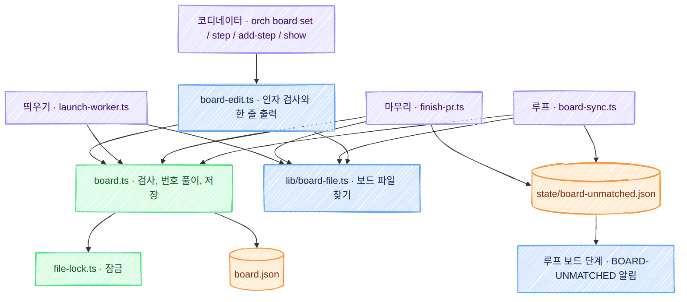

# orch: 보드 항목 고치기 명령(`orch board`) 기술 설계

스펙: [spec.md](spec.md)

이 설계 위에 [보드 자동 진행](../board-auto-advance/spec.md)과 [보드 승인 버튼](../board-approval/spec.md)이 이어진다. 두 기능이 기대는 자리는 「뒤 기능이 기대는 자리」 에 모았다.

## 요구사항 연결

PR 은 「PR 나누기와 순서」 의 번호다.

| ID | 해결 방법 | PR |
| --- | --- | --- |
| REQ1 | 명령 표(`skills/orch/scripts/lib/commands.ts`)의 board 묶음에 `set`, `step`, `add-step`, `show` 행을 더한다. 이 행들은 모두 새 스크립트 `scripts/board/board-edit.ts` 를 가리키고 동작 이름을 앞 인자로 붙인다(`feedback` 묶음과 같은 꼴). 플러그인 경로는 진입점이 설치 기록에서 푼다 | PR3 |
| REQ2 | 보드 파일 찾기를 새 모듈 `lib/board-file.ts` 의 `boardPath` 한 곳에 둔다. 순서는 명령줄 `--board`, `config.json` 의 `finish.board`, work-board 기본 위치다. 지금 `lib/paths.ts` 의 `boardPath` 를 쓰는 호출자를 모두 이 함수로 옮긴다(아래 「보드 파일 찾기」 의 호출자 표) | PR2, PR3 |
| REQ3 | `board.ts` 가 단계 번호를 푼다. 엄격 호출(`--exact`)과 새 동작은 같은 번호의 줄이 둘이면 거절하고, 없는 번호는 있는 번호를 알려 준다. 새 명령은 받은 번호를 그대로 넘긴다 | PR1, PR3 |
| REQ4 | `done`, `undo` 는 `board.ts step --exact`, `text` 는 새 동작 `board.ts step-edit` 다. 번호 일치, 끝냄 상태 유지, 사건 꼬리표를 지우는 글의 거절을 `step-edit` 가 판정한다. `decide` 항목의 자동 전환은 `board.ts` 의 지금 동작이다 | PR1, PR3 |
| REQ5 | 새 동작 `board.ts step-add` 가 단계를 세는 쪽을 고르고, 번호를 붙이고, 중복 번호와 `done` 항목을 거절하고, `progress` 필드가 있으면 stderr 로 알린다 | PR1, PR3 |
| REQ6 | `step-edit` 와 `step-add` 가 `--event "<PR> <사건>"` 을 받아 줄 끝 꼬리표를 붙이거나 바꾼다. 새 명령의 `--on` 이 이 옵션으로 넘어간다. 꼬리표 글의 원본은 `extensions/work-board/hooks/event-tags.js` 다 | PR1, PR3 |
| REQ7 | `board.ts set --exact` 가 없는 항목을 만들지 않고 거절한다. 상태 값과 진행률 검사는 `board.ts set` 의 지금 검사다 | PR1, PR3 |
| REQ8 | 엄격 호출과 새 동작은 성공하면 고친 뒤의 항목을 JSON 한 줄로 낸다. `board-edit.ts` 가 그 JSON 으로 `BOARD-SET`, `BOARD-STEP`, `BOARD-STEP-ADD` 한 줄을 만들고 `board.ts` 의 종료 코드와 stderr 를 그대로 넘긴다. 인자 검사는 `board-edit.ts` 가 하고 종료 코드 2 다 | PR1, PR3 |
| REQ9 | 읽기 전용 새 동작 `board.ts view` 가 항목의 상태, 진행률, 줄 목록을 JSON 으로 낸다. `board-edit.ts` 가 머리 줄과 끝나지 않은 단계로 줄여 보인다. 안 풀린 `BOARD-UNMATCHED` 줄은 PR4 가 더한다 | PR1, PR3, PR4 |
| REQ10 | 자동 진행 구현이 머지된 뒤 `board.ts step-mark` 와 `orch board step <항목> <번호> auto\|ask\|wait\|plain` 을 더한다. 그때까지 이 동작 이름은 사용법 오류다(아래 「자동 진행 표시 동작이 기다리는 방법」) | PR5 |
| REQ11 | 잠금은 새 모듈 `extensions/work-board/bin/file-lock.ts` 에 두고 `board.ts` 의 모든 쓰기 동작이 읽기부터 쓰기까지 잡는다. 낡은 목록은 `set --if-rev <줄 지문>` 으로 거절하고, 줄 목록을 통째로 저장하는 호출자가 읽을 때의 지문을 넘긴다 | PR1, PR2 |
| REQ12 | 머지를 보드에 반영하는 두 자리(`board-sync.ts`, `finish-pr.ts`)가 같은 순수 판정으로 「가리키는 줄이 하나도 없는 머지」 를 가려 `state/board-unmatched.json` 에 기록한다. 루프의 보드 단계가 알리지 않은 기록마다 `BOARD-UNMATCHED` 를 한 번 보낸다 | PR4 |
| REQ13 | 새 옵션을 주지 않은 `board.ts` 호출은 분기가 그대로다. 새 옵션 이름은 지금 옵션의 줄임 꼴과 겹치지 않게 짓는다. 예외는 잠금을 못 잡은 때의 종료 코드 1 이다 | PR1 |
| REQ14 | `skills/orch/references/board.md` 의 「갱신 담당」 과 worker 금지 문장을 새 명령으로 바꾸고 「직접 고치지 않는다」 를 더한다. 보드 창의 요청문과 work-board 문서의 안내도 새 명령으로 바꾼다 | PR3 |
| REQ15 | 사건 표시가 없는 항목은 마지막 PR 이 머지돼도 그 PR 번호가 적힌 줄만 끝낸다. 끝나지 않은 단계가 남으면 `done` 으로 바꾸지 않고, 가리키는 줄이 없으면 REQ12 의 알림이 간다(아래 「마지막 PR 과 남은 단계」) | PR4 |

## 설계 단계 실측

2026-11-10, node 24.22.1, macOS. 임시 폴더에서 쟀다.

| 확인한 것 | 결과 |
| --- | --- |
| `board.ts` 한 번 호출에 걸리는 시간 | `set` 약 100ms, `steps` 평균 약 140ms. 대부분이 프로세스를 띄우는 시간이라 잠금을 쥐는 구간(읽기, 고치기, 쓰기)은 그보다 훨씬 짧다 |
| 동기 코드에서 기다리기 | `Atomics.wait` 로 50ms 를 기다리면 52ms 가 지난다. `board.ts` 의 `main` 을 비동기로 바꾸지 않고 잠금을 기다릴 수 있다 |
| 잠금 파일 만들기 | `openSync(파일, 'wx')` 는 파일이 이미 있으면 `EEXIST` 로 실패한다. 먼저 만든 프로세스 하나만 잠금을 쥔다 |
| 잠금 파일의 나이 | `statSync(파일).mtimeMs` 로 30초가 지났는지 읽을 수 있다. 테스트는 `utimesSync` 로 나이를 옮겨 30초를 기다리지 않는다 |
| 낡은 잠금 넘겨받기의 경쟁 | PR 리뷰가 든 순서(둘이 같은 낡은 잠금을 본 뒤 한쪽이 넘겨받아 저장 직전까지 가고 다른 쪽이 재개)를 권리 파일 방식으로 실행하면, 늦게 온 쪽은 권리 파일을 만들지 못한다. 먼저 온 쪽이 놓은 뒤에 오면 권리 파일은 만들어도 다시 확인에서 물러나고 그 사이 정상으로 잡은 잠금이 그대로다 |

## 책임과 경계



| 층 | 파일 | 맡는 것 |
| --- | --- | --- |
| work-board | `extensions/work-board/bin/board.ts` | 항목 검사, 단계 번호 풀이, 글 바꾸기와 더하기 규칙, 꼬리표 붙이기, 저장 꼴, 잠금 잡기, 낡은 목록 판정. 보드 파일을 쓰는 유일한 코드다 |
| work-board | `extensions/work-board/bin/file-lock.ts`(새 파일) | 파일 잠금 한 벌. 대상 파일 옆에 잠금 파일을 만들고 기다림과 낡은 잠금 넘겨받기를 맡는다. 보드 형식을 모른다 |
| work-board | `extensions/work-board/hooks/event-tags.js` | 줄에서 사건 꼬리표를 읽고 붙이는 규칙의 원본. 줄 끝 꼬리표를 바꾸는 함수와 줄 앞 꼬리표(`[merge]` 따위)를 읽는 함수를 더한다 |
| orch 명령 표 | `skills/orch/scripts/lib/commands.ts` | 새 동작 이름과 스크립트, 문맥 인자(`--repo`)만 정한다. 판정은 두지 않는다 |
| orch 스크립트 | `skills/orch/scripts/board/board-edit.ts`(새 파일) | 인자 개수와 꼴 검사(종료 코드 2), 보드 파일 찾기, `board.ts` 호출, 결과 JSON 을 한 줄 출력으로 바꾸기. 번호, 글, 상태의 옳고 그름은 판정하지 않는다 |
| orch lib | `skills/orch/scripts/lib/board-file.ts`(새 파일) | 보드 파일 찾기. 설정(`finish.board`)을 읽는 유일한 자리다 |
| orch core | `skills/orch/scripts/core/board.ts` | 값으로 정하는 판정. 명령 묶음에 지문을 붙이는 함수(PR2), 못 맞춘 머지와 풀림 판정(PR4)을 더한다 |
| orch lib | `skills/orch/scripts/lib/board-unmatched.ts`(새 파일, PR4) | 못 맞춘 머지 기록 파일을 읽고 쓴다 |

- `board.ts` 와 `hooks/` 의 파일은 지금처럼 orch 를 import 하지 않는다(`lib/board-file.ts` 와 `lib/board.ts` 가 `board.ts` 를 import 해 고리가 생긴다). work-board 의 다른 파일(`bin/worker-marks.ts`, `bin/merge-queue.ts`)이 orch 를 import 하는 것은 그대로이고 새 고리는 생기지 않는다. 그래서 `board.ts` 를 직접 부르면 `finish.board` 를 모르고 부른 폴더의 기본 위치를 쓴다. 이 동작은 그대로 둔다.
- 새 명령은 다른 orch 스크립트처럼 `board.ts` 를 자식 프로세스로 부른다. `BOARD_BIN` 환경 변수로 바꿀 수 있다.
- 소유 경계의 분리 신호(쓰는 사람, 배포 환경, 데이터 생명주기, 거꾸로 읽기)에 걸리는 것이 없다. 새 파일은 모두 지금 모듈 안에 둔다.

## 인터페이스와 데이터

보드 파일의 형식은 바꾸지 않는다. 항목에 새 칸을 더하지 않는다.

### `board.ts` 에 더하는 것 (PR1)

| 호출 | 하는 일 | 거절(종료 코드 1) |
| --- | --- | --- |
| `set <id> [<status>] … --exact` | 지금의 `set` 과 같다. 항목이 없으면 만들지 않는다 | `항목이 없다: <id>` |
| `set <id> … --if-rev <지문>` | 저장 직전, 잠금 안에서 그 항목의 지금 줄 지문이 받은 값과 같을 때만 저장한다 | `읽은 뒤 <id> 의 줄이 바뀌어 저장하지 않았다`, 항목이 없으면 `항목이 없다` |
| `step <id> <번호> [--undo] --exact` | 지금의 `step` 과 같다 | 같은 번호 줄이 둘 이상, 없는 번호(`9 번 단계가 없다. 있는 번호: 1 2 3`) |
| `step-edit <id> <번호> <글> [--event "<PR> <사건>"]` | 그 번호의 줄 전체를 새 글로 바꾼다. 단계가 있는 쪽(`details`, 없으면 `next`)의 줄을 고친다. 새 글에 앞 표시가 없으면 끝냄 상태는 그대로다 | 번호 풀이 거절(위와 같다), 새 글이 같은 번호로 시작하지 않음, 옛 줄에 있던 꼬리표가 새 글에 없음 |
| `step-add <id> <글> [--event "<PR> <사건>"]` | 단계를 세는 쪽 끝에 끝나지 않은 줄을 더한다. 단계가 어느 쪽에도 없으면 `details` 다. 글이 번호로 시작하지 않으면 그쪽의 가장 큰 번호에 1 을 더해 `<번호>. <글>` 로 만든다. 앞 표시는 떼고 끝나지 않은 줄로 둔다 | 이미 있는 번호, `done` 항목, 항목 없음 |
| `view <id>` | 보드를 고치지 않고 항목을 JSON 한 줄로 낸다 | 항목 없음 |

- `--exact` 는 「있는 항목과 하나뿐인 번호에만 듣는다」 는 뜻이다. `step-edit`, `step-add` 는 늘 이 규칙이다.
- `--event` 의 PR 은 `1455` 와 `#1455` 를 같게 받고 사건은 `pr`, `merge`, `deploy`, `release` 다. 다른 값은 거절이다. PR 번호 `0` 과 `0` 으로 시작하는 번호도 거절한다. 꼬리표를 읽는 쪽(`parseEventTag`)이 그 번호를 읽지 못해 끝나지 않는 줄이 된다. 줄 끝에 이미 `(#N 사건)` 이 있으면 바꾼다. `step-edit` 의 새 글에 꼬리표가 없어도 `--event` 를 주면 꼬리표가 있는 것으로 본다.
- 줄 앞 꼬리표는 줄 글에 `2. [merge] 머지` 처럼 적힌 것만 본다. 띄우기가 만든 항목은 꼬리표를 글에 두지 않고 `stages` 필드에 단계 번호로 둔다(`core/milestones.ts` 의 `milestoneLines`). 그 줄은 `step-edit` 가 번호를 못 바꾸게 막으므로 글을 바꿔도 사건과의 짝이 남는다.
- 꼬리표를 지우는 글의 판정: 옛 줄에 줄 앞 꼬리표가 있으면 새 글에도 줄 앞 꼬리표가, 옛 줄에 줄 끝 꼬리표가 있으면 새 글(또는 `--event`)에도 줄 끝 꼬리표가 있어야 한다. 사건이나 PR 번호를 다른 값으로 바꾸는 것은 받는다. 번호를 잘못 붙인 꼬리표를 고칠 수 있어야 한다.
- `stages` 필드가 있는 항목(띄우기가 만든 마일스톤 항목)에서 `step-edit`, `step-add` 가 반영한 줄에 줄 끝 꼬리표가 있으면(`--event` 로 붙였든 새 글에 직접 썼든) 반영한 뒤 stderr 에 한 줄로 알린다. 줄 끝 꼬리표가 하나라도 있으면 `board-sync` 와 마무리가 그 항목을 꼬리표 줄만 사건으로 끝내는 항목으로 다뤄(`board.md` 「직접 작성한 사건 단계」) `stages` 의 단계가 저절로 끝나지 않게 된다. 종료 코드는 0 이다.
- `step-add` 는 항목에 `progress` 필드(N/M)이 있으면 반영한 뒤 stderr 에 `progress 칸이 단계 수보다 앞서 새 줄이 진행률에 안 보인다` 한 줄을 낸다. 종료 코드는 0 이다.
- 지금 `board.ts` 는 옵션을 고유한 앞 글자로 줄여 받는다(`--o` 는 `--owner`, `--s` 는 `--stages`). 새 옵션 이름 `--exact`, `--event`, `--if-rev` 는 지금 옵션 어느 것과도 첫 글자가 겹치지 않아, 지금 듣는 줄임 꼴이 모호해지지 않는다.
- 새 옵션을 주지 않은 호출은 출력이 지금과 같다(쓰기 동작은 성공해도 아무것도 내지 않는다).
- 읽기 동작의 이름은 `view` 다. 새 명령의 `show` 와 이름이 다른 까닭은 `board.ts` 의 기존 테스트가 `show` 를 「모르는 명령」 의 예로 써서, 같은 이름을 더하면 그 테스트를 고쳐야 하기 때문이다(스펙 REQ13 「기존 테스트가 고치지 않고 통과한다」).

엄격 호출(`--exact`), `step-edit`, `step-add` 의 성공과 `view` 는 stdout 에 아래 JSON 한 줄을 낸다. 고친 뒤의 값이고 잠금 안에서 만든다.

```json
{"id": "order-api", "status": "doing", "was": "doing", "progress": [1, 3], "rev": "9f2c41d07ab3", "number": 3, "lines": [{"number": 1, "done": true, "text": "1. 구현", "in": "details"}, {"number": null, "done": false, "text": "참고: 배포는 다음 주", "in": "details"}]}
```

| 칸 | 값 |
| --- | --- |
| `status`, `was` | 고친 뒤와 고치기 전의 상태. `view` 는 둘이 같다 |
| `progress` | `board.ts list` 와 같은 셈(`progress` 필드가 앞서고 없으면 단계 줄). 둘 다 없으면 `null` |
| `rev` | 고친 뒤의 줄 지문 |
| `number` | 고치거나 더한 단계 번호. `set`, `view` 에는 없다 |
| `lines` | `details` 다음 `next` 순서의 빈 줄을 뺀 모든 줄. `number` 는 진행률을 세는 단계 줄에만 있고 참고 줄은 `null` 이다. `in` 은 그 줄이 든 칸이다 |

### 잠금 (PR1)

- 잠금 파일은 보드 파일 옆의 `<보드 파일 이름>.lock` 이다(기본 위치면 `.omc/board.json.lock`). 보드 파일과 같은 폴더라 같은 파일시스템이고, `--file` 로 다른 보드를 주면 그 보드만 잠근다.
- 쓰는 동작(`set`, `detail-edit`, `detail-add`, `step`, `mark`, `del`, `step-edit`, `step-add`)은 보드를 읽기 전에 잠금을 잡고, 임시 파일을 보드 파일 이름으로 바꾼 뒤 놓는다. 임시 파일 이름에는 프로세스 번호를 넣어 프로세스끼리 겹치지 않게 한다. `.bak` 사본도 잠금 안에서 만든다. 읽는 동작(`list`, `steps`, `view`)은 잠그지 않는다. 쓰기가 이름 바꾸기로 끝나 읽는 쪽은 늘 온전한 파일을 본다.
- 잡기: 잠금 파일을 「없을 때만 만들기」 로 만들고 자기 표지(프로세스 번호와 무작위 글)를 적는다. 이미 있으면 50ms 쉬고 다시 해 본다. 5초가 지나면 `보드 잠금을 5초 안에 잡지 못했다: <잠금 파일>` 을 stderr 에 쓰고 종료 코드 1 이다. 보드는 읽지도 쓰지도 않는다.
- 낡은 잠금: 잠금 파일의 마지막 수정 시각이 30초보다 오래됐으면 죽은 프로세스가 남긴 것으로 본다. 프로세스가 살아 있는지는 보지 않는다(스펙 DECISION16).
- 넘겨받기: 낡은 잠금 하나를 넘겨받을 수 있는 프로세스는 하나뿐이다. 그 권리는 「권리 파일을 없을 때만 만들기」 한 번으로 정한다. 확인과 덮어쓰기를 따로 하면, 둘이 같은 확인을 통과한 뒤 차례로 덮어 둘 다 들어간다(PR 리뷰의 재현). 순서는 아래와 같다.
  1. 잠금 파일의 내용과 수정 시각을 읽어 그 잠금만의 이름(둘을 합친 해시)을 만든다.
  2. 권리 파일 `<잠금 파일>.claim.<그 이름>` 을 없을 때만 만들기로 만든다. 이미 있으면 다른 프로세스가 넘겨받는 중이라 물러나 다시 기다린다.
  3. 권리를 얻은 뒤 잠금 파일을 다시 읽는다. 1 에서 본 이름 그대로면 자기 표지를 쓴 임시 파일을 잠금 파일 이름으로 바꿔 덮고 잡은 것으로 본다. 다르면(그 사이 다른 프로세스가 넘겨받았거나 잠금이 풀렸다) 권리 파일을 지우고 물러난다.
  4. 권리 파일은 잠금을 놓을 때 함께 지운다.
- 이 순서가 막는 것: 권리 파일의 이름이 낡은 잠금 하나에 묶여 있어, 그 잠금을 덮을 수 있는 프로세스가 하나로 정해진다. 덮은 뒤의 잠금은 내용이 달라 이름도 달라지므로, 옛 값을 쥔 채 늦게 깨어난 프로세스가 권리 파일을 만들더라도 3 의 확인에서 물러난다. 죽은 프로세스의 잠금은 스스로 바뀌지 않으므로 3 의 확인과 덮어쓰기 사이에 다른 프로세스가 끼어들 길이 없다.
- 남는 한계 둘을 문서에 적는다.
  - 잠금을 쥔 프로세스가 죽지 않고 30초 넘게 멈춰 있다 깨어나면, 그 사이 넘겨받은 프로세스와 함께 쓸 수 있다. 「나이만 본다」 는 결정에 딸린 한계이고, 아래 「쓰기 직전」 확인이 그 틈을 좁힌다.
  - 넘겨받던 프로세스가 권리 파일을 만든 직후(덮기 전)에 죽으면 그 잠금은 아무도 넘겨받지 못한다. 쓰기는 5초 뒤 종료 코드 1 로 끝나고, 권리 파일이 30초보다 오래됐으면 stderr 가 두 파일(잠금 파일과 권리 파일)을 지우라고 알린다. 저절로 풀지 않는다. 풀려면 같은 경쟁이 한 단계 더 생긴다. 잠금을 쥔 채 죽은 뒤 다시 넘겨받다 죽어야 생기는 일이라 사람이 지우는 쪽을 골랐다.
- 쓰기 직전: 보드 파일을 바꾸기 전에 잠금 파일이 아직 자기 표지인지 본다. 아니면(30초 넘게 멈춰 있다 넘겨받혔다) 쓰지 않고 종료 코드 1 이다.
- 놓기: 잠금 파일이 자기 표지일 때만 지운다. 거절이나 예외로 끝나도 놓는다.
- 보드 파일의 폴더가 없으면 잠금 파일을 둘 곳이 없어 폴더를 먼저 만든다. 이 호출이 만든 폴더인데 보드를 쓰지 않고 끝났으면(거절) 빈 폴더를 다시 지운다. 거절한 호출이 워크트리에 빈 `.omc` 를 남기지 않게 하려는 것이다.
- `file-lock.ts` 는 `withFileLock(대상 파일, 할 일, { waitMs, staleMs })` 와, 넘겨받기의 순서를 테스트가 끼워 실행할 수 있게 그 단계 함수를 내보낸다. 기본값이 5초와 30초다. `board.ts` 는 환경 변수 `BOARD_LOCK_WAIT_MS` 가 있으면 기다리는 시간만 그 값으로 바꾼다. 테스트가 5초를 기다리지 않게 하려는 값이고 문서에는 테스트용이라고 적는다.

### 줄 지문과 낡은 목록 거절 (PR1, PR2)

- 줄 지문은 항목의 `details` 와 `next` 줄(글과 끝냄 값)을 `board.ts` 가 읽는 꼴로 맞춘 뒤 sha1 로 줄인 앞 12 글자다. `board.ts` 가 `linesRev(항목)` 으로 내보내고, orch 는 이 함수를 import 해 자기가 읽은 항목의 지문을 만든다. 계산 규칙이 한 곳에만 있다.
- 지문은 저장하지 않는다. 읽을 때마다 계산하므로 보드 형식이 그대로다.
- `set --if-rev` 를 붙이는 호출자는 「보드를 먼저 읽고, 그 줄 목록을 고쳐 `--detail` 로 통째 저장하는」 자리다.

| 호출자 | 통째 저장하는 때 | 거절되면 |
| --- | --- | --- |
| `board/board-sync.ts` | 옛 자동 줄을 지울 때, `남은 일:` 줄을 바꿀 때 | 그 항목의 남은 명령을 건너뛰고 stderr 한 줄과 `BOARD <id> stale` 을 낸 뒤 다음 항목으로 간다. 다음 틱이 다시 읽어 판정한다. 그 밖의 보드 명령 실패는 지금처럼 종료 코드 1 로 끝낸다 |
| `board/board-release.ts` | 릴리스에 든 PR 의 항목에서 `남은 일:` 줄을 지울 때 | `board-sync` 와 같이 그 항목을 건너뛰고 다음 항목으로 간다. 건너뛴 항목이 있으면 종료 코드 1 이라 부른 쪽(저장소의 절차나 핸들러)이 다시 부른다 |
| `lib/board.ts` 의 `registerBoard` | `중간 과정:` 줄을 바꿀 때, `done` 항목을 다시 열 때 | 보드를 다시 읽어 한 번 더 한다. 또 거절되면 지금처럼 Error 다(`launch-worker` 는 stderr 에 알리고 띄우기는 계속한다) |
| `queue/finish-pr.ts` | 중간 PR 과 마일스톤 항목의 `남은 일:` 줄을 바꿀 때 | 항목과 단계를 다시 읽어 한 번 더 한다. 또 거절되면 지금의 「반영하지 못했다」 로 `FINISH-FAIL` 이다 |

- 한 항목의 명령 묶음에는 통째 저장을 하나만 두고 묶음의 맨 앞에서 실행한다. 지금 `board-sync.ts` 는 옛 자동 줄 지우기와 `남은 일:` 줄 바꾸기가 겹치면 통째 저장을 두 번 낸다. 첫 저장이 지문을 바꿔 둘째가 거절되므로 뒤의 것 하나로 합친다. 합치는 일과 `--if-rev` 를 붙이는 일은 `core/board.ts` 의 순수 함수가 맡고, 지문 값은 `lib` 쪽이 넘긴다(core 는 work-board 를 import 하지 못한다).
- 묶음의 나머지 명령(`step`, 칸만 바꾸는 `set`)은 줄 하나나 칸 하나를 고치므로 잠금만으로 앞 수정을 지우지 않는다.
- `board-sync` 가 지문 거절에서 틱 전체를 멈추지 않는 까닭: 보드는 틱의 처음에 한 번 읽고 항목마다 gh 조회 뒤에 쓰므로 읽기와 쓰기 사이가 수 초에서 수십 초다. 코디네이터가 그 사이 새 명령으로 고치는 일은 정상이고, 그때마다 다른 항목의 반영까지 한 틱 늦출 까닭이 없다.
- 남는 틈: 묶음 끝의 `set <id> done` 은 앞서 읽은 단계 목록으로 정한다. 그 사이 `add-step` 이 줄을 더하면 끝나지 않은 줄이 있는 채 `done` 이 될 수 있다. 통째 저장이 아니라 이번 지문 거절의 대상이 아니고, 스펙도 다루지 않아 그대로 둔다.
- 대상이 아닌 통째 저장: `goal-progress.ts` 의 `--details` 옵션은 목표 항목의 줄을 다른 항목의 제목으로 새로 만든다. 자기 줄을 읽어 고치는 저장이 아니라 붙이지 않는다. 새 항목을 만드는 `registerBoard` 의 첫 저장도 읽은 줄이 없어 붙이지 않는다. `finish-pr.ts` 의 `done` 처리(`--next ''`)는 읽은 목록 없이 칸을 비우는 호출이라 그대로다.

### 보드 파일 찾기 (PR2)

`lib/board-file.ts` 의 `boardPath(저장소, 명령줄 값?)` 이 아래 순서로 처음 있는 것을 돌려준다.

1. 명령줄 값(`--board`). 상대경로는 주 checkout 기준이다.
2. `<orch 루트>/config.json` 의 `finish.board`. 상대경로는 주 checkout 기준이다. 빈 문자열은 지금처럼 값이 없는 것으로 보고 3 으로 간다. 문자열이 아니면 설정 오류(`ConfigError`)다.
3. work-board 의 기본 위치(`board.ts` 의 `defaultBoardPath`). 받은 폴더가 속한 git 작업 트리의 `.omc/board.json` 이고 옛 `.omc/handoffs/board.json` 이 있으면 그것이다.

- 새 꼴 명령은 진입점이 `--repo` 를 주 checkout 으로 채운다(`lib/context.ts`). 그래서 워크트리에서 `orch board set` 을 불러도 주 checkout 의 보드가 바뀐다. `--repo <워크트리>` 를 직접 주면 3 이 그 워크트리의 보드를 고른다. 설정 파일은 워크트리에서 읽어도 주 checkout 의 것이라 2 는 어디서 불러도 같은 파일이다.
- `lib/paths.ts` 의 `boardPath` 는 지운다. 이름이 같은 함수가 둘이면 설정을 읽지 않는 쪽을 다시 부르기 쉽다. `lib/paths.ts` 가 설정을 읽게 하지 않는 까닭은 `lib/config.ts` 가 이미 `lib/paths.ts` 를 import 해 고리가 생기기 때문이다.
- 설정 파일이 깨졌으면 기본 위치로 떨어지지 않고 오류를 그대로 올린다. 조용히 기본 보드를 고치는 것이 더 나쁘다. 루프는 틱을 시작할 때 같은 설정을 읽어 먼저 멈춘다. `orch status` 는 지금 보드 읽기 실패를 `SKIP-BOARD` 한 줄로 내므로 설정 오류도 같은 줄로 낸다.

지금 코드에서 다시 찾은 호출자다(2026-11-10, `origin/main` 14.37.0).

| 호출자 | 지금 | 바뀌는 것 |
| --- | --- | --- |
| `board/board-sync.ts`(`--board` 없을 때) | 기본 위치만 | `finish.board` 를 읽는다 |
| `board/board-release.ts`(`--board` 없을 때) | 기본 위치만 | 같다 |
| `board/goal-progress.ts`(`--board` 없을 때) | 기본 위치만 | 같다 |
| `loop/steps/board.ts`(동기화를 돌릴지 정하는 파일 확인) | 기본 위치만 | 같다. 지정 보드만 있는 저장소에서 동기화를 건너뛰지 않게 된다 |
| `loop/steps/auto-merge.ts`(자동 머지의 보드 읽기) | 기본 위치만 | 같다 |
| `loop/completion-watch.ts`(준비됨 뒤 `pr` 필드 채우기) | 기본 위치만 | 같다 |
| `lib/movement.ts` 의 `collectStages`(멈춘 단계) | 기본 위치만 | 같다 |
| `lib/decisions.ts`(결정 알림) | 기본 위치만 | 같다 |
| `lib/board.ts` 의 `registerBoard`(띄우기) | 기본 위치만 | 같다 |
| `status/orch-status.ts`, `paths/orch_paths.ts`(`orch paths board`) | 기본 위치만 | 같다 |
| `queue/finish-pr.ts`, `cleanup/handoff-cleanup.ts` | 자기 옵션과 설정에서 읽은 값을 넘긴다 | import 자리만 바뀐다. `handoff-cleanup` 은 자기 값이 없을 때 `finish.board` 를 쓰게 된다 |

- 바꾸지 않는 것: `board-sync.ts` 와 `board-release.ts` 의 `--board` 는 지금처럼 부른 폴더 기준으로 푼다. `goal-progress.ts` 는 `--repo` 가 없어 부른 폴더로 찾는다(`finish.board` 가 없는 저장소의 워크트리에서 `orch board goal` 을 부르면 그 워크트리의 보드다). `handoff-cleanup.ts` 는 자기 설정(`cleanup.board`)을 먼저 본다. 기존 스크립트의 인자 뜻을 이 기능에서 바꾸지 않고 이 예외를 `board.md` 에 적는다.
- 범위 밖으로 남는 것: 보드 창(`hooks/register.js` 의 `BOARD_PATHS`)과 `board.ts` 를 직접 부르는 호출은 `finish.board` 를 읽지 않는다. `finish.board` 를 기본 위치와 다르게 둔 저장소에서는 창이 다른 파일을 보인다. 스펙의 범위가 orch 쪽 호출자라 이번에 고치지 않고 `board.md` 에 이 한계를 적는다.

### 새 명령 (PR3)

```text
orch board set <항목> <상태>
orch board step <항목> <번호> done|undo
orch board step <항목> <번호> text "<글>" [--on "<PR> <사건>"]
orch board add-step <항목> "<글>" [--on "<PR> <사건>"]
orch board show <항목>
공통: [--board <파일>] [--repo <폴더>] [--full]
```

| 명령 | `board.ts` 호출 | 성공 출력(stdout) |
| --- | --- | --- |
| `set <항목> <상태>` | `set <항목> <상태> --exact` | `BOARD-SET <항목> <상태>` |
| `step <항목> <번호> done` | `step <항목> <번호> --exact` | `BOARD-STEP <항목> <번호> done`. 상태가 바뀌었으면(`was` 와 `status` 가 다르면) 끝에 `status=<상태>` |
| `step <항목> <번호> undo` | `step <항목> <번호> --undo --exact` | `BOARD-STEP <항목> <번호> undo` |
| `step <항목> <번호> text "<글>"` | `step-edit <항목> <번호> <글>` | `BOARD-STEP <항목> <번호> text` |
| `add-step <항목> "<글>"` | `step-add <항목> <글>` | `BOARD-STEP-ADD <항목> <번호>` |
| `show <항목>` | `view <항목>` | `BOARD <항목> <상태> <끝낸>/<전체>`(진행률이 없으면 `진행률 없음`)과 끝나지 않은 단계 줄 |

- 모든 호출에 `--file <boardPath 의 결과>` 를 붙인다.
- `board-edit.ts` 가 막는 사용법 오류(종료 코드 2, 사용법 출력): 위치 인자가 모자라거나 남는다, 번호 자리가 숫자가 아니다, `step` 의 동작 이름이 표에 없다. 그 밖의 거절은 `board.ts` 가 판정하고 stderr 와 종료 코드 1 을 그대로 넘긴다. `--on` 의 값이 틀린 것도 `board.ts` 의 거절이다(스펙 REQ6 이 종료 코드 1 로 정했다).
- `--full` 은 진입점이 떼어 신호로 넘긴다(`lib/output.ts` 의 `fullAsked`). 쓰는 명령은 한 줄 뒤에 그 항목의 모든 줄을 잇고, `show` 는 끝난 단계와 참고 줄도 낸다. 끝난 줄은 앞에 `✓ ` 를 붙인다. 스크립트를 경로로 직접 부르면 신호가 없어 짧은 출력이다. 출력은 `lib/output.ts` 의 `emit` 을 거치지 않고 직접 쓴다. `emit` 은 대문자 낱말로 시작하지 않는 줄을 버려 `show` 의 단계 줄(`2. 리뷰 반영`)이 사라진다.
- 보드 파일이 없으면 `board.ts` 가 빈 보드로 읽어 `항목이 없다` 로 거절한다. 파일은 생기지 않는다.

### 못 맞춘 머지 알림 (PR4)

판정은 「머지를 보드에 반영하는 자리」 에서 한다. 그 자리에서만 「이 머지가 어느 줄을 끝내야 하는가」 를 안다. 나중에 보드만 봐서는 가릴 수 없다.

- 못 맞춘 머지는 「이 머지가 가리키는 줄이 하나도 없고, 끝나지 않은 단계가 남았고, 항목이 `done` 으로 바뀌지 않은」 경우다(스펙 REQ12, DECISION11). 「끝난 줄이 늘지 않았다」 보다 좁은 기준이다. 가리키는 줄이 이미 끝나 있어 끝난 줄이 늘지 않은 머지는 알리지 않는다.
- 이 기준이 놓치는 경우: 그 머지와 무관한 이유로 이미 끝난 줄이 그 PR 번호를 갖고 있으면(다른 일을 적은 줄에 같은 번호가 적혔다) 가리키는 줄이 있는 것으로 보여 알리지 않는다. 스펙 DECISION11 이 이 한계를 받아들였다.
- 머지가 가리키는 줄(`core/board.ts` 의 순수 함수가 단계 목록과 항목으로 정한다). 이미 끝난 줄도 센다.

| 항목 | 가리키는 줄 |
| --- | --- |
| 마일스톤 항목(`stages` 필드가 있다) | `stages` 의 `pr`, `merge` 번호와 같은 단계 줄 |
| 옛 꼴 항목 | 글에 그 PR 번호(`#N`)가 적힌 단계 줄 |
| 줄 끝 꼬리표가 있는 항목 | 그 PR 을 가리키는 꼬리표(`(#N 사건)`) 줄 |

- 「줄 글에 그 PR 번호가 적혔는가」 는 `core/board.ts` 의 `prSteps` 가 쓰는 판정 하나로 본다. 끝낼 줄(끝나지 않은 것만, 아래 「마지막 PR 과 남은 단계」)과 가리키는 줄(끝난 것 포함)이 그 판정을 함께 쓰고, 같은 뜻의 함수를 따로 만들지 않는다. 근거 괄호 `(앞 사건: #N 사건)` 안의 번호는 이 판정에서 뺀다. 보드 자동 진행 설계 PR A phase 02 가 예정한 같은 고침을 PR4 에서 먼저 하므로, 그 phase 의 해당 작업은 필요 없다.
- 이미 끝난 줄을 세는 까닭: 마일스톤 항목의 둘째 PR 은 첫 PR 이 `[pr]`, `[merge]` 단계를 이미 끝내 더 끝낼 줄이 없다. 수동 단계가 남은 채 PR 을 이어 가는 정상 흐름이고, 줄은 정해져 있다. 끝난 줄을 빼면 PR 마다 알림이 간다. 옛 꼴 항목에서 코디네이터가 머지 전에 그 PR 줄을 먼저 끝낸 경우도 같다.
- 판정하는 자리:

| 자리 | 판정하는 때 | 판정하지 않는 때 |
| --- | --- | --- |
| `board-sync.ts` | 머지된 PR 을 처음 반영하는 묶음(마일스톤 항목과 옛 꼴 항목 모두) | 마무리가 돌고 있어 맡긴 항목, 기능 검증이 남은 항목, gh 실패로 다음 틱에 미룬 항목, `merged-pr` 에 이미 든 PR, 줄 끝 꼬리표가 있는 항목 |
| `finish-pr.ts` | 마일스톤 항목과 옛 꼴 항목에 머지를 반영하는 묶음. 줄 끝 꼬리표가 있어 `board-sync` 에 맡기는 항목 | `--board-id` 로 정한 항목, 보드 항목을 못 찾은 PR |

- 줄 끝 꼬리표가 있는 항목을 `board-sync.ts` 가 판정하지 않는 까닭: 그 항목은 꼬리표 줄만 보고 `pr` 필드의 PR 상태를 조회하지 않는다. 판정하려면 틱마다 꼬리표 항목의 PR 상태를 더 조회해야 한다. 마무리를 거친 머지는 `finish-pr.ts` 가 판정하고, 마무리 없이 머지된 PR 은 `FINISH-MISSING` 이 따로 알린다.
- 기록: `<orch 루트>/state/board-unmatched.json`. 꼴은 `{"items": {"<항목 id>": {"<PR 번호>": {"at": "<ISO 시각>", "notified": "<ISO 시각>" 또는 null}}}}` 다. 읽고 고쳐 쓰는 일을 모두 `file-lock.ts` 의 잠금 안에서 한다. 마무리는 루프와 따로 도는 프로세스라 같은 파일을 겹쳐 쓸 수 있다. 이미 있는 항목과 PR 의 기록은 덮지 않는다(`notified` 가 지워지면 다시 알린다). 형식은 `docs/data-schema.md` 의 「orch 루트에 더하는 파일」 에 더한다.
- 기록한 쪽은 그 자리에서 `BOARD-UNMATCHED <항목> PR #<번호>` 한 줄을 낸다(`board-sync` 는 stdout, 마무리는 자기 로그).
- 풀림(스펙 REQ12): `board-sync.ts` 가 끝에 기록마다 다시 본다. 항목이 보드에 없거나, 끝나지 않은 단계가 없거나, 그 PR 을 가리키는 줄 끝 꼬리표 줄이 끝났으면 기록을 지운다. 이 판정도 `core/board.ts` 의 순수 함수다.
- 알림: 루프의 보드 단계(`loop/steps/board.ts`)가 동기화 뒤에 기록을 읽어 `notified` 가 없는 것마다 주 Run 으로 `BOARD-UNMATCHED <항목> PR #<번호>` 를 보내고 `notified` 를 적는다. 보내지 못했거나 주 Run 이 없으면 적지 않아 다음 틱이 다시 본다. 외부 전송은 별도 알림 잠금으로 직렬화하고 기록 파일의 잠금은 전송 전 확인과 전송 뒤 시각을 합칠 때만 잡는다. 전송 중 다른 머지가 기록 파일을 바꿔도 새 목록에 시각을 합쳐 보존한다. 모아 보내는 알림이 아니라 바로 보낸다. 코디네이터가 손을 써야 풀리는 일이다. 기록이 파일에 있어 루프를 다시 띄워도 같은 항목과 PR 로는 다시 보내지 않는다.
- 알림이 오는 때: 마무리는 배포를 기다린 뒤에 보드를 고치고, 그동안 `board-sync` 는 그 항목을 마무리에 맡겨 둔다. 배포 워크플로를 둔 저장소에서는 「머지 뒤 다음 틱」 이 아니라 「마무리가 보드에 반영한 뒤 다음 틱」 이다. 검증과 `waiting.md` 에 이 시점을 적는다.
- `show`: `board-edit.ts` 가 같은 기록 파일을 읽어 그 항목의 안 풀린 기록마다 `BOARD-UNMATCHED <항목> PR #<번호>` 줄을 더한다. 풀렸는지는 `board.ts view` 의 JSON 으로 같은 순수 함수를 불러 본다. 기록 파일은 고치지 않는다.
- 코디네이터가 푸는 길은 `waiting.md` 의 알림 표에 적는다. 풀림 조건이 꼬리표 줄이므로 안내도 꼬리표다.
  - 그 머지가 끝냈어야 할 줄이 있으면 `orch board step <항목> <번호> text "<글>" --on "<PR> merge"` 로 꼬리표를 붙인다. 다음 틱이 그 줄을 끝내고 기록을 지운다.
  - 그런 줄이 없으면 `orch board add-step <항목> "<PR 이 한 일>" --on "<PR> merge"` 로 줄을 더한다. 같은 길로 풀린다.
  - `stages` 필드가 있는 항목에는 이 길을 쓰지 않는다(위 「`board.ts` 에 더하는 것」 의 알림). 그 항목은 `stages` 가 가리키는 줄이 지워졌을 때만 못 맞춘 머지가 되므로, 남은 단계를 `step <항목> <번호> done` 으로 끝내 푼다.

### 마지막 PR 과 남은 단계 (PR4)

지금은 줄 앞 사건 표시도 줄 끝 꼬리표도 없는 옛 꼴 항목에서 마지막 PR 이 머지되면, `board-sync.ts` 가 남은 단계를 모두 끝내고 `done` 으로 바꾸고 `finish-pr.ts` 가 단계와 상관없이 `done` 으로 바꾼다(`--next ''` 로 `next` 의 줄도 지운다). 「real 활성화」 처럼 머지와 무관한 줄이 끝난 것으로 바뀐다. `pr` 필드가 남아 있어 코디네이터가 `doing` 으로 되돌려도 다음 틱에 다시 `done` 이 된다. `BOARD-UNMATCHED` 가 잡는 「안 끝남」 과 반대쪽 오판이고, 같은 자리에서 막는다(스펙 REQ15, DECISION18).

- 옛 꼴 항목에 머지를 반영할 때는 마지막 PR 이든 중간 PR 이든 그 PR 번호(`#N`)가 적힌 줄만 끝낸다(`core/board.ts` 의 `prSteps`, 지금 중간 PR 의 규칙).
- 그 뒤 끝나지 않은 단계가 없으면 `done` 으로 바꾼다. 남으면 `doing` 으로 두고 `pr` 필드를 비워 `merged-pr` 에 적는다. `merged-pr` 의 PR 은 다시 판정하지 않으므로 되돌린 항목이 다시 `done` 이 되지 않는다. 가리키는 줄이 하나도 없으면 위의 못 맞춘 머지로 기록돼 알림이 간다.
- 마지막 PR 인지 판정하지 못했을 때 「끝나지 않은 단계가 하나 이하면 마지막으로 본다」 는 규칙은 같은 이유로 없앤다. 남은 한 줄이 머지 줄이라는 보장이 없다.
- 중간 PR 로 판정된 머지는 지금처럼 남은 단계가 없어도 `done` 으로 바꾸지 않고 `남은 일:` 줄을 둔다.
- `--board-id` 로 항목을 직접 정한 마무리는 지금처럼 판정과 상관없이 `done` 이다. 항목을 사람이 골랐다.
- `--complete`(`PR!`)는 예외가 아니다. 「업무의 마지막 PR」 이라는 뜻이고 「보드 항목을 닫는다」 는 뜻이 아니다. 그래서 `PR!` 로 마무리하면 업무는 완료 처리되고(`after-deploy` 의 `last_of_task`) 보드 항목은 남은 단계와 함께 `doing` 일 수 있다. 마일스톤 항목이 이미 그렇게 동작하고, `board.md` 에 이 경우를 적는다.
- 마일스톤 항목은 이미 같은 규칙이다(「그 뒤에 끝나지 않은 수동 단계가 있으면 done 으로 바꾸지 않는다」, [ADR-018](../../adr/018-board-milestone-steps.md)). 바꾸지 않는다.
- 띄우기가 만든 항목도 옛 꼴일 수 있다. `board.steps` 나 지시서의 `## 보드 단계` 가 사건 표시 없는 줄뿐이면 `stages` 필드가 생기지 않는다. 그런 저장소는 마지막 PR 이 머지돼도 `done` 대신 `doing` 과 `BOARD-UNMATCHED` 를 받는다. 단계 정의에 `[merge]` 를 붙이면 풀린다고 `board.md` 에 적는다.

### 자동 진행 표시 동작이 기다리는 방법 (PR5)

- 표시(`[auto]`, `[ask]`, `[wait]`, `[wait: 조건]`)의 꼴과 읽는 규칙은 자동 진행 스펙이 원본이고, 읽는 코드는 그 구현이 만든다. 이 설계는 그 코드를 미리 만들지 않는다. 같은 문법을 두 곳에서 따로 구현하지 않으려는 것이다.
- 자리만 정한다. 표시를 읽는 함수는 창, `board.ts`, orch 가 함께 import 하는 `extensions/work-board/hooks/` 에 둔다(`event-tags.js` 와 같은 자리). 자동 진행 설계가 다른 자리를 고르면 PR5 의 계획을 쓸 때 이 절을 고친다.
- PR5 는 그 모듈에 「번호 뒤의 표시만 바꾼 글」 을 만드는 함수 하나를 더하고, `board.ts step-mark <id> <번호> <auto|ask|wait|plain> [<조건>]` 과 `orch board step <항목> <번호> auto|ask|wait ["<조건>"]|plain` 을 더한다. 번호 풀이와 잠금은 `step-edit` 의 것을 쓴다. 사건 단계에는 거절한다. 사건 단계는 줄 글에 줄 앞 꼬리표가 있거나, 항목의 `stages` 필드가 그 번호를 가리키는 줄이다. 띄우기가 만든 항목은 꼬리표를 글이 아니라 `stages` 에 두므로 둘 다 본다. 줄 끝 꼬리표만 있는 줄은 받는다(자동 진행 스펙 REQ6 이 `[wait]` 줄 끝의 `(#N 사건)` 을 쓴다).
- PR5 의 계획은 자동 진행 구현이 main 에 머지된 뒤에 쓴다. 그때까지 `orch board step` 은 `auto`, `ask`, `wait`, `plain` 을 모르는 동작 이름으로 보고 종료 코드 2 와 지금 쓸 수 있는 동작을 낸다.
- 그 전에도 표시를 바꿀 길은 있다. 표시는 줄 글의 일부라 `step … text "<줄 전체>"` 로 바꿀 수 있다.

### 뒤 기능이 기대는 자리

| 기대는 것 | 이 설계가 주는 것 | 쓰는 쪽 |
| --- | --- | --- |
| 잠금 | 잠금 규약(대상 파일 옆 `<이름>.lock`, 없을 때만 만들기, 표지 확인, 30초 넘은 잠금을 권리 파일로 넘겨받기)과 node 에서 도는 구현 `file-lock.ts` 의 `withFileLock`. 보드가 아닌 파일에도 쓸 수 있다. 창(`hooks/register.js`)은 node 의 파일 모듈이 아니라 창의 파일 API 로 돌고 5초를 멈춰 기다릴 수 없으므로, 창이 쓰는 쪽은 같은 규약을 「한 번 해 보고 안 되면 그만두는」 꼴로 승인 버튼 설계가 정한다 | 승인 버튼 스펙 DECISION12 의 승인 대기 저장 파일(명령 쪽은 `withFileLock`, 창 쪽은 같은 규약) |
| 단계 끝내기 | `board.ts step <id> <번호>` 는 인자와 출력이 그대로다 | 자동 진행의 시각 wait 를 루프가 끝낼 때 |
| 표시 바꾸기 | PR5 의 `orch board step <항목> <번호> auto\|ask\|wait\|plain`. 그 전에는 `step … text` | 자동 진행에서 `[auto]` 를 `[ask]` 로 바꿀 때 |
| 줄 읽기 | `board.ts view` 의 JSON `lines` 가 표시와 꼬리표가 든 원래 글을 낸다 | 단계 글을 읽어야 하는 코디네이터 규칙과 승인 대기의 `--item`, `--step` |
| 저장 꼴 | 그대로다. 표시와 꼬리표는 줄 글에 들고 항목에 새 칸이 없다 | 두 기능 모두 |
| PR 번호로 줄 고르기 | `core/board.ts` 의 `prSteps` 판정 하나(PR4 가 끝낼 줄과 가리키는 줄에 함께 쓴다) | 자동 진행이 근거 괄호 `(앞 사건: #N 사건)` 의 번호를 이 판정에서 뺄 때 |
| 보드 파일 | `lib/board-file.ts` 의 `boardPath` | 보드를 읽는 새 루프 단계 |

## 실패와 일관성

- 동시 쓰기: 모든 쓰기가 `board.ts` 를 지나고 `board.ts` 가 읽기부터 쓰기까지 잠근다. 서로 다른 항목을 고치는 두 프로세스는 차례로 돌아 둘 다 남는다. 같은 항목의 줄 하나를 고치는 쓰기도 차례로 반영된다.
- 낡은 목록: 잠금은 「읽고 한참 뒤 통째로 저장」 을 막지 못한다. 그 저장만 지문으로 거절한다. 거절된 호출자의 동작은 위 표와 같다.
- 죽은 프로세스: 잠금을 쥔 채 죽으면 30초 동안 다른 쓰기는 5초를 기다린 뒤 종료 코드 1 이다. 루프의 동기화는 그 틱을 실패로 적고 다음 틱에 다시 한다. 30초 뒤에는 다음 쓰기가 넘겨받는다. 넘겨받던 프로세스까지 죽어 권리 파일이 남으면 쓰기가 계속 종료 코드 1 이고 stderr 가 지울 파일을 알린다(위 「잠금」 의 한계).
- 명령 묶음의 부분 반영: 한 항목의 명령들은 지금처럼 하나씩 잠금을 잡는다. 중간에 실패하면 앞 명령만 반영된 채 끝난다. 통째 저장을 묶음의 맨 앞에 두므로 지문 거절은 아무것도 반영하지 않은 채 일어난다.
- 옛 번들과 섞일 때: 플러그인은 work-board 와 orch 를 한 번들로 싣는다. 새 옵션을 쓰는 호출자가 옛 `board.ts` 를 만나는 일은 `BOARD_BIN` 으로 옛 파일을 가리킬 때뿐이다. 반대로 갱신 전에 띄운 루프는 옛 `board.ts` 로 잠금 없이 쓴다. doctor 의 `LOOP-STALE` 안내대로 루프를 다시 띄우면 풀린다. PR1 의 문서에 이 점을 적는다.
- 배포 순서: PR1(받는 쪽)이 먼저고 PR2 와 PR3(부르는 쪽)이 뒤다. 순서가 바뀌면 `board.ts` 가 모르는 옵션으로 사용법 오류를 낸다.
- `finish.board` 를 기본과 다르게 둔 저장소: PR2 뒤 루프와 동기화가 그 파일을 쓰기 시작한다. 스펙 REQ2 가 뜻한 변화다. 기본과 같게 둔 저장소와 값을 두지 않은 저장소는 달라지지 않는다.
- 못 맞춘 머지 기록: 기록 쓰기가 실패해도 보드 반영과 마무리의 결과를 바꾸지 않고 stderr 에 한 줄 남긴다. 알림 하나를 잃는 쪽이 마무리를 실패로 만드는 쪽보다 낫다.
- 마지막 PR 규칙을 바꾼 뒤: PR 번호가 없는 줄만 있는 옛 꼴 항목은 머지로 끝나지 않고 `BOARD-UNMATCHED` 가 온다. 띄우기가 만드는 항목은 단계 정의에 사건 표시가 있으면 마일스톤 항목이라 달라지지 않고, 사건 표시가 하나도 없으면 옛 꼴이라 같은 변화를 받는다.

## 검증 전략

| 요구사항 | 확인하는 경계 |
| --- | --- |
| REQ3~REQ7, REQ13 | `extensions/work-board/tests/` 의 새 테스트 파일이 임시 보드 파일로 `board.ts` 를 실행한다. 거절한 호출 뒤 보드 파일 바이트가 같은지 본다. 기존 `board.spec.ts` 는 고치지 않은 채 통과해야 하므로 새 사례를 그 파일에 더하지 않는다 |
| REQ11 잠금 | 같은 폴더의 새 테스트 파일. 여러 프로세스가 서로 다른 항목을 함께 고친 뒤 모두 남는지, 잠금이 풀리기를 기다린 쓰기가 그 사이의 변경을 읽고 쓰는지, 잠금 파일을 미리 두고 기다림이 종료 코드 1 로 끝나는지(`BOARD_LOCK_WAIT_MS` 로 줄인다), 나이를 30초 넘게 옮긴 잠금을 넘겨받는지 본다. `file-lock.ts` 는 함수 단위로도 본다. 넘겨받기는 두 경쟁자의 단계를 리뷰가 든 순서로 끼워 실행해 하나만 들어가는지 본다 |
| REQ11 낡은 목록 | PR1 은 `set --if-rev` 의 통과와 거절, PR2 는 스펙의 재현(글을 바꾼 뒤 옛 목록으로 동기화)이 거절되고 바꾼 글이 남는지를 `board-sync.spec.ts`, `lib-board.spec.ts`, `finish-pr.spec.ts` 에서 본다 |
| REQ2 | `finish.board` 를 다른 파일로 둔 임시 저장소에서 `sync`, `release`, `goal`, 루프의 보드 단계, 상태 조회, 마무리가 그 파일만 고치는지, 기본 보드가 없어도 루프가 동기화를 도는지 본다. 워크트리에서 부른 새 명령이 주 checkout 의 보드를 고치는지는 PR3 에서 진입점을 거쳐 본다 |
| REQ1, REQ8, REQ9 | 새 `board-edit.spec.ts` 가 스크립트를 실행해 출력 한 줄, 종료 코드, `--full`, 사용법 오류를 본다. 명령 표 테스트(`lib-commands.spec.ts`)와 `orch board --help` 가 새 동작을 보이는지 본다 |
| REQ12, REQ15 | 순수 판정은 값만으로(`core-values.spec.ts` 방식), 기록과 알림은 `board-sync.spec.ts`, `finish-pr.spec.ts`, 루프 단계 테스트에서 본다. 같은 PR 로 두 번 보내지 않는지, 꼬리표로 줄이 끝난 항목에는 기록이 없는지, 기록이 풀리면 지워지는지, 마일스톤 항목의 둘째 PR 에는 기록이 없는지, 사건 표시 없는 단계 정의로 띄운 항목이 마지막 PR 뒤 `doing` 으로 남는지 본다 |
| REQ14 | 문서 계약 테스트(`docs-contract.spec.ts`)와 doctor 의 문서 판정이 새 명령 꼴을 명령 표로 확인한다 |
| 동작 보존 | 고정 입력 기록(`tests/golden/`, `tests/loop-order/`)은 PR1~PR3 에서 그대로여야 한다. PR4 는 마지막 PR 규칙이 바뀌는 기록만 다시 만들고 차이를 PR 본문에 보인다 |
| 실제 사용 | PR3 뒤 이 저장소의 체크아웃(`ORCH_SCRIPTS_DIR`)으로 임시 저장소와 그 워크트리에서 네 명령을 부르고, 스펙 인수 조건의 출력과 맞는지 본다 |

테스트 명령과 작업 순서는 PR 마다의 계획이 정한다.

## PR 나누기와 순서

| PR | 담는 것 | 앞서야 하는 것 |
| --- | --- | --- |
| PR1 | `board.ts` 의 잠금, `--exact`, `--if-rev`, `step-edit`, `step-add`, `--event`, `view`, 결과 JSON 과 `file-lock.ts`, `event-tags.js` 의 함수. work-board 문서 | 없다 |
| PR2 | `lib/board-file.ts` 와 호출자 옮기기, 통째 저장 호출자에 `--if-rev` 붙이기와 거절 뒤 다시 하기 | PR1 |
| PR3 | 명령 표의 새 행, `board-edit.ts`, `board.md` 와 창 요청문 등 문서 | PR1, PR2 |
| PR4 | 못 맞춘 머지의 판정, 기록, 알림, `show` 의 줄. 마지막 PR 과 남은 단계 규칙 | PR3 |
| PR5 | 자동 진행 표시 동작 | PR3, 자동 진행 구현의 머지 |

- PR1 만 머지돼도 지금 쓰기끼리의 겹침이 없어진다. PR3 까지 가면 코디네이터가 새 명령을 쓴다.
- 계획서는 PR 마다 쓰고 그 PR 에서 지운다. 뒤 PR 은 앞 PR 이 머지된 코드를 보고 쓴다.

## 결정

| 결정 | 종류 | ADR 또는 필요 없음의 이유 | 현재 규칙의 원본 |
| --- | --- | --- | --- |
| 보드 쓰기의 잠금과 낡은 목록 거절 | architecture | [ADR-029](../../adr/029-board-write-lock.md) | 이 문서의 「잠금」, 「줄 지문과 낡은 목록 거절」 |

| ID | 결정 | 답 | 누가 | 근거 |
| --- | --- | --- | --- | --- |
| DECISION1 | 새 명령의 스크립트 | 스크립트 하나(`board/board-edit.ts`)에 동작 이름을 앞 인자로 준다 | 작성자 | `feedback`, `study` 묶음이 같은 꼴이다. 네 동작이 보드 파일 찾기와 `board.ts` 호출을 함께 쓴다 |
| DECISION2 | `board.ts` 에 없는 규칙을 두는 자리 | 모두 `board.ts` 에 두고 엄격 호출(`--exact`)과 새 동작으로 연다. 새 명령은 미리 읽어 검사하지 않는다 | 작성자 | 스펙 REQ13 「규칙이 한 곳」, 「없는 항목 거절은 잠금 안에서」. 새 명령이 먼저 읽어 검사하면 잠금 밖의 판정이 된다 |
| DECISION3 | 새 옵션과 동작의 이름 | 옵션은 `--exact`, `--event`, `--if-rev`, 읽기 동작은 `view`. 새 명령의 `--on` 은 `--event` 로, `show` 는 `view` 로 넘긴다 | 작성자 | `--strict` 는 `--s`(`--stages`), `--on` 은 `--o`(`--owner`)의 줄임 꼴을 모호하게 만든다. `show` 는 기존 테스트가 모르는 명령의 예로 쓴다. 스펙 REQ13 이 기존 호출의 인자와 기존 테스트를 그대로 두라고 했다 |
| DECISION4 | 새 명령이 결과를 아는 방법 | `board.ts` 가 잠금 안에서 만든 JSON 한 줄을 읽는다 | 작성자 | 쓴 뒤 다시 읽으면 호출마다 프로세스가 하나 더 뜨고(실측 약 140ms) 그 사이 다른 쓰기가 끼어 번호와 상태가 어긋날 수 있다 |
| DECISION5 | 잠금 파일의 자리와 넘겨받기 | 보드 파일 옆 `<이름>.lock`. 낡은 잠금은 그 잠금에 묶인 권리 파일을 없을 때만 만들기로 얻은 프로세스 하나만 덮는다. 넘겨받다 죽어 권리 파일이 남으면 저절로 풀지 않고 지우라고 알린다. 잠금 코드는 `file-lock.ts` 로 뗀다 | 작성자 | 지우고 다시 만들기, 확인한 뒤 이름 바꾸기로 덮기는 둘 다 확인과 덮어쓰기 사이에 다른 프로세스가 끼어 함께 잡는다(PR 리뷰가 파일 작업으로 재현했다). 파일시스템에는 「내용이 그대로일 때만 바꾸기」 가 없어, 원자적인 「없을 때만 만들기」 를 권리로 쓴다. 고친 순서를 같은 방식으로 실행해 늦게 온 쪽이 물러나는 것을 확인했다. 승인 버튼 스펙 DECISION12 가 같은 방식을 쓴다고 정해 따로 떼었다 |
| DECISION6 | 낡은 목록을 알아보는 값 | 줄(글과 끝냄 값)의 해시를 읽을 때마다 계산한다. `board.ts` 가 계산 함수를 내보낸다 | 작성자 | 버전 칸을 저장하면 보드 형식이 바뀐다(스펙 「도메인 규칙 변경 없음」). `stepAt` 은 초 단위라 같은 초의 두 쓰기를 못 가린다 |
| DECISION7 | 지문에 끝냄 값을 넣을지 | 넣는다 | 작성자 | 통째 저장은 끝난 줄을 `✓` 로 넘겨, 그 사이 되돌린(`undo`) 줄을 다시 끝낸 것으로 덮는다. 글만 보면 이 경우를 놓친다 |
| DECISION8 | `boardPath` 의 자리 | 새 `lib/board-file.ts`. `lib/paths.ts` 의 것은 지운다 | 작성자 | `lib/config.ts` 가 `lib/paths.ts` 를 import 한다. 함수를 하나만 남겨 설정을 안 읽는 쪽을 부를 길을 없앤다 |
| DECISION9 | 보드 창과 `board.ts` 직접 호출의 `finish.board` | 이번에 읽게 하지 않고 한계를 문서에 적는다 | 작성자 | 스펙 범위가 orch 쪽 호출자다. `board.ts` 는 orch 설정을 import 하지 못하고, 창은 설정 파일을 읽는 코드가 없다. PR 본문에서 후속 후보로 알린다 |
| DECISION10 | `BOARD-UNMATCHED` 를 판정하는 자리 | 머지를 반영하는 두 자리(`board-sync.ts`, `finish-pr.ts`)에서 같은 순수 함수로. 기준은 스펙 DECISION11(가리키는 줄이 하나도 없다. 이미 끝난 줄도 센다)이다 | 작성자 | 스펙 DECISION11, DECISION17 이 자리를 설계에 맡겼다. 기준은 설계 독립 검토에서 「끝난 줄이 늘지 않았다」 만 보면 마일스톤 항목의 둘째 PR 부터 PR 마다 알림이 간다는 것이 나와, PR 리뷰 뒤 사용자가 스펙 DECISION11 을 고쳐 정했다(2026-11-10) |
| DECISION11 | 기록하는 곳과 알리는 쪽 | `state/board-unmatched.json` 에 기록하고 루프의 보드 단계가 알린다. 바로 보낸다 | 작성자 | 마무리는 루프 밖에서 도는 프로세스라 Run 을 깨울 길이 루프뿐이다. 보드 항목에 칸을 더하면 보드 형식이 바뀐다. `STAGE-STALLED` 처럼 모아 보내면 스펙의 「다음 틱 안에」 를 못 지킨다 |
| DECISION12 | 줄 끝 꼬리표가 있는 항목의 못 맞춘 머지 | 마무리가 `board-sync` 에 맡길 때, 그 PR 을 가리키는 꼬리표 줄이 하나도 없으면 기록한다. 마무리 없이 머지된 꼬리표 항목은 판정하지 않는다 | 작성자 | 꼬리표의 PR 번호를 잘못 적은 항목이 조용히 남지 않는다. 마무리 없는 머지까지 보려면 틱마다 꼬리표 항목의 PR 상태를 더 조회해야 하고, 그 머지는 `FINISH-MISSING` 이 따로 알린다 |
| DECISION13 | `finish-pr` 의 지문 거절 | 다시 읽어 한 번 더 한다 | 작성자 | 스펙은 `board-sync` 와 중간 과정 기록만 적었다. 마무리는 한 번 도는 프로세스라 다음 틱이 없고, 드문 겹침으로 `FINISH-FAIL` 이 되면 사람이 다시 돌려야 한다 |
| DECISION14 | 자동 진행 표시 동작을 기다리는 방법 | 표시를 읽는 코드는 자동 진행 구현이 만들고 PR5 가 그 위에 쓰는 함수를 더한다. 그때까지 동작 이름은 사용법 오류다 | 작성자 | 스펙 DECISION6 이 구현 순서를 정했다. 문법을 두 곳에서 구현하면 `[Auto]` 같은 어긋남이 생긴다 |
| DECISION15 | PR 나누기 | 위 「PR 나누기와 순서」 | 작성자 | 받는 쪽(`board.ts`)이 먼저 있어야 부르는 쪽이 듣는다. PR 마다 혼자 검증할 수 있는 선에서 잘랐다 |
| DECISION16 | 창의 요청문 | 항목의 상태와 단계를 `board.ts` 경로로 고치라는 문장(항목 상태 확인, 대기 재개)만 `orch board` 명령으로 바꾼다. 결정 줄을 `mark` 로 끝내라는 문장은 새 명령에 `mark` 가 없어 그대로 두고, 「`board.json` 을 갱신하고 done 항목은 비워 줘」 는 직접 고치지 않게 명령(`orch board`, `board.ts del`)을 가리키도록 고친다 | 작성자 | 요청문이 플러그인 경로를 찾게 만든다. 스펙의 배경이 그 비용이다. `send-to-worker` 를 새 꼴로 바꾼 앞 사례(`docs/features/orch-cli/design.md` REQ8)와 같다 |
| DECISION17 | 마지막 PR 과 남은 단계 | 옛 꼴 항목은 마지막 PR 이어도 그 PR 번호가 적힌 줄만 끝내고, 남은 단계가 있으면 `done` 으로 바꾸지 않는다 | 사용자 2026-11-10 | 설계 중 코디네이터가 넘긴 입력을 결정 질문으로 올려 사용자가 골랐다. 스펙 REQ15, DECISION18 에 더했다 |
| DECISION18 | 못 맞춘 머지를 푸는 안내 | 꼬리표를 붙이거나 꼬리표 붙은 줄을 더하는 길만 안내한다. `stages` 가 있는 항목에는 `--on` 을 쓰면 stderr 로 알린다 | 작성자 | 스펙 REQ12 의 풀림 조건이 꼬리표 줄과 「남은 단계 없음」 뿐이라, 다른 줄을 `done` 으로 끝내는 것으로는 기록이 안 지워진다. 마일스톤 항목에 줄 끝 꼬리표를 붙이면 `stages` 단계의 진행이 멈춘다(`board.md` 「직접 작성한 사건 단계」) |
| DECISION19 | `board-sync`, `board-release` 의 지문 거절 | 그 항목만 건너뛰고 다음 항목으로 간다 | 작성자 | 스펙은 「다음 틱에 다시 판정한다」 만 정했다. 읽기와 쓰기 사이가 길어 거절이 드물지 않고, 틱 전체를 멈추면 다른 항목의 반영이 한 틱 늦는다(독립 검토 발견). 잠금 실패 같은 그 밖의 실패는 지금처럼 종료 코드 1 이다 |
| DECISION20 | `--complete`(`PR!`)와 남은 단계 | 예외로 두지 않는다. `done` 을 강제하는 것은 `--board-id` 뿐이다 | 작성자 | `PR!` 는 업무의 마지막 PR 이라는 뜻이다. 예외로 두면 스펙 REQ15 가 막으려는 오판이 `PR!` 마다 그대로 남는다. 마일스톤 항목이 이미 같은 동작이다 |
| DECISION21 | 사건 단계를 알아보는 방법 | 줄 글의 줄 앞 꼬리표와 항목 `stages` 필드의 번호를 함께 본다 | 작성자 | 띄우기가 만든 항목은 꼬리표를 글에 두지 않는다(`core/milestones.ts` 의 `milestoneLines`). 글만 보면 스펙 REQ10 의 「사건 꼬리표 줄에는 거절한다」 를 지키지 못한다(독립 검토 발견) |
