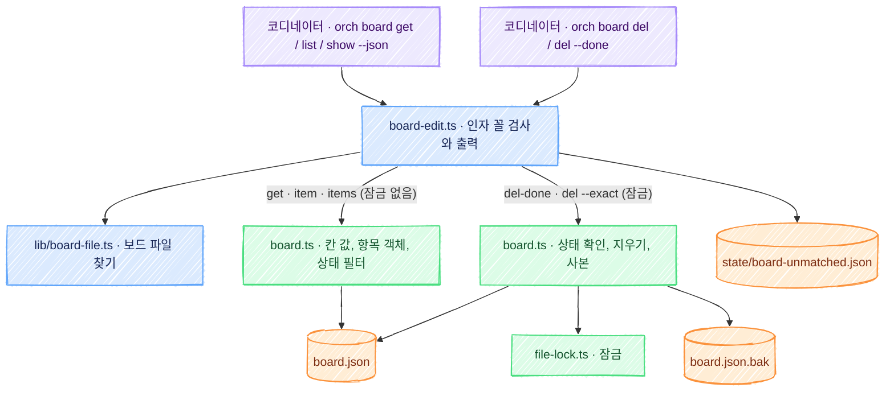

# orch: 보드 읽기와 지우기 명령(`orch board get`, `list`, `del`) 기술 설계

스펙: [spec.md](spec.md)

[보드 고치기 명령 설계](../orch-board-cli/design.md) 위에 얹는다. 보드 파일 찾기(`lib/board-file.ts`), 잠금(`file-lock.ts`), 「규칙은 `board.ts`, 명령은 얇은 감싸기」 는 그 설계 그대로다. 이 문서는 읽기와 지우기에서 더하는 것만 적는다.

## 요구사항 연결

| ID | 해결 방법 |
| --- | --- |
| REQ1 | 명령 표(`skills/orch/scripts/lib/commands.ts`)의 board 묶음에 `get`, `list`, `del` 행을 더한다. 세 행 모두 지금의 `board/board-edit.ts` 를 가리키고 동작 이름을 앞 인자로 붙인다. 보드 파일은 `set`, `show` 와 같이 `lib/board-file.ts` 의 `boardPath` 로 찾는다 |
| REQ2 | 받는 칸 목록의 원본은 `board.ts` 가 내보내는 `GET_FIELDS` 하나다. 새 동작 `board.ts get` 과 `board-edit.ts` 가 같은 상수로 이름을 본다. 목록 밖의 이름은 사용법 오류(종료 코드 2)이고 stderr 의 사용법에 칸 목록이 나온다 |
| REQ3 | `board.ts get <id> <칸>` 과 `get <id> step <번호>` 가 값을 정한다. 진행률은 `progressOf`, 단계는 `findStep`(`step --exact` 와 같은 번호 풀이)을 쓴다. `board-edit.ts` 는 받은 값을 한 줄로 쓴다 |
| REQ4 | 값이 비었으면 `board.ts get` 이 `"value": null` 과 종료 코드 4 를 낸다. 없는 항목과 없는 단계는 지금의 거절(종료 코드 1)이다. `board-edit.ts` 는 종료 코드를 그대로 넘긴다 |
| REQ5 | 새 동작 `board.ts items [<상태>[,<상태>…]]` 가 상태 값을 검사하고 그 상태의 항목만 남겨 항목 객체 배열을 낸다. `board-edit.ts` 가 항목마다 한 줄로 바꾸고, 빈 배열이면 `BOARD-NONE`, `--full` 이면 줄과 `BOARD-UNMATCHED` 를 잇는다 |
| REQ6 | `del <항목>` 은 새 동작 `board.ts del-done <id>` 를, `del <항목> --force` 는 `board.ts del <id> --exact` 를 부른다. 없는 항목과 `done` 이 아닌 항목의 거절은 `board.ts` 가 잠금 안에서 판정한다 |
| REQ7 | `del --done` 은 `board.ts del-done`(id 없음)을 부른다. 상태가 `done` 인 항목을 모두 지우고, 지울 것이 없으면 저장하지 않는다 |
| REQ8 | 엄격한 지우기(`del --exact`, `del-done`)가 항목을 하나라도 지우면 잠금 안에서 `<보드 파일>.bak` 를 남긴다. 지금 `set --detail` 이 쓰는 자리와 같은 파일이다. 사본은 저장이 확정된 뒤에만 바꾼다. 지울 것이 없거나, 거절했거나, 잠금을 잃어 저장하지 못한 호출은 기존 `.bak` 를 건드리지 않는다 |
| REQ9 | 새 동작 `board.ts item <id>` 와 `items` 가 항목 객체를, `get` 이 `{"id", "field", "value"}` 를 JSON 으로 낸다. `--json` 이면 `board-edit.ts` 가 받은 JSON 을 그대로 내고, `show --json` 에만 `unmatched` 를 더한다 |
| REQ10 | `get`, `item`, `items` 는 `list`, `steps`, `view` 처럼 잠그지 않는다. 지우기는 지금 쓰기와 같은 잠금 안에서 보드를 읽고, 상태를 보고, 지우고, 저장한다 |
| REQ11 | 종료 코드 4 는 `board.ts get` 만 낸다. 그 밖은 지금의 0, 1, 2 다. 진입점(`skills/orch/bin/orch.ts`)과 실행기(`bin/orch`)는 자식의 종료 코드를 그대로 돌려준다 |
| REQ12 | 새 규칙은 모두 `board.ts` 의 새 동작과 `del --exact` 에 둔다. `board.ts` 에 새 옵션을 더하지 않아 옵션 목록과 줄임 꼴이 그대로다. 기존 호출도 함께 지나는 `parse`, `apply`, `main` 은 아래 「`board.ts` 의 공유 코드에서 바뀌는 자리」 만 고치고, 기존 동작의 결과가 같은지는 기존 `board*.spec.ts` 가 고치지 않은 채 통과하는 것으로 지킨다 |

## 설계 단계 실측

2026-11-12, node 24.22.1, macOS. `origin/main`(16.2.1)의 `board.ts` 를 임시 보드로 실행했다.

| 확인한 것 | 결과 |
| --- | --- |
| 새 동작 이름이 비어 있는가 | `get`, `item`, `items`, `del-done` 은 지금 「모르는 명령」 사용법 오류(종료 코드 2)다. `show` 는 기존 테스트(`board.spec.ts`)가 모르는 명령의 예로 써서 쓰지 못한다 |
| `del <id> --exact` | 지금 사용법 오류(종료 코드 2)다. 뜻을 주어도 지금 듣는 호출이 바뀌지 않는다 |
| `del <id> <남는 글>` | 지금 종료 코드 0 이고 셋째 위치 인자를 버린 채 지운다. `del` 에 위치 인자로 뜻을 더하면 지금 듣는 호출이 바뀐다 |
| 옵션 줄임 꼴 | `--f <파일>` 이 `--file` 로, `--s`, `--o` 가 `--stages`, `--owner` 로 듣는다(`board-exact.spec.ts` 가 뒤 둘을 고정한다). `--force`, `--status`, `--done` 을 옵션으로 더하면 `--f`, `--s`, `--d` 가 모호해져 사용법 오류로 바뀐다 |
| 읽기 한 번에 걸리는 시간 | `view` 5회 평균 약 70ms. 대부분 프로세스를 띄우는 시간이다 |
| 창의 「오늘 시작」 요청문 | `extensions/work-board/hooks/register.js` 의 `START_PROMPT` 가 「done 항목은 board.ts del 로 비워 줘」 를 담고 `prompts.spec.ts` 가 그 글을 고정한다. 스펙이 찾지 못한 「아침 정리」 의 자리다 |

## 책임과 경계



| 층 | 파일 | 맡는 것 |
| --- | --- | --- |
| work-board | `extensions/work-board/bin/board.ts` | 받는 칸 목록, 칸 값을 글로 바꾸는 규칙, 빈 값 판정, 제목이 없을 때 id 로 대신하기, 항목 객체의 꼴, 상태 값 검사와 상태 필터, 없는 항목과 `done` 이 아닌 항목의 거절, 지우기 전 사본. 보드 파일을 쓰는 유일한 코드인 것은 그대로다 |
| orch 명령 표 | `skills/orch/scripts/lib/commands.ts` | 새 동작 이름과 사용법 한 줄, 문맥 인자(`--repo`). 판정은 두지 않는다 |
| orch 스크립트 | `skills/orch/scripts/board/board-edit.ts` | 위치 인자와 옵션의 꼴 검사(종료 코드 2), 보드 파일 찾기, `board.ts` 호출, 받은 JSON 을 한 줄 출력으로 바꾸거나 그대로 내기, `BOARD-UNMATCHED` 줄과 `unmatched` 더하기 |
| orch lib | `skills/orch/scripts/lib/board-unmatched.ts` | 못 맞춘 머지 기록 읽기. 고치지 않고 `show` 가 쓰던 함수를 `list --full` 과 `show --json` 이 함께 쓴다 |

- 새 파일과 새 모듈은 없다. 소유 경계의 분리 신호(쓰는 사람, 배포 환경, 데이터 생명주기, 거꾸로 읽기)에 걸리는 것이 없다.
- `board.ts` 는 지금처럼 orch 를 import 하지 않는다. orch 쪽은 `board.ts` 가 내보낸 값 둘(`GET_FIELDS`, `itemTitle`)을 `lib/board.ts` 를 거쳐 받는다. orch 의 lib 가 `board.ts` 의 값을 import 하는 지금 방향(`lib/board.ts` 의 `linesRev`, `lib/board-file.ts` 의 `defaultBoardPath`)과 같다.
- `board-edit.ts` 는 보드 파일을 직접 읽지 않는다. 읽기도 `board.ts` 를 자식 프로세스로 부른다(`BOARD_BIN` 으로 바꿀 수 있다). 감싸기가 파일을 직접 읽으면 옛 문자열 줄 변환, 숫자 id 맞추기, 진행률 셈이 두 곳에 생긴다.

## 인터페이스와 데이터

보드 파일의 형식은 바꾸지 않는다. 항목에 새 칸을 더하지 않는다.

### `board.ts` 에 더하는 것

| 호출 | 하는 일 | stdout(JSON 한 줄) | 거절과 사용법 오류 |
| --- | --- | --- | --- |
| `get <id> <칸>` | 그 칸의 값을 글로 낸다. 보드를 고치지 않는다 | `{"id":"order-api","field":"branch","value":"feat/order-history"}` | 종료 코드 1: 항목 없음. 종료 코드 2: 칸 이름이 목록 밖이거나 빠졌다, `step` 이 아닌 칸에 번호를 줬다 |
| `get <id> step <번호>` | 그 번호 단계 줄의 글을 낸다 | `{"id":"order-api","field":"step","number":2,"value":"2. [ask] 머지 (#70 merge)"}` | 종료 코드 1: 항목 없음, 없는 번호(`9 번 단계가 없다. 있는 번호: 1 2 3`), 같은 번호 줄이 둘 이상. 종료 코드 2: 번호가 빠졌거나 숫자가 아니다 |
| `item <id>` | 항목 하나를 아래 「항목 객체」 로 낸다 | 항목 객체 | 종료 코드 1: 항목 없음 |
| `items [<상태>[,<상태>…]]` | 보드 파일 순서의 항목 객체 배열을 낸다. 상태를 주면 그 상태의 항목만 남긴다 | `[<항목 객체>, …]` 또는 `[]` | 종료 코드 1: 쉼표로 나눈 값 가운데 다섯 상태가 아닌 것(빈 값 포함)이 있다. stderr 는 `set` 과 같은 허용 값 안내다 |
| `del <id> --exact` | 있는 항목을 상태와 상관없이 지운다 | `{"deleted":["order-api"]}` | 종료 코드 1: 항목 없음 |
| `del-done <id>` | 그 항목이 `done` 일 때만 지운다 | `{"deleted":["order-api"]}` | 종료 코드 1: 항목 없음, `done` 이 아님 |
| `del-done` | 상태가 `done` 인 항목을 모두 지운다. id 를 명령줄로 받지 않으므로 숫자 id 항목도 지운다 | `{"deleted":["a",7,"b"]}`(보드 파일 순서, id 는 저장된 값 그대로). 없으면 `{"deleted":[]}` | 없다 |

- 출력은 `view` 처럼 `JSON.stringify` 한 줄이다(구분자 뒤에 공백이 없다). `--json` 이 이 바이트를 그대로 낸다.
- `get` 의 종료 코드는 값이 있으면 0, 비었으면 4 다. 4 일 때도 JSON 은 내고 `value` 가 `null` 이다. `get` 밖의 동작은 4 를 내지 않는다.
- `get` 이 받는 칸 목록은 상수 `GET_FIELDS` 하나다. `status`, `step` 과 `set` 의 칸 옵션 목록(`FIELDS`)으로 만든다. `set` 에 칸이 늘면 `get` 도 함께 받는다. 스펙 DECISION5(이름은 `set` 옵션 이름과 같다)를 코드로 묶은 것이다.
- 칸 값을 글로 바꾸는 규칙:

| 칸 | 값 |
| --- | --- |
| `status`, `owner`, `branch`, `worktree`, `task`, `stages` | 저장된 글 그대로 |
| `title` | 저장된 글. 칸이 없거나 빈 문자열이면 id(`itemTitle`). 빈 문자열까지 id 로 바꾸는 까닭은 DECISION10 이다 |
| `pr`, `merged-pr` | 저장된 값을 글로 쓴 것. 숫자 `555` 는 `555`, 글 `492, 495` 는 그대로 |
| `progress` | `progressOf` 가 낸 `<끝낸>/<전체>`. `show` 머리와 같은 셈이다 |
| `step <번호>` | `findStep` 이 고른 줄의 `text`. 끝냄 표시는 `text` 에 들어 있지 않아 붙지 않는다 |

- 빈 값은 칸이 없거나, `null` 이거나, 빈 문자열이거나, 진행률이 없는 경우다. 글도 숫자도 아닌 값(파일을 직접 고친 보드의 객체나 배열)도 빈 값으로 본다.
- `del-done <id>` 가 `done` 이 아닌 항목을 거절할 때의 stderr 는 `done 이 아닌 항목은 지우지 않는다: <id> (지금 <상태>). 상태와 상관없이 지우려면 orch board del <id> --force 를 쓴다` 다. 상태 칸이 글이 아니면 `<상태>` 자리에 `없음` 을 쓴다. `board.ts` 의 글이 orch 명령을 가리키는 까닭은 아래 DECISION4 다.
- 엄격한 지우기는 항목을 하나라도 지웠을 때만 `.bak` 를 남기고 저장한다. 지운 것이 없는 `del-done` 은 `{"deleted":[]}` 만 내고 보드 파일, `.bak`, `updatedAt` 을 건드리지 않는다. 보드 파일이 없으면 만들지 않는다(잠금을 두려고 만든 폴더는 지금처럼 다시 지운다).
- `del-done` 이 `done` 항목을 모두 지우는 것은 id 인자가 아예 없을 때뿐이다(`undefined` 로 판정한다). 빈 문자열 id(`del-done ''`, 셸의 빈 변수에서 온 `orch board del "$id"`)는 다른 동작처럼 `id 가 필요하다` 로 거절한다(종료 코드 1). 빈 값을 「없음」 으로 읽으면 항목 하나를 지우려던 호출이 끝난 항목을 모두 지운다.
- 옵션 없는 `del <id>` 는 지금과 같다. 상태를 보지 않고, 없는 id 여도 종료 코드 0 이고, 아무것도 내지 않고, `.bak` 를 남기지 않는다.
- 새 동작과 `del --exact` 는 정해진 수보다 많은 위치 인자를 사용법 오류로 거절한다(`del <id> <남는 글> --exact` 포함). `--exact` 는 `set`, `step`, `del` 에만 듣는다.
- `board.ts` 의 사용법 줄과 `--help` 에 새 동작을 더한다. 사용법 줄의 앞머리(`{set,detail-edit,detail-add,`)는 기존 테스트가 고정하므로 새 이름은 목록 끝에 붙인다.

### `board.ts` 의 공유 코드에서 바뀌는 자리

새 동작은 기존 호출이 함께 지나는 `parse`, `apply`, `main` 을 고쳐야 들어간다. 손대는 자리를 아래로 묶고, 기존 동작의 분기 안은 고치지 않는다.

| 자리 | 바뀌는 것 | 기존 호출에 닿는 것 |
| --- | --- | --- |
| `parse` 의 위치 인자 상한 | 새 동작마다 상한을 두고 `del` 은 `--exact` 일 때만 id 하나로 줄인다 | 없다. 기존 동작의 상한은 그대로다 |
| `parse` 의 `--exact` 검사 | 받는 동작에 `del` 을 더한다 | `del <id> --exact` 가 사용법 오류에서 엄격한 지우기로 바뀐다(실측: 지금 듣는 호출이 아니다) |
| `apply` 의 `del` 분기 | `--exact` 일 때의 길을 앞에 더한다 | 없다. `--exact` 가 없으면 지금 코드다 |
| `main` 의 읽기 목록 | `get`, `item`, `items` 를 더한다 | 없다 |
| `main` 의 `.bak` 조건 | `deleted` 가 든 결과를 더한다 | 없다 |
| `.bak` 를 남기는 순서(`main`, `saveBoard`) | 사본 만들기를 `saveBoard` 안으로 옮기고 아래 「저장 순서」 로 바꾼다. `saveBoard` 는 사본을 남길지를 넷째 인자로 받고 기본값은 남기지 않음이다 | `set --detail`, `set --next` 도 같은 순서를 지난다. 성공한 호출의 `.bak` 내용은 지금과 같다. 달라지는 것은 잠금을 잃어 저장하지 못한 호출이 `.bak` 를 다시 쓰지 않게 되는 것 하나다 |

`apply` 가 돌려주는 값과 `main` 이 하는 일은 아래로 정한다. 지금의 세 값에 `'empty'` 하나와 객체의 새 꼴 하나를 더한다.

| `apply` 가 돌려주는 값 | `main` 이 하는 일 | 쓰는 동작 |
| --- | --- | --- |
| `false` | 저장하지 않고 종료 코드 0 이다. stdout 은 `apply` 가 직접 쓴다(지금 `list`, `steps`, `view` 와 같다) | 읽기 동작, 지운 것이 없는 `del-done` |
| `'empty'`(새 값) | 저장하지 않고 종료 코드 4 다 | 값이 빈 `get` |
| `true` | 저장한다. 출력은 없다 | 기존 쓰기 동작 |
| 객체 | 저장한 뒤 그 객체를 JSON 한 줄로 낸다. `deleted` 가 든 객체면 아래 「저장 순서」 로 `.bak` 를 남긴다 | 지금의 항목 값(`--exact`, `step-edit` 따위)과 새 `{"deleted":[…]}` |

저장 순서는 아래와 같다. 지금은 사본을 먼저 만들고(`copyFileSync`) `saveBoard` 가 잠금 표지를 확인해, 잠금을 잃은 호출이 종료 코드 1 로 끝나면서도 `.bak` 를 이미 덮었다. 스펙 REQ8 은 거절한 호출이 `.bak` 를 바꾸지 않는다고 정했으므로 사본을 저장 확정 뒤로 옮긴다.

1. 새 보드를 임시 파일에 쓴다.
2. 잠금 파일이 자기 표지인지 확인한다. 아니면 저장하지 않고 끝낸다(종료 코드 1). `.bak` 는 건드리지 않았다.
3. 사본을 남기는 호출이고 보드 파일이 있으면, 지금 보드 파일을 사본용 임시 파일로 복사한다.
4. 새 보드의 임시 파일을 보드 파일 이름으로 바꾼다. 저장이 확정되는 자리다.
5. 사본용 임시 파일을 `.bak` 이름으로 바꾼다.
6. 어느 단계에서 끝나든 남은 임시 파일을 지운다.

- 2 에서 멈추거나 3, 4 가 실패하면 기존 `.bak` 는 바이트까지 그대로다.
- 임시 파일 이름에는 지금처럼 프로세스 번호를 넣는다. 기존 테스트(`board-lock.spec.ts`)가 저장 뒤 `.tmp` 로 끝나는 파일이 남지 않는 것을 고정하므로 사본용 임시 파일도 `.tmp` 로 끝나게 짓고 6 에서 지운다.
- `saveBoard(path, board, lock)` 의 세 인자 호출은 지금과 결과가 같다(기존 테스트가 이 꼴로 부른다).

### 항목 객체

`item` 과 `items` 가 내는 꼴이다. 스펙 REQ9 가 정한 내용을 `board.ts` 한 곳에서 만든다.

```json
{"id":"order-api","title":"주문 이력 조회 API","status":"doing","pr":877,"branch":"feat/order-history","stepAt":"2026-11-12T09:10:00+09:00","progress":[1,2],"lines":[{"number":1,"done":true,"text":"1. 구현","in":"details"},{"number":2,"done":false,"text":"2. [ask] 머지 (#70 merge)","in":"details"}]}
```

| 칸 | 값 |
| --- | --- |
| `id`, `title`, `status`, `owner`, `pr`, `merged-pr`, `branch`, `worktree`, `task`, `stages`, `stepAt` | 항목에 그 키가 있을 때만 넣고 저장된 값과 타입 그대로다(`pr` 은 숫자이거나 글이다). 순서는 이 줄의 순서다 |
| `progress` | `progressOf` 의 `[끝낸, 전체]` 또는 `null`. 저장된 `progress` 칸의 글은 넣지 않는다 |
| `lines` | `view` 의 `lines` 를 만드는 코드를 함께 쓴다. `details` 다음 `next` 순서, 빈 줄 제외, 단계를 세는 쪽의 단계 줄에만 `number` |

- `was`, `rev`, `details`, `next` 는 넣지 않는다(스펙 DECISION10). `view` 의 출력은 그대로 두고 `show` 의 JSON 없는 출력은 지금처럼 `view` 를 쓴다.
- 제목이 없는 항목은 `title` 키가 없다. id 로 대신하는 것은 `get title` 과 `list` 의 한 줄 출력뿐이다.

### 새 명령

```text
orch board get <항목> <칸> [--json]
orch board get <항목> step <번호> [--json]
orch board list [--status <상태>[,<상태>…]] [--json]
orch board show <항목> [--json]
orch board del <항목> [--force]
orch board del --done
공통: [--board <파일>] [--repo <폴더>] [--full]
```

| 명령 | `board.ts` 호출 | stdout |
| --- | --- | --- |
| `get <항목> <칸>` | `get <항목> <칸>` | 종료 코드 0 이면 `value` 한 줄, 4 면 아무것도 없다. `--json` 이면 두 경우 모두 받은 JSON 그대로 |
| `get <항목> step <번호>` | `get <항목> step <번호>` | 위와 같다 |
| `list` | `items` | 항목마다 `BOARD <항목> <상태> <끝낸>/<전체> <제목>`. 배열이 비었으면 `BOARD-NONE`. `--json` 이면 받은 배열 그대로 |
| `list --status <값>` | `items --file <파일> -- <값>` | 위와 같다. 값은 풀지 않고 그대로 넘긴다 |
| `show <항목> --json` | `item <항목>` | 받은 항목 객체에 `unmatched`(숫자 배열)를 더한 JSON 한 줄 |
| `del <항목>` | `del-done <항목>` | `BOARD-DEL <항목>` |
| `del <항목> --force` | `del <항목> --exact` | `BOARD-DEL <항목>` |
| `del --done` | `del-done` | 지운 항목마다 `BOARD-DEL <항목>`. `deleted` 가 비었으면 `BOARD-NONE` |

- 모든 호출에 `--file <boardPath 의 결과>` 를 붙인다. `--status` 의 값만은 `--file` 뒤, `--` 다음에 둔다. `--status=-x` 처럼 `-` 로 시작하는 값이 `board.ts` 의 옵션으로 읽혀 사용법 오류(종료 코드 2)가 되지 않고 상태 값 거절(종료 코드 1)이 되게 하려는 것이다. `board.ts` 의 stderr 와 종료 코드는 그대로 넘긴다. 종료 코드가 0 도 4 도 아니면 stdout 에 아무것도 쓰지 않는다(스펙 DECISION14).
- `board-edit.ts` 가 막는 사용법 오류(종료 코드 2, 사용법 출력): 위치 인자가 모자라거나 남는다, `get … step` 뒤의 번호가 숫자가 아니다, `--json` 을 `get`, `list`, `show` 밖에 준다, `--status` 를 `list` 밖에 준다, `--force` 나 `--done` 을 `del` 밖에 준다, `--done` 을 항목 id 나 `--force` 와 함께 준다, `--on` 을 새 동작에 준다, `get` 의 칸 이름이 `GET_FIELDS` 에 없다. 상태 값은 검사하지 않는다.
- `board-edit.ts` 의 사용법 글은 받는 칸을 `GET_FIELDS` 에서 읽어 보이고, 칸 이름도 같은 상수에 드는지만 본다. 목록을 글로 한 번 더 적지 않아 원본은 하나다. 감싸기가 먼저 막는 까닭은 `board.ts` 의 사용법 오류가 `board.ts` 의 긴 사용법 줄을 내 `orch board` 사용자에게 맞지 않기 때문이다. `board.ts get` 도 직접 호출을 위해 같은 검사를 한다.
- `list` 한 줄의 진행률은 `show` 머리와 같은 식이다(없으면 `진행률 없음`). 상태는 글일 때만 그 값이고 아니면(칸이 없거나 글이 아니면) `show` 머리처럼 `null` 이다. 제목은 `itemTitle` 이다.
- `list --full` 은 항목마다 머리 줄, 그 항목의 안 풀린 `BOARD-UNMATCHED` 줄, 모든 줄(끝난 줄 앞에 `✓ `)을 `show --full` 과 같은 순서로 잇는다. 못 맞춘 머지 기록은 한 번만 읽는다. `--full` 이 없는 `list` 와 `get` 은 그 기록을 읽지 않는다.
- `unmatched` 는 `show` 가 지금 `BOARD-UNMATCHED` 줄을 고르는 판정(`unmatchedRecords`, `unmatchedResolved`)을 그대로 쓰고, 남은 PR 번호를 숫자로 바꿔 넣는다. 판정에 넘기는 단계 줄은 항목 객체의 `lines` 다.
- `--json` 과 `--full` 을 함께 주면 JSON 만 낸다. JSON 은 늘 온전한 내용이라 더 낼 것이 없다. `del` 은 `--full` 이어도 출력이 같다.
- 출력은 지금 `show` 처럼 `lib/output.ts` 의 `emit` 을 거치지 않고 직접 쓴다. `get` 의 값과 JSON 은 대문자 낱말로 시작하지 않아 `emit` 이 버린다.
- `board-edit.ts` 의 새 옵션 `--json`, `--status`, `--done`, `--force` 는 지금 옵션(`--repo`, `--board`, `--on`, `--help`)과 첫 글자가 겹치지 않아 지금 듣는 줄임 꼴이 모호해지지 않는다.

### 문서와 요청문

스펙의 「스펙이 머지되면 바꿀 곳」 에 설계에서 찾은 자리를 더했다. 모두 구현 PR 에서 함께 고친다.

| 자리 | 바꿀 내용 |
| --- | --- |
| `skills/orch/references/board.md` 「상태와 단계 고치기」 | 명령 목록에 `get`, `list`, `del`, `--json` 을 더하고 출력과 종료 코드(4 포함)를 적는다. 「항목을 지울 때는 `board.ts del`」 을 `orch board del` 로 바꾼다. 맨 위의 `board.ts` 직접 호출 안내를 칸 고치기(`set`)와 `mark` 로 좁힌다. `.bak` 가 한 세대이고 통째 저장과 함께 쓴다는 점, `set -e` 셸에서 종료 코드 4 를 받는 법을 적는다 |
| `extensions/work-board/README.md` 「보드에 항목 적기」 | `board.ts list` 예시를 `orch board list` 로 바꾸고 `board.ts` 예시는 칸 고치기만 남긴다 |
| `extensions/work-board/references/behavior.md` | 잠그지 않는 읽기 목록에 새 동작을 더하고, 항목 객체와 엄격한 지우기, `.bak` 를 남기는 호출을 적는다 |
| `extensions/work-board/hooks/register.js` 의 `START_PROMPT` | 「done 항목은 board.ts del 로 비워 줘」 를 `orch board del --done` 으로 바꾼다. `tests/prompts.spec.ts` 의 고정 글도 함께 바꾼다 |
| `skills/orch/tests/docs-contract.spec.ts` | `board.md` 가 `board.ts del` 을 담는지 보던 검사를 새 명령(`orch board get`, `list`, `del`) 쪽으로 옮긴다 |
| 변경 조각 | `skills/orch/changes/`, `extensions/work-board/changes/` 에 minor 조각을 하나씩 둔다 |

- 저장소 문서 밖에서 `board.ts list`, `board.ts del` 을 외워 부르던 코디네이터에게는 구현 PR 의 머지 알림에 새 명령을 적는다(스펙 표의 마지막 행).

## 실패와 일관성

- 읽기와 쓰기의 겹침: 읽기는 잠그지 않는다. 쓰기가 임시 파일을 보드 파일 이름으로 바꿔 끝나므로 읽는 쪽은 바꾸기 전이나 뒤의 온전한 파일을 본다. `get` 으로 읽은 값이 곧 낡을 수 있는 것은 받아들인다. 그 값으로 보드를 고치는 호출은 고치기 명령이 잠금 안에서 다시 검사한다.
- 상태 확인과 지우기: `del-done` 은 잠금을 얻은 뒤에 보드를 읽는다. 기다리는 동안 다른 프로세스가 그 항목을 `doing` 으로 되돌렸으면 새 상태를 보고 거절한다(스펙 REQ10). 감싸기가 먼저 읽어 상태를 보지 않는 까닭이다.
- 잠금 실패: 지우기가 5초 안에 잠금을 못 잡으면 지금 쓰기처럼 종료 코드 1 이고 보드는 그대로다. 낡은 잠금 넘겨받기와 「쓰기 직전 표지 확인」 도 그대로 쓴다([ADR-029](../../adr/029-board-write-lock.md)).
- `.bak` 는 한 세대이고 `set --detail`, `set --next` 가 쓰는 파일과 같다. 지운 뒤 루프의 통째 저장이나 다음 지우기가 오면 덮인다. 되살리려면 지운 직후에 꺼내야 한다. 스펙 DECISION8 이 한 세대로 정했고 `board.md` 에 적는다.
- 저장하지 않은 호출과 `.bak`: 사본은 저장이 확정된 뒤에만 바뀐다(위 「`board.ts` 의 공유 코드에서 바뀌는 자리」 의 저장 순서). 잠금을 쥔 채 30초 넘게 멈췄다 깨어나 잠금을 넘겨받힌 지우기는 표지 확인에서 멈추므로 종료 코드 1 이고 보드와 기존 `.bak` 가 그대로다. 보드의 이름 바꾸기가 실패한 호출도 `.bak` 를 바꾸지 않는다. 스펙 REQ8 의 「거절한 호출은 `.bak` 를 바꾸지 않는다」 를 잠금을 잃은 호출까지 지킨다. 남는 틈은 보드를 바꾼 뒤 사본의 이름을 바꾸기 전에 프로세스가 죽는 경우 하나다. 이때는 지우기가 반영됐고 `.bak` 는 한 세대 앞의 것이다.
- 지운 항목이 다시 생기는 틈: 루프의 동기화가 보드를 읽은 뒤 그 항목이 지워지고, 그다음 동기화가 `set <id> done` 처럼 상태가 든 옛 꼴 `set` 을 부르면 `board.ts` 가 그 id 로 새 항목을 만든다. 지금의 `board.ts del` 에도 있는 틈이다. 동기화는 `done` 항목의 상태를 다시 쓰지 않으므로(`board-sync.ts` 의 `SKIP_STATUS`) 기본 지우기에서는 생기기 어렵고, `--force` 로 진행 중 항목을 지울 때 남는다. 이 기능에서 고치지 않는다(동기화의 호출 꼴을 바꾸는 일이라 범위 밖이다). `board.md` 의 `--force` 설명에 적는다.
- 빈 id: `orch board del "$id"` 에서 변수가 비면 `board.ts del-done ''` 가 된다. 「모두 지우기」 로 읽지 않고 거절한다(위 「`board.ts` 에 더하는 것」). 계획 검토에서 나온 위험이다.
- `del --done` 의 부분 반영은 없다. 지우기와 저장이 한 번의 잠금, 한 번의 이름 바꾸기다.
- 종료 코드 4 와 `set -e`: `b=$(orch board get x branch)` 는 값이 없으면 4 로 끝나 `set -e` 셸을 멈춘다. 값 없음을 흐름으로 받으려면 `if b=$(…); then` 이나 `|| true` 로 쓴다. `board.md` 에 적는다.
- 깨진 보드 파일: 읽기도 지금 쓰기처럼 `board.ts: <이유>` 와 종료 코드 1 이다. stdout 은 빈다.
- 옛 번들과 섞일 때: 감싸기와 `board.ts` 는 한 번들에 함께 들어 있다. `BOARD_BIN` 으로 옛 `board.ts` 를 가리킬 때만 새 동작이 사용법 오류(종료 코드 2)가 된다. 떠 있는 루프는 새 동작을 부르지 않아 다시 띄울 필요가 없다.
- 호환: `board.ts` 의 지금 호출, `orch board show` 의 JSON 없는 출력, 다른 `orch board` 동작은 바뀌지 않는다. 바뀌는 것은 `show --json` 이 사용법 오류에서 JSON 출력이 되는 것 하나다.
- 배포 순서: PR 하나라 순서가 없다.

## 검증 전략

| 요구사항 | 확인하는 경계 |
| --- | --- |
| REQ2, REQ3, REQ4, REQ9 의 값과 꼴 | `extensions/work-board/tests/` 의 새 테스트 파일이 임시 보드로 `board.ts get`, `item`, `items` 를 실행한다. 칸마다의 값, 빈 값의 종료 코드 4 와 `null`, 없는 항목·없는 단계·같은 번호 둘·숫자 id 의 거절, 목록 밖 칸 이름의 종료 코드 2 를 본다. 거절한 호출의 stdout 이 비었는지 본다 |
| REQ5 의 상태 필터 | 같은 파일. 상태 하나와 여럿, 다섯 상태 밖의 값, 빈 보드와 없는 보드 파일. `-` 로 시작하는 `--status` 값이 종료 코드 1 인지는 명령 쪽에서 본다 |
| REQ6, REQ7, REQ8 | 같은 폴더의 새 테스트 파일이 `del --exact`, `del-done` 을 실행한다. 잠금을 잃은 저장은 `saveBoard` 를 `board-lock.spec.ts` 처럼 직접 불러(표지 확인이 거짓인 잠금) 미리 둔 `.bak` 와 보드의 바이트가 그대로인지 본다. 거절 뒤 보드 바이트와 `.bak` 가 그대로인지, 지운 뒤 `.bak` 가 지우기 전 바이트와 같은지, 지울 것 없는 `del-done` 이 보드 파일의 바이트와 수정 시각을 바꾸지 않고 없는 파일을 만들지 않는지, 숫자 id 의 `done` 항목이 지워지는지 본다 |
| REQ10 | 잠금 파일을 미리 둔 채 `get`, `item`, `items` 가 바로 끝나는지 본다. 지우기는 `board-lock.spec.ts` 의 방식(잠금 파일을 둔 채 `del-done <id>` 를 띄우고, 그 사이 항목을 `doing` 으로 바꾼 뒤 잠금을 놓는다)으로 거절과 항목 보존을 본다 |
| REQ12 | 기존 `board*.spec.ts` 가 고치지 않은 채 통과하는지 본다. 옵션 없는 `del <없는 id>` 의 종료 코드 0 과 `list` 출력은 기존 테스트가 이미 고정한다. 새 사례는 새 파일에만 둔다 |
| REQ1, REQ5, REQ9, REQ11 의 명령 쪽 | `skills/orch/tests/board-edit.spec.ts` 에 사례를 더해 진입점을 거쳐 실행한다(같은 스크립트의 테스트라 준비 코드를 함께 쓴다. 기존 사례는 그대로 둔다). 값 한 줄과 바이트 일치, `--json`, `BOARD-NONE`, `--full` 의 줄과 `BOARD-UNMATCHED`, `BOARD-DEL`, 사용법 오류, 워크트리에서 부른 호출이 주 checkout 의 보드를 읽고 지우는지, `finish.board` 로 정한 보드를 쓰는지 본다. 명령 표 테스트(`lib-commands.spec.ts`)와 `orch board --help` 가 새 동작을 보이는지 본다 |
| 문서와 요청문 | `docs-contract.spec.ts` 와 `prompts.spec.ts` 가 바뀐 글을 고정한다 |
| 동작 보존 | 고정 입력 기록(`tests/golden/`, `tests/loop-order/`)은 그대로여야 한다. 루프와 마무리의 코드를 고치지 않는다 |
| 실제 사용 | 이 저장소의 체크아웃(`ORCH_SCRIPTS_DIR`)으로 임시 저장소와 그 워크트리에서 새 명령을 부른다. `b=$(orch board get <항목> branch)` 로 담은 값을 보드의 값과 비교하고, 값 없는 칸의 종료 코드 4 가 PATH 의 실행기(`bin/orch`)를 지나도 4 인지 본다 |

테스트 명령과 작업 순서는 계획이 정한다.

## PR 나누기와 순서

구현 PR 하나로 끝낸다. 나누지 않는다.

- `board.ts` 와 감싸기가 한 번들로 함께 배포돼 받는 쪽을 먼저 내보낼 까닭이 없다. 보드 고치기 설계의 PR1 은 잠금만으로 값이 있었지만, 이번 `board.ts` 의 새 동작은 감싸기 없이는 쓰는 곳이 없다.
- 읽기와 지우기를 따로 내면 `board.md`, 명령 표, 변경 조각을 두 번 고친다. 지우기는 `board.ts` 의 분기 둘과 감싸기의 분기 하나라 따로 검토받을 만큼 크지 않다.
- 계획의 phase 는 `board.ts` 읽기, `board.ts` 지우기, 감싸기 읽기, 감싸기 지우기, 문서와 요청문 순서다. plan 의 크기 기준(phase 6개 이하) 안이다.

## 결정

없음: 여러 기능이 다시 참조할 장기 결정이 없어 ADR 을 남기지 않는다. 잠금은 [ADR-029](../../adr/029-board-write-lock.md), 감싸기 구조는 [보드 고치기 명령 설계](../orch-board-cli/design.md)의 결정을 그대로 따른다. 아래는 이 기능 안의 선택이다.

| ID | 결정 | 답 | 누가 | 근거 |
| --- | --- | --- | --- | --- |
| DECISION1 | `board.ts` 에 새 규칙을 여는 방법 | 새 옵션 없이 새 동작(`get`, `item`, `items`, `del-done`)과 지금 옵션 `--exact` 의 `del` 확장으로 연다. 상태 필터 값과 단계 번호는 위치 인자다 | 작성자 | 스펙 DECISION11 이 이름을 설계에 넘겼다. `--force`, `--status`, `--done` 은 지금 듣는 줄임 꼴 `--f`, `--s`, `--d` 를 모호하게 만든다(실측). 옵션 목록을 건드리지 않으면 줄임 꼴을 하나씩 따질 일이 없다. `step-mark` 가 조건을 위치 인자로 받은 앞 사례와 같다 |
| DECISION2 | 지우기 동작을 나누는 선 | `del-done [<id>]` 는 「`done` 만 지운다」, `del <id> --exact` 는 「있는 항목만 지운다」 다. `--force` 는 뒤의 것으로 간다 | 작성자 | `--exact` 의 지금 뜻(있는 항목에만 듣는다)을 그대로 넓힌다. `del <id> --exact` 는 지금 사용법 오류라 듣던 호출이 바뀌지 않는다. `del` 의 위치 인자에 뜻을 주는 안은 지금 `del <id> <남는 글>` 이 지우고 0 으로 끝나 버렸다(실측) |
| DECISION3 | 감싸기가 결과를 아는 방법 | 읽기와 지우기 모두 `board.ts` 가 낸 JSON 한 줄을 읽는다. `get` 도 값만 내지 않고 JSON 을 낸다 | 작성자 | 보드 고치기 설계 DECISION4 와 같은 꼴이다. 값만 내면 감싸기가 `--json` 의 객체를 다시 만들어야 하고 빈 값과 빈 문자열을 종료 코드로만 가린다. `board.ts` 에 `--json` 옵션을 더하지 않아도 된다 |
| DECISION4 | `--force` 안내를 내는 자리 | `board.ts del-done` 의 거절 글이 `orch board del <id> --force` 를 적는다 | 작성자 | 스펙 REQ6 이 stderr 에 `--force` 안내를 요구한다. 감싸기가 안내를 붙이려면 종료 코드 1 의 여러 이유(없는 항목, 잠금 실패, 상태) 가운데 상태 거절을 stderr 글로 가려야 해서 글에 묶인 판정이 생긴다. `del-done` 은 `orch board del` 이 부르려고 둔 동작이고, work-board 의 README 와 창의 요청문이 이미 `orch board` 명령을 가리킨다. 감당할 것: `board.ts` 의 글 하나가 orch 의 옵션 이름에 묶인다. orch 가 `--force` 의 이름을 바꾸면 이 글도 고쳐야 하므로 `board.ts` 의 테스트가 글의 `--force` 를 고정하고 `del-done` 의 주석에 이 묶임을 적는다. `board.ts` 에 `--force` 옵션을 두는 안은 DECISION1 의 이유로 버렸다 |
| DECISION5 | 항목 객체를 내는 동작 | `view` 를 넓히지 않고 `item`, `items` 를 따로 둔다. `show` 의 JSON 없는 출력은 `view` 를 그대로 쓴다 | 작성자 | `view` 의 꼴(`was`, `rev` 포함)은 고치기 결과와 같고 work-board 문서가 계약으로 적었다. 스펙 DECISION10 이 `was`, `rev` 를 뺐다. `show` 의 지금 출력 경로를 바꾸지 않아 기존 테스트가 그대로 통과한다 |
| DECISION6 | 제목 대신 id, 받는 칸 목록을 두 층이 함께 쓰는 방법 | `board.ts` 가 `itemTitle`, `GET_FIELDS` 를 내보내고 orch 가 import 한다. 칸 이름은 두 층이 같은 상수로 본다 | 작성자 | `list` 한 줄의 제목과 `get title` 이 같은 규칙이어야 한다. 사용법 글에 칸 목록을 다시 적으면 `set` 에 칸이 늘 때 어긋난다. `linesRev`, `defaultBoardPath` 를 import 하는 지금 방향과 같다. 칸 이름을 감싸기가 먼저 보는 것은 독립 검토에서 나왔다. `board.ts` 의 사용법 줄이 `orch board` 사용자에게 그대로 보이던 것을 막는다 |
| DECISION7 | 「아침 정리」 의 자리 | 창의 「오늘 시작」 요청문(`START_PROMPT`)을 구현 PR 에서 `orch board del --done` 으로 바꾼다 | 작성자 | 스펙은 저장소 문서에서 이 절차를 찾지 못했다고 적었다. 설계에서 창의 요청문이 `board.ts del` 을 시키는 것을 찾았다. 요청문이 플러그인 경로를 찾게 만드는 것이 스펙의 배경이고, 보드 고치기 설계 DECISION16 이 같은 요청문을 같은 이유로 고쳤다 |
| DECISION8 | PR 나누기 | 구현 PR 하나 | 작성자 | 위 「PR 나누기와 순서」 |
| DECISION9 | 지운 항목이 동기화로 다시 생기는 틈 | 이번에 막지 않고 문서에 적는다 | 작성자 | 지금 `board.ts del` 에도 있는 틈이고, 막으려면 동기화의 `set` 을 모두 엄격 호출로 바꿔야 한다. 스펙 범위(읽기와 지우기 입구) 밖이다. 구현 PR 본문에서 후속 후보로 알린다 |
| DECISION10 | 빈 문자열 제목 | `title` 칸이 빈 문자열이어도 없는 것처럼 id 를 낸다(`get title`, `list` 의 제목) | 작성자 | 스펙 REQ3 은 「칸이 없는 옛 항목」 만 적었고 REQ4 는 빈 문자열을 값 없음으로 정했다. 둘이 겹치는 자리를 REQ3 쪽으로 읽었다. `board.ts` 가 새 항목을 만들 때 `title \|\| id` 로 채우는 규칙과 같고(스펙 DECISION16 의 근거), `set --title ''` 은 칸을 지우므로 빈 제목은 파일을 직접 고친 보드에만 있다 |
