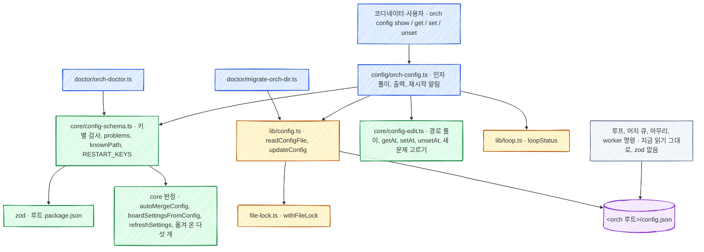

# orch: 설정 파일 명령(`orch config`) 기술 설계

스펙: [spec.md](spec.md)

## 요구사항 연결

PR 은 「PR 나누기」 의 번호다.

| ID | 해결 방법 | PR |
| --- | --- | --- |
| REQ1 | 명령 표(`skills/orch/scripts/lib/commands.ts`)에 `config` 묶음의 `show`, `get`, `set`, `unset` 행을 더한다. 네 행은 새 명령 `scripts/config/orch-config.ts` 를 가리키고 동작 이름을 앞 인자로 붙인다(`feedback` 묶음과 같은 꼴). 문맥은 `repo` 하나라 진입점이 주 checkout 을 채운다 | PR2 |
| REQ2 | `show` 는 `lib/config.ts` 의 새 날 읽기(`readConfigFile`)로 파일을 읽고 `problems` 를 stderr 로 낸다. 깨진 JSON 만 종료 코드 1 이다 | PR2 |
| REQ3 | `get` 은 경로 풀이(`core/config-edit.ts`)로 값을 찾고, 없으면 `core/config-schema.ts` 의 `knownPath` 로 「설정 파일에 없다」 와 「모르는 키」 를 가른다 | PR2 |
| REQ4 | 인자 풀이가 `--json` 이 있을 때만 `JSON.parse` 한다. 위치 인자는 `-` 로 시작해도 값으로 받는다(「인자 풀이」). 중간 객체 만들기는 `setAt` 이 한다 | PR2 |
| REQ5 | 잠금 안에서 바꾸기 전과 뒤의 `problems` 를 비교한다. 바꾼 경로와 그 아래의 문제는 늘 거절 이유이고, 그 밖은 바꾼 절에 새로 생긴 문제만 거절 이유다(「검사 흐름」) | PR2 |
| REQ6 | 새 core 모듈 `core/config-schema.ts` 가 키마다 zod 스키마나 기존 core 판정 하나를 가진다. 기준은 「키별 검사 기준」 표다. `lib` 와 명령 파일에 있던 순수 판정 다섯 개를 core 로 옮겨 이 모듈이 부른다. 읽는 쪽의 동작은 바꾸지 않는다 | PR1 |
| REQ7 | `orch doctor` 의 설정 검사 세 갈래를 `problems` 한 번으로 바꾸고 문제마다 `INVALID-CONFIG <경로> <이유>` 를 낸다 | PR1 |
| REQ8 | `unset` 은 `unsetAt` 으로 지우고 빈 객체를 위로 거슬러 지운다. 지울 범위 안에 옛 설정 칸이 있으면 거절한다 | PR2 |
| REQ9 | `lib/config.ts` 의 새 `updateConfig` 가 `withFileLock`(`extensions/work-board/bin/file-lock.ts`) 안에서 다시 읽고, 바꾸고, 옆 파일에 쓴 뒤 이름을 바꾼다. 파일이 없으면 `ensure('config', repo)` 로 orch 루트를 만든다. 옛 위치에 설정이 남은 저장소는 `requireMigrated` 로 먼저 막는다. `doctor migrate` 의 설정 쓰기 두 길도 이 함수로 옮긴다 | PR2 |
| REQ10 | 명령이 `CONFIG-SET`, `CONFIG-UNSET` 한 줄을 만든다. 이전 값은 잠금 안에서 읽은 값이다 | PR2 |
| REQ11 | `core/config-schema.ts` 의 `RESTART_KEYS` 에 든 경로를 바꿨고 `lib/loop.ts` 의 `loopStatus` 가 살아 있음이나 다시 확인 필요를 내면 stderr 에 한 줄을 낸다 | PR2 |
| REQ12 | `skills/orch/references/overlay.md` 에 「설정 바꾸기」 절을 두고, 값을 직접 두라는 안내(`replying.md`, `heavy-checks.md`, `board.md`, `hooks.md`, `cleanup.md`, `spec-writing.md`)를 `orch config set` 예시로 바꾼다. 키 타입 표도 코드 기준으로 맞춘다 | PR2 |
| REQ13 | 공통 지시서 틀(`skills/orch/templates/spec-common.md`)에 `<!-- orch-rule: no-config-edit -->` 항목을 더한다 | PR2 |

## PR 나누기

| PR | 내용 | 앞 PR |
| --- | --- | --- |
| PR1 | 저장소 루트의 `package.json`·`package-lock.json`(zod), `.gitignore`, CI 의 `npm ci`, 저장소 실행 규칙과 검사 고침, [ADR-030](../../adr/030-plugin-npm-dependencies.md), 검사표(`core/config-schema.ts`), 순수 판정 다섯 개 옮기기, `orch doctor` 의 `INVALID-CONFIG` 확장 | 없음 |
| PR2 | `orch config` 명령, 설정 쓰기 잠금과 `doctor migrate` 이전, 루프 재시작 알림, 문서 안내와 공통 지시서 규칙, `docs/data-schema.md` 와 `overlay.md` 의 키 타입 맞추기 | PR1 |

PR1 만 머지돼도 doctor 가 틀린 값을 알려 쓸모가 있다. PR2 는 PR1 의 검사표 없이는 `set` 이 검사할 수 없다.

## zod 와 의존 설치

값 검사는 zod 4 로 쓴다. 저장소 루트(플러그인 루트)에 `package.json` 과 `package-lock.json` 을 두고, 사용자 머신의 설치는 Claude Code 의 플러그인 의존 설치에 맡긴다(사용자 결정 2026-11-12). 선택 이유와 기각한 대안은 [ADR-030](../../adr/030-plugin-npm-dependencies.md) 이 소유한다.

- **패키지 파일:** 루트 `package.json` 에 `"private": true`, `"type": "module"`, 의존 `zod` 를 정확한 버전으로 둔다(설계 단계 4.6.7). Claude Code 는 레지스트리 패키지의 정확한 버전만 설치하고 `--ignore-scripts`, 60초 제한으로 돈다(공식 문서 plugins/loading 「Node.js package dependencies」). lock 은 `package-lock.json` 이다. `pnpm-lock.yaml` 은 그 설치가 건너뛰므로 쓰지 않는다.
- **CommonJS 진입:** 루트의 `"type": "module"` 은 CommonJS 로 쓴 `bin/orch` 와 `skills/orch/scripts/lib/guard/gh`·`orca` 를 ES 모듈로 읽게 해 깨뜨린다(설계 검토에서 Node 24.22.1 로 재현). `bin/` 에는 `{"type": "commonjs"}` 만 담은 `package.json` 을 둔다(`bin/` 에는 `orch` 하나뿐이다). `skills/orch/scripts/lib/guard/` 는 같은 폴더에 ES 모듈 `guard.ts` 가 있어 그 방법을 쓰면 `guard.ts` 가 깨진다(계획 검토에서 재현). 그래서 shim `gh`·`orca` 를 `githooks/commit-msg` 처럼 `process.getBuiltinModule` 과 `process.argv[1]` 로 고쳐 `type` 과 상관없이 돌게 한다. `"type"` 을 빼면 `.ts` 를 돌릴 때마다 `MODULE_TYPELESS_PACKAGE_JSON` 경고가 나와서 그 길은 쓰지 않는다. work-board 의 hooks `.js` 넷은 이미 ES 모듈이다. 루트 `"type": "module"` 은 확장자 `.py` 인 korean-check 의 옛 이름 진입 둘(`korean-style-check.py`, `check-readability.py`)도 막는다(ESM 로더가 모르는 확장자라 `ERR_UNKNOWN_FILE_EXTENSION` 이고 파일 내용을 고쳐도 소용없다. 구현 중 재현). 그래서 node-runtime 스펙 DECISION17 대로 korean-check 3.0.0 에서 두 진입을 지웠다(사용자 2026-11-13).
- **`node_modules`:** 커밋하지 않는다. `.gitignore` 에 `/node_modules/` 를 둔다. 빌드 단계는 두지 않고 `.ts` 를 지금처럼 바로 실행한다.
- **사용자 머신:** Claude Code 가 플러그인을 캐시에 복사할 때(설치, 버전 갱신, 캐시가 없을 때의 세션 시작) `<캐시>/<버전>/node_modules` 에 설치한다. 이 자동 설치는 끌 수 없다.
- **개발과 CI:** 체크아웃과 worker 워크트리는 `npm ci` 로 설치한다. CI 의 테스트 job 은 테스트 앞에 `npm ci` 를 돈다. 이 저장소의 `.orch/overlay.md` 「로컬 검증」 첫 단계에 `npm ci` 를 두어 worker 가 워크트리에서 돈다.
- **설치 확인:** `node scripts/run-tests.ts` 는 저장소 루트(워크트리면 그 워크트리)의 `node_modules/.package-lock.json` 이 `package-lock.json` 의 패키지 버전과 맞는지 본다. 없거나 다르면 `npm ci` 를 안내하고 종료 코드 2 로 끝난다. 워크트리는 `<주 checkout>/worktrees/` 아래에 있어(`worker/make-worktree.ts`) 설치가 없으면 Node 가 주 checkout 의 `node_modules` 를 찾아 쓰므로, 있는지만 보면 zod 를 올리는 PR 이 옛 zod 로 통과할 수 있다.
- **불러오는 범위:** zod 는 `core/config-schema.ts` 만 import 하고, 그 모듈은 `config/orch-config.ts` 와 `doctor/orch-doctor.ts` 만 부른다. `lib/config.ts` 와 루프, worker 명령, 훅은 zod 를 불러오지 않는다. 의존 설치가 실패한 머신에서도 그 명령들은 돈다.
- **설치 실패:** `orch-config.ts` 는 검사표를 동적으로 불러온다. 못 불러오면 종료 코드 1 과 「의존을 읽지 못했다. 플러그인을 다시 설치하거나 플러그인 폴더에서 npm ci 를 돈다」 를 낸다. `orch doctor` 는 같은 상황에서 `CLI-DEPS-MISSING <이유>` 한 줄을 내고 설정 검사만 건너뛴다.
- **Codex 설치본:** Codex 는 이 설치를 하지 않는다. `orch` 실행기는 Claude 설치 기록에서 번들을 고르므로(`skills/orch/scripts/lib/install-record.ts`) Codex worker 가 부른 `orch` 도 Claude 캐시의 번들로 돈다. 그 번들을 못 찾아 자기 번들로 돌면 위 「설치 실패」 와 같다.
- **메시지:** 거절 이유는 zod 의 한국어 로케일(`z.locales.ko()`)을 파싱 호출마다 넘겨 만든다. 전역 `z.config` 는 부르지 않는다. 같은 프로세스의 다른 코드에 영향을 주지 않기 위해서다.
- **지키는 검사:**
  - `scripts/runtime-policy.ts` 에 두 규칙을 더한다. 의존을 담은 `package.json` 은 루트 하나만 두고, 그 밖의 `package.json` 은 `type` 하나만 담는다. `node:` 가 아닌 bare import 는 허용 목록의 짝(파일, 이름)에서만 쓴다. 허용 목록은 `skills/orch/scripts/core/config-schema.ts` 의 `zod` 와, 플러그인 테스트(`*.test.ts`)의 `claude-code/testing` 이다. 팀 저장소가 스킬 폴더만 복사해 가는 스킬이 의존을 쓰지 못하게 하려는 것이다.
  - bare import 검사는 줄 머리의 정적 import·export from·부수 효과 import와, 줄 어디서든 문자열 인자 하나인 `import('x')`·`require("x")` 호출만 본다. 여러 줄 정적 문은 첫 줄이 import·export로 시작해야 한다. 줄 머리가 `//`나 `*`인 주석 줄은 제외한다.
  - 문자열·템플릿·정규식의 코드 표본은 해당 줄에 `// runtime-policy: sample`을 달아 제외한다. 여러 줄 정적 문은 그 문의 어느 줄에 표시가 있어도 제외한다. 표시는 다음 문이나 다음 줄의 호출에 듣지 않는다.
  - 결정(사용자 2026-11-13): 리뷰 세 번에서 토큰 상태 추적이 문자열·정규식·나눗셈을 잘못 구분하는 빈틈이 드러났다. 상태 추적을 없애고 위 형태만 검사하며 표본은 표시로 구분한다.
  - core 경계 검사(`skills/orch/tests/core-boundary.spec.ts`)의 허용 의존에 `zod` 를 더한다.
  - 테스트가 `core/config-schema.ts` 를 import 하는 파일이 위 두 명령뿐인지 본다.

## 설계 단계 실측

2026-11-12, node 24.22.1, macOS. 세션 임시 폴더에서 쟀다.

| 확인한 것 | 결과 |
| --- | --- |
| 플러그인 테스트와 `node_modules` | 루트 `node_modules/zod`(4.6.7, `*.test.ts` 196개)를 둔 임시 플러그인에서 `claude plugin test .` 가 플러그인 자기 테스트 하나만 돌렸다 |
| 플러그인 의존 자동 설치 | 루트에 `package.json`(zod 4.6.7)과 `package-lock.json` 만 있고 `node_modules` 를 무시한 작은 플러그인을 임시 `CLAUDE_CONFIG_DIR` 로 `claude plugin install` 했다. 캐시 `plugins/cache/<마켓>/<플러그인>/0.0.1/node_modules/zod` 가 생겼다 |
| pnpm | pnpm 11 의 기본 설치는 심볼릭 링크이고 `node_modules/.modules.yaml` 에 머신 경로와 시각을 남긴다. Claude Code 의 의존 설치는 `pnpm-lock.yaml` 을 건너뛴다 |
| zod 패키지 | 4.6.7 은 의존 패키지가 없고 파일 840개, 8.1MB 다 |
| 실행과 타입 검사 | zod 를 `.ts` 에서 import 해 `node` 로 바로 돌고, 저장소 `tsconfig.json` 과 같은 옵션의 `tsc` 가 통과한다 |
| 한국어 메시지 | `{ tick_sec: -1, tick_secs: 1 }` 에 「number이 너무 작습니다: 0 초과여야 합니다」 와 「인식할 수 없는 키: "tick_secs"」 가 나온다 |
| 스키마 탐색 | `strictObject` 의 `shape` 키와 `record` 의 `_zod.def.type` 을 읽을 수 있다 |
| zod 의 객체 검사 순서 | 객체 안의 키 하나가 틀리면 그 객체에 단 `superRefine` 이 돌지 않는다. 그래서 짝 규칙과 기존 core 판정은 zod 객체에 달지 않는다(설계 검토에서 zod 4.4.3 으로 재현) |
| zod 의 이유 문구 | 이유에 값이 들어가지 않는다. `'abc'` 와 `'xyz'` 가 같은 문구다. 그래서 바꾼 경로의 문제는 옛 문제와 비교하지 않는다(설계 검토에서 재현) |

## 책임과 경계



- **검사표는 core 에 둔다.** 값 판정은 `scripts/core/`, 외부 조회와 기록은 `scripts/lib/` 가 맡는 층 규칙([ADR-028](../../adr/028-orch-core-layer.md))을 따른다. 검사표는 파일을 읽지 않고 config 객체만 받는다.
- **읽는 쪽은 그대로 둔다(스펙 DECISION11).** 루프와 기존 명령은 지금처럼 `loadConfig` 와 자기 검사를 쓴다. 검사표를 쓰는 것은 `orch config`, `orch doctor` 둘이다.
- **순수 판정 다섯 개를 core 로 옮긴다.** core 는 lib 와 명령 파일을 import 하지 못한다. 아래 함수는 config 나 값만 받고 외부 상태를 읽지 않으므로 몸체를 core 로 옮기고 원래 자리는 재수출한다. 지금 호출자는 고치지 않아도 같은 함수를 부른다.

| 함수 | 지금 자리 | 옮길 자리 |
| --- | --- | --- |
| `contractSettings` | `lib/contract-merge.ts` | `core/contracts.ts` |
| `dockerRules` | `lib/docker.ts` | `core/docker.ts` |
| `adrDirs` | `lib/reservations.ts` | `core/reservations.ts` |
| `compileHeavy` | `slot/heavy-slot.ts` | `core/heavy.ts` |
| `stallTicks` | `loop/steps/context.ts`(내보내지 않음) | `core/loop.ts` |

이벤트 이름 목록(`lib/events.ts` 의 `EVENTS` 키)과 `cleanup` 절의 키 목록(`cleanup/handoff-cleanup.ts` 의 `CLEANUP_KEYS`), `DOCKER_KEYS` 도 core 로 옮긴다. 검사표가 `hooks.timeouts` 의 이름과 절마다 아는 키를 알아야 하기 때문이다.

- **쓰기는 lib 한 곳이다.** 설정 파일을 쓰는 길은 `updateConfig` 하나로 모은다. `doctor migrate` 에는 지금 두 길이 있다. `migrateHooks` 의 옮긴 키 지우기(`migrate-orch-dir.ts` 1014-1073행)와, orch 루트의 `.json` 안 옛 경로를 바꾸는 `finish()` 의 다시 쓰기(399-401, 609행 근처)다. 둘 다 바꾸는 함수를 `updateConfig` 에 넘겨 잠금 안에서 다시 읽은 값에 적용한다. `migrateHooks` 는 잠금 밖에서 만든 `fresh` 를 쓰지 않고, 옮긴 키만 지운다.

`doctor migrate` 의 경로 치환·cleanup 이전은 설정 파일을 읽지 못하면 이유를 한 줄 알리고 설정 변경만 건너뛴다. 미리보기와 `--apply` 모두 다른 파일 이전은 계속한다. 변경 함수·저장·잠금 실패까지 읽기 실패로 처리하지는 않는다. `migrate-hooks` 와 설정 변경 명령은 깨진 설정 파일을 거절한다.

## 인터페이스와 데이터

### 명령

```text
orch config show [<절>]
orch config get <경로>
orch config set <경로> <값> [<경로> <값>...] [--json]
orch config unset <경로>...
```

- `set` 은 경로와 값을 짝으로 여러 개, `unset` 은 경로를 여러 개 받는다(스펙 DECISION22). 모두 한 잠금 안에서 함께 바꾸고 「검사 흐름」 을 한 번 돈다. 하나라도 거절되면 아무것도 쓰지 않는다. `--json` 은 그 호출의 모든 값에 적용된다. 같은 경로가 두 번 나오거나 한 경로가 다른 경로의 윗 경로면 사용법 오류다.
- 경로는 `.` 으로 나눈 이름 목록이다. 이름은 비지 않아야 한다. `.` 이 든 이름(모듈 이름 따위)과 목록 안의 항목은 경로로 고르지 못한다. 그때는 윗 객체나 목록 전체를 `set --json` 으로 바꾼다.
- `get` 과 `set` 은 이름이 둘 이상이다. 하나뿐이면 사용법 오류(종료 코드 2)이고 `show <절>` 이나 `set <절>.<키>` 를 안내한다.
- `unset` 은 이름 하나도 받는다. 파일의 모르는 절을 통째로 지우는 길이다. 아는 절도 통째로 지우지만, 그 안에 옛 설정 칸이 있으면 거절한다.
- 네 동작 모두 먼저 `requireMigrated` 로 옛 위치(`.claude/orch-finish.json` 따위)에 설정이 남은 저장소를 막는다. 다른 orch 명령과 같은 안내가 나온다.

### 인자 풀이

`orch-config.ts` 가 직접 푼다. 진입점은 명령 표에 `positional` 이 없으면 인자를 그대로 넘긴다(`lib/commands.ts` 294행 근처).

- 아는 옵션은 `--json`(`set` 만), `--repo <폴더>`, `--` 다. `--` 뒤는 모두 위치 인자다.
- 그 밖에 `--` 로 시작하는 낱말은 사용법 오류다. `-1`, `-x` 처럼 `-` 하나로 시작하는 낱말은 위치 인자다(스펙 DECISION20).
- 위치 인자 수가 동작의 꼴과 맞지 않으면 사용법 오류다(`set` 은 2개 이상의 짝수, `unset` 은 1개 이상, `get` 은 1개, `show` 는 0~1개).

### 출력

| 경우 | stdout | stderr | 종료 코드 |
| --- | --- | --- | --- |
| `show` | 2칸 들여쓰기 JSON | 파일의 문제마다 `orch config: 설정 문제 <경로>: <이유>` | 0 |
| `get` | 값의 `JSON.stringify` 한 줄 | 위와 같은 문제 줄 | 0 |
| `set` 성공 | 바꾼 경로마다 `CONFIG-SET <경로> <새 값 JSON> (이전: <옛 값 JSON 또는 없음>)` | 전부터 있던 문제 줄, 「새로 만듦」, 재시작 알림 | 0 |
| `unset` 성공 | 지운 경로마다 `CONFIG-UNSET <경로> (이전: <옛 값 JSON 또는 없음>)` | 위와 같음 | 0 |
| 거절 | 없음 | `orch config: <이유>` | 1 |
| 사용법 오류 | 없음 | 사용법 | 2 |

### 검사표

`core/config-schema.ts` 가 내보내는 것:

- `KEYS`: 절 이름에서 키 이름에서 검사로. 검사는 둘 가운데 하나다.
  - zod 스키마. 「키별 검사 기준」 의 꼴을 그 키 값 하나에 대해 적는다. 이름을 정한 객체는 `strictObject`, 이름을 마음대로 쓰는 객체는 `record` 다.
  - 기존 core 판정. 그 키 하나만 담은 설정(`{ queue: { auto_review: 값 } }`)으로 판정을 부르고, 던진 `ConfigError` 를 그 키 경로의 문제로 바꾼다. 판정 함수가 절의 모르는 키를 먼저 막거나 첫 오류 하나만 던져도, 키 하나만 넘기므로 다른 키에 가리지 않는다.
  - 판정이 다른 키 값에 따라 일부를 건너뛰는 경우(`refreshSettings` 는 `refresh_slots` 가 0 이면 `refresh_worker_paths` 를 보지 않는다)는 그 키에 따로 zod 스키마를 둔다.
- `PAIRS`: 절마다 짝 규칙 목록. 규칙마다 `{ keys, check(body): string | null }` 다. zod 객체에 달지 않고 절의 원래 객체에 따로 돌린다. 규칙의 키 가운데 하나라도 자기 검사에서 틀렸으면 그 규칙은 건너뛴다. 같은 원인을 두 번 알리지 않으려는 것이다.
- `problems(raw: unknown): Problem[]`. `Problem` 은 `{ path, reason, kind }` 다. `kind` 는 `structure`(최상위·절의 꼴), `unknown`(모르는 절·키·이름), `removed`(옛 설정 칸), `value`(키별 검사), `pair`(짝 규칙)다. doctor 는 `removed` 의 안내에 `--repo <저장소>` 를 붙이고, 명령은 `kind` 로 이유를 고른다. 차례는 최상위가 객체인지, 절 이름, 절이 객체인지, 옛 설정 칸, 키 이름, 키별 검사, 짝 규칙이다. 모든 키와 모든 짝 규칙을 서로 독립으로 돌린다. 깨진 JSON 은 파일 읽기 단계의 일이라 여기 들어오지 않는다.
- `knownPath(names: string[]): 'known' | 'unknown' | 'removed'`. `KEYS` 를 따라 내려간다. zod `strictObject` 는 `shape` 의 키, `record` 는 어떤 이름이든 안다. 기존 core 판정인 키는 아래 이름 목록을 함께 적는다(`queue.auto_review` 는 `pass`, `block`, `require`, `feature_head`, 원본은 `core/auto-merge.ts` 의 키 목록).
- `RESTART_KEYS`: `pipeline.tick_sec`, `finish.run`, `finish.specs_dir`.

절마다 아는 키는 `KEYS` 의 키다. 지금 키 목록(`QUEUE_KEYS` 따위)은 그대로 두고, 테스트가 두 목록이 같은지 본다(「검증 전략」).

### 키별 검사 기준

기준은 「그 키를 읽는 모든 곳이 오류 없이 뜻대로 쓰는 값」 이다. 읽는 곳이 하나면 그 코드가 받는 꼴이고, 여럿이 다르게 받으면 교집합이다. 오류를 내지 않고 조용히 무시하는 값과, 받기는 하지만 뜻과 다르게 도는 값(0 이하의 대기 시간, Node 타이머 상한을 넘는 시간)은 받지 않는다. 읽는 코드가 없는 키는 문서 타입이다.
「목록」 은 JSON 배열, 「정수」 는 `Number.isInteger` 인 number 다. 「타이머 상한」 은 2147483초다(Node 타이머의 최대 지연. 넘으면 1ms 로 바뀐다). `pyRegExp` 는 `core/regexp.ts`, JS 정규식은 `new RegExp` 로 읽힌다는 뜻이다.

| 절 | 키 | 받는 값 | 근거 |
| --- | --- | --- | --- |
| hooks | `timeouts` | 객체. 이름은 이벤트 이름(`EVENTS`). 값은 타이머 상한 이하의 양수 | `lib/events.ts` 251~269행, 580행의 타이머 |
| queue | `required` | 비지 않은 문자열이고 쉼표로 나눈 조각 가운데 비지 않은 것이 하나 이상, 또는 비지 않은 문자열만 든 비지 않은 목록. 어느 쪽이든 이름에 `"`, `\` 가 없음 | `lib/queue-defaults.ts` 33-43행, `queue/steps/options.ts` 114행, `queue/steps/runtime.ts` 의 `splitNames`, `lib/gh.ts` 157-168행의 교집합 |
| queue | `verify_merged_when` | `overlap`, `code`, `always` | `options.ts` 105행 |
| queue | `docs_glob` | 비지 않은 문자열, 또는 비지 않은 문자열만 든 비지 않은 목록 | `queue-defaults.ts` 37행과 `core/refresh.ts` 의 `joined` 의 교집합 |
| queue | `method` | `merge`, `squash`, `rebase` | `options.ts` 98행 |
| queue | `up_to_date_when` | `always`, `overlap` | `options.ts` 106행, `core/refresh.ts` 46행 |
| queue | `shared_paths` | `docs_glob` 과 같은 꼴이고 `\|` 로 이은 값이 `pyRegExp` 로 읽힘 | `core/refresh.ts` 48~55행 |
| queue | `unit_prefix` | 비지 않은 문자열 | `core/refresh.ts` 56행 |
| queue | `skipped_is_missing`, `update_docs_on_overlap`, `require_up_to_date`, `auto_merge` | 참거짓 | `queue-defaults.ts` 46~50행, `core/auto-merge.ts` 141행 |
| queue | `sweep_args` | 비지 않은 문자열만 든 목록(빈 목록 받음) | `queue-defaults.ts` 51~58행. 루프의 `sweepArgs` 는 틀린 꼴을 무시한다 |
| queue | `unit_groups` | 비지 않은 목록. 안쪽 목록마다 2개 이상이고 항목은 쉼표 없는 비지 않은 문자열. 한 단위가 두 묶음에 들지 않음 | `queue-defaults.ts` 59~68행, `core/overlap.ts` 의 `groupMap` |
| queue | `poll_min_sec`, `poll_max_sec`, `ci_expected_sec` | 1 이상, 타이머 상한 이하의 정수 | `queue-defaults.ts` 38~41행 |
| queue | `auto_review` | `strictObject`(이름 `pass`, `block`, `require`, `feature_head`)이고 `autoMergeConfig` 가 받으며 모르는 조건 이름이 없음 | `core/auto-merge.ts` 100~131행 |
| pipeline | `enabled`, `docs_merge`, `update_behind_drafts` | 참거짓 | 읽는 코드 없음. `docs/data-schema.md` 의 타입 |
| pipeline | `after_queue_interval_sec`, `ci_missing_after_sec` | 0 이상의 유한한 수 | 읽는 코드 없음. 문서의 number 와 기본값 0, 600 |
| pipeline | `tick_sec`, `digest_sec` | 타이머 상한 이하의 양수 | `loop/steps/context.ts` 92~99행, `loop/lifecycle.ts` 597행 |
| pipeline | `ready_slots` | 1 이상의 정수 | `queue/ci-ready.ts` 189~194행 |
| pipeline | `refresh_slots` | 0 이상의 정수 | `core/refresh.ts` 23~24행 |
| pipeline | `refresh_worker_paths` | `joined` 꼴이고 `pyRegExp` 로 읽힘. `refresh_slots` 와 상관없이 본다 | `core/refresh.ts` 35~43행 |
| pipeline | `authors` | 비지 않은 문자열만 든 목록 | `lib/gh.ts` 71~82행 |
| pipeline | `stall_ticks` | `stallTicks` 가 받음. 이름은 `error`, `idle` | `loop/steps/context.ts` 69~83행 |
| pipeline | `idle_min` | 0 이상의 유한한 수 | `lib/movement.ts` 61~68행 |
| pipeline | `idle_exited` | 참거짓 | `lib/movement.ts` 65행 |
| heavy | 네 키 | `compileHeavy` 가 받음(문자열 목록, JS 정규식) | `slot/heavy-slot.ts` 102~119행 |
| migrations | 네 키 | `autoMergeConfig` 가 받음. `dirs`, `watch`, `before` 의 이름은 마음대로 | `core/auto-merge.ts` 88~158행 |
| adr | `dirs` | `adrDirs` 가 받음. 이름은 마음대로 | `lib/reservations.ts` 190~201행 |
| contracts | 두 키 | 키마다 `contractSettings` 의 그 키 판정. 둘의 짝은 짝 규칙 | `lib/contract-merge.ts` 49~61행 |
| board | `steps`, `done_after`, `task_line` | `boardSettingsFromConfig` 가 받음 | `core/milestones.ts` 94~124행 |
| board | `auto_advance` | `autoAdvanceOf` 가 받음 | `core/auto-advance.ts` 82~87행 |
| review | `prepare` | 문자열 | `worker/launch-worker.ts` 523행 |
| routing | `review_author` | 비지 않은 문자열 | `lib/routing-log.ts` 131~137행. 지금은 문자열이 아니면 오류를 삼킨다 |
| routing | `review_pattern` | JS 정규식(`m`)이고 캡처 묶음이 5개 이상 | `lib/routing-log.ts` 121, 141행 |
| routing | `size_pattern` | JS 정규식(`m`)이고 캡처 묶음이 1개 이상 | `lib/routing-log.ts` 142행 |
| docker | `containers`, `images` | `dockerRules` 가 받음 | `lib/docker.ts` 84~112행 |
| finish | `repo`, `gh_host`, `base_branch`, `board_id`, `board_bin`, `pid_file`, `run`, `deploy_workflow`, `deploy_branch` | 문자열이나 null | `queue/finish-pr.ts` 257-261행의 `optional`, `core/milestones.ts` 126-128행. 다른 읽는 곳도 null 을 「없음」 으로 쓴다 |
| finish | `task_pattern`, `spec_task_pattern` | null, 또는 문자열. 비지 않은 문자열이면 `pyRegExp` 로 읽히고 캡처 묶음이 1개 이상 | `lib/last-pr.ts` 의 `numberPattern`, 58행 |
| finish | `specs_dir`, `board` | 문자열 | `lib/feature-evidence.ts` 43-45행, `lib/board-file.ts` 10-20행이 null 을 거절한다 |
| finish | `sweep_arg` | 문자열 목록 | `finish-pr.ts` 290~293행 |
| finish | `complete`, `intermediate` | 참거짓 | `finish-pr.ts` 294~295행 |
| finish | `merge_timeout`, `deploy_timeout`, `poll_interval` | null, 또는 양수인 수나 공백만이 아니고 `Number()` 가 양수로 읽는 문자열. `poll_interval` 은 타이머 상한 이하 | `finish-pr.ts` 263~268행의 `minutes`, 347, 384, 495행. 0 이하면 바로 시간 초과가 되거나 쉬지 않고 gh 를 부른다 |
| finish | `worker_done_timeout` | null, 또는 0 이상의 수나 그렇게 읽히는 문자열 | `finish-pr.ts` 443행. 0 은 기다리지 않는다는 뜻으로 쓴다 |
| cleanup | `repo`, `gh_host`, `run`, `orch_dir`, `previews`, `trash`, `board`, `data_ext` | 문자열이나 null | `cleanup/handoff-cleanup.ts` 434~439행 |
| cleanup | `queue_days`, `folder_days`, `data_days` | null, 또는 0 이상의 수나 그렇게 읽히는 문자열 | `handoff-cleanup.ts` 409-414, 452-454행. 0 은 바로 정리한다는 뜻으로 쓴다 |
| cleanup | `apply` | 참거짓 | `handoff-cleanup.ts` 441행 |
| inbox | `enabled` | 참거짓 | `skills/inbox/scripts/lib/view.ts` 21~23행은 `false` 만 끈다. 글자 `"false"` 가 켠 것으로 읽히지 않게 막는다 |
| inbox | `dooray`, `slack` | 객체. 이름은 마음대로이고 값은 문자열이나 수의 목록 | `view.ts` 45~54행은 목록 값만 쓰고 항목을 `String()` 으로 바꾼다 |

### 짝 규칙

| 절 | 규칙 | 근거 |
| --- | --- | --- |
| contracts | `merge_command` 와 `paths` 는 둘 다 있거나 둘 다 없다 | `lib/contract-merge.ts` 51~55행 |
| finish | `deploy_workflow` 와 `deploy_branch` 는 둘 다 비지 않거나 둘 다 비었다 | `finish-pr.ts` 333행 |
| finish | `complete` 와 `intermediate` 가 함께 참이 아니다 | `finish-pr.ts` 334행 |
| queue | `up_to_date_when` 이 `overlap` 이면 `require_up_to_date` 가 참이다 | `options.ts` 107~108행 |
| queue | `shared_paths`, `unit_groups` 는 `up_to_date_when` 이 `overlap` 일 때만 둔다 | `options.ts` 109~111행 |
| queue | `update_docs_on_overlap` 이 참이면 `docs_glob` 이 있다 | `options.ts` 113행 |
| queue | `poll_min_sec` 이 `poll_max_sec` 이하다. 한쪽이 없으면 기본값(60, 300)과 비교한다 | `options.ts` 104행 |

핸들러 파일(`hooks/verify-merged.ts` 따위)이 있어야 하는 규칙(`queue/steps/setup.ts` 99~101행)은 검사표에 넣지 않는다. 설정 파일 밖의 파일에 달려 있고, 핸들러를 설정 뒤에 만드는 순서가 정상이다.

### 검사 흐름

`set`, `unset` 은 잠금 안에서 아래를 한다.

1. 파일을 읽는다. 없으면 `{}` 이고, JSON 이 깨졌으면 거절한다.
2. 경로마다 본다. `set` 은 `knownPath` 가 `removed` 면 거절하고 `orch doctor migrate-hooks --apply` 를 안내한다. `unknown` 도 거절한다. `unset` 은 지울 범위 안에 옛 설정 칸이 있으면 같은 안내로 거절하고, `unknown` 이어도 파일에 있으면 지운다.
3. 모든 경로를 차례로 적용한 새 객체를 만든다(`setAt`, `unsetAt`). 바뀐 것이 하나도 없으면(`unset` 의 없는 경로들) 쓰지 않고 0 이다.
4. `problems(옛 객체)` 와 `problems(새 객체)` 를 구한다. 거절 이유는 둘이다.
   - 새 쪽에서 바꾼 경로나 그 아래 경로의 문제. 옛 문제와 비교하지 않는다. zod 의 이유 문구에 값이 들어가지 않아, 틀린 값을 다른 틀린 값으로 바꿔도 같은 문구가 되기 때문이다.
   - 짝 규칙의 문제 가운데 그 규칙의 키를 하나라도 바꾼 것. 옛 문제와 비교하지 않는다. 이미 어긋난 짝을 다른 어긋난 값으로 바꾸는 것도 막는다.
   - 새 쪽에서 바꾼 절의 나머지 문제 가운데 옛 쪽에 같은 `(path, reason)` 이 없는 것.
5. 거절 이유가 바꾼 키의 검사이고, `--json` 없이 받은 글자를 `JSON.parse` 한 값이 그 검사를 통과하면 「`--json` 을 붙인다」 를 이유에 더한다.
6. 쓰고, 옛 쪽의 문제(바꾼 경로의 것은 빼고)를 stderr 에 낸다.

### 파일 쓰기

- 잠금 파일은 `<orch 루트>/config.json.lock` 이다. `withFileLock` 기본값(5초 기다림, 30초 넘은 잠금 넘겨받기)을 쓴다. 못 잡으면 거절(종료 코드 1)이다.
- `updateConfig(repo, change)` 는 잠금 안에서 파일을 다시 읽어 `change` 에 넘기고, 돌려받은 값이 있으면 쓴다. 부르는 쪽이 잠금 밖에서 읽은 값으로 쓰는 길은 두지 않는다.
- 쓰는 꼴은 `JSON.stringify(값, null, 2)` 와 끝 줄바꿈이다. JS 객체는 넣은 순서를 지키므로 키 순서는 그대로이고 새 키는 객체 끝에 붙는다.
- 옆 파일 `config.json.<pid>.tmp` 에 쓴 뒤 `rename` 한다. 설정을 읽는 쪽은 잠금을 쥐지 않지만 반쯤 쓴 파일을 보지 않는다.
- `docs/data-schema.md` 의 「orch 루트에 더하는 파일」 에 `config.json.lock` 행을 더한다.

### 루프 재시작 알림

`RESTART_KEYS` 의 경로나 그 윗 경로를 바꿨고 `loopStatus(repo, Date.now())` 가 `alive` 이거나 `recheck` 이면 한 줄을 낸다. `recheck` 는 pid 는 살았는데 생존 기록이 오래된 경우다(macOS 가 잠들었다 깬 때. `lib/loop.ts` 18-23, 166-171행).

- `pipeline.tick_sec`: 「루프를 다시 띄워야 반영된다(orch loop stop 뒤 orch loop start)」.
- `finish.run`, `finish.specs_dir`: 「루프를 --run 없이 띄웠다면 다시 띄워야 반영된다(orch loop stop 뒤 orch loop start)」. 루프 기록(`loop.json`)은 Run 을 설정에서 읽었는지 `--run` 으로 받았는지 남기지 않는다. 그래서 루프가 살아 있으면 조건을 붙여 늘 알린다.

### doctor 줄

`orch-doctor.ts` 의 설정 검사(415~432행)를 아래로 바꾼다. `OLD-INBOX-FILTER` 줄은 그대로다.

- 파일을 `readConfigFile` 로 읽는다. 깨진 JSON 은 `INVALID-CONFIG config.json <이유>` 하나를 낸다.
- 그 밖에는 `problems` 의 문제마다 `INVALID-CONFIG <경로> <이유>` 를 낸다. 옛 설정 칸의 이유는 지금 문구처럼 `orch doctor migrate-hooks --repo <저장소> --apply` 를 담아 `references/hooks.md` 줄 표의 꼴에 맞는다.
- 검사표를 못 불러오면 `CLI-DEPS-MISSING <이유>` 를 내고 설정 검사를 건너뛴다. 종료 코드에는 넣지 않는다. 다른 doctor 검사는 돈다.

## 실패와 일관성

- **동시 쓰기:** `set` 끼리, `set` 과 `doctor migrate` 는 같은 잠금으로 줄을 서고, 잠금 안에서 다시 읽은 값에 바꿈을 적용한다. 잠금 규약과 감당하는 한계는 [ADR-029](../../adr/029-board-write-lock.md)를 따른다.
- **편집기와 겹침:** 편집기는 잠금을 쥐지 않는다. 편집기가 저장한 사이에 `set` 이 쓰면 늦게 쓴 쪽이 이긴다. 지금 편집기로 고칠 때와 같은 위험이고, 명령이 생기면 편집기를 쓸 일이 줄어든다.
- **읽는 쪽:** 루프 틱 자식, 머지 큐, 마무리는 `rename` 뒤의 완성된 파일만 본다. 바꾼 값은 다음에 읽을 때 반영된다. 시작할 때만 읽는 값은 재시작 알림이 맡는다.
- **부분 실패:** 검사에서 거절하면 파일을 쓰지 않는다. 쓰기 도중 실패하면 옆 파일만 남고 원본은 그대로다.
- **의존 설치 실패:** 플러그인 설치나 갱신 때 네트워크가 없거나 60초를 넘기면 zod 가 없다. 그때 `orch config` 는 안내와 함께 거절하고, `orch doctor` 는 `CLI-DEPS-MISSING` 을 낸다. 루프와 나머지 명령은 zod 를 불러오지 않아 영향이 없다.
- **호환:** 읽는 쪽의 동작은 그대로다. doctor 의 종료 코드만 달라진다. 지금 틀린 값이나 모르는 절이 든 저장소에서는 doctor 가 `INVALID-CONFIG` 와 종료 코드 1 을 새로 낸다. 그 저장소의 루프 틱은 이미 실패하고 있거나 값을 무시하고 있다.
- **배포 순서:** PR1 은 혼자 머지해도 된다. PR2 는 PR1 뒤다. 설치본이 섞여도 `orch config` 가 없는 옛 번들은 이 묶음을 모르는 것으로 거절할 뿐이다.

## 검증 전략

| 요구사항 | 경계 | 확인 |
| --- | --- | --- |
| REQ6 | 의존 설치 | PR1 의 플러그인을 임시 `CLAUDE_CONFIG_DIR` 에 로컬 마켓플레이스로 설치해 캐시에 `node_modules/zod` 가 생기고 `orch doctor` 가 `CLI-DEPS-MISSING` 없이 도는지 본다. `node_modules` 를 지운 체크아웃에서 `orch doctor` 가 `CLI-DEPS-MISSING` 을 내고, `orch loop status` 가 그대로 도는지 본다 |
| REQ6 | 저장소 검사 | `node scripts/runtime-policy.ts` 가 루트 밖 `package.json` 과 허용 목록 밖의 bare import 를 막는다. core 경계 검사가 통과하고, `core/config-schema.ts` 를 import 하는 파일이 두 명령뿐이다 |
| REQ6 | core 단위 테스트 | 절마다 `KEYS` 의 키와 지금 키 목록(`QUEUE_KEYS`, `FINISH_KEYS` 따위)이 같다. 키마다 맞는 값과 틀린 값 표본이 하나 이상 있고, 표본이 없는 키가 있으면 실패한다 |
| REQ6 | 대조 테스트 | 읽는 곳이 여럿이거나 검사를 새로 쓴 키(`queue.required`, `docs_glob`, `shared_paths`, `unit_groups`, `sweep_args`, `tick_sec`, `digest_sec`, `ready_slots`, finish 의 시간 키)는 같은 표본을 읽는 함수에도 넣는다. 검사표가 받은 값을 읽는 곳이 거절하면 실패한다. repo 를 받는 함수는 임시 저장소에 설정을 써서 부른다 |
| REQ6 | 동작 보존 | 옮긴 다섯 함수의 기존 테스트가 고치지 않고 통과한다. 글자 `"30"` 인 `finish.merge_timeout` 으로 마무리 옵션 풀이가 지금처럼 돈다 |
| REQ5, REQ7 | 검사 흐름 테스트 | 같은 절에 오타 키가 있을 때 짝 규칙을 어기는 `set` 이 거절되고 doctor 가 그 짝 규칙을 알린다. 틀린 값을 다른 틀린 값으로 바꾸는 `set` 이 거절된다. 오타 키를 `unset` 해도 다른 문제가 새로 보이지 않는다 |
| REQ7 | doctor 테스트 | 틀린 값, 오타 키, 모르는 절, 깨진 JSON, 옛 설정 칸을 하나씩 넣은 임시 저장소마다 `INVALID-CONFIG` 줄과 종료 코드 1 |
| REQ1~5, 8, 10 | 명령 테스트 | 임시 저장소와 워크트리에서 진입점(`bin/orch.ts`)으로 부른다. 스펙의 인수 조건을 하나씩 확인하고, 거절한 호출은 파일 바이트를 비교한다. 옛 칸이 든 절의 `unset <절>` 이 거절되고, 옛 위치에 설정이 남은 저장소에서 네 동작이 막힌다 |
| REQ9 | 동시성 테스트 | 두 자식 프로세스가 서로 다른 키를 동시에 `set` 해 두 값이 모두 남는다. `set` 과 `doctor migrate-hooks --apply` 를 겹쳐 돌려도 `set` 의 값이 남는다. 잠금 파일을 남겨 둔 채 부르면 기다린 뒤 종료 코드 1 이다(테스트는 기다림을 줄이는 옵션을 쓴다) |
| REQ11 | 명령 테스트 | 살아 있는 pid 를 적은 `loop.json` 으로 루프를 흉내 내 알림 줄을 보고, 생존 기록이 오래된 경우에도 나온다. 루프가 없을 때와 `digest_sec` 일 때는 나오지 않는다 |
| REQ12, 13 | 문서 검사 | `orch spec lint` 의 공통 표지 검사와 저장소 문서 검사가 통과하고, 바꾼 안내에 `orch config set` 이 있다 |

## 결정

| ID | 결정 | 답 | 누가 | 근거 |
| --- | --- | --- | --- | --- |
| DECISION1 | 검사표 자리 | 새 core 모듈 `core/config-schema.ts`. 경로 풀이와 편집은 `core/config-edit.ts` | 작성자 | [ADR-028](../../adr/028-orch-core-layer.md) 의 층 규칙. 두 모듈 모두 외부 상태를 읽지 않는다 |
| DECISION2 | 여러 곳이 다르게 받는 키 | 모든 읽는 곳이 뜻대로 쓰는 값의 교집합. 조용히 무시하는 값과 뜻과 다르게 도는 값은 받지 않는다 | 작성자 | 스펙 DECISION19 를 읽는 곳이 여럿일 때로 푼 것이다. 한 곳이라도 거절하는 값을 받으면 `set` 의 목적(틀린 값으로 실패하지 않기)이 깨진다 |
| DECISION3 | 기존 순수 판정의 재사용 | core 에 있는 함수는 키 하나만 담은 설정으로 부르고, lib 와 명령 파일의 다섯 개는 core 로 옮겨 재수출한다 | 작성자 | 같은 키의 검사가 두 벌이 되지 않는다. 키 하나만 넘기면 판정 함수의 「모르는 키 먼저」, 「첫 오류만」 동작이 다른 키를 가리지 않는다 |
| DECISION4 | 핸들러 파일 규칙 | 검사표에 넣지 않는다 | 작성자 | 설정 밖의 파일에 달려 있고, 핸들러를 나중에 만드는 순서가 정상이다 |
| DECISION5 | 경로 문법의 한계 | `.` 이 든 이름과 목록 항목은 경로로 고르지 않는다. 윗 값을 `set --json` 으로 바꾼다 | 작성자 | 지금 아는 키에 `.` 이 든 이름이 없다. 이름을 마음대로 쓰는 객체만 해당한다 |
| DECISION6 | 이름 하나의 경로 | `get`, `set` 은 사용법 오류, `unset` 은 절을 통째로 지우되 옛 설정 칸이 있으면 거절한다 | 작성자 | 스펙 REQ8 이 파일의 모르는 절을 지우게 했고, DECISION9 가 옛 칸을 지우지 않게 했다 |
| DECISION7 | `finish.run`·`finish.specs_dir` 재시작 알림 | 루프가 살아 있거나 다시 확인이 필요하면 「--run 없이 띄웠다면」 조건을 붙여 늘 알린다 | 작성자 | 루프 기록이 값의 출처를 남기지 않는다. 출처를 새로 기록하는 것보다 조건 붙은 알림 한 줄이 싸다. 스펙 REQ11 보다 넓게 알리는 쪽이라 놓치는 경우가 없다 |
| DECISION8 | `doctor migrate` 의 쓰기 | 두 길 모두 `updateConfig` 로 옮기고 잠금 안에서 다시 읽은 값에 적용한다 | 작성자 | 잠금 밖에서 만든 값을 쓰면 그 사이의 `set` 이 지워진다(설계 검토) |
| DECISION9 | 키 목록의 원본 | 지금 키 목록을 그대로 두고 `KEYS` 와 같은지 테스트로 본다 | 작성자 | 키 목록은 읽는 쪽이 `section` 에 넘기는 값이라 바꾸면 읽기 동작이 바뀔 수 있다. 같은지만 지키면 두 벌이 어긋나지 않는다 |
| DECISION10 | PR 나누기 | PR1 의존 설치와 검사표와 doctor, PR2 명령과 문서 | 작성자 | PR1 만으로도 doctor 가 틀린 값을 알린다. 명령은 검사표에 기댄다 |
| DECISION11 | 검사 표현 | zod 4 | 사용자 2026-11-12 | 타입·범위 검사를 선언으로 쓴다. 의존 규칙의 예외는 [ADR-030](../../adr/030-plugin-npm-dependencies.md) |
| DECISION12 | zod 를 갖추는 방법 | 루트 `package.json`·`package-lock.json` 을 두고 Claude Code 의 플러그인 의존 설치에 맡긴다. `node_modules` 는 커밋하지 않고 빌드도 두지 않는다 | 사용자 2026-11-12 | 「설계 단계 실측」 의 자동 설치. 저장소에는 소스만 남는다 |
| DECISION13 | 패키지 관리자 | npm | 사용자 2026-11-12 | Claude Code 의 의존 설치가 `pnpm-lock.yaml` 을 건너뛴다. pnpm 으로 직접 설치하는 훅은 ESM import 가 `NODE_PATH` 를 보지 않아 맞지 않는다 |
| DECISION14 | 거절 이유 문구 | zod 한국어 로케일을 파싱마다 넘긴다 | 작성자 | 전역 `z.config` 는 같은 프로세스의 다른 zod 사용에 번진다 |
| DECISION15 | zod 를 불러오는 범위 | `core/config-schema.ts` 만 import 하고 `orch config`, `orch doctor` 만 그 모듈을 부른다 | 작성자 | 의존 설치가 실패한 머신에서도 루프와 worker 명령은 돌아야 한다 |
| DECISION16 | 짝 규칙과 기존 판정의 자리 | zod 객체의 `superRefine` 에 달지 않고 키별·규칙별로 따로 돌린다 | 작성자 | zod 는 객체 안의 키 하나가 틀리면 `superRefine` 을 건너뛴다(「설계 단계 실측」) |
| DECISION17 | 바꾼 경로의 문제 | 옛 문제와 비교하지 않고 늘 거절 이유로 센다 | 작성자 | zod 의 이유 문구에 값이 들어가지 않아 비교하면 틀린 값끼리의 바꿈이 통과한다 |
| DECISION19 | 여러 경로 한 호출 | `set`·`unset` 이 여러 경로를 한 잠금 안에서 함께 바꾸고 함께 검사한다 | 사용자 2026-11-12 | 스펙 DECISION22 |
| DECISION20 | CommonJS 진입과 `"type": "module"` | `bin/` 에는 `type` 만 담은 `package.json` 을 두고, guard shim 둘은 `type` 과 상관없이 도는 꼴로 고친다 | 작성자 | `bin/orch` 는 고치지 않아 낮은 Node 에서 버전 부족을 알리는 동작이 그대로다. guard 폴더에는 ES 모듈 `guard.ts` 가 함께 있어 폴더 단위 `type` 을 쓸 수 없다. 형식 무관 진입은 `githooks/commit-msg` 가 이미 쓰는 꼴이다 |
| DECISION21 | 워크트리 설치 확인 | `run-tests` 가 자기 `node_modules` 와 lock 의 버전 일치를 본다 | 작성자 | 워크트리는 주 checkout 아래에 있어 설치가 없으면 주 checkout 의 옛 의존을 쓴다(설계 검토) |
| DECISION18 | 옛 위치에 설정이 남은 저장소 | 네 동작 모두 `requireMigrated` 로 막는다 | 작성자 | 다른 orch 명령과 같은 규칙이다(`lib/paths.ts` 59~61, 180행). 막지 않으면 `set` 이 새 파일을 만들어 옛 설정을 가린다 |

## 결정 기록 연결

| 결정 | 종류 | ADR | 현재 규칙의 원본 |
| --- | --- | --- | --- |
| DECISION11~13, DECISION15 | architecture | [ADR-030](../../adr/030-plugin-npm-dependencies.md). [ADR-010](../../adr/010-orch-typescript.md) 과 [ADR-025](../../adr/025-script-runtime-typescript.md) 의 「npm 의존을 두지 않는다」 를 일부 대체한다 | `docs/code-architecture.md` 「저장소 실행 규칙」, 루트 `package.json`, `scripts/runtime-policy.ts` |

검사표 자리는 [ADR-028](../../adr/028-orch-core-layer.md), 잠금은 [ADR-029](../../adr/029-board-write-lock.md) 를 따른다.
