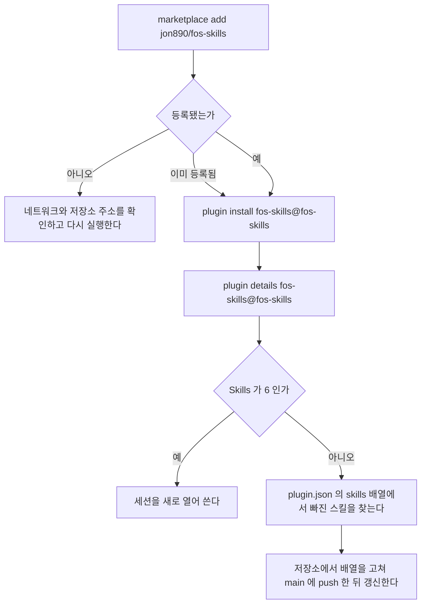
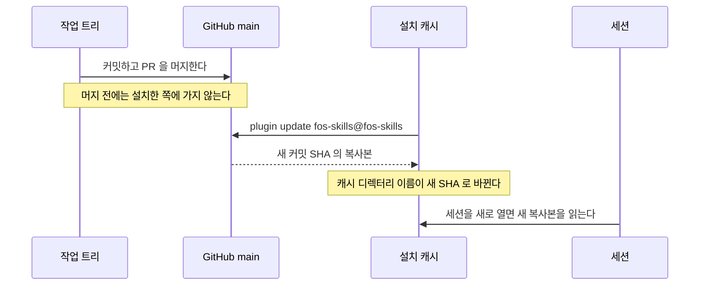
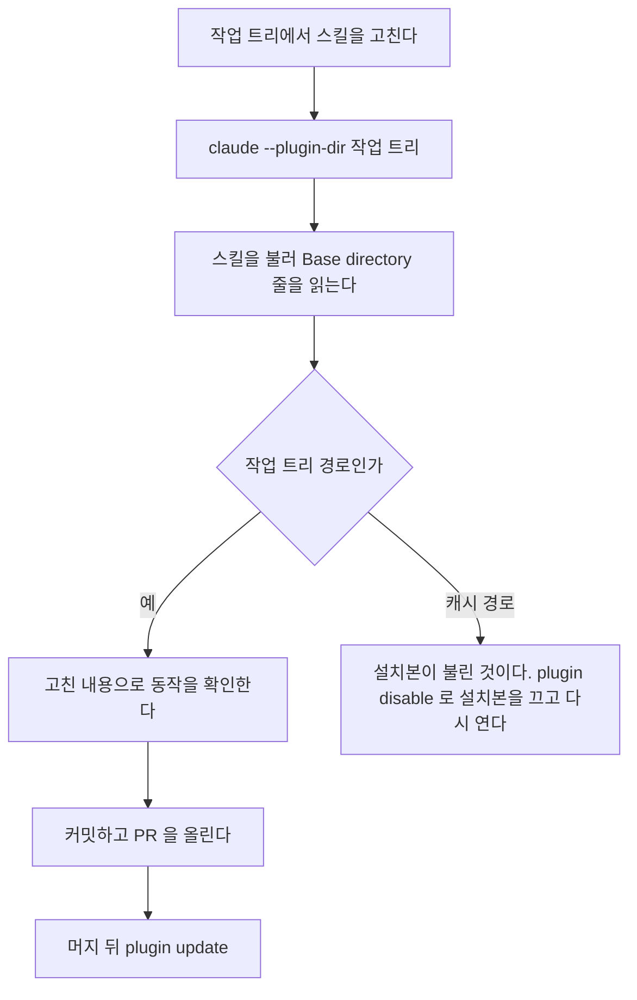
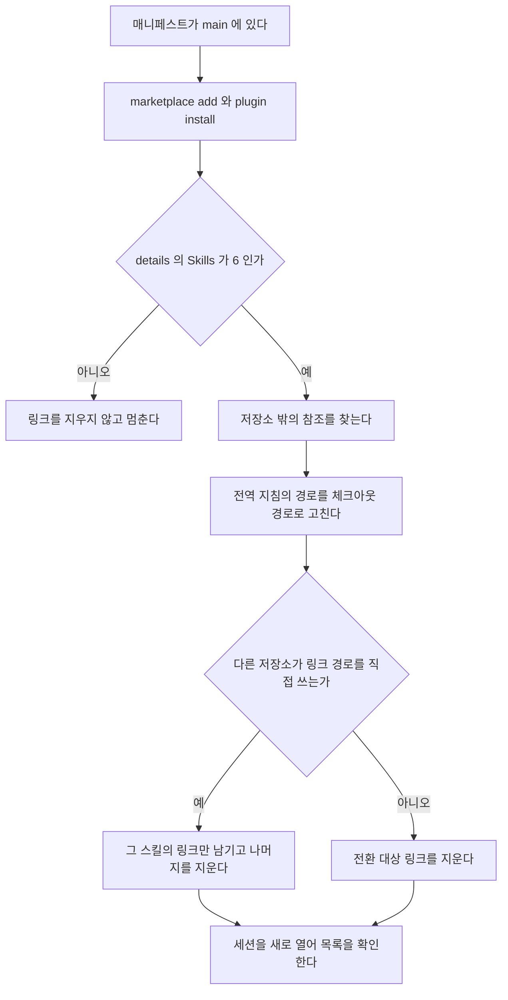
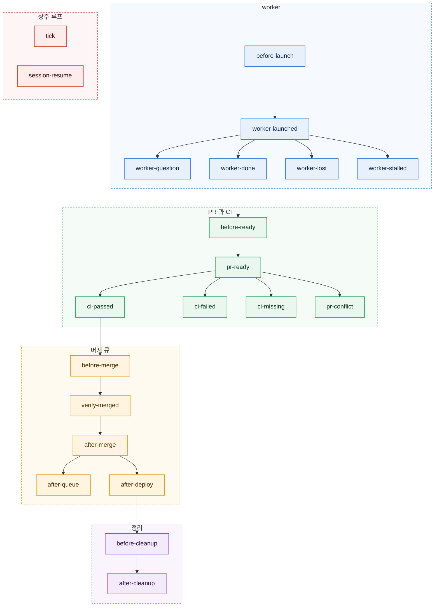
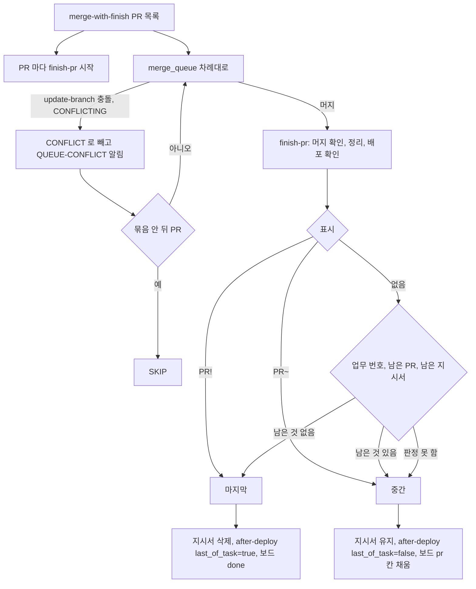
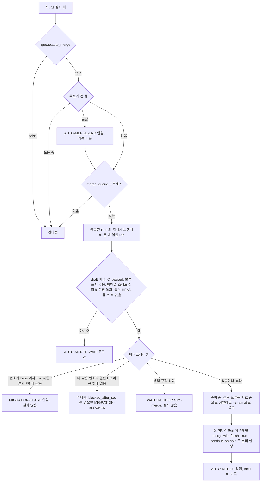

# 흐름

플러그인 `fos-skills` 를 설치하고, 갱신하고, 스킬을 고치는 동안 확인하는 흐름과 orch 의 이벤트 흐름이다.
배치와 경로 참조는 [code-architecture.md](code-architecture.md) 가 소유한다.

## 설치

사람이 터미널에서 시작한다. 이 머신과 사외 머신이 같은 명령을 쓴다.

```bash
claude plugin marketplace add jon890/fos-skills
claude plugin install fos-skills@fos-skills
claude plugin details fos-skills@fos-skills
```

이 설치로 스킬 여섯 개를 받는다.
`content-preview` 와 `korean-check` 의 원본은 여기 있고, 스킬로는 사본을 싣는 팀 저장소의 플러그인으로 받는다.
그 플러그인을 받을 수 없는 환경에서는 두 스킬이 목록에 뜨지 않는다.
파일은 이 플러그인의 설치 캐시에도 남으므로 경로로 직접 읽고 실행할 수 있다.



| 상황 | 동작 |
| --- | --- |
| 마켓플레이스가 이미 등록돼 있다 | 등록을 건너뛰고 설치로 간다 |
| 플러그인이 이미 설치돼 있다 | 설치 대신 「갱신」 의 명령을 쓴다 |
| 스킬 수가 여섯과 다르다 | `skills` 배열과 내보내기 전용 원본 목록을 확인한다. 매니페스트 테스트가 미등록 스킬을 저장소에서 잡는다 |

## 갱신

설치한 쪽은 main 의 커밋을 받는다. 버전을 올리는 단계는 없다.

```bash
claude plugin update fos-skills@fos-skills
```



| 상황 | 동작 |
| --- | --- |
| `already at the latest version` 이 나온다 | main 에 새 커밋이 없다. 머지와 push 가 끝났는지 확인한다 |
| 커밋하지 않은 변경이 있다 | 설치본에 가지 않는다. 「고치는 동안의 확인」 으로 본다 |
| 갱신한 뒤에도 옛 내용이 보인다 | 열려 있던 세션은 옛 복사본을 읽는다. 세션을 새로 연다 |

## 고치는 동안의 확인

설치본은 main 에 push 한 뒤에만 바뀐다.
고치는 동안에는 작업 트리를 그 세션에만 직접 로드한다.

```bash
claude --plugin-dir "$(git rev-parse --show-toplevel)"
```



`--plugin-dir` 로 연 세션에서는 작업 트리가 `fos-skills@inline` 으로 로드되고 커밋하지 않은 변경도 읽는다.
설치본 `fos-skills@fos-skills` 도 함께 켜져 있다.
같은 이름의 두 플러그인 가운데 어느 쪽 스킬이 불리는지는 세션을 띄워야 확인되고 격리 환경에서 실측하지 못했다.
그래서 스킬을 부른 뒤 본문 앞의 `Base directory for this skill` 줄로 어느 복사본인지 판정한다.

스크립트만 고쳤으면 세션 없이 작업 트리의 스크립트와 테스트를 직접 실행한다.
`~/.claude/scripts/` 의 훅 링크와 `~/.claude/rules/korean-style.md` 는 체크아웃을 가리키므로, 체크아웃에서 고친 내용은 push 하지 않아도 바로 반영된다.

## 링크 설치에서 옮기기

`~/.claude/skills/<이름>` 링크로 쓰던 머신을 플러그인으로 옮기는 순서다.
`content-preview` 와 `korean-check` 는 이 플러그인의 스킬 목록에 없으므로, 팀 저장소의 플러그인으로 받을 수 있는지 별도로 확인한다.
매니페스트가 main 에 머지된 뒤에 한 번에 진행한다.



1. 설치하고 `claude plugin details fos-skills@fos-skills` 가 스킬 여섯 개를 보이는지 확인한다. 여섯이 아니면 링크를 지우지 않는다.
2. 저장소 밖에서 링크 경로를 적은 곳을 찾는다.

   ```bash
   grep -rnE '\.claude/skills/(build-with-teams|content-preview|docs-check|harness-cleanup|korean-check|planning|pr-review|review-fix)' \
     ~/.claude/CLAUDE.md ~/.claude/references ~/.claude/rules
   ```

3. 찾은 경로의 `~/.claude/skills/<스킬>/` 을 `~/personal/fos-skills/<스킬>/` 로 고친다. 캐시 경로는 갱신할 때마다 바뀌므로 적지 않는다.
4. 다른 저장소의 스킬이나 오버레이가 `~/.claude/skills/<스킬>/` 아래 파일을 실행하면 그 스킬의 링크는 그 저장소를 고칠 때까지 남긴다. 설명으로만 적은 경로는 링크를 남길 이유가 아니다.
5. 나머지 링크를 지운다. `~/.claude/scripts/` 와 `~/.claude/rules/` 의 링크는 지우지 않는다. 스킬 링크가 아니라 체크아웃 안의 파일을 가리킨다.
6. 세션을 새로 열어 `fos-skills:` 접두사가 붙은 스킬 여섯 개가 뜨는지 확인한다. 두 내보내기 전용 스킬은 팀 저장소의 플러그인을 설치했으면 그쪽에만 뜨고, 받을 수 없으면 뜨지 않는다.

| 상황 | 동작 |
| --- | --- |
| 설치한 뒤 링크를 지우기 전 | 같은 스킬이 접두사 있는 것과 없는 것으로 둘씩 뜬다. 1번에서 5번까지를 이어서 진행해 이 기간을 짧게 둔다 |
| 링크를 지우기 전에 열어 둔 세션 | 옛 목록을 그대로 쓴다. 세션을 새로 연다 |
| 링크를 먼저 지우고 설치한다 | 설치가 실패하면 스킬이 하나도 없는 상태가 된다. 그래서 설치를 먼저 한다 |
| 4번 때문에 링크가 하나 남는다 | 그 스킬만 둘로 뜬다. 내용은 체크아웃과 설치본이 같은 저장소에서 온 것이다 |

## orch 이벤트

이 절은 orch 개편 뒤의 흐름이다([ADR-009](adr/009-orch-event-handlers.md)).
상주 루프의 자동 진행(ready 슬롯, base 합치기, 순서 머지, 문서 PR 머지)과 배포 묶기, `ci-missing` 은 아직 구현하지 않았다.
이 문서의 그 부분은 설계이고, 지금 동작은 `orch/SKILL.md` 와 `orch/references/` 가 소유한다.
핸들러의 입력과 종료 코드는 [data-schema.md](data-schema.md) 의 「orch 이벤트 핸들러 입력」, 코어와 핸들러의 경계는 [code-architecture.md](code-architecture.md) 의 「orch 코어와 핸들러」 가 소유한다.

orch 의 공용 코어는 단계마다 이벤트를 낸다. 저장소에 `.orch/hooks/<이벤트>.ts` 가 있으면 그 시점에 실행하고, 없으면 코어 동작만 한다.



### 이벤트 목록

`거부` 가 예인 이벤트는 핸들러가 다음 동작을 막을 수 있다. `worker-stalled` 의 거부는 넘김이다. 핸들러가 처리하지 않고 코디네이터에게 넘긴다. 코어 동작과 핸들러의 순서는 거부할 수 있는 이벤트면 핸들러가 먼저, 나머지는 코어 동작 뒤다. `after-deploy` 만 예외로 보드 done 앞에 낸다. 옛 업무 완료 명령이 보드 done 앞에 돌던 순서를 지키기 위해서다.

| 이벤트 | 내는 명령 | 시점 | 거부 | 코어 동작 | 핸들러가 맡을 일의 예 |
| --- | --- | --- | --- | --- | --- |
| `before-launch` | `launch-worker` | 워크트리를 만든 뒤, `worker-start` 전 | 예 | 지시서 검사, 허락 줄, deny 규칙 | 저장소의 동시 worker 상한, 준비되지 않은 개발 환경 거부 |
| `worker-launched` | `launch-worker` | `LAUNCHED` 를 낸 뒤 | 아니오 | `LAUNCHED` 줄과 `launch.effective` | 개발 서버 접속 설정을 워크트리에 복사 |
| `worker-question` | `orch-loop`, `watch-questions` | 새 question 이나 escalation 을 처음 알릴 때와 다시 알릴 때 | 아니오 | `QUESTION`, `REMINDER` 줄, 보드 결정 필요 | 메신저 알림 |
| `worker-done` | `wait-important` | `worker_done` 을 받고 완료 근거를 판정한 뒤 | 아니오 | 의심스러운 완료 분리 | 저장소 고유 완료 조건 확인 결과를 출력에 붙인다 |
| `worker-lost` | `wait-important` | 끊긴 dispatch 를 처음 알릴 때 | 아니오 | `WORKER_LOST` 줄과 상태 기록 | runner 호스트 상태 확인 |
| `worker-stalled` | `orch-loop` | 등록된 Run 의 살아 있는 dispatch 화면에서 같은 멈춤(`error`, 켜면 `idle`)을 `pipeline.stall_ticks` 의 틱 수만큼 본 때. 핸들러가 0 으로 끝나면 같은 화면이 그 틱 수만큼 더 이어질 때 다시 낸다. 사람이 끊은 화면(`interrupted`)에는 내지 않는다 | 예 | 입력하지 않는다. 핸들러가 없거나 0 이 아니면(거부는 넘김) 그 Run 의 알림 파일에 `WORKER-STALLED` 줄 | `nudge-worker --text` 로 다시 시도시키고 횟수 상한에서 코디네이터에게 넘긴다 |
| `before-ready` | `ci-ready`, `orch-loop` | draft 를 ready 로 바꾸기 전 | 예 | 겹침과 충돌 보류, ready 슬롯 | 이 저장소에서 CI 를 돌릴 수 없는 시간대 거부 |
| `pr-ready` | `ci-ready`, `orch-loop` | ready 로 바꾼 뒤 | 아니오 | 없음 | 리뷰 요청 |
| `ci-passed` | `orch-loop` | 필수 체크가 모두 통과한 것을 처음 본 때 | 아니오 | 순서 파일에 따라 머지 큐 차례 | 없음 |
| `ci-failed` | `orch-loop` | 체크 하나가 실패한 것을 처음 본 때 | 아니오 | 살아 있는 dispatch 의 worker 에게 알림. 알림 파일에 `CI-FAILED` 줄 | runner 장애면 다시 실행 |
| `ci-missing` | `orch-loop` | ready 뒤 `pipeline.ci_missing_after_sec` 안에 필수 체크가 나타나지 않을 때 | 아니오 | `CI-MISSING` 줄 | runner 재시작 |
| `pr-conflict` | `notify-conflicts`, `orch-loop` | base 와 충돌하는 내 PR 을 (PR, base SHA) 마다 처음 본 때 | 아니오 | 그 PR 을 만든 worker 에게 base 를 합치라고 보낸다. dispatch 가 끝났으면 남은 터미널에 후속 지시서로 이어 쓴다. 이어 쓰지 못하면 `CONFLICT-ORPHAN` 줄. 새 worker 는 띄우지 않는다 | 없음 |
| `before-merge` | `merge_queue` | PR 마다 머지 직전, HEAD 를 고정한 뒤 | 예 | 머지 조건 확인 | DB 마이그레이션 PR 앞의 백업 |
| `verify-merged` | `merge_queue` | `queue.verify_merged_when` 이 맞는 PR 의 합친 사본을 만든 뒤 | 예 | 사본 생성, HEAD 대조, 사본 삭제 | 사본에서 로컬 CI 실행 |
| `after-merge` | `merge_queue` | PR 하나가 MERGED 인 것을 확인한 뒤 | 아니오 | 원격 브랜치 삭제, 그 브랜치를 base 로 둔 내 PR 의 base 옮기기 | 없음 |
| `after-queue` | `merge_queue`, `orch-loop` | 큐가 끝나거나 보류나 큐 도중의 설정 오류로 멈춘 뒤, 하나라도 머지했을 때 | 아니오 | `pipeline.after_queue_interval_sec` 로 묶기 | 로컬 배포. `code_prs` 가 비면 건너뛴다 |
| `after-deploy` | `finish-pr` | 배포 판정과 마지막 PR 판정 뒤, 보드 done 앞. 배포 워크플로가 없으면 정리 직후. `last_of_task` 는 마지막 PR 판정(`!`, `~`, 없으면 `lib/last-pr.ts`)이다. `deploy` 가 `failure` 나 `timeout` 이어도 내고, 그때는 보드 done 을 하지 않는다 | 아니오 | 보드 done | 업무의 마지막 PR 이면 업무 완료 처리 |
| `before-cleanup` | `cleanup-sweep` | 워크트리 하나를 지우기 직전. `--apply` 일 때만 | 예 | 소유와 머지 확인 | 저장소가 남길 워크트리 거부 |
| `after-cleanup` | `cleanup-sweep` | 저장소 하나의 정리(`--apply`)가 끝난 뒤 | 아니오 | 지운 것과 남긴 것 출력 | 저장소 캐시 폴더 정리 |
| `tick` | `orch-loop` | `pipeline.tick_sec` 마다 루프에 등록된 Run 하나에 한 번. 입력의 `run` 이 그 Run 이고, 주 Run 에서만 `primary` 가 true 다 | 아니오 | Run 마다 질문 확인과 정리. 원격 브랜치 정리, 보드 동기화, CI 감시는 틱마다 한 번. 충돌 처리는 `tick` 핸들러 뒤에 한다. 순서는 `orch-loop.ts` 머리 주석의 「틱」 이 소유한다 | 그 Run 의 산출물 정리. 저장소 공유 점검은 `primary` 일 때만 |
| `session-resume` | `orch-doctor --run` | 압축이나 재시작 뒤 코디네이터가 doctor 를 부를 때 | 아니오 | 루프와 대기 생존 확인, 미답변 질문 | 저장소 상태 요약 |

### 운영 공백을 막는 곳

| 공백 | 막는 곳 | 방법 |
| --- | --- | --- |
| 질문 감시가 꺼진다. Monitor 는 시간이 지나면 끝나고, 조회 실패를 stderr 로만 내 알림이 없다 | `orch-loop` 의 `tick`, `wait-important`, `session-resume` | 질문 확인을 루프의 틱에 넣어 Monitor 에 기대지 않는다. 루프는 하네스의 백그라운드 명령이 아니라 스스로 분리된 프로세스로 돌아 하네스의 시간 한도에 묶이지 않는다. 코디네이터를 깨워야 하는 일은 알림 파일에 적고, 코디네이터가 늘 다시 거는 `wait-important` 가 그 파일을 읽어 깨어난다. 조회 실패도 `WATCH-ERROR` 로 같은 파일에 간다. 루프가 죽으면 `wait-important` 가 `LOOP-DEAD` 로 깨어나고, doctor 가 다시 띄울 명령을 낸다 |
| 미답변 질문이 쌓인다 | `tick`, `worker-question` | 틱마다 미답변을 세고 재알림 시간이 지난 것을 `REMINDER` 로 알림 파일에 적는다. 대기(`wait-important`)가 그 줄에 깨어난다. 저장소는 `worker-question` 으로 외부에 알린다 |
| 원격 브랜치가 쌓인다. 직접 머지한 PR 과 다른 PR 에 합쳐 닫힌 PR 의 브랜치가 남는다 | `after-merge`, `tick` | 머지를 확인한 자리에서 원격 브랜치를 지운다. 틱마다 내 PR 가운데 MERGED 이거나, CLOSED 이고 head 커밋이 base 에 들어간 PR 의 원격 브랜치를 지운다 |
| 같은 저장소를 쓰는 둘째 세션이 루프를 쓰지 못한다. 첫 세션의 루프를 멈추면 첫 세션이 루프를 잃는다 | `orch-loop --start --run`, `wait-important --run --loop-repo` | 루프는 저장소마다 하나이고 여러 Run 을 맡는다([ADR-012](adr/012-orch-loop-multi-run.md)). 세션은 자기 Run 을 등록하고 뺀다. 질문 확인, 정리, `tick` 은 Run 마다 그 Run 범위로 돌고, 알림 파일도 Run 마다 나뉘어 대기는 자기 Run 의 알림에만 깨어난다 |
| 정리가 다른 세션의 산출물을 옮긴다 | `cleanup-sweep --run`, `handoff-cleanup --run` | `--run` 을 주면 그 Run 의 worker 와 Task 가 쓴 것만 정리한다. Run 에 묶을 수 없는 산출물(큐 로그, 폴더, csv)은 `--run` 없이 사용자가 직접 돌릴 때만 옮긴다 |
| worker 가 모델 오류 화면에서 멈춰 사람이 터미널을 봐야 안다 | `tick`, `worker-stalled` | 틱마다 등록된 Run 이 띄운 살아 있는 worker 의 화면을 판정해 같은 멈춤이 이어지면 이벤트를 낸다. 다시 시도시키는 일은 저장소 핸들러가 맡고, 맡지 못하면 그 Run 의 코디네이터가 `WORKER-STALLED` 로 깨어난다([ADR-013](adr/013-orch-worker-stalled.md)) |
| 코디네이터가 `!` 를 빠뜨려 배포가 끝나도 업무가 완료되지 않고 보드 항목이 진행 중으로 남는다 | `finish-pr`, `board-sync` | 표시가 없는 PR 은 마무리가 배포 확인 뒤, 보드 동기화가 머지를 본 틱에 업무의 마지막 PR 인지 판정한다([ADR-014](adr/014-orch-auto-last-pr.md)). 판정하지 못하면 중간 PR 이다 |
| 보드 항목의 `pr` 필드가 비어 머지 뒤에도 항목이 진행 중으로 남는다 | `launch-worker`, `wait-important`, `board-sync`, `finish-pr` | 띄울 때 같은 워크트리의 항목을 이어 쓰고, 준비됨 `worker_done` 과 틱이 브랜치로 `pr` 필드를 채우고, 마무리가 `pr` 필드가 빈 항목을 브랜치나 워크트리 이름으로 찾는다 |
| 충돌한 PR 하나 때문에 머지 큐가 멈춰 머지할 수 있는 뒤 PR 도 머지되지 않는다 | `merge_queue` | 충돌한 PR 은 `CONFLICT` 로 빼고 뒤 PR 을 이어 머지한다. 알림 파일에 `QUEUE-CONFLICT` 를 쓴다. 순서가 있는 PR 은 `--chain` 으로 묶어 앞 PR 이 빠지면 뒤 PR 도 뺀다 |
| 준비된 PR 이 코디네이터가 다른 일을 하는 동안 몇 시간씩 머지되지 않는다. 같은 모듈의 마이그레이션 번호를 PR 끼리 겹쳐 써 두 번째 PR 이 개발 서버 기동을 깨뜨린다 | `orch-loop` 의 `tick` | `queue.auto_merge` 를 켠 저장소에서 틱이 머지할 수 있는 PR 을 골라 `merge-with-finish` 를 건다. 마이그레이션 번호가 base 이하거나 다른 열린 PR 과 같으면 걸지 않고 `MIGRATION-CLASH` 로 알린다([ADR-016](adr/016-orch-auto-merge.md)). 아래 「상주 루프의 자동 머지」 |
| ready PR 의 CI 가 머지마다 처음부터 다시 돈다 | 코어 gh 모듈과 가드 shim | base 를 합치는 일(`update-branch`)은 머지 큐가 차례가 온 PR 에만, 그리고 `pipeline.update_behind_drafts` 가 draft 에만 한다. 핸들러의 `gh` 는 `update-branch` 를 거부한다 |

### 갈래

| 상황 | 동작 |
| --- | --- |
| 핸들러 파일이 없다 | 코어 동작만 한다. 기록도 남기지 않는다 |
| 모르는 이름의 핸들러 파일이 있다 | `orch-doctor` 가 `UNKNOWN-HOOK <파일>` 로 경고한다. 실행하지 않는다 |
| 거부할 수 있는 이벤트의 핸들러가 거부한다 | `HOOK-REJECT <이벤트> <이유>` 를 내고 그 동작을 하지 않는다. 머지 큐는 그 PR 에서 `STOP` 이다 |
| 거부할 수 있는 이벤트의 핸들러가 실패하거나 시간을 넘긴다 | 거부처럼 멈춘다. 줄은 `HOOK-FAIL <이벤트> <종료 코드>` 다. 시간을 넘기면 `HOOK-FAIL <이벤트> timeout`, 잠금을 기다리다 시간을 넘기면 `HOOK-FAIL <이벤트> lock` 이다. 모르는 실패로 머지하거나 지우지 않는다 |
| 나머지 이벤트의 핸들러가 실패하거나 시간을 넘긴다 | `HOOK-FAIL` 을 내고 코어 동작은 이어 간다. 명령의 종료 코드에 반영한다. 띄우기, 대기, 질문 감시, doctor, ready 전환, 충돌 알림, 정리 명령은 알림 이벤트의 실패를 종료 코드에 반영하지 않는다. 대기의 종료 코드는 코디네이터의 다음 동작을 고르는 계약이고, 질문 감시는 질문 줄을 이미 냈으며 멈추면 다음 질문을 알리지 못하기 때문이다. ready 전환(`ci-ready`)의 종료 코드는 코디네이터의 ready 판정 계약이라, 0 을 다른 값으로 바꾸면 이미 ready 로 바뀐 PR 을 보류로 읽는다. 충돌 알림(`notify-conflicts`)의 `pr-conflict` 는 충돌한 PR 이 있을 때만 나서 종료 코드가 이미 1 이고, 실패를 따로 나타낼 값이 없다. 정리(`cleanup-sweep`)의 2 는 사용법 오류와 저장소 조회 실패를 뜻한다(머리 주석의 「종료 코드」). `after-cleanup` 의 실패를 2 에 섞으면 정리 자체가 실패한 경우와 구별할 수 없다. 코어는 핸들러를 다시 돌리지 않는다. `tick` 만 다음 틱에 다시 돈다 |
| 같은 저장소의 같은 이벤트가 동시에 난다(PR 여럿의 `after-deploy`) | 이벤트마다 잠금을 잡아 하나씩 실행한다 |
| worker 를 띄운 저장소가 둘 이상이다 | 이벤트는 그 PR 이나 워크트리의 저장소에서 나고, 그 저장소의 핸들러만 돈다 |
| `config.json` 에 옛 셸 명령 칸이 있고 같은 이벤트의 핸들러가 없다 | 다음 major 까지는 옛 칸을 그 이벤트의 핸들러처럼 돌리고 `DEPRECATED <키> → hooks/<이벤트>.ts` 줄로 옮길 곳을 알린다. 옮기는 명령은 `migrate-orch-dir.ts --hooks` 다 |
| 머지한 브랜치를 base 로 둔 열린 PR 가운데 내 PR 이 아닌 것이 있거나, 그 조회 또는 base 옮기기가 실패한다 | 원격 브랜치를 남기고 `after-merge` 의 `remote_branch_deleted` 를 false 로 낸다 |
| 옛 셸 명령 칸과 핸들러가 함께 있다 | 사용법 오류(종료 코드 2)로 멈춘다. 어느 쪽이 맞는지 정할 수 없다. 머지 큐가 시작한 뒤에 알게 되면 그 전에 머지한 PR 이 있을 때 `after-queue` 만 돌린 뒤 2 로 끝난다 |
| worker 가 `worker_done` 을 보냈는데 PR 이 아직 열려 있다 | 그 worker 터미널을 남긴다. 충돌이나 리뷰 반영을 같은 worker 가 이어 받는다. PR 이 머지되거나 닫히면 정리가 바로 닫는다 |
| 상주 루프가 죽었거나 틱이 멈췄다 | `state/loop.json` 의 pid 가 죽었거나 `alive_at` 이 `max(3 × tick_sec, 120)` 초보다 오래되면 `wait-important` 가 `LOOP-DEAD` 로 깨어난다. `alive_at` 은 루프의 부모 프로세스가 틱과 따로 쓰므로 긴 틱은 죽음이 아니다. pid 가 살아 있는 루프 프로세스인데 `alive_at` 만 오래됐으면 생존 타이머 간격에 5초를 더한 만큼 기다려 한 번 더 판정한다. 잠들었다 깬 뒤의 거짓 `LOOP-DEAD` 를 막는다. 기다리는 시간은 `lib/loop.ts` 머리 주석의 「생존」 이 소유한다. 코디네이터가 루프를 다시 띄운다. 루프가 없던 동안의 일은 다음 틱이 상태로 다시 판정하므로 따로 기억하지 않는다 |
| `notify-conflicts` 와 상주 루프의 충돌 처리가 겹쳐 돈다 | 같은 (PR, base SHA) 를 두 번 보낼 수 있다. `state/notify-conflicts.json` 에 잠금이 없다. 차례로 돌면 한 번이다 |
| 같은 저장소에 루프를 둘 띄운다 | 둘째 프로세스는 `state/loop.lock` 이나 `state/loop.json` 의 살아 있는 루프 프로세스(명령줄에 `orch-loop` 가 든 pid)를 보고 띄우지 않는다. `--run` 을 줬고 그 Run 이 아직 등록되지 않았으면 등록하고 `LOOP-JOINED` 와 0 으로 끝난다. 이미 등록됐거나 `--run` 이 없으면 `LOOP-RUNNING` 과 4 다. 등록을 모르는 옛 루프면 등록하지 못하고 4 와 안내 줄을 낸다. 두 세션이 거의 동시에 `--start` 해 둘 다 루프를 띄우면 잠금을 먼저 쥔 쪽이 돌고, 진 쪽은 그 루프에 합류해 `LOOP-JOINED` 와 0 으로 끝난다. 새로 뜬 루프는 앞 루프의 `alive_at` 뒤에 쓴 등록을 지우지 않으므로 두 Run 이 함께 등록된다 |
| Run 이 등록된 루프를 `--run` 없이 멈춘다 | 등록이 하나여도 다른 세션의 Run 일 수 있다. `finish.run` 도 없으면 다른 세션의 루프를 끊지 않게 신호를 보내지 않고 `LOOP-STOP-SHARED` 와 1 이다. 자기 Run 만 빼려면 `--stop --run`, 모두 멈추려면 `--stop --all` 이다. 마지막 Run 이 빠지면 루프가 끝난다 |
| 대기의 Run 이 살아 있는 루프에 등록되지 않았다 | `wait-important --run <Run> --loop-repo` 가 `LOOP-DEAD <repo> run <Run> 미등록` 과 8 로 깨어난다. 코디네이터가 `--start --run` 으로 등록한다. 등록을 모르는 옛 루프면 이 판정을 하지 않는다 |

### 머지 뒤 마지막 PR 판정

머지 큐는 PR 마다 마무리를 함께 걸고, 마무리가 배포를 확인한 뒤 업무의 마지막 PR 인지 정한다.
판정 조건은 `orch/scripts/lib/last-pr.ts` 머리 주석이, 표시와 쓰는 때는 `orch/references/cleanup.md` 의 「머지」 가 소유한다.



### 상주 루프의 자동 머지

`queue.auto_merge` 가 true 이면 틱이 CI 감시 뒤, 충돌 처리 앞에 한 번 돈다. 대상 조건, 순서, 알림 text 는 `orch-loop.ts` 머리 주석의 「자동 머지」 가,
판정 함수는 `orch/scripts/lib/auto-merge.ts` 가 소유한다. 설정 키는 [data-schema.md](data-schema.md) 의 「config.json 에 더하는 절」 이다.



| 상황 | 동작 |
| --- | --- |
| 큐가 멈춰 PR 이 열린 채 남았다 | 같은 HEAD 는 다시 걸지 않는다. `AUTO-MERGE-END` 의 끝 줄(`QUEUE-HELD`, `STOP`)로 코디네이터가 이유를 보고 직접 건다. worker 가 push 해 HEAD 가 바뀌면 다시 대상이 된다 |
| 코디네이터가 큐를 따로 걸었다 | 그 큐가 도는 동안에는 걸지 않는다(머지 큐 프로세스 검사). 큐가 끝난 뒤에도 열린 PR 은 마무리가 기다리는 중이어도 다시 대상이다. `merge-with-finish` 가 도는 마무리를 그대로 쓴다 |
| 다른 Run 의 낮은 번호 PR 이 이번 큐에서 빠진다 | 그 PR 을 기다리는 같은 모듈의 높은 번호 PR 도 이번 큐에서 뺀다. 남는 집합이 더 바뀌지 않을 때까지 다시 본다 |
| 보드 파일을 읽지 못했다 | 보류 표시를 볼 수 없어 그 틱에는 걸지 않는다 |
| 루프가 건 큐가 도는 동안 루프가 멈췄다 | 큐는 분리 실행이라 이어 돈다. 다시 뜬 루프는 기록의 pid 로 끝을 보고 `AUTO-MERGE-END` 를 쓴다 |
| 대상 PR 이 여러 Run 의 것이다 | 큐 첫 PR 의 Run 것만 건다. 나머지는 그 큐가 끝난 뒤 다음 틱에 건다 |
| 열린 PR 이나 리뷰를 읽지 못했다 | 그 틱에는 걸지 않는다. 이유는 `WATCH-ERROR auto-merge` 로 알린다 |
