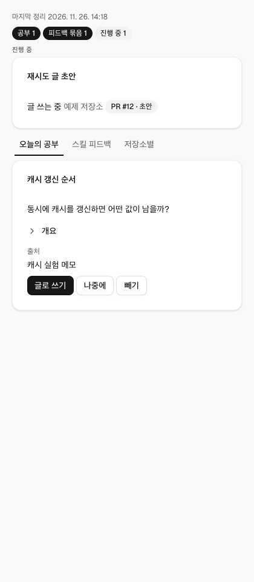

# 공부·피드백

Orca 사이드바에서 fosbot이 정리한 공부 후보와 스킬 피드백을 고를 수 있어요. 글을 쓰거나 반영을 요청한 뒤에는 같은 패널에서 진행 상황과 열린 PR을 볼 수 있어요.

2026-11-26, 격리된 예제 요약으로 촬영했어요.

## 처음 써 보기

1. fosbot의 요약 파일과 「공부·피드백 패널 요청」 자동화가 준비되었는지 확인해요.
2. fos-skills 주 체크아웃에서 `orca plugin install ./extensions/study-feedback-panel`을 실행해요. 처음에는 Orca가 실행 권한과 설정·저장소 접근 범위를 보여줘요. 권한을 확인하고 승인할 때 출력에 나온 `--approve` 명령을 실행해요.
3. Orca의 플러그인 설정에서 **fosbot 홈**에 절대 경로를 넣고, **공부·피드백 패널 자동화**에 전용 자동화의 전체 ID를 넣어요. 앱에서 `orca` 명령을 찾을 수 없다면 **Orca 실행 파일**에 절대 경로를 넣어요.
4. 오른쪽 사이드바에서 **공부·피드백**을 열어요. 마지막 정리 시각과 오늘 고를 후보가 보여요.

## 사용 예시

- **오늘의 공부**에서 질문, 개요, 출처를 보고 **글로 쓰기**, **나중에**, **빼기**를 골라요. 나중에를 고른 후보는 기존 정리 규칙에 따라 14일 후 다시 볼 수 있어요.
- **스킬 피드백**에서 대상 스킬과 포함된 후보를 보고 **반영**, **보류**, **기각**을 골라요. 빼기·보류·기각에는 이유를 한 줄 적어요.
- 후보에 답을 보내면 **보냄**과 전송 시각이 보여요. fosbot이 요약을 갱신하면 카드 상태가 바뀌어요. 10분 동안 후보가 그대로면 **처리 대기**가 표시되고, 그때 선택 가능한 카드는 다시 누를 수 있어요.
- **저장소별**에서 저장소마다 열린 공부 후보와 피드백 후보가 몇 건인지 볼 수 있어요.

## 갱신

주 체크아웃에서 `git pull` 한 뒤 `orca plugin update local.study-feedback-panel`을 실행해요. Orca가 같은 폴더에서 파일을 다시 복사해요. 코드만 바뀌면 기존 승인이 이어지고, 접근 범위가 늘어나면 다시 물어요.

요약 항목과 전송 형식은 [기술 설계](../../docs/features/study-panel/technical-design.md)에서 확인할 수 있어요.
