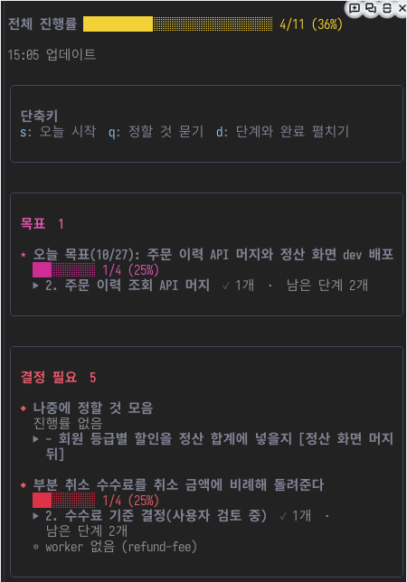

# work-board

여러 worker 와 PR 을 함께 돌릴 때 지금 무엇이 진행 중이고 무엇을 내가 정해야 하는지 한 창에서 보여 줘요.
Claude Code 안에서 `/board` 를 열면 보드 파일의 항목, 일하는 worker, 열린 PR, 답하지 않은 질문, 업무 알림이 한곳에 모여요.
창의 단축키는 다음에 보낼 요청문을 입력란에 채워 줘요. 내용을 보고 Enter 만 누르면 코디네이터에게 가요.



위 화면은 데모 저장소에서 2026-10-27 에 찍었어요.

## 이럴 때 쓴다

- orch 로 worker 여럿을 띄워 두고, 누가 멈췄고 어느 PR 이 머지를 기다리는지 한눈에 보고 싶을 때
- worker 가 보낸 질문과 내가 정할 것을 빠뜨리지 않고 모아 답하고 싶을 때
- 하루를 시작하거나 마칠 때 보드를 실제 상태(PR, CI, 배포, 업무)와 맞추고 싶을 때
- 두레이에서 나를 태그한 알림을 작업 화면을 떠나지 않고 처리하고 싶을 때

## 처음 써 보기

**1. 설치해요.** work-board 는 fos-skills 플러그인에 함께 들어 있어요. 저장소 루트 README 의 「처음 써 보기」 대로 플러그인을 설치하면 따로 할 일이 없어요.

**2. 창을 열어요.** Claude Code 입력란에 `/board` 를 입력해요. 「작업 현황」 창이 열려요.

**3. 창으로 포커스를 옮겨요.** 단축키는 창에 포커스가 있을 때만 눌려요. `ctrl+x` 다음 `tab` 을 누르면 창으로 옮겨 가요. Orca 터미널에서는 창을 클릭해도 포커스가 가지 않으니 이 키를 써요. `Esc` 를 누르면 창이 닫히고 입력란으로 돌아가요. 다시 열 때는 `/board` 를 입력해요.

**4. 단축키를 눌러 봐요.** `s` 를 누르면 입력란에 하루를 시작하는 요청문이 채워져요. 읽어 보고 Enter 를 누르면 보내져요. 창은 요청문을 채우기만 하고 직접 보내지 않아요.

보드에 항목이 하나도 없으면 「보여 줄 작업이 없어요」 가 보여요. orch 로 worker 를 띄우면 항목이 저절로 생겨요. 직접 적는 방법은 아래 「보드에 항목 적기」 에 있어요.

## 사용 예시

**하루를 시작할 때** `s` 를 눌러요. 어제 끝난 항목을 비우고, 감시 루프가 꺼져 있으면 다시 띄우고, 오늘 볼 PR 과 정할 것을 보고받아요.

**worker 가 질문을 보냈을 때** 「결정 필요」 에 질문이 쌓여요. `q` 를 누르면 질문마다 배경, 선택지, 권장안을 먼저 보고 답할 수 있어요. 답한 질문은 다음 읽기에서 사라져요.

**항목 하나가 멈춘 것 같을 때** `c` 를 누르면 진행 중과 대기 항목 앞에 번호가 붙어요. 진행 중 항목의 번호를 누르면 아래 같은 요청문이 채워져요. 제목 줄을 클릭해도 같아요.

```text
보드 항목 order-api 의 지금 상태를 확인하고 다음 단계를 이어 가 줘. (주문 이력 조회 API)
- 끝나지 않은 단계: 3. develop 머지 / 4. dev 배포
- worker: order-api  PR #877 CI 12/12
- PR: #877
1. PR·CI·배포·worker 보고·업무 상태와 대조해 지금 상태를 확인하고, 멈춰 있으면 다음 단계를 진행하거나 내가 정할 것을 물어 줘.
2. 확인하지 못한 상태는 추측하지 말고 남겨 줘. 확인한 근거로 orch board set/step/add-step 명령으로 이 항목의 상태와 단계를 고쳐 줘.
3. 확인한 상태, 진행한 것, 내가 정할 것만 짧게 보고해 줘.
```

**기다리던 답이 왔을지 모를 때** 대기 칸의 항목 제목 줄을 클릭하거나 `c` 다음 그 번호를 눌러요. 대기 사유를 다시 확인하고 조사를 재개하는 요청문이 채워져요.

```text
보드 항목 login-fix 의 대기 사유를 다시 확인하고 조사를 재개해 줘. (로그인 오류 수정)
- 대기 사유: 기획 답 대기 / 3. 배포 뒤 확인
- 업무: https://tasks.example.com/task/7
- worker: 없음 (워크트리 login-fix)
- PR: #41
1. 기다리던 것(답, 결정, 배포, 외부 회신)이 왔는지 업무 댓글, 메신저, PR, 배포 상태로 확인해 줘.
2. 왔으면 그 내용으로 다음 단계를 진행하고 이 항목을 진행 중(doing)으로 올려 줘.
3. 아직 오지 않았으면 무엇을 누구에게 기다리는지 적고, 재촉하거나 우회할 방법을 제안해 줘.
4. 확인하지 못한 것은 추측하지 말고 남겨 줘. 확인한 근거로 orch board set/step/add-step 명령으로 이 항목의 상태와 단계를 고쳐 줘.
5. 확인한 것, 진행한 것, 내가 정할 것만 짧게 보고해 줘.
```

대기 사유는 끝나지 않은 단계와, 「대기」, 「기다림」, 「회신」 이 든 참고 줄에서 모아요. 항목을 적을 때 `--next '기획 답 대기'` 처럼 무엇을 기다리는지 적어 두면 요청문에 들어가요.

**코디네이터가 확인을 기다릴 때** 「승인 대기」 상자에 대기가 올라와요. 「미리보기 열기」 로 내용을 보고 「승인」 을 누르면 그 대기를 올린 코디네이터에게 승인이 가요. 채팅에 「진행해줘」 를 치거나 어느 대기인지 다시 적지 않아도 돼요. 고칠 곳이 있으면 「고쳐 달라」 를 눌러 글칸에 적고 보내요. 코디네이터가 그대로 고쳐 같은 대기를 다시 올려요. 그사이 내용이 바뀌어 예전 화면에서 누르면 「내용이 바뀌었어요」 라고 알려 주고 아무것도 보내지 않아요. real 환경에 쓰는 대기는 빨간 글로 대상과 되돌리는 법을 보여 주고 「승인」 을 10초 안에 두 번 눌러야 가요. 사람이 직접 쳐야 하는 명령은 「명령 채우기」 가 입력란에 `! 명령` 을 채우고 Enter 는 내가 쳐요. worker 터미널에서 연 창에는 버튼이 없어요. 코디네이터 창이나 다른 창에서 눌러요.

**보드가 실제와 어긋나 보일 때** `u` 를 눌러요. 확인한 근거로만 보드를 고치고, 바뀐 것과 정할 것만 보고받아요.

**업무 알림이 왔을 때** 알림 상자의 번호를 누르면 그 알림의 답변 초안을 만들고 미리보기로 확인받는 요청문이 채워져요. 답할 필요가 없는 알림은 `x` 다음 번호로 넘기고, 잘못 넘겼으면 `z` 로 되돌려요. 알림함 설정은 [inbox](../../skills/inbox/README.md) 에 있어요.

## 화면 읽기

창은 위에서 아래로 이렇게 보여요.

| 자리 | 보이는 것 |
| --- | --- |
| 전체 진행률 | 진행 중 항목들의 끝낸 단계 수와 전체 단계 수 |
| 머리 줄 | 마지막으로 읽은 시각과 지금 쓰는 플러그인 버전. 최신이 아니면 노란색으로 알려 줘요 |
| 단축키 | 지금 누를 수 있는 단축키. 상황에 따라 버튼이 생기거나 사라져요 |
| 목표 | 오늘 목표처럼 여러 항목을 묶는 큰 일 |
| 승인 대기 | 코디네이터가 「확인해 주세요」 하며 올린 대기. 제목, 종류, 미리보기, 기다린 시간과 「승인」·「고쳐 달라」 버튼이 있어요. 24시간 넘게 기다린 시간은 노란색이에요. 대기가 없으면 상자가 없어요 |
| 결정 필요 | worker 가 보낸 질문과 막힘, 내가 정할 항목 |
| 알림 | 두레이에서 온 새 알림. 알림함을 설정했을 때만 보여요 |
| worker | 어느 항목에도 붙지 않고 일하는 worker |
| 열린 PR | CI 결과와 머지 가능 여부. 머지할 수 있는 PR 이 맨 위에 와요. orch 머지 큐를 쓰는 저장소에서만 PR 마다 「머지 큐 2 번째」, 「대기: 리뷰 보류 · 14:05 부터」 같은 한 줄이 붙어요 |
| 진행 중, 대기, 완료 | 보드 항목. 완료 칸은 `d` 를 눌러야 펼쳐져요 |

항목 하나는 제목, 진행 막대, 지금 단계(「▶」), 맡은 worker 순서로 보여요.
worker 줄 끝의 빨간 글은 손이 필요하다는 뜻이에요. 「멈춤 40분」, 「오류: 계정 한도」, 「입력 대기」 같은 글이 붙어요.
「⚙ worker 없음 · 2시간」 처럼 노란 줄은 단계가 남았는데 맡은 worker 가 없다는 뜻이에요.

## 단축키

| 키 | 하는 일 |
| --- | --- |
| `s` | 오늘 시작. 보드 정리, 감시 루프 확인, 열린 PR 과 정할 것 보고, 끝나지 않은 확인 단계 확인을 시키는 요청문을 채워요 |
| `q` | 정할 것 묻기. 결정 필요 항목과 worker 질문을 모아 하나씩 묻게 하는 요청문을 채워요 |
| `c` 다음 번호 | 항목 상태 확인. 진행 중 항목은 지금 상태를 확인하고 다음 단계를 이어 가게 하고, 대기 항목은 대기 사유를 다시 확인하고 조사를 재개하게 해요 |
| 항목 제목 클릭 | `c` 다음 번호와 같아요. 진행 중이나 대기 항목의 제목 줄을 클릭하거나 포커스를 두고 Enter 를 눌러요 |
| `i` | 알림 답변. 새 알림을 훑어 답할 것과 넘길 것을 나누게 해요 |
| 번호 | 그 알림 하나에 답하는 요청문을 채워요 |
| `x` 다음 번호 | 그 알림을 답하지 않고 넘겨요. 에이전트를 거치지 않아요 |
| `z` | 방금 넘긴 알림을 되돌려요 |
| `a` | 열린 PR 을 작성자별로 필터링해 봐요. 누를 때마다 다음 작성자로 넘어가요 |
| `d` | 모든 단계와 완료 칸을 펼치거나 접어요 |
| `p` | 플러그인을 최신으로 갱신해요. 폴더(directory 소스 마켓플레이스)에서 읽은 설치본은 그 폴더에서 `git pull --ff-only origin main` 으로 받아요. main 이 아니거나 고치는 중인 파일이 있거나 fast-forward 할 수 없으면 받지 않고 이유를 알려요. 최신으로 확인된 설치본이나 작업 트리에서는 보이지 않아요 |

`c`, `x` 를 누르면 번호를 고르는 모드가 켜져요. 다시 누르면 꺼지고, 둘은 함께 켜지지 않아요.
`c` 모드에서 `Esc` 를 누르면 창은 남고 번호만 사라져요. 포커스는 입력란으로 가니 이어서 고르려면 `ctrl+x` 다음 `tab` 으로 돌아와요.

## 보드에 항목 적기

보드 파일은 저장소 git 루트의 `.omc/board.json` 이에요. orch 가 worker 를 띄우고 PR 을 머지할 때마다 항목과 단계를 자동으로 고쳐요.
상태와 단계는 `orch board` 로 고쳐요. `board.json` 은 직접 고치지 않아요. 새 항목을 만들거나 제목·PR 같은 칸을 고칠 때는 플러그인의 `extensions/work-board/bin/board.ts` 를 써요.

```bash
BOARD_BIN="<플러그인 경로>/extensions/work-board/bin/board.ts"
node --disable-warning=ExperimentalWarning "$BOARD_BIN" set order-api doing --title "주문 이력 조회 API" --pr 877 \
  --next "1. 구현" --next "2. 리뷰" --next "3. 머지"
orch board step order-api 1 done        # 1번 단계를 끝내요
orch board show order-api               # 남은 단계를 봐요
orch board add-step order-api "배포" --on "877 deploy"
node --disable-warning=ExperimentalWarning "$BOARD_BIN" list               # 모든 항목과 진행률을 봐요
```

상태는 `goal`(목표), `decide`(결정 필요), `doing`(진행 중), `wait`(대기), `done`(완료) 중 하나예요.
「1. 구현」 처럼 번호로 시작하는 줄이 단계가 되고, 막대는 끝낸 단계 수로 채워져요. 진행 중 항목에는 단계가 하나 이상 있어야 해요.
새 명령은 `orch board --help`, 칸을 고치는 옵션은 `board.ts --help` 에 있어요. 단계 번호, `--full`, 보드 파일 선택 규칙은 [보드 명령 안내](../../skills/orch/references/board.md#상태와-단계-고치기)에 있어요.

## 받는 것

- 지금 진행 중인 일, 막힌 일, 내가 정할 일을 한 창에서 봐요
- 다음에 보낼 요청문이 입력란에 채워져요. 보내기 전에 고칠 수 있어요
- 상태 줄에 「결정 필요 1 · 진행 2」 같은 요약이 늘 떠 있어요. 창을 닫아도 보여요

## 갱신

main 에 머지된 새 버전은 창의 `p` 로 받아요. `claude plugin update fos-skills@fos-skills` 를 돌린 뒤 입력란에 채워지는 `/reload-plugins` 를 Enter 로 보내면 돼요.
창을 닫거나 오래 입력하지 않으면 자동 네트워크 조회를 쉬어요. 상태 줄에는 PR과 알림을 확인한 시각과 「조회 쉼」을 붙여요. `/board` 를 다시 열면 상태를 읽고, 같은 저장소를 보는 세션은 PR 조회 결과를 나눠 써요.
work-board 를 고치는 동안에는 저장소 루트 README 의 「고치는 동안」 대로 작업 트리를 `--plugin-dir` 로 로드해요. 테스트는 저장소 루트에서 `claude plugin test .` 로 돌려요.

## 함께 쓰는 스킬

- [orch](../../skills/orch/README.md): worker 를 띄우고 보드의 항목과 단계를 자동으로 고쳐요. 언제 무엇을 고치는지는 [갱신 담당 표](../../skills/orch/references/board.md#갱신-담당)에 있어요
- [inbox](../../skills/inbox/README.md): 알림을 받아 오고 답변을 등록해요. 창은 그리기만 해요

창이 무엇을 어떤 규칙으로 그리는지(멈춤 판정, 질문 조회 범위, 저장 형식)는 [동작 세부](references/behavior.md)에 있어요. 창이나 보드 명령을 고칠 때 읽어요.
기존 `~/.claude/mods/work-board` 를 쓰던 사람이 옮겨 오는 순서는 [ADR-006](../../docs/adr/006-work-board-in-plugin.md) 에 있어요.
