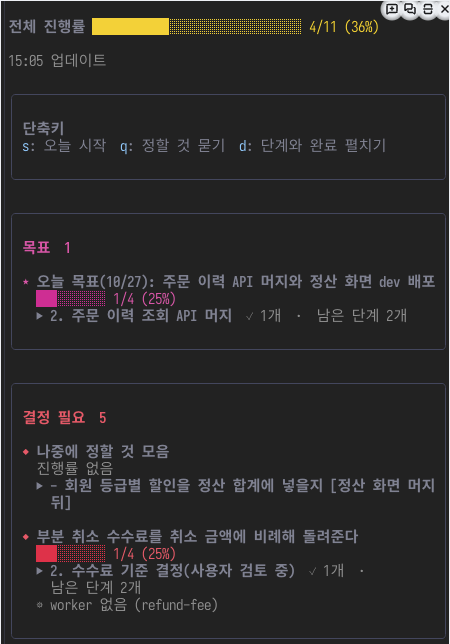

# work-board

저장소의 작업 현황을 Claude Code 창으로 본다. 개발 루프가 항목과 PR 상태를 갱신하고 코디네이터가 결정과 단계를 관리하며, 사람은 `/board` 로 본다.



위 화면은 데모 저장소에서 2026-10-27 에 찍었다.

- 창: `/board`. 결정 필요, 진행 중, 대기, 완료 순으로 묶는다
- 접힌 보기: 항목마다 「표시 · 제목」 한 줄, 그 아래 막대 한 줄, 「▶ 지금 단계」 한 줄, worker 가 있으면 worker 한 줄만 보인다. 끝낸 단계는 「✓ n개」, 지금 단계 뒤에 남은 단계는 「남은 단계 n개」 로 접힌다. 수는 막대와 같은 값에서 낸다(진행률을 세는 쪽의 단계 줄, `progress` 가 있으면 그 값)
- 펼친 보기: `d` 를 누르면 담당·PR, details 와 next 의 모든 줄을 적힌 순서대로 보이고 완료 칸도 펼친다. 끝낸 줄은 취소선과 흐림, 지금 단계는 굵게, 남은 단계는 보통 글씨, 번호 없는 참고 줄은 흐리게 보인다. 다시 누르면 접힌다
- 단계 줄 모양: details 와 next 의 모든 줄이 같은 들여쓰기와 두 칸짜리 표시 칸(끝냄 「✓」, 지금 「▶」, 남음과 참고 줄은 빈칸)을 갖는다. `done` 값으로 표시를 정해 번호와 본문이 같은 열에서 시작하고, 줄바꿈된 뒷줄도 본문 열에서 시작한다
- 지금 단계: 진행률을 세는 쪽(아래 「진행률」)의 끝나지 않은 첫 단계 줄이다. 거기 없으면 다른 쪽의 끝나지 않은 첫 단계, 단계 줄이 하나도 없으면 첫 참고 줄을 쓴다. 단계가 모두 끝났으면 지금 단계는 없다
- 머리 줄: `live.at`(실제 상태를 읽은 시각)과 보드 파일의 `updatedAt` 중 늦은 쪽을 「HH:MM 업데이트」 한 줄로 보인다. 둘 다 없으면 「읽는 중」이다. Run ID 와 수동·자동 구분은 보이지 않는다
- 단축키 상자: 「단축키」 제목의 테두리 상자 하나에 `s` 오늘 시작, `u` 보드 갱신, `q` 정할 것 묻기, `d` 펼치기 버튼을 모은다
- 창 포커스: Orca 터미널에서는 창을 클릭해도 포커스가 가지 않는다. `ctrl+x` 다음 `tab` 으로 옮긴다. 단축키는 포커스가 있을 때만 동작한다
- 오늘 시작: 창의 `오늘 시작`(`s`) 은 입력란에 하루를 시작하는 요청문(보드 갱신, 정리, 감시 확인, 보고)을 채운다. Enter 를 누르면 코디네이터에게 간다
- 정할 것 묻기: 창의 `정할 것 묻기`(`q`) 는 지금 정할 것을 모아 묻는 요청문을 채운다. 두 요청문은 `hooks/register.js` 의 `START_PROMPT`, `DECIDE_PROMPT` 가 소유한다
- 보드 갱신: `보드 갱신`(`u`) 은 PR·CI, 배포, 두레이 업무 상태, orch worker 보고를 대조하고 `board.ts` 로 보드를 고치는 요청문을 채운다. 바뀐 것과 정할 것만 보고하며 Enter 로 보낸다. 요청문은 `REFRESH_PROMPT` 가 소유한다
- 훅이 직접 보내지 않는 이유: 훅의 `prompt.submit` 과 `command.run` 의 `text` 는 코디네이터 모델에 닿지 않는다. 그래서 입력란을 채우고 사람이 Enter 로 보낸다. `/board` 외의 명령은 등록하지 않는다
- 상태 줄: 프롬프트 아래에 개수 요약이 5초마다 갱신된다. 파일이 없는 저장소에서는 나오지 않는다
- 파일: git 루트의 `.omc/board.json` (예전 위치 `.omc/handoffs/board.json` 도 읽는다)
- 항목: 제목, 담당·PR, 하위 항목(details), 다음 할 일(next), 워크트리(worktree). orch 가 쓰는 필드로 브랜치(branch), 처리한 머지 PR(merged-pr), 사건과 단계 번호의 짝(stages)이 있다. 창은 이 셋을 그리지 않는다
- 워커: `orca orchestration worker-list` 를 모든 페이지에서 주기적으로 읽어 항목의 worktree 와 같은 이름의 워커 상태를 붙인다. 이 저장소에서 돌지만 어느 항목에도 없는 워커는 「항목에 없는 워커」 로 모은다
- 결정 필요: 현재 Run 의 `check --all` 과 `--peek` 에 `--types question,escalation` 을 붙여 질문 후보를 모으고, 질문마다 발신자, `dispatch:<payload.dispatchId>`, 그 질문이 붙은 살아 있는 worker 의 `dispatch:<id>` 를 `inbox --terminal` 로 읽는다(같은 handle 은 한 번, 네 개씩). 코디네이터 터미널에서 `orca orchestration reply` 로 보낸 회신은 `dispatch:<그 worker 터미널의 지금 dispatch>` 로 가서 발신 터미널 `term_*` 의 inbox 에는 나오지 않기 때문이다. 질문의 thread 에 받는 쪽(`to_handle`)이 있고 그것이 Run(`run:<Run>`)이 아닌 메시지가 있으면 답한 질문이다. 보낸 사람이 Run 인지 `term_*` 인지는 보지 않고, worker 가 Run 으로 보낸 후속 status 는 답이 아니다. 질문의 dispatch 는 `payload.dispatchId`, 없으면 발신자 handle 의 `dispatch:` 접두사로 정하고, 둘 다 없으면 발신 터미널 handle 을 `worker-list` 의 `agentTerminalHandle` 과 대조한다. `pending`, `dispatched`, `running` 인 worker 에 속하지 않는 질문은 후보에서 뺀다. 그 질문은 다른 경로로 처리됐고, 닫힌 dispatch 의 inbox 에는 답변이 남지 않아 답해도 줄지 않기 때문이다. `worker-list` 를 읽지 못하면 질문도 「확인 불가」 로 보인다. 답하면 다음 조회에서 줄고, ack 만 하면 남는다. 같은 worker(살아 있는 worker 의 id, 없으면 질문의 dispatch, 그것도 없으면 발신자)의 질문은 묶는다. 답한 질문보다 늦지 않은 미답변은 빼고, 남은 미답변 가운데 가장 늦은 것(`created_at`, 같으면 뒤에 온 것) 하나만 「다시 보냄 n」 과 함께 보인다. `ask` 는 답을 받을 때까지 막혀 worker 하나에 열린 질문은 하나이고, 다시 보낸 질문은 본문이 달라 본문으로는 묶지 않는다. 수동 `decide` 항목도 더한다. 전체 inbox 는 읽지 않는다. decide 항목은 끝나지 않은 줄을 세고, 줄이 없으면 항목 하나로 센다. 빈 줄(공백뿐 포함)은 줄로 세지 않고, 줄이 모두 끝난 decide 항목만 남으면 결정 필요 상자를 보이지 않는다. 답한 줄은 `board.ts mark` 로 끝내고, 줄이 모두 끝난 decide 항목은 `mark` 나 `step` 이 done 으로 바꾼다(`--undo` 는 status 를 바꾸지 않는다)
- 질문 조회 범위: Orca 의 `--all` 과 `--peek` 는 각각 100건까지 반환한다. 상한에 닿으면 「최근 질문 기준」 을 표시하며, 그 밖의 미답변은 빠질 수 있다. 질문의 handle 마다 수신 기록은 200건까지 조회한다. 상한에 닿은 handle 의 질문이 모든 handle 의 회신을 합쳐도 미답변이면 답변 여부를 판단할 수 없어 조회 오류를 표시한다. 다른 handle 의 회신으로 답한 것이 확인되면 오류가 아니다
- 명령 출력 한도: Claude Code 2.1.309 의 `$.process.run` 은 stdout 과 stderr 를 각각 4MiB(4,194,304바이트)에서 자른다. 설치 실행 파일의 `Hat=4194304`, `Bat` 수집기와 `VQr` 반환값으로 확인했다. 보드는 `isStdoutTruncated` 를 검사해 잘린 JSON 대신 출력 한도 오류를 표시한다
- 단계 줄: 번호로 시작하는 줄이다(「1 …」, 「1. …」, 「1) …」). `done: true` 는 끝낸 단계, `done: false` 는 끝나지 않은 단계다. 번호로 시작하지 않는 참고 줄은 세지 않는다
- 진행률: 하위 항목(details)의 단계 줄을 세고, details 에 단계가 없으면 다음 할 일(next)의 줄을 센다. `progress` 필드(「7/10」)가 있으면 그 값이 우선한다. 단계로 나타낼 수 없을 때만 쓴다
- 진행률 표시: 창 맨 위에 진행 중 항목들의 끝낸 단계 합 / 전체 단계 합을 전체 막대로 그린다. 완료가 아닌 항목마다 제목 바로 아래 줄에 막대를 그리고(제목 길이와 상관없이 같은 자리), 진행률이 없는 옛 항목은 「진행률 없음」 으로 보인다. `board.ts list` 도 항목마다 「n/m (p%)」 를 붙인다
- 진행률 필수: `board.ts set` 은 doing 항목에 단계 줄이나 `--progress N/M` 이 없으면 거절하고 보드를 고치지 않는다. `--next` 를 여러 번 주면 줄로 이어 단계 줄을 적을 수 있다
- 마일스톤 단계: orch 가 띄울 때 만드는 항목은 지시서의 할 일이 아니라 사용자 마일스톤 단계(기본 「PR」, 「머지」)를 갖는다. `stages` 필드(「pr=1,merge=2」)가 어느 단계를 어느 사건이 끝내는지 기억하고, `board.ts set --stages` 로 쓴다. 사건은 `pr`, `merge`, `deploy`, `release` 다. 단계를 끝내는 시점은 [갱신 담당 표](../orch/references/board.md#갱신-담당)가 소유한다
- 직접 작성한 사건 단계: `3. develop 머지 (#665 merge)`, `4. dev 배포 (#665 deploy)`, `5. real 반영 (#665 release)` 처럼 줄 끝에 `(#PR번호 사건)` 을 붙인다. 사건은 `pr`, `merge`, `deploy`, `release` 다. 꼬리표가 있는 항목은 goal 도 사건별 단계만 끝내며, 꼬리표 없는 줄과 항목 상태는 자동으로 바꾸지 않는다. 진행률을 세는 쪽의 단계가 대상이다. 창에서는 꼬리표를 숨기고 파일과 `board.ts steps` 출력에는 보존한다
- 단계 끝내기: `board.ts step <id> <n>` 이 진행률을 세는 줄에서 n 번 단계를 끝낸다. `done` 값만 `true` 로 바꾼다(`--undo` 는 `false`). `set --progress auto` 는 `progress` 값을 지워 단계 수로 세게 한다. `board.ts steps <id>` 는 진행률을 세는 단계 줄을 JSON 으로 낸다. orch 의 `board-sync.ts` 가 이것으로 단계를 판정한다. 단계 밖의 줄(참고 줄, 세지 않는 쪽의 줄)은 JSON 에 넣지 않고 stderr 에 「단계 밖의 줄(mark 번호):」 머리와 함께 낸다
- 줄 끝내기: `board.ts mark <id> <n>` 은 번호 없는 줄도 끝낸다. n 은 details 다음 next 순서로 1부터 센 줄 번호이고, 빈 줄(공백뿐 포함)은 건너뛴다. `done` 값만 바꾼다(`--undo` 는 되돌린다). `board.ts list` 는 항목 줄 아래에 모든 줄을 `    <n> ✓ <text>`(끝냄)나 `    <n>   <text>`(안 끝냄)로 보이고, n 은 `mark` 의 번호와 같다. `step` 의 단계 번호와 `mark` 의 줄 번호는 다르다
- 갱신: orch 의 띄우기와 루프가 자동 반영한다. 시점과 담당은 [갱신 담당 표](../orch/references/board.md#갱신-담당)를 따른다. 수동 보정은 `node --disable-warning=ExperimentalWarning "$BOARD_BIN" set <id> doing --title "..." --next "..."`. `$BOARD_BIN` 은 이 디렉터리의 `bin/board.ts` 다

## 저장 형식

`next` 와 `details` 는 줄마다 `text` 와 불리언 `done` 을 가진 객체의 목록이다. 번호 없는 참고 줄도 같은 형식으로 저장하지만 진행률에는 세지 않는다.

```json
{
  "id": "example",
  "status": "doing",
  "next": [{"text": "2. 리뷰", "done": false}],
  "details": [
    {"text": "1. 구현", "done": true},
    {"text": "2. 리뷰", "done": false},
    {"text": "참고: 배포는 별도", "done": false}
  ]
}
```

`set --next/--detail` 은 계속 글을 받는다. 입력 줄 앞의 `✓`, `[x]`, `[X]` 는 `done: true` 로 읽고, `[ ]`, `▶`, `◇` 는 `done: false` 로 읽는다. 표시는 `text` 에서 떼며 창이 체크 표시와 취소선을 그린다.

옛 `next` 문자열과 `details` 문자열 목록은 읽을 때 객체로 변환한다. 객체와 문자열을 섞은 파일도 읽는다. `list` 와 `steps` 는 파일을 고치지 않고, 다음 쓰기 명령에서 모든 항목을 새 형식으로 저장한다. `steps` 출력은 `[{"number": 1, "done": true, "text": "1. 구현"}]` 이며 `text` 에 완료 표시는 없다.

## 설치와 갱신

fos-skills 플러그인의 구성 요소로 함께 실린다. `plugin.json` 의 `hooks` 배열이 `work-board/hooks/hooks.json` 을 가리킨다.
갱신은 다른 스킬과 같다. main 에 머지한 뒤 `claude plugin update fos-skills@fos-skills` 와 `/reload-plugins` 를 한다.
고치는 동안은 저장소 루트의 README 「고치는 동안」 대로 작업 트리를 `--plugin-dir` 로 싣는다.
테스트는 저장소 루트에서 `claude plugin test .` 로 돈다.

옮겨 온 배경과 기존 `~/.claude/mods/work-board` 를 끄는 순서는 [ADR-006](../docs/adr/006-work-board-in-plugin.md) 이 소유한다.
